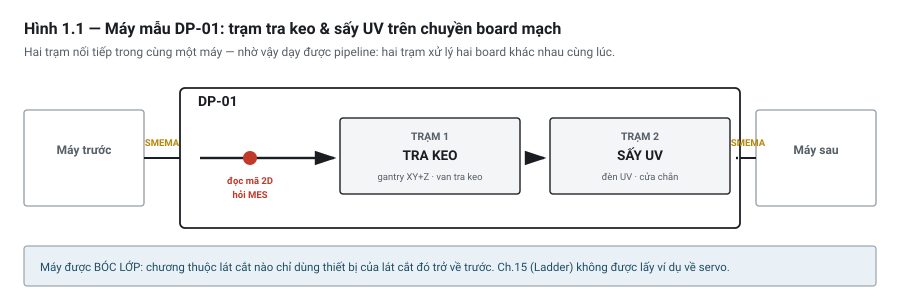

# Chương 1 — Sách này dành cho ai & cách dùng

---

## 1.1 Cuốn sách này giải quyết chuyện gì

Có một khoảnh khắc gần như ai vào nghề tự động hoá cũng gặp.

Bạn đã xem hết một khoá học trên mạng. Bạn biết `TON` là timer trễ sườn lên, biết `CTU` đếm lên,
biết kéo thả một tiếp điểm vào nấc thang. Rồi người ta giao cho bạn một cỗ máy thật — băng tải, vài
xy-lanh, chục cảm biến — và bảo "viết chương trình cho nó chạy". Bạn ngồi trước màn hình trống, biết
đủ mọi lệnh, mà **không biết bắt đầu từ đâu**.

Khoảng cách đó không phải do bạn thiếu lệnh. Nó do ba thứ mà phần lớn tài liệu nhập môn không dạy:

- **Cách biến một yêu cầu thành một cấu trúc chương trình** — máy có mấy chế độ, dừng giữa chừng thì
  sao, mất điện rồi bật lại thì máy đang ở đâu.
- **Cách nối chương trình với thế giới vật lý** — cảm biến này đấu kiểu gì mới lên tín hiệu, van này
  mất điện thì về đâu, tại sao board mạch qua tay bạn xong lại hỏng.
- **Cách xử lý khi máy không chạy** — thứ chiếm phần lớn thời gian thực tế của nghề này.

Sách này viết để lấp đúng ba khoảng đó.

> 💡 **MẸO**
> Nếu bạn đang tự hỏi "tôi học xong rồi, giờ chứng minh với nhà tuyển dụng bằng cách nào?" — câu trả
> lời nằm ở Chương 57 và 58. Nhưng đừng nhảy tới đó vội: thứ để chứng minh chính là cỗ máy bạn sẽ
> dựng dần qua cuốn sách này.

### Cuốn sách này **không** phải cái gì

Nói rõ từ đầu để bạn không mất thời gian:

- **Không phải sách hướng dẫn một phần mềm.** Bạn sẽ không tìm thấy "bấm vào menu này, chọn mục kia".
  Lý do ở mục 1.5.
- **Không phải giáo trình lý thuyết điều khiển.** Không có biến đổi Laplace, không có phân tích ổn
  định. Phần điều khiển liên tục (Chương 35) dừng ở mức đủ để chỉnh một vòng PID chạy tốt trên máy thật.
- **Không thay thế tài liệu của hãng bạn đang dùng.** Sách dạy nguyên lý; số hiệu chân, giới hạn dòng,
  mã lỗi cụ thể thì phải tra datasheet của đúng thiết bị bạn cầm trên tay.
- **Không thay thế đánh giá rủi ro của người có thẩm quyền.** Các chương an toàn dạy bạn *hiểu* và
  *đặt đúng câu hỏi*, không phải để bạn tự ký duyệt một cỗ máy.

---

## 1.2 Ba xuất phát điểm — bạn thuộc nhóm nào

Người vào nghề tự động hoá đến từ ba hướng rất khác nhau. Cùng một cuốn sách, nhưng chỗ khó của mỗi
nhóm nằm ở chỗ khác nhau — và **cái bẫy lớn nhất của mỗi nhóm lại chính là điểm mạnh của nhóm đó**.

### Lộ trình A — chuyển ngành, chưa biết điện

Bạn học cơ khí, công nghệ thông tin, kinh tế, hoặc đang làm nghề khác và muốn chuyển sang.

**Đọc thế nào:** tuần tự, không bỏ chương nào. Đặc biệt **đọc trọn Phần I trước khi chạm vào Phần III**.

**Vì sao nghiêm khắc như vậy:** lỗi tốn kém nhất của người mới trong nghề này gần như không bao giờ là
lỗi logic. Nó là đấu nhầm nguồn cảm biến, chọn sai kiểu ngõ ra rồi tải cháy module, hoặc cầm board mạch
bằng tay trần. Những lỗi đó **không báo lỗi trên màn hình** — chúng báo bằng thiết bị hỏng, hoặc tệ hơn,
bằng sản phẩm lỗi mà không ai phát hiện cho tới khi tới tay khách hàng.

Bạn sẽ thấy Phần I dài và có vẻ chưa liên quan tới lập trình. Nó liên quan. Chương 4 (cảm biến) và
Chương 6 (khí nén) sẽ được gọi lại liên tục từ Chương 15 trở đi.

### Lộ trình B — thợ điện, kỹ thuật viên đi lên

Bạn đã đấu tủ, đã đọc sơ đồ, đã sửa máy. Bạn thiếu phần lập trình.

**Đọc thế nào:** Chương 3 và Chương 5 đọc lướt — bạn đã biết. Đọc kỹ **Phần III và Phần IV**, đặc biệt
**Chương 30 (chuẩn hoá & tái sử dụng)**.

**Bẫy của bạn:** ngôn ngữ ladder được thiết kế để trông giống sơ đồ rơ-le, và điều đó vừa giúp vừa hại
bạn. Giúp, vì bạn đọc được ngay từ ngày đầu. Hại, vì bạn sẽ có xu hướng viết chương trình PLC **y như
đi dây một tủ rơ-le** — mỗi khi cần thêm chức năng thì chồng thêm một nhánh. Cách đó chạy được với máy
nhỏ và sụp đổ với máy vừa. Chương 25 (máy trạng thái) là chỗ để chữa thói quen này.

### Lộ trình C — dân lập trình phần mềm chuyển sang

Bạn viết được C#, Python, hoặc ngôn ngữ khác. Bạn nhìn ladder và thấy nó thô sơ.

**Đọc thế nào:** Chương 20 (Structured Text) đọc lướt — cú pháp sẽ quen thuộc. Đọc **rất kỹ Chương 10
(vòng quét)**, toàn bộ Phần I, và Phần VII.

**Bẫy của bạn — và đây là nhóm hay bị đau nhất:** bạn thua ở đúng những chỗ tưởng dễ.

- Bạn sẽ viết một vòng lặp `WHILE` chờ điều kiện, và **treo cả CPU** — vì trong PLC không có ai chạy
  song song để thay đổi điều kiện đó.
- Bạn sẽ ra lệnh cho xy-lanh đi ra rồi coi như nó đã ra — vì trong phần mềm, gọi hàm xong là xong.
  Trong máy thật, **lệnh không phải là kết quả**; phải chờ cảm biến xác nhận.
- Bạn sẽ không có phản xạ hỏi "mất điện đúng lúc này thì máy đang ở tư thế nào, và bật lại thì nó làm
  gì?" — vì phần mềm mất điện thì khởi động lại là xong, còn máy thì có thể đang kẹp một board với mũi
  khoan cắm dở.

> ⚡ **LƯU Ý**
> Ba lộ trình chỉ khác nhau ở **thứ tự và mức độ đọc kỹ**, không khác nhau ở nội dung. Không có chương
> nào chỉ dành cho một nhóm.

---

## 1.3 Ba đường tra cứu

Một cuốn sách 58 chương mà chỉ đọc được theo một cách thì hỏng. Sách này thiết kế để dùng theo ba cách,
tuỳ bạn đang ở tình huống nào.

### Đường 1 — học nghề, đọc tuần tự

Từ Chương 1 tới Chương 58. Thứ tự chương đã sắp theo **chuỗi phụ thuộc thật**: nền tảng vật lý →
phần cứng và vòng quét → ngôn ngữ → thiết kế logic → analog → truyền thông → an toàn và hiện trường →
ráp lại. Mỗi chương chỉ dùng kiến thức của các chương trước nó.

Đây là đường dài nhất và cũng là đường duy nhất cho người mới hoàn toàn.

### Đường 2 — đang làm một việc cụ thể

Bạn đang phải làm một việc và cần đúng phần liên quan. Tra theo bảng này:

| Bạn đang phải làm gì | Đọc chương nào |
|---|---|
| Chọn PLC cho một máy sắp làm | 8, 9, 13 |
| Lập bảng I/O và viết đặc tả | 23, và Phụ lục C lấy biểu mẫu |
| Đấu cảm biến, không chắc NPN hay PNP | **4** |
| Chọn kiểu ngõ ra cho một tải | 9 |
| Tính lực và tốc độ xy-lanh | 6 |
| Viết trình tự cho một máy nhiều bước | 25, 26, 27 |
| Xử lý bài toán "về gốc" sau khi máy dừng giữa chừng | **28** |
| Đọc tín hiệu 4–20 mA, quy đổi ra đơn vị kỹ thuật | 31, 32 |
| Chỉnh một vòng PID | 35 |
| Cho hai máy bắt tay nhau trên chuyền | 41 |
| Đọc mã sản phẩm và nói chuyện với hệ thống quản lý sản xuất | 42 |
| Thiết kế mạch an toàn | **47, 48** |
| Chuẩn bị chạy thử và nghiệm thu | 50, 52 |
| Tính máy chạy được bao nhiêu sản phẩm mỗi giờ | 55 |
| Nhận một máy cũ không có tài liệu | 56 |

### Đường 3 — máy đang hỏng, cần tra theo triệu chứng

Đây là đường bạn sẽ dùng nhiều nhất sau khi đi làm. **Phụ lục E** là chỉ mục tra theo triệu chứng:
"một ngõ vào không lên", "giá trị analog nhảy loạn", "mạng rớt ngẫu nhiên", "chu trình dừng giữa chừng",
"board hỏng mà máy vẫn báo OK"… mỗi triệu chứng dẫn thẳng tới đúng mục cần đọc.

Chương 51 là chương chẩn đoán đầy đủ. Nhưng khi bạn đang đứng cạnh một cỗ máy dừng và cả xưởng đang
chờ, bạn không có thời gian đọc một chương — bạn cần một dòng. Phụ lục E cho bạn dòng đó.

> 💡 **MẸO**
> Nếu bạn định in cuốn sách này ra, in riêng Phụ lục E và dán cạnh tủ điện.

---

## 1.4 Máy mẫu DP-01 — và vì sao chỉ có một máy

Từ Chương 8 trở đi, mọi ví dụ trong sách dùng chung **một cỗ máy duy nhất**:

**DP-01 — Trạm tra keo và sấy UV trên chuyền board mạch**
*(dispensing & UV-cure station on a PCB conveyor line)*



*Hình 1.1 — Máy mẫu DP-01. Hai trạm nối tiếp trong cùng một máy.*

Board mạch đi từ máy phía trước sang, được tra một đường keo bảo vệ lên vùng linh kiện, sấy cứng bằng
đèn UV, rồi chuyển sang máy phía sau. Mỗi board có mã 2D riêng — máy đọc mã, hỏi hệ thống quản lý sản
xuất *(MES)* xem board này có được phép làm không và làm theo công thức nào, rồi báo kết quả về sau khi xong.

### Vì sao dùng một máy xuyên suốt thay vì mỗi chương một ví dụ

Ví dụ rời rạc dạy được từng lệnh, nhưng không dạy được thứ khó nhất: **các quyết định ảnh hưởng lẫn
nhau**. Chọn kiểu ngõ ra ở Chương 9 sẽ quyết định bạn phải mắc mạch dập ở Chương 5. Cách bạn đặt tên tag
ở Chương 30 sẽ quyết định bạn tra lỗi nhanh hay chậm ở Chương 51. Chỉ một máy chạy suốt mới cho bạn thấy
những sợi dây đó.

Và ở Chương 57, toàn bộ mảnh ghép được ráp lại thành **một dự án hoàn chỉnh** — từ tờ đặc tả tới cỗ máy
chạy. Đó cũng chính là thứ bạn có thể trưng ra khi đi phỏng vấn.

### Vì sao là máy này

DP-01 được chọn vì nó chạm được cả bảy nhóm kỹ năng cần dạy, và vì một điểm thiết kế quan trọng:
**nó có hai trạm nối tiếp**.

Máy một trạm không dạy được bài toán khó nhất của máy thật — **hai việc chạy song song trên hai sản
phẩm khác nhau**. Ở DP-01, trong lúc trạm keo đang xử lý board A thì trạm UV đang sấy board B; ràng
buộc duy nhất giữa hai trạm là chỗ trống. Đó là bài toán pipeline thật, không phải ví dụ giả định.

Máy cũng có một mối nguy vật lý thật: **bức xạ tia cực tím**. Nhờ vậy chương an toàn không phải nói lý
thuyết suông — nó có một mối nguy cụ thể để phân tích, và là loại mối nguy đặc biệt khó chịu: **không
có triệu chứng tức thời**, người bị chiếu thường không biết mình vừa bị chiếu.

> ⚠ **NGUY HIỂM**
> DP-01 là máy **phiếm chỉ**, dựng riêng để dạy học. Số liệu trong sách là minh hoạ hợp lý, **không
> phải thông số kiểm định**. Đừng chép nguyên si vào một máy thật.

### Máy được bóc lớp dần

Nếu ném cả cỗ máy vào Chương 8 thì bạn sẽ ngợp. Nên máy được **bóc lớp**: mỗi phần của sách chỉ dùng
đúng những thiết bị mà kiến thức tới thời điểm đó cho phép hiểu.

| Lát cắt | Chương | Bạn được dùng gì |
|---|---|---|
| **1 — thuần rời rạc** | 8–22 | Chuyền, chặn, nâng kẹp, cảm biến board, nút bấm, đèn tháp |
| **2 — thêm thiết kế** | 23–30 | + máy trạng thái hai trạm, trình tự song song, công thức sản phẩm |
| **3 — thêm analog & trục** | 31–37 | + áp keo, nhiệt độ, cường độ UV, gantry XY/Z |
| **4 — thêm mạng** | 38–46 | + mã 2D, MES, bắt tay chuyền, màn hình vận hành |
| **5 — đầy đủ** | 47–58 | + mạch an toàn, chạy thử, chẩn đoán |

Nghĩa là: khi đọc Chương 15 (ladder), bạn sẽ **không** thấy ví dụ nào về servo — dù máy có servo. Servo
xuất hiện ở Chương 37, đúng lúc bạn đã đủ nền để hiểu.

Hồ sơ đầy đủ của máy — bảng I/O, đặc tả trình tự, bảng công thức, danh sách chức năng an toàn — nằm ở
**Phụ lục J**. Bạn không cần đọc nó bây giờ; các chương sẽ dẫn bạn tới đúng phần cần thiết.

---

## 1.5 Vì sao sách không dạy theo một phần mềm cụ thể

Đây là quyết định lớn nhất của cuốn sách, và bạn có quyền biết lý do.

Thân sách — từ Chương 1 tới 58 — **không dạy click theo giao diện của bất kỳ phần mềm nào**. Khái niệm
được dạy theo chuẩn quốc tế **IEC 61131-3**, chuẩn quy định các ngôn ngữ lập trình PLC. Mọi thứ phụ
thuộc hãng được gom vào **Phụ lục A**, nơi cùng một đoạn logic được viết trên năm hệ khác nhau.

Ba lý do:

**Thứ nhất — tài liệu hãng luôn tốt hơn ở phần "bấm nút".** Hãng nào cũng có hướng dẫn miễn phí, đầy
đủ hơn và cập nhật hơn bất cứ cuốn sách nào. Viết lại phần đó là cạnh tranh với thứ mình chắc chắn thua.

**Thứ hai — sách "bấm nút" chết theo phiên bản.** Hãng đổi giao diện một lần là ảnh chụp màn hình trong
sách vô dụng. Còn vòng quét thì mười năm nữa vẫn là vòng quét.

**Thứ ba, và quan trọng nhất — nghề này bắt bạn đổi hãng.** Bạn học Siemens rồi vào một nhà máy toàn
Mitsubishi. Bạn làm Mitsubishi rồi khách hàng chỉ định Inovance. Người chỉ biết một hệ thì mỗi lần đổi
là mỗi lần học lại từ đầu. Người hiểu nguyên lý thì đổi hệ chỉ mất vài ngày tra cứu.

> ⚡ **LƯU Ý — nói thật về "tính khả chuyển"**
> Chuẩn IEC 61131-3 **không** làm cho code chạy được trên mọi hãng. Chuyện đó gần như không bao giờ
> xảy ra trong thực tế. Cái chuẩn làm được là khiến **kỹ năng của bạn** chuyển được: bạn hiểu khối
> chức năng là gì thì tìm nó ở hãng nào cũng ra. Chương 14 nói kỹ về ranh giới này, và Phụ lục A ghi
> rõ những chỗ các hãng làm khác chuẩn.

Năm hệ được đối chiếu ở Phụ lục A: **Siemens · Mitsubishi · Inovance · CODESYS · Rockwell**. Trong đó
CODESYS đóng vai **cột neo** — khi bốn hệ kia làm khác nhau, cột này cho biết chuẩn *nói* gì.

Phụ lục A **mô tả khác biệt, không xếp hạng hãng**. Chỗ nào một hãng làm khác chuẩn thì ghi rõ là khác
— đó là dữ kiện bạn cần biết khi chuyển hệ, không phải lời chê.

---

## 1.6 Quy ước dùng trong sách

### Khối cảnh báo

Bốn loại, phân biệt theo **hậu quả nếu bỏ qua**:

> ⚠ **NGUY HIỂM**
> Sai là hỏng thiết bị, điện giật, máy chạy bất ngờ, hoặc gây thương tích cho người.

> ⚡ **LƯU Ý**
> Sai là không chạy được hoặc không đạt chuẩn khi kiểm tra — nhưng không gây nguy hiểm.

> 💡 **MẸO**
> Kinh nghiệm thực tế, làm cho công việc dễ hơn.

> 🔍 **BẪY**
> Chỗ người mới sai nhiều nhất. Mỗi cái bẫy được đặt tên riêng để bạn tra lại được sau này.

### Thuật ngữ song ngữ

Thuật ngữ chuyên môn ghi **tiếng Việt trước, tiếng Anh trong ngoặc nghiêng**, ở lần xuất hiện đầu tiên
của mỗi chương. Ví dụ: vòng quét *(scan cycle)*, tự giữ *(seal-in)*, khối chức năng *(function block, FB)*.

Lý do rất thực dụng: **tài liệu hãng, thông báo lỗi trên phần mềm, và diễn đàn nghề đều bằng tiếng
Anh**. Người chỉ biết thuật ngữ tiếng Việt sẽ không tra cứu được đúng lúc cần tra nhất — lúc máy đang
hỏng lúc hai giờ sáng.

Một số thứ **giữ nguyên tiếng Anh, không dịch**, vì dịch ra sẽ gây khó hiểu hơn:

| Loại | Ví dụ |
|---|---|
| Tên lệnh & từ khoá | `TON`, `CTU`, `MOVE`, `CASE` |
| Tên chuẩn & giao thức | IEC 61131-3, Modbus TCP, PROFINET, EtherCAT, IO-Link |
| Từ đã thành tên riêng trong nghề | PLC, HMI, SCADA, MES, STO, LOTO, SMEMA |
| Tên tag trong ví dụ code | `DI_BoardStn1`, `DO_Clamp1Vlv` |

**Phụ lục F** là bảng đối chiếu Việt–Anh đầy đủ, sắp theo cả chủ đề lẫn vần.

### Ví dụ code

Code trong sách viết ở dạng trung lập chuẩn IEC 61131-3, không phải cú pháp riêng của hãng nào. Tag
đặt tên theo quy ước thống nhất toàn sách (giải thích ở Chương 30):

```text
DI_  ngõ vào số        DO_  ngõ ra số
AI_  ngõ vào analog    AO_  ngõ ra analog
AX_  trục              NET_ kết nối mạng
```

Mọi đoạn code trong sách đều **tự kiểm được về mặt logic**: không có cuộn dây trùng, không có vòng lặp
vô hạn, có xử lý điều kiện biên, và mọi bước chờ đều có timeout báo lỗi.

---

## 1.7 "Thành công = gì" sau mỗi phần

Đây là tiêu chí tự kiểm. Đọc xong một phần, nếu bạn **làm được** những việc dưới đây thì đi tiếp; nếu
không, quay lại chứ đừng cố đi tiếp — các phần sau xây trên phần trước.

| Phần | Xong phần này bạn phải **làm được** |
|---|---|
| **I** — Nền tảng | Cầm một cảm biến lạ, đọc datasheet, đấu đúng vào ngõ vào PLC ngay lần đầu. Tính được lực và tốc độ một xy-lanh. Giải thích được vì sao mạch dừng dùng tiếp điểm NC. |
| **II** — Phần cứng & vòng quét | Vẽ được vòng quét bằng lời. Giải thích được vì sao một xung 5 ms có thể bị mất hoàn toàn. Chọn được kiểu ngõ ra cho một tải cụ thể và nói được lý do. |
| **III** — Ngôn ngữ | Viết được mạch tự giữ, timer, counter, thanh ghi dịch mà không cần tra tài liệu. Đọc được chương trình của người khác và tìm ra nơi một tag bị ghi. |
| **IV** — Thiết kế logic | Nhận một yêu cầu bằng lời và ra được: bảng I/O, sơ đồ trạng thái, danh sách bước kèm timeout. Trả lời được "máy dừng giữa chừng thì về gốc kiểu gì". |
| **V** — Analog | Quy đổi được tín hiệu 4–20 mA ra đơn vị kỹ thuật và tự kiểm bằng tay. Phát hiện được đứt dây từ giá trị analog. Chỉnh được một vòng PID tới mức chạy ổn định. |
| **VI** — Truyền thông | Nhìn một yêu cầu và chọn được đúng **họ** giao thức, nói được lý do. Gỡ được một kết nối Modbus không lên. |
| **VII** — An toàn & hiện trường | Nói được vì sao E-Stop không đi qua logic PLC thường. Chẩn đoán một máy hỏng theo quy trình thay vì đoán. Lập được danh sách ca kiểm thử trước khi ra hiện trường. |
| **VIII** — Ráp lại & nghề | Dựng trọn một máy từ đặc tả tới chạy thử. Trình bày được nó cho người khác nghe. |

> 💡 **MẸO**
> Đừng tự chấm bằng cảm giác "hình như hiểu rồi". Cách chấm đúng là **thử làm mà không mở sách**.
> Cuối mỗi chương có mục *Tự kiểm* với vài việc cụ thể — làm được thì tiếp.

---

## 1.8 Bạn cần chuẩn bị gì

Câu trả lời ngắn: **không cần gì để bắt đầu đọc, nhưng cần một chỗ để gõ thử càng sớm càng tốt.**

Đọc về lập trình không làm bạn thành người lập trình. Ngay từ Phần III bạn nên có một môi trường chạy
thử được. Có bốn đường, khác nhau về chi phí và độ giống thực tế:

| Đường | Chi phí | Giống thực tế | Hợp với |
|---|---|---|---|
| Phần mềm PLC chạy trên máy tính + bộ mô phỏng | Miễn phí | Thấp — không có phần cứng thật | Học ngôn ngữ và logic (Phần III, IV) |
| PLC mã nguồn mở trên máy tính nhúng | Rất thấp | Trung bình | Người thích tự lắp |
| PLC nhỏ giá thấp mua mới | Thấp–trung bình | Cao | Muốn có phần cứng thật để chạm |
| PLC cũ mua lại | Thấp | Cao, đúng thiết bị đang chạy ngoài nhà máy | Người muốn sát thực tế nhất |

**Chương 13** so sánh đầy đủ bốn đường này, kèm hướng dẫn **tự dựng một bàn thực hành** — danh sách vật
tư, sơ đồ đấu, công tắc gạt làm ngõ vào, đèn làm ngõ ra. **Phụ lục G** liệt kê **công cụ nào tồn tại** và
mỗi loại làm được gì.

### ⭐⭐ Cách tự học đã được kiểm chứng — bốn việc, theo đúng thứ tự

⭐ Có một lối tự học được người dạy nghề đo lường – điều khiển mô tả rất gọn, và nó khác hẳn lối
"đọc hết sách rồi mới làm":

| Thứ tự | Việc | ⭐ Vì sao đúng thứ tự đó |
|---|---|---|
| 1 | **Có một con PLC của riêng bạn** | ⚡ Lập trình **không phải môn thể thao để xem**; chỉ học được bằng thời gian gõ thật |
| 2 | ⭐ Đọc **tài liệu "Getting Started"** của chính con PLC đó trước tiên | Hãng nào cũng có; nó dẫn bạn qua trọn một vòng nạp – chạy – lưu |
| 3 | ⭐⭐ Tự lắp một **bàn thực hành**: công tắc làm ngõ vào, đèn làm ngõ ra | ⭐ Học đấu mạch vào/ra **quan trọng ngang** học viết chương trình — Chương 13 |
| 4 | Viết **chương trình mẫu bé xíu cho từng lệnh**, mỗi lệnh một bài | ⚡ Kiểu *"Hello World"* của nghề PLC: vô dụng khi chạy, cực kỳ có ích khi học |

> ⭐⭐ **Việc thứ tư có một phần mà hầu hết người học bỏ qua: CHÚ THÍCH cho chính mình.** ⭐ Với mỗi
> chương trình mẫu, ghi lại **năm thứ**: cách dùng đúng · lệnh này làm gì (bằng lời của bạn) · dùng
> được vào việc thật nào · ⚠ **chỗ nó hành xử lạ** · ⚠⚠ **lỗi bạn đã mắc khi thử nó**.
>
> ⚡ Bộ chương trình mẫu có chú thích đó về sau thành **sổ tay riêng của bạn** — và mục thứ năm,
> danh sách lỗi đã mắc, là mục có giá trị nhất, vì lỗi đã mắc một lần thì rất dễ mắc lại.

> ⭐ **Vì sao "sửa ví dụ có sẵn" dễ hơn "bắt đầu từ trang trắng":** giống hệt học một ngoại ngữ —
> người ta tập nói lại câu của người khác trước, rồi mới tự đặt câu. ⚡ Cuốn sách này được viết theo
> đúng giả định đó: mọi chương đều có mã mẫu để bạn chép, chạy, rồi phá ra xem.

> ⚡ **LƯU Ý — và đây là lý do Phụ lục G được viết theo cách khác thường**
> ⭐ Điều kiện bản quyền và giá phần mềm **thay đổi liên tục**: miễn phí năm nay có thể thu phí năm
> sau, bản dùng thử 30 ngày có thể thành 21 ngày. ⚠ Nên Phụ lục G **cố ý KHÔNG liệt kê điều kiện
> bản quyền cụ thể** — một bảng như vậy sẽ sai trước khi bạn đọc tới.
>
> ⭐⭐ Thay vào đó nó cho bạn **danh mục câu hỏi phải tự kiểm** (mục G.5), và yêu cầu **bạn** ghi
> lại ngày mình kiểm. ⚡ Một danh mục câu hỏi thì không hết hạn; một bảng điều kiện thì có.

---

## 1.9 Một lời về an toàn, ngay từ đầu

Bạn sẽ gặp cảnh báo an toàn rải khắp sách. Đây là lý do chúng có mặt.

Phần mềm bạn viết **điều khiển vật thể có khối lượng, chuyển động, và mang năng lượng**. Một dòng logic
sai không làm chương trình văng ra lỗi — nó làm một cơ cấu chuyển động lúc có người thò tay vào. Sự
khác biệt giữa lập trình PLC và lập trình phần mềm thông thường nằm ở đúng chỗ đó.

Ba nguyên tắc áp dụng từ trang này tới hết sách:

1. **Không có ngoại lệ "làm tắt cho nhanh".** Sách sẽ không bao giờ chỉ bạn cách đấu tắt một khoá liên
   động để tiện thử máy. Nếu bạn thấy mình đang định làm vậy, đó là dấu hiệu quy trình có vấn đề, không
   phải dấu hiệu khoá liên động thừa.
2. **Chức năng an toàn không nằm trong logic thường.** Mạch dừng khẩn cấp không đi qua chương trình PLC
   thông thường — vì nếu CPU treo thì logic chết theo. Chương 47 giải thích đầy đủ.
3. **Chọn trạng thái an toàn cho mọi ngõ ra.** Với mỗi cơ cấu, hỏi: mất điện thì nó về đâu? Đứt dây thì
   sao? Đó là câu hỏi thiết kế, không phải chuyện tính sau. Chương 48.

> ⚠ **NGUY HIỂM — đọc kỹ, áp dụng cho cả sách**
> Nội dung an toàn trong sách này là **định hướng để hiểu và đặt đúng câu hỏi**. Nó **không thay thế**
> đánh giá rủi ro, tính toán mức hiệu năng, và kiểm định do người có thẩm quyền thực hiện cho đúng cỗ
> máy của bạn. Một cỗ máy thật phải được đánh giá riêng — không có cách nào chép kết quả từ sách sang.

---

## 1.9b Bảng chốt — dùng cuốn sách này thế nào

⭐ Một trang để quay lại khi bạn quên mình đang ở đâu.

| Bạn là ai | Bắt đầu từ | ⚠ Đừng bỏ qua | Chương đầu tiên nên đọc kỹ |
|---|---|---|---|
| **Chuyển ngành, chưa biết điện** | ⭐ Lộ trình A — đọc tuần tự từ Ch.1 | ⚠ **Ch.3 (điện) và Ch.6 (khí nén)** — thiếu nền này thì các chương sau chỉ là chép mẫu | 3 · 4 · 9 |
| **Thợ điện, kỹ thuật viên đi lên** | Lộ trình B — nhảy qua phần điện cơ bản | ⚠ **Ch.10 (vòng quét)** — đây là chỗ tư duy mạch điện dẫn tới hiểu sai | 10 · 15 · 17 |
| **Dân lập trình phần mềm** | Lộ trình C | ⚠⚠ **Ch.10 và Ch.48** — chương trình PLC không "chạy một lần", và phần cứng **hỏng thật** | 10 · 15 · 48 |

| Bạn đang cần gì ngay lúc này | ⭐ Đi đường nào |
|---|---|
| Học nghề, có thời gian | **Đường 1** — đọc tuần tự (mục 1.3) |
| Đang làm một việc cụ thể | **Đường 2** — tra theo việc (mục 1.3) |
| ⚠ **Máy đang hỏng, có người đứng chờ** | ⭐⭐ **Đường 3 — Phụ lục E, tra theo triệu chứng.** Đừng đọc tuần tự lúc này |
| Cần một đoạn code mẫu | **Phụ lục L** — 16 mẫu dùng ngay |
| ⭐ Sắp làm dự án thật đầu tiên, không biết ngoài viết code còn phải làm gì | ⭐⭐ **Phụ lục M** — cấu hình, mạng, khởi động, chẩn đoán, bảo vệ |
| Cần một công thức | **Phụ lục K** — kèm điều kiện áp dụng |
| Cần đối chiếu sang hãng mình dùng | **Phụ lục A1 và A2** |

| Ba điều nhớ trước khi bắt đầu | |
|---|---|
| ⭐ **Một máy mẫu duy nhất** | Mọi ví dụ từ Ch.8 trở đi dùng chung máy **DP-01**, bóc lớp dần theo chương (mục 1.4) |
| ⭐ **Sách không dạy theo phần mềm nào** | Thân sách dạy khái niệm; mọi thứ phụ thuộc hãng nằm ở **Phụ lục A** (mục 1.5) |
| ⚠⚠ **An toàn không phải một chương** | Nó nằm rải khắp sách. Các chương có cờ ⚠ đang **chờ người có thẩm quyền duyệt** — đọc để hiểu, ⚠ **không dùng thay đánh giá rủi ro** (mục 1.9) |

---

## 1.10 Tự kiểm

Đọc xong chương này, bạn phải trả lời được:

1. Bạn thuộc lộ trình A, B hay C? **Cái bẫy riêng của lộ trình đó là gì?**
2. Ba đường tra cứu là gì, và bạn sẽ dùng đường nào khi máy đang dừng mà cả xưởng đang chờ?
3. Vì sao sách dùng **một** máy mẫu xuyên suốt thay vì mỗi chương một ví dụ?
4. Vì sao thân sách không dạy theo một phần mềm cụ thể? Nêu được **ít nhất hai** lý do.
5. Bốn khối cảnh báo khác nhau ở điểm nào — phân biệt theo tiêu chí gì?
6. Vì sao thuật ngữ ghi song ngữ, dù sách viết bằng tiếng Việt?

Nếu câu 1 và câu 4 bạn trả lời trôi chảy thì đi tiếp được. Hai câu đó quyết định bạn dùng cuốn sách này
đúng cách hay không.

---

### Chương tiếp theo

**Chương 2 — PLC là gì, và khi nào không nên dùng PLC.** Bắt đầu từ bài toán gốc đã đẻ ra thiết bị này
vào năm 1968, để hiểu vì sao PLC được thiết kế như hiện nay — và vì sao có những trường hợp nó là lựa
chọn sai.

---

### Nguồn tham khảo chương 1

Chương này là chương dẫn nhập, không viện dẫn số liệu kỹ thuật. Các quyết định về cấu trúc sách (hướng
trung lập hãng, chọn máy mẫu, quy ước song ngữ) được ghi trong hồ sơ thiết kế nội bộ của dự án.

- IEC 61131-3 — *Programmable controllers, Part 3: Programming languages*. Tiêu chuẩn có bản quyền;
  sách chỉ diễn giải ở mức khái niệm và **không thay thế bản gốc**.
- **Kuphaldt, Tony R.** — *Lessons In Industrial Instrumentation*, §12.10 *How to teach yourself PLC
  programming*: ⭐ trình tự tự học bốn bước ở mục 1.8 — **có PLC của riêng mình** · đọc tài liệu
  *Getting Started* trước · ⭐ **tự lắp bàn thực hành** (công tắc làm ngõ vào) vì học đấu mạch vào/ra
  quan trọng ngang học viết chương trình · viết chương trình mẫu bé cho **từng lệnh** kiểu
  *"Hello World"*; và ⭐⭐ **năm mục phải ghi trong chú thích** của mỗi chương trình mẫu, trong đó có
  ⚠ *hành vi lạ* và ⚠⚠ *lỗi mình đã mắc*. Cũng là nguồn cho phép so sánh **học lập trình ≈ học một
  ngoại ngữ**: tập nói lại câu của người khác trước khi tự đặt câu.
- **AutomationDirect** — *PLC Handbook*: phần dẫn nhập PLC là gì và dùng vào việc gì — nền cho cách
  đặt vấn đề ở mục 1.1. Phần chọn bộ điều khiển của tài liệu này dùng ở Chương 13.
