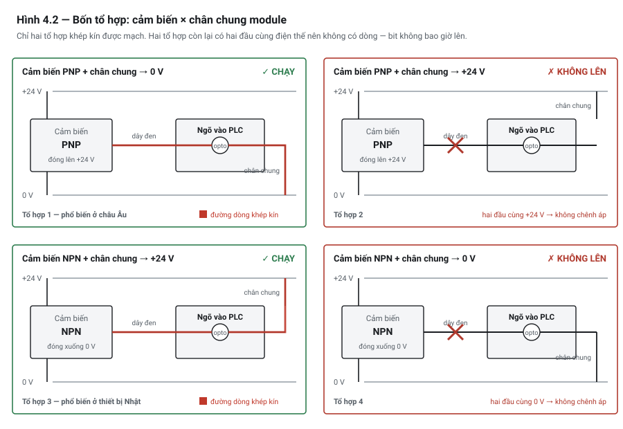

# Chương 4 — Cảm biến số & đấu nối: NPN/PNP, sinking/sourcing

---

## 4.1 Bài toán: cảm biến tốt, module tốt, đấu đúng dây — mà không lên

Bạn mua một cảm biến quang, đấu ba dây theo đúng màu ghi trên thân: nâu vào +24 V, xanh dương vào 0 V,
đen vào ngõ vào PLC. Đưa vật vào vùng phát hiện — **đèn trên cảm biến sáng**, chứng tỏ nó nhận vật.

Nhưng **đèn ngõ vào trên module PLC không sáng**. Trong phần mềm, bit vẫn bằng 0.

Bạn đo bằng đồng hồ: dây đen có 24 V khi có vật. Tín hiệu rõ ràng có mặt. Cảm biến chạy. Module chạy —
bạn thử chập dây thì bit lên. Không có gì hỏng cả.

Cái sai nằm ở chỗ **cảm biến và module thuộc hai kiểu không ghép được với nhau**. Có bốn tổ hợp, và
**hai trong bốn tổ hợp đó không bao giờ chạy** — dù mọi thiết bị đều tốt và mọi dây đều đúng màu.

Đây là chương gây nhầm nhất của nghề tự động hoá. Nó cũng là chương mà sai lầm biểu hiện rõ ràng nhất
— không chạy là không chạy — nên may mắn thay, nó ít nguy hiểm hơn nhiều chương khác. Cái nó đốt là
thời gian.

---

## 4.2 Trạng thái NORMAL — nền tảng của mọi thứ phía sau

Trước khi nói về dòng điện, phải thống nhất một từ.

Với mọi thiết bị đóng cắt ngoài hiện trường — nút bấm, công tắc hành trình, công tắc áp suất, công tắc
cửa — **trạng thái "normal" là trạng thái khi không có kích thích**:

- Nút bấm: **chưa ai nhấn**
- Công tắc hành trình: **chưa có vật chạm vào**
- Công tắc áp suất: **chưa có áp**
- Công tắc cửa: cửa **đang ở vị trí bình thường**

Từ đó:

| Loại tiếp điểm | Ký hiệu | Lúc bình thường | Khi bị kích thích |
|---|---|---|---|
| **Thường mở** *(normally open, NO)* | `─o o─` | **hở** — không dẫn | đóng lại — dẫn |
| **Thường đóng** *(normally closed, NC)* | `─o‾o─` | **kín** — dẫn | mở ra — không dẫn |

Nghe đơn giản, nhưng nó dẫn tới một sự thật có hậu quả rất lớn:

> ⚠ **NGUY HIỂM — sự thật nền tảng của toàn bộ thiết kế an toàn**
>
> **Đứt dây trông y hệt "tiếp điểm hở".** Cả hai đều làm mất dòng, và PLC đọc được **cùng một giá trị
> bit = 0**. Không có cách nào phân biệt bằng phần mềm.
>
> Hệ quả: với mọi tín hiệu mà **mất nó là phải dừng máy** — nút Dừng, công tắc cửa bảo vệ, công tắc áp
> suất, phản hồi mạch an toàn — tiếp điểm vật lý phải là **NC**. Khi đó đứt dây làm bit = 0, và bit = 0
> nghĩa là dừng. Hỏng hóc tự dẫn tới trạng thái an toàn.

Nguyên tắc này có tên: **thiết kế hướng an toàn khi hỏng** *(fail-safe)*. Chương 15 sẽ ghép trạng thái
vật lý này với lệnh trong chương trình thành một bảng 4 tổ hợp thứ hai; Chương 48 khai triển đầy đủ
thành nguyên tắc thiết kế.

> 💡 **MẸO**
> Đừng tin nhãn. Một nút bấm công nghiệp thường có **cả hai** khối tiếp điểm NO và NC lắp trên cùng
> một đầu nút — bạn chọn dùng khối nào là do bạn đấu. Cách duy nhất chắc chắn là **đo bằng đồng hồ ở
> thang thông mạch, lúc chưa nhấn**.

---

## 4.3 Cảm biến 2, 3 và 4 dây

### Cảm biến 3 dây — loại bạn sẽ dùng nhiều nhất

Ba dây, màu theo quy ước phổ biến:

| Dây | Màu thường gặp | Chức năng |
|---|---|---|
| Nguồn dương | **nâu** | +24 V nuôi mạch điện tử bên trong |
| Nguồn âm | **xanh dương** | 0 V |
| Tín hiệu ra | **đen** | đầu ra chuyển mạch |

Cảm biến tự lấy điện nuôi mình từ hai dây nguồn, nên tín hiệu ra "sạch": khi tắt thì tắt hẳn, không rò.
Đây là lý do 3 dây là lựa chọn mặc định.

**Câu hỏi quyết định:** khi phát hiện vật, dây đen được nối tới đâu?

### Cảm biến 2 dây — và cái bẫy dòng rò

Cảm biến 2 dây mắc **nối tiếp với tải**, giống hệt một công tắc cơ khí. Gọn dây, và đó là toàn bộ ưu điểm.

Nhược điểm nằm ở vật lý: mạch điện tử bên trong **vẫn phải có điện để hoạt động**, kể cả lúc cảm biến
đang ở trạng thái tắt. Nó lấy điện ở đâu? Từ chính dòng chảy qua tải. Nghĩa là:

> 🔍 **BẪY — dòng rò làm ngõ vào "dính"**
>
> Cảm biến 2 dây luôn cho một **dòng rò** *(leakage current)* chảy qua tải ngay cả khi đã tắt — điển
> hình cỡ vài phần nghìn ampe. Nếu ngõ vào PLC có trở kháng cao, dòng rò đó đủ tạo ra điện áp làm ngõ
> vào **hiểu nhầm là đang có tín hiệu**.
>
> Triệu chứng: bit ngõ vào **không bao giờ về 0**, hoặc chỉ về 0 lúc trời lạnh, hoặc chập chờn.

Ba cách xử lý, theo thứ tự nên ưu tiên:

1. **Dùng cảm biến 3 dây.** Cách tốt nhất. Nếu chưa lắp thì đừng chọn 2 dây.
2. **Mắc điện trở xả** song song với ngõ vào, để dòng rò chảy qua đó thay vì tạo áp trên ngõ vào. Giá
   trị điện trở tính từ dòng rò ghi trong datasheet cảm biến và ngưỡng điện áp mức 0 của ngõ vào.
3. **Chọn module ngõ vào có trở kháng thấp hơn** — một số module ghi rõ tương thích cảm biến 2 dây.

Cảm biến 2 dây cũng thường có **dòng tải tối thiểu**: nếu ngõ vào PLC hút quá ít dòng, cảm biến không
đủ nuôi mình và hành xử thất thường. Đây là chiều ngược lại của cùng một vấn đề.

### Cảm biến 4 dây

Bốn dây: hai dây nguồn cộng **hai đầu ra**. Hai đầu ra đó thường là một cặp NO và NC, hoặc một cặp
PNP và NPN.

Dùng khi cần cả hai trạng thái, hoặc khi bạn chưa chắc hệ thống của mình là kiểu nào — mua loại có cả
hai đầu ra rồi đấu cái phù hợp. Đắt hơn một chút; đôi khi đáng.

---

## 4.4 PNP và NPN — bốn tổ hợp

### Hai kiểu đầu ra

Bên trong cảm biến 3 dây có một transistor làm nhiệm vụ đóng cắt. Tuỳ nó được mắc kiểu nào mà cảm biến
thuộc một trong hai loại:

**Cảm biến PNP — đóng lên nguồn dương**

```text
        +24V ──────┬─────────────────┐
                   │                 │
              ┌────┴────┐         [transistor]
              │  mạch   │            │
              │ cảm biến│            ├──── dây ĐEN ──► tới ngõ vào PLC
              └────┬────┘            │
                   │            (khi phát hiện vật,
         0V ───────┴───────      transistor nối dây đen lên +24V)
```

Khi phát hiện vật: **dây đen = +24 V**. Cảm biến **cấp dòng ra** *(sourcing)*.

**Cảm biến NPN — đóng xuống nguồn âm**

```text
        +24V ──────┬─────────────────
                   │
              ┌────┴────┐
              │  mạch   │            ├──── dây ĐEN ──► tới ngõ vào PLC
              │ cảm biến│            │
              └────┬────┘         [transistor]
                   │                 │
         0V ───────┴─────────────────┘

                              (khi phát hiện vật,
                               transistor nối dây đen xuống 0V)
```

Khi phát hiện vật: **dây đen = 0 V**. Cảm biến **hút dòng vào** *(sinking)*.

### Module ngõ vào cũng có hai kiểu

Module ngõ vào PLC có một **chân chung** *(common)* dùng chung cho cả nhóm ngõ vào. Kiểu của module
quyết định bởi **chân chung đó được nối tới đâu**:

- Chân chung nối **0 V** → module chờ nhận +24 V ở chân tín hiệu → ghép với **cảm biến PNP**
- Chân chung nối **+24 V** → module chờ nhận 0 V ở chân tín hiệu → ghép với **cảm biến NPN**

> ⚡ **LƯU Ý — vì sao chương này gây nhầm đến thế**
>
> Từ "sinking" và "sourcing" được **các tài liệu dùng ngược nhau**: có tài liệu gọi tên theo chiều dòng
> ở cảm biến, có tài liệu gọi theo chiều dòng ở module. Cùng một cách đấu, hai cuốn sách gọi hai tên
> trái ngược. Bạn không sai — thuật ngữ mới là thứ mâu thuẫn.
>
> **Cách chắc chắn không bao giờ nhầm: đừng nghĩ bằng từ "sinking/sourcing". Hãy hỏi đúng một câu —
> *chân chung của module này nối đi đâu?***

### Bốn tổ hợp — nhìn bằng hình trước



*Hình 4.2 — Bốn tổ hợp. Đường đỏ là đường dòng khép kín; dấu ✗ là chỗ mạch hở vì hai đầu cùng điện thế nên không có chênh áp.*

### ⭐ Bảng 4 tổ hợp

Đây là bảng phải thuộc. Cột cuối là câu trả lời.

| # | Cảm biến | Chân chung module nối tới | Đường đi của dòng khi phát hiện vật | Kết quả |
|:-:|---|---|---|---|
| 1 | **PNP** | **0 V** | cảm biến đẩy +24 V ra → qua chân tín hiệu → qua đèn cách ly trong module → về chân chung → 0 V | ✅ **CHẠY** |
| 2 | **PNP** | +24 V | chân tín hiệu +24 V, chân chung +24 V → **không có chênh áp** → không có dòng | ❌ Không bao giờ lên |
| 3 | **NPN** | **+24 V** | +24 V → chân chung → qua đèn cách ly → ra chân tín hiệu → cảm biến hút xuống 0 V | ✅ **CHẠY** |
| 4 | **NPN** | 0 V | chân tín hiệu 0 V, chân chung 0 V → **không có chênh áp** → không có dòng | ❌ Không bao giờ lên |

Quy tắc rút gọn:

> **PNP đi với chân chung 0 V. NPN đi với chân chung +24 V.**
>
> Cách nhớ theo bản chất: cảm biến và module phải **ngược chiều nhau** — một bên đẩy dòng ra thì bên
> kia phải hút dòng vào. Hai bên cùng đẩy, hoặc cùng hút, thì mạch không khép kín.

### Vì sao cả hai kiểu cùng tồn tại

Không phải vì kỹ thuật — vì lịch sử và vùng địa lý:

- **PNP** phổ biến ở châu Âu và các thị trường theo chuẩn IEC. Đây cũng là kiểu chiếm ưu thế trong
  thiết bị mới.
- **NPN** là truyền thống của thiết bị Nhật Bản và một phần châu Á.

Ở Việt Nam bạn sẽ gặp **cả hai** — máy châu Âu dùng PNP, máy Nhật đời cũ dùng NPN, và không hiếm nhà
máy có cả hai loại máy cạnh nhau.

> 💡 **MẸO**
> Khi làm máy mới, **chọn một kiểu và dùng thống nhất cho cả máy**. Trộn hai kiểu trên cùng một máy là
> món quà tệ nhất bạn có thể để lại cho người bảo trì. Nếu buộc phải trộn (thiết bị chuyên dụng chỉ có
> một kiểu), hãy ghi rõ trên sơ đồ và dán nhãn ngay tại cầu đấu.

### Khi lỡ mua sai kiểu

Xảy ra thường xuyên. Ba lựa chọn:

1. **Đổi cảm biến** — sạch nhất nếu còn đổi được.
2. **Đổi cách đấu chân chung của module** — nhiều module cho phép chọn kiểu bằng cách đấu chân chung.
   Kiểm tra tài liệu module trước; **không phải module nào cũng cho**. Lưu ý chân chung thường dùng
   chung cho cả nhóm, nên đổi là đổi cả nhóm.
3. **Dùng rơ-le trung gian** hoặc bộ chuyển đổi — thêm linh kiện, thêm điểm hỏng, nhưng cứu được tình
   thế khi hai cách trên bất khả thi.

---

## 4.5 Các loại cảm biến số thường gặp

### Công tắc hành trình *(limit switch)*

Tiếp điểm cơ khí, bị gạt bởi vật thể chạm vào. Đơn giản, rẻ, không cần nguồn, **nhìn là biết trạng
thái**. Nhược: mòn cơ khí, chậm, và **rung tiếp điểm** *(contact bounce)* — tiếp điểm nảy vài lần trong
vài mili-giây khi đóng cắt, có thể làm bộ đếm đếm nhiều lần cho một lần chạm. Chương 18 xử lý chống rung.

### Cảm biến tiệm cận cảm ứng *(inductive proximity)*

Phát hiện **kim loại** không cần chạm. Rất bền, chịu bẩn tốt, tốc độ cao. Tầm phát hiện ngắn — thường
vài mm tới hơn chục mm tuỳ kích thước. Tầm phát hiện **phụ thuộc loại kim loại**: thép cho tầm xa nhất,
nhôm và đồng ngắn hơn đáng kể (datasheet có hệ số quy đổi).

Đây là loại được dùng nhiều nhất trong máy tự động hoá.

### Cảm biến tiệm cận điện dung *(capacitive proximity)*

Phát hiện được **hầu hết vật liệu** — nhựa, thuỷ tinh, chất lỏng, bột. Đổi lại: nhạy với độ ẩm, bụi bám,
và cần chỉnh độ nhạy. Dùng khi vật cần phát hiện không phải kim loại.

### Cảm biến quang *(photoelectric)*

Ba kiểu, khác nhau về độ tin cậy và công đi dây:

| Kiểu | Cấu tạo | Tầm | Độ tin cậy | Đánh đổi |
|---|---|---|---|---|
| **Thu-phát** *(through-beam)* | 2 thân riêng, đối diện nhau | Xa nhất | **Cao nhất** | Phải đi dây **cả hai phía** |
| **Phản xạ gương** *(retro-reflective)* | 1 thân + 1 gương phản xạ | Trung bình | Khá | Vật bóng có thể phản xạ và bị hiểu nhầm là gương |
| **Khuếch tán** *(diffuse)* | 1 thân, thu ánh sáng dội từ chính vật | Ngắn nhất | Thấp nhất | Phụ thuộc **màu và bề mặt** vật — vật đen có thể không phát hiện được |

> 💡 **MẸO**
> Cần chắc chắn thì chọn **thu-phát**, chấp nhận đi dây hai phía. Kiểu khuếch tán rẻ và gọn nhưng là
> nguồn gốc của rất nhiều lỗi "lúc được lúc không" — vì nó phụ thuộc thứ bạn không kiểm soát được:
> màu sắc và bề mặt của sản phẩm.

### Cảm biến từ trên xy-lanh *(reed switch)*

Gắn vào rãnh trên thân xy-lanh khí nén, phát hiện nam châm gắn trên piston. Rẻ, gọn, là cách tiêu chuẩn
để biết xy-lanh đã ra hay đã về.

Hai lưu ý thực tế:

- **Nhiễu từ trường ngoài** — đặt gần động cơ lớn hoặc dây động lực có thể tác động sai.
- **Với xy-lanh hành trình ngắn**, vùng nhạy của hai cảm biến có thể chồng lên nhau, làm **cả hai cùng
  báo** ở một số vị trí. Kiểm tra khi lắp, đừng giả định.

Loại cảm biến này chính là thứ cho phép **giám sát phản hồi thay vì tin lệnh** (Chương 48) — ra lệnh
kẹp rồi chờ reed xác nhận, thay vì chờ một khoảng thời gian rồi đoán.

---

## 4.6 Trên máy mẫu DP-01

Toàn bộ cảm biến số của DP-01 dùng **PNP**, module ngõ vào có **chân chung nối 0 V** — tổ hợp 1.

| Tag | Loại cảm biến | Tiếp điểm | Vì sao chọn vậy |
|---|---|---|---|
| `DI_BoardStn1` | Quang **thu-phát**, PNP | NO — có board thì bit = 1 | Board mạch có màu và bề mặt rất khác nhau tuỳ mã hàng → kiểu khuếch tán không đáng tin. Đây là tín hiệu quy trình, không phải tín hiệu an toàn |
| `DI_BoardStn2` | Quang thu-phát, PNP | NO | như trên |
| `DI_Stop1Up` / `DI_Stop1Dn` | Reed trên xy-lanh chặn, PNP | NO | Phản hồi vị trí — dùng để chuyển bước, kèm timeout |
| `DI_Clamp1Up` / `DI_Clamp1Dn` | Reed trên xy-lanh kẹp, PNP | NO | như trên |
| `DI_StopPB` | Nút nhấn | **NC** | Tín hiệu an toàn: đứt dây → bit 0 → dừng |
| `DI_AirOK` | Công tắc áp suất | Kín khi đủ khí | Mất khí **hoặc** đứt dây đều cho bit 0 → dừng |

> ⚡ **LƯU Ý**
> `DI_AirOK` đáng chú ý: về danh mục nó là tiếp điểm NO (hở khi không có áp), nhưng nó **hành xử đúng
> như ta cần** vì cả "hết khí" lẫn "đứt dây" đều cho bit = 0. Bài học: **tiêu chí là hậu quả khi mất
> tín hiệu, không phải cái nhãn trên vỏ.**

### Đọc bảng I/O như một bài kiểm tra

Nhìn bảng trên, bạn phải phân loại được mỗi dòng vào một trong hai nhóm:

- **Tín hiệu an toàn** — mất nó là phải dừng máy. Bắt buộc fail-safe. Ở đây: `DI_StopPB`, `DI_AirOK`.
- **Tín hiệu quy trình** — mất nó thì sai sản phẩm hoặc kẹt chu trình, xử lý bằng timeout và báo động.
  Ở đây: các cảm biến board và reed.

Việc phân loại này phải làm **lúc lập bảng I/O**, không phải lúc viết code. Chương 23 đưa nó vào biểu mẫu.

---

## 4.7 Bẫy thường gặp

### 🔍 BẪY 1 — Đèn trên cảm biến sáng nên kết luận là đấu đúng

Đèn trên thân cảm biến chỉ báo **cảm biến đã phát hiện vật**. Nó **không** nói gì về việc tín hiệu có
tới được PLC hay không — đèn đó vẫn sáng bình thường trong cả tổ hợp 2 và tổ hợp 4.

Đây chính là bài toán mở đầu chương, và là lý do nó tốn thời gian đến vậy: mọi dấu hiệu bề mặt đều báo
"ổn".

**Cách kiểm đúng:** đo điện áp **giữa chân tín hiệu và chân chung của module** — không phải giữa chân
tín hiệu và 0 V. Nếu chênh áp bằng 0 khi cảm biến đang phát hiện vật, bạn đang ở tổ hợp 2 hoặc 4.

### 🔍 BẪY 2 — Ngõ vào không bao giờ về 0

Đã nói ở mục 4.3: dòng rò của cảm biến 2 dây. Nhưng còn hai nguyên nhân khác cho cùng triệu chứng:

- **Cáp dài chạy song song với cáp động lực** — ghép điện dung tạo ra điện áp cảm ứng đủ giữ ngõ vào.
  Cách chữa là tách cáp, không phải đổi cảm biến. Chương 49.
- **Bộ lọc ngõ vào đặt quá dài** — một số module cho chỉnh thời gian lọc; đặt quá lớn thì tín hiệu ngắn
  bị "nuốt" hoặc bị kéo dài. Liên hệ Chương 10.

**Cách phân biệt ba nguyên nhân:** rút hẳn dây tín hiệu ra khỏi module. Nếu bit vẫn = 1 → lỗi ở module.
Nếu bit về 0 → đo điện áp trên dây vừa rút: có vài vôn khi cảm biến tắt → dòng rò hoặc nhiễu cảm ứng.

### 🔍 BẪY 3 — Trộn PNP và NPN trên cùng một máy

Chạy được, nếu mỗi cảm biến đấu vào đúng nhóm ngõ vào có chân chung phù hợp. Nhưng bạn vừa tạo ra một
cỗ máy mà **người bảo trì không thể suy luận được** — thay một cảm biến hỏng bằng loại có sẵn trong kho
là máy không chạy, và không ai hiểu vì sao.

Nếu buộc phải trộn: ghi rõ trên sơ đồ, dán nhãn tại cầu đấu, và ghi vào tài liệu bàn giao.

### 🔍 BẪY 4 — Quên rằng chân chung dùng chung cho cả nhóm

Module ngõ vào thường chia thành các nhóm, mỗi nhóm một chân chung. Đổi kiểu chân chung là **đổi cho cả
nhóm**, không phải cho một kênh.

Người mới hay lên kế hoạch "kênh 0–3 dùng PNP, kênh 4–7 dùng NPN" mà không kiểm tra ranh giới nhóm —
rồi phát hiện cả tám kênh chung một chân chung.

**Kiểm tra sơ đồ chân module trước khi lập bảng I/O**, không phải sau.

### 🔍 BẪY 5 — Suy ra kiểu cảm biến từ màu dây

Quy ước màu nâu/xanh dương/đen là **phổ biến**, không phải **bắt buộc**. Cáp nhập khẩu, cáp thay thế,
hoặc cảm biến của một số hãng dùng màu khác.

Luôn tra datasheet của đúng model. Và nếu cáp đã bị cắt nối, đo trước khi cấp nguồn — đấu ngược nguồn
vào chân tín hiệu có thể làm hỏng cả cảm biến lẫn ngõ vào module.

---

## 4.8 Tự kiểm

1. **Viết lại bảng 4 tổ hợp từ trí nhớ**, kèm giải thích đường đi của dòng cho hai tổ hợp chạy được.
2. Một cảm biến PNP, đèn trên thân sáng khi có vật, nhưng bit PLC không lên. **Ba bước kiểm tra đầu
   tiên** của bạn là gì, theo thứ tự?
3. Vì sao PLC **không thể** phân biệt "tiếp điểm hở" với "đứt dây"? Quy tắc thiết kế nào sinh ra từ
   sự thật đó?
4. `DI_AirOK` của DP-01 dùng tiếp điểm kín-khi-đủ-khí. Giải thích vì sao cách đó là fail-safe, dù về
   danh mục nó không phải tiếp điểm NC.
5. Bạn cần phát hiện board mạch có màu thay đổi theo mã hàng. **Chọn kiểu cảm biến quang nào** — và
   loại nào phải tránh, vì sao?
6. Một ngõ vào không bao giờ về 0. Nêu **ba nguyên nhân** khả dĩ và **phép kiểm để phân biệt** chúng.

Câu 1 và câu 3 phải trả lời được không cần nghĩ. Câu 6 là câu chuẩn bị cho Chương 51 — nó rèn đúng lối
tư duy chẩn đoán mà chương đó dạy.

---

### Chương tiếp theo

**Chương 5 — Cơ cấu chấp hành điện & tải.** Chương này lo phần tín hiệu **đi vào** PLC. Chương 5 lo
phần đi **ra**: van điện từ, contactor, đèn tháp — và vì sao một cuộn dây bị ngắt điện có thể tạo ra
điện áp đủ phá hỏng ngõ ra vừa điều khiển nó.

---

### Nguồn tham khảo chương 4

- IEC 61131-2 — *Programmable controllers, Part 2: Equipment requirements and tests*: đặc tính điện của
  ngõ vào số, ngưỡng mức 0/mức 1, thời gian lọc. *(tiêu chuẩn có bản quyền)*
- IEC 60947-5-1 — *Low-voltage switchgear and controlgear — Control circuit devices and switching
  elements*: định nghĩa tiếp điểm NO/NC và trạng thái nghỉ.
- IEC 60204-1 — *Safety of machinery — Electrical equipment of machines*: nguyên tắc mạch dừng, cơ sở
  cho quy tắc fail-safe ở mục 4.2.
- Datasheet cảm biến của các hãng — dùng cho các con số tầm phát hiện, hệ số quy đổi theo vật liệu và
  dòng rò. **Các con số trong chương là bậc độ lớn điển hình**; thông số thật phải tra đúng model bạn dùng.
- Cấu hình I/O của DP-01 — Phụ lục J.
