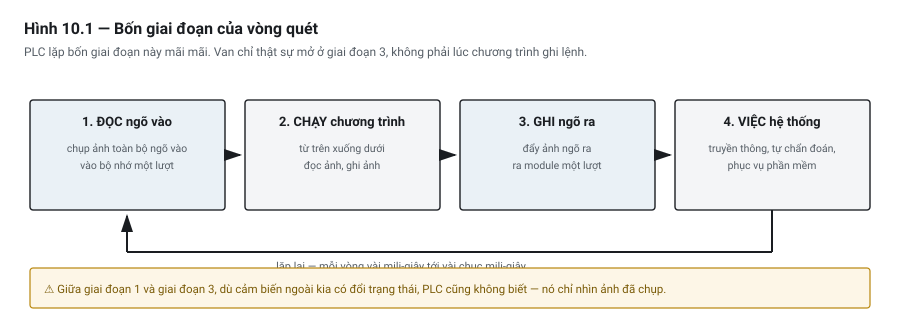
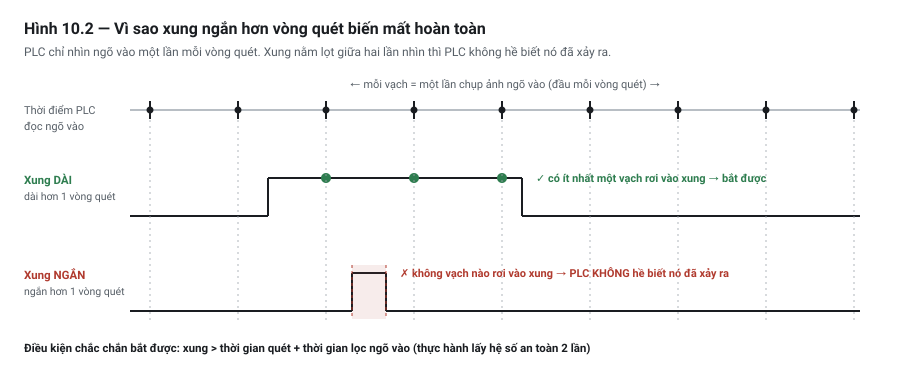

# Chương 10 — Vòng quét: mô hình tinh thần quan trọng nhất

> **Lát cắt máy mẫu:** 1 — chỉ dùng chuyền, chặn, nâng kẹp, cảm biến board, nút bấm, đèn tháp.

---

## 10.1 Bài toán: hai dòng lệnh giống hệt nhau, kết quả khác nhau

Một kỹ sư viết đoạn logic tạo xung một chu kỳ — mỗi lần nhấn nút chỉ cho ra đúng một xung, dù giữ nút
bao lâu. Đoạn logic hai dòng, ai nhìn cũng thấy đúng:

```text
Dòng 1:   DI_StartPB  AND  NOT M_StartMem   →   M_StartPulse
Dòng 2:   DI_StartPB                        →   M_StartMem
```

Chạy thử: hoạt động hoàn hảo.

Người khác bảo trì máy, sắp xếp lại chương trình cho gọn, **đổi thứ tự hai dòng**. Không sửa một ký tự
nào trong logic. Từ đó `M_StartPulse` **không bao giờ lên nữa**.

Không có lệnh nào sai. Không có tag nào gõ nhầm. Thứ thay đổi là một điều mà cả hai người đều chưa
hiểu: **PLC không chạy chương trình như bạn nghĩ**.

Chương này là mô hình tinh thần để hiểu chuyện đó — và nó là mô hình quan trọng nhất trong toàn bộ
cuốn sách. Gần như mọi lỗi "kỳ lạ" mà người mới gặp đều truy về đây.

---

## 10.2 Vòng quét hoạt động thế nào

PLC **không** phản ứng tức thời với ngõ vào. Nó chạy một vòng lặp vô tận, lặp đi lặp lại bốn giai đoạn.
Vòng đó gọi là **vòng quét** *(scan cycle)*.



*Hình 10.1 — Bốn giai đoạn của vòng quét.*

**Giai đoạn 1 — Đọc ngõ vào.** PLC đọc trạng thái *tất cả* các ngõ vào **cùng một lúc** và cất vào một
vùng nhớ gọi là **ảnh ngõ vào** *(input process image)*. Sau khoảnh khắc này, dù cảm biến ngoài kia có
đổi trạng thái, PLC cũng không biết — nó chỉ nhìn vào ảnh đã chụp.

**Giai đoạn 2 — Chạy chương trình.** PLC thực thi từ dòng đầu tới dòng cuối, **theo thứ tự**. Mọi lệnh
đọc ngõ vào đều đọc từ ảnh, không đọc từ thiết bị thật. Mọi lệnh ghi ngõ ra đều ghi vào **ảnh ngõ ra**
*(output process image)*, không tác động thẳng ra module.

**Giai đoạn 3 — Ghi ngõ ra.** Toàn bộ ảnh ngõ ra được đẩy ra module một lượt. Đây là lúc van mới thực
sự mở, đèn mới thực sự sáng.

**Giai đoạn 4 — Việc hệ thống.** Xử lý truyền thông, tự chẩn đoán, cập nhật đồng hồ, phục vụ phần mềm
lập trình đang kết nối.

Rồi quay lại giai đoạn 1. Mãi mãi, cho tới khi ai đó chuyển CPU sang STOP hoặc mất điện.

### Vì sao lại thiết kế kiểu chụp ảnh

Có vẻ thừa: sao không đọc thẳng cảm biến mỗi khi cần? Ba lý do, và cả ba đều quan trọng:

**Thứ nhất — tính nhất quán.** Trong một vòng quét, `DI_BoardStn1` được đọc ở dòng 5 và dòng 200 luôn
cho **cùng một giá trị**. Nếu đọc thẳng thiết bị, cảm biến có thể đổi trạng thái giữa hai dòng, và bạn
sẽ có logic tự mâu thuẫn: cùng một chu kỳ mà chỗ này thấy có board, chỗ kia thấy không.

**Thứ hai — tốc độ.** Đọc một ô nhớ nhanh hơn hàng chục lần so với đi qua bus tới module I/O. Chương
trình đọc một ngõ vào hàng trăm lần thì chênh lệch này quyết định thời gian quét.

**Thứ ba — tính tất định** *(deterministic behaviour)*. Vòng quét luôn mất khoảng thời gian gần như
nhau. Nhờ vậy bạn **dự đoán được** hành vi của máy — điều mà một máy tính thông thường chạy hệ điều
hành đa nhiệm không hứa được.

> ⚡ **LƯU Ý**
> Ba từ cần phân biệt cho rõ, vì sách và tài liệu hãng dùng lẫn lộn: **ngõ vào vật lý** là cái chân
> trên module; **ảnh ngõ vào** là bản sao trong RAM; **tag** là cái tên bạn đặt để trỏ tới ảnh đó.
> Khi bạn viết `DI_BoardStn1` trong chương trình, bạn đang đọc **ảnh**, không phải chân.

### Truy cập trực tiếp — lối thoát hiểm

Mọi hãng đều cho phép **bỏ qua ảnh** và đọc/ghi thẳng module ngay giữa lúc chạy chương trình. Tên gọi
khác nhau tuỳ hãng — truy cập tức thời, truy cập trực tiếp, đọc ngoại vi — nhưng ý nghĩa như nhau.

Khi nào cần: khi vài mili-giây quyết định kết quả. Ví dụ: cắt tín hiệu cho một cơ cấu tốc độ cao ngay
giữa chu kỳ thay vì chờ tới cuối vòng quét.

Cái giá phải trả:

- **Mất tính nhất quán** — lý do thứ nhất ở trên bay mất cho đúng tín hiệu đó.
- **Chậm hơn** cho mỗi lần truy cập.
- **Khó đọc** — người bảo trì sau bạn sẽ ngạc nhiên vì sao một tín hiệu hành xử khác các tín hiệu còn lại.

> 💡 **MẸO**
> Nguyên tắc thực dụng: **mặc định dùng ảnh**. Chỉ dùng truy cập trực tiếp khi bạn đã đo được rằng độ
> trễ một vòng quét là vấn đề thật, và ghi comment ngay tại chỗ giải thích vì sao.

### Thời gian quét — con số bạn phải biết về máy của mình

**Thời gian quét** *(scan time)* là thời gian đi hết một vòng. Với một máy cỡ DP-01, con số điển hình
nằm trong khoảng vài mili-giây tới vài chục mili-giây, tuỳ CPU và độ lớn chương trình.

Cái gì làm thời gian quét phình lên:

| Nguyên nhân | Mức ảnh hưởng | Ghi chú |
|---|---|---|
| Chương trình dài thêm | Tuyến tính | Thêm gấp đôi lệnh thì gần gấp đôi thời gian |
| Vòng lặp trong Structured Text | **Rất lớn, khó lường** | Xem Chương 20 — đây là nguyên nhân treo CPU phổ biến nhất |
| Khối truyền thông (đọc/ghi qua mạng) | Lớn | Nhiều khối chờ phản hồi từ thiết bị khác |
| Chuyển khối dữ liệu lớn | Trung bình | Sao chép mảng lớn mỗi vòng quét là lãng phí |
| Địa chỉ gián tiếp / con trỏ | Trung bình | Chương 19 |
| Tính toán số thực nhiều | Trung bình | Phụ thuộc CPU có đơn vị dấu phẩy động không |
| Nhiều I/O phân tán *(remote I/O)* | Lớn | Dữ liệu phải đi qua mạng — xem Chương 8 |

Mọi hãng đều cho xem thời gian quét hiện tại, nhỏ nhất và **lớn nhất** trong phần mềm lập trình. Con số
đáng quan tâm là **lớn nhất**, không phải trung bình — vì máy sẽ hỏng vào đúng lúc chậm nhất.

> 💡 **MẸO**
> Ghi lại thời gian quét lớn nhất **ngay khi máy vừa chạy tốt**, và dán con số đó vào tài liệu bàn giao.
> Sáu tháng sau, khi có người thêm chức năng và máy bắt đầu hành xử lạ, con số cũ là bằng chứng đầu tiên.

### Watchdog — cái phanh cuối cùng

Mỗi PLC có một bộ đếm giám sát gọi là **watchdog**. Nếu một vòng quét vượt quá giới hạn cho phép, CPU
kết luận chương trình đã mất kiểm soát và **tự chuyển sang trạng thái lỗi**.

Điều gì xảy ra khi watchdog kích: CPU dừng thực thi, và các ngõ ra chuyển về **trạng thái đã cấu hình
trước** — thường là tắt hết, nhưng cấu hình được. Đây không phải chi tiết kỹ thuật vụn vặt:

> ⚠ **NGUY HIỂM**
> Watchdog kích nghĩa là **toàn bộ logic của bạn ngừng chạy trong khi máy vẫn còn năng lượng** — khí
> nén còn trong ống, động cơ còn quán tính, cơ cấu còn ở tư thế dở dang. Đây chính là một trong những
> lý do **mạch dừng khẩn cấp không được đi qua logic PLC thường** (Chương 47): khi CPU chết, logic chết
> theo, còn mối nguy thì không.

> ⚠⚠ **Và có một lệnh cho phép bạn TẮT lời cảnh báo này — đừng dùng nó để làm việc đó.**
>
> Phần lớn hệ có một lệnh nạp lại watchdog giữa vòng quét (tên hay gặp: `WDT`). ⭐ Nó có công dụng
> hợp lệ: một đoạn khởi tạo chạy **đúng một lần** lúc bật máy và cố tình mất lâu.
>
> ⚠ Nhưng cách nó **thường** được dùng là: chương trình bắt đầu chạm ngưỡng watchdog, ai đó thêm
> một lệnh nạp lại vào giữa, và cảnh báo biến mất. ⭐⭐ **Vòng quét vẫn dài y như cũ** — thứ duy nhất
> mất đi là **cái báo cho bạn biết điều đó**.
>
> ⚡ Vòng quét dài là một **triệu chứng**, và nó có nguyên nhân tra được: vòng lặp chờ tín hiệu ngoài
> (Chương 20 mục 20.5), khối mới thêm vào tác vụ sai, hay dữ liệu lớn hơn dự tính. ⭐ Chữa nguyên
> nhân; đừng tháo đồng hồ báo.

---

## 10.3 Trên máy mẫu DP-01

Lấy một đoạn thật từ lát cắt 1 của DP-01: board tới vị trí trạm keo thì dừng chuyền và nâng chặn.

```text
// ── Dòng 1 ──────────────────────────────────────────────
// Có board tại trạm 1 → yêu cầu dừng chuyền
DI_BoardStn1                         →  M_Stn1Occupied

// ── Dòng 2 ──────────────────────────────────────────────
// Chuyền chạy khi được phép chạy VÀ trạm 1 chưa có board
M_RunEnable  AND  NOT M_Stn1Occupied →  DO_ConvRun

// ── Dòng 3 ──────────────────────────────────────────────
// Nâng chặn khi trạm 1 có board
M_Stn1Occupied                       →  DO_Stop1Vlv
```

Bây giờ theo dõi từng vòng quét khi một board đi tới. Giả sử thời gian quét 5 ms.

| Vòng quét | Giai đoạn 1 đọc được | Dòng 1 | Dòng 2 | Dòng 3 | Giai đoạn 3 ghi ra |
|---|---|---|---|---|---|
| N | `DI_BoardStn1` = 0 | `M_Stn1Occupied` = 0 | `DO_ConvRun` = 1 | `DO_Stop1Vlv` = 0 | chuyền chạy |
| N+1 | `DI_BoardStn1` = **1** | = **1** | = **0** | = **1** | chuyền dừng, chặn lên |
| N+2 | = 1 | = 1 | = 0 | = 1 | giữ nguyên |

Ba điều rút ra, và điều thứ ba là điều quan trọng:

**Một — phản ứng không tức thời.** Board che cảm biến vào một thời điểm bất kỳ trong vòng quét N, nhưng
chuyền chỉ dừng ở cuối vòng N+1. Độ trễ thực tế nằm trong khoảng **0 đến 2 lần thời gian quét**, cộng
thêm thời gian lọc của ngõ vào phần cứng. Với 5 ms thì là 0–10 ms — không đáng kể so với quán tính cơ khí.

**Hai — thứ tự dòng ở đây không quan trọng.** Dòng 2 và dòng 3 đều đọc `M_Stn1Occupied` do dòng 1 ghi.
Nếu ai đó đảo dòng 1 xuống cuối, dòng 2 và 3 sẽ đọc giá trị của **vòng quét trước** → toàn bộ phản ứng
chậm thêm đúng một vòng quét. Với đoạn này, 5 ms trễ thêm là vô hại.

**Ba — nhưng nó *sẽ* quan trọng ở chỗ khác.** Đó chính là bài toán mở đầu chương. Xem mục 10.4.

> ⚡ **LƯU Ý**
> Đừng rút ra kết luận "thứ tự dòng không quan trọng". Kết luận đúng là: **thứ tự dòng quyết định một
> tín hiệu được nhìn thấy ở vòng quét này hay vòng quét sau** — và có những loại logic mà sự khác biệt
> một vòng quét làm chúng hỏng hoàn toàn, chứ không phải chỉ chậm đi.

---

## 10.4 Bẫy thường gặp

### 🔍 BẪY 1 — Đảo thứ tự dòng làm hỏng logic tạo xung

Đây là bài toán mở đầu chương. Giờ giải thích được rồi.

```text
Dòng 1:   DI_StartPB  AND  NOT M_StartMem   →   M_StartPulse
Dòng 2:   DI_StartPB                        →   M_StartMem
```

**Thứ tự đúng (1 rồi 2).** Nút vừa được nhấn ở vòng quét N:

| | Dòng 1 tính | Dòng 2 tính | Kết quả |
|---|---|---|---|
| Vòng N | `1 AND NOT 0` = **1** → `M_StartPulse` = 1 | `M_StartMem` = 1 | ✅ xung ra |
| Vòng N+1 | `1 AND NOT 1` = 0 → `M_StartPulse` = 0 | `M_StartMem` = 1 | xung tắt |

Đúng một vòng quét có xung. Chính xác như thiết kế.

**Thứ tự đảo (2 rồi 1).** Cùng tình huống:

| | Dòng 2 tính trước | Dòng 1 tính sau | Kết quả |
|---|---|---|---|
| Vòng N | `M_StartMem` = **1** | `1 AND NOT 1` = **0** | ❌ không bao giờ có xung |

`M_StartMem` đã bị đặt lên **ngay trong cùng vòng quét**, trước khi dòng 1 kịp đọc nó. Điều kiện
`NOT M_StartMem` không bao giờ đúng nữa.

**Bài học:** khi một dòng ghi vào bit mà dòng khác đọc, **thứ tự trở thành một phần của logic**. Nó
không còn là chuyện sắp xếp cho gọn.

> 💡 **MẸO**
> Trong thực tế, đừng tự dựng mạch tạo xung bằng hai dòng như trên — mọi hãng đều có lệnh bắt sườn
> *(edge detection)* sẵn, ổn định hơn và không phụ thuộc thứ tự (Chương 16). Ví dụ trên có mặt ở đây
> vì nó **phơi bày cơ chế**, không phải vì nó là cách nên làm.

### 🔍 BẪY 2 — Xung ngắn hơn vòng quét biến mất hoàn toàn

PLC chỉ nhìn ngõ vào **một lần mỗi vòng quét**. Một xung xuất hiện rồi tắt hẳn giữa hai lần nhìn thì
**PLC không hề biết nó đã xảy ra**. Không phải "bắt trễ" — mà là **không tồn tại**.



*Hình 10.2 — Cùng một cảm biến, hai độ dài xung, hai số phận. Xung ngắn không bị "bắt trễ" — nó không tồn tại đối với PLC.*

Điều kiện để chắc chắn bắt được một xung:

> 📐 **Xung phải kéo dài hơn:  thời gian quét  +  thời gian lọc ngõ vào**
>
> Thực hành nên lấy hệ số an toàn 2 lần. Điều kiện áp dụng: ngõ vào đọc qua ảnh (không dùng truy cập
> trực tiếp), chương trình chạy trong tác vụ chu kỳ thông thường.

Đưa số vào cho cụ thể — chuyền của DP-01 chạy tối đa 20 m/phút, tức 333 mm/s:

| Vật thể qua cảm biến | Thời gian che | So với quét 5 ms | Kết luận |
|---|---|---|---|
| Board dài 100 mm | 300 ms | gấp 60 lần | ✅ an toàn tuyệt đối |
| Khe hở 30 mm giữa hai board | 90 ms | gấp 18 lần | ✅ an toàn |
| Vấu định vị 5 mm | 15 ms | gấp 3 lần | ⚠ mỏng manh — nếu thời gian quét tăng thì mất |
| Xung encoder ở tốc độ cao | dưới 1 ms | nhỏ hơn | ❌ **chắc chắn mất** |

Nói thẳng: **với chuyền chậm như DP-01, vòng quét không phải vấn đề.** Nhiều tài liệu doạ người mới về
chuyện này rồi đưa ví dụ phi thực tế. Chỗ nó cắn thật là khi tần số tín hiệu lên tới hàng trăm Hz trở
lên — đếm sản phẩm trên chuyền tốc độ cao, đọc encoder, đo xung lưu lượng. Lúc đó không có cách nào
chữa bằng phần mềm: phải dùng **bộ đếm tốc độ cao** *(high-speed counter, HSC)* — phần cứng đếm độc lập,
không phụ thuộc vòng quét. Chương 18.

> ⚡ **LƯU Ý**
> Hàng thứ ba trong bảng là hàng nguy hiểm nhất — **mỏng manh chứ không sai**. Nó chạy tốt lúc nghiệm
> thu, rồi hỏng sáu tháng sau khi có người thêm chức năng làm thời gian quét tăng từ 5 ms lên 20 ms.
> Không ai nghĩ tới việc liên hệ hai chuyện đó với nhau. Đây là lý do mục 10.2 khuyên ghi lại thời gian
> quét lúc bàn giao.

### 🔍 BẪY 3 — Tưởng lệnh là kết quả

Đây là bẫy đặc trưng của **lộ trình C** (người từ lập trình phần mềm sang), và nó không hẳn là bẫy về
vòng quét — nhưng vòng quét là chỗ nó lộ ra.

Trong phần mềm, gọi một hàm xong là việc đã xong. Trong máy:

```iecst
DO_Clamp1Vlv := TRUE;    // ra lệnh nâng kẹp
// … dòng ngay sau, cùng vòng quét:
// kẹp ĐÃ nâng chưa?  →  CHƯA. Van còn chưa được ghi ra module.
```

Ở thời điểm dòng lệnh tiếp theo chạy:

- Ngõ ra vật lý **chưa** được ghi — việc đó xảy ra ở giai đoạn 3.
- Van **chưa** mở.
- Khí **chưa** vào xy-lanh.
- Xy-lanh **chưa** di chuyển — mất hàng trăm mili-giây.

Cách viết đúng là chờ **tín hiệu phản hồi** từ cảm biến xác nhận, kèm timeout để báo lỗi nếu quá lâu:

```iecst
// Ra lệnh, rồi chuyển bước CHỈ KHI cảm biến xác nhận
DO_Clamp1Vlv := TRUE;
IF DI_Clamp1Up THEN
    Step := Step + 1;        // kẹp đã lên thật → đi tiếp
END_IF;
// timeout của bước xử lý riêng — xem Chương 26
```

Nguyên tắc này quan trọng tới mức nó có chương riêng: **giám sát phản hồi thay vì tin lệnh** (Chương 48).
Và cách làm sai kinh điển — thay cảm biến phản hồi bằng một timer "chờ 2 giây chắc kẹp xong rồi" — được
mổ xẻ ở Chương 17.

### 🔍 BẪY 4 — Cuộn dây trùng: hai chỗ cùng ghi một ngõ ra

Nếu hai dòng khác nhau cùng ghi vào `DO_ConvRun`, thì **dòng chạy sau thắng** — mỗi vòng quét. Dòng
chạy trước coi như không tồn tại, vì giá trị nó ghi vào ảnh bị đè trước khi ảnh được đẩy ra module.

Người mới hay tạo lỗi này khi thêm một điều kiện dừng ở cuối chương trình mà quên rằng đầu chương trình
đã có một dòng điều khiển cùng ngõ ra đó. Triệu chứng: **điều kiện mới có vẻ không có tác dụng** — hoặc
tệ hơn, ngõ ra nhấp nháy theo cách không giải thích được.

Đây là lỗi **cuộn dây trùng** *(double coil)*. Chương 15 nói kỹ, kèm cách phát hiện và cách viết lại cho
đúng. Nhắc ở đây vì nguyên nhân gốc là cơ chế ảnh ngõ ra của chương này.

### 🔍 BẪY 5 — Tranh chấp giữa hai khối chương trình

Khi chương trình lớn lên, bạn sẽ tách nó thành nhiều khối *(program organization unit, POU)*. Nếu khối
A ghi một bit mà khối B đọc, thì **thứ tự gọi hai khối quyết định B thấy giá trị của vòng quét này hay
vòng trước**.

Đây là phiên bản phóng to của Bẫy 1, và nó khó thấy hơn nhiều — vì hai khối có thể nằm ở hai file khác
nhau, do hai người viết, cách nhau sáu tháng.

Nếu bạn còn dùng nhiều **tác vụ** *(task)* chạy ở chu kỳ khác nhau thì tình hình phức tạp thêm: một tác
vụ nhanh có thể đọc dữ liệu do tác vụ chậm ghi dở. Chương 27 (kiến trúc chương trình nhiều trạm) xử lý
bài toán này một cách có hệ thống.

> 💡 **MẸO**
> Quy tắc đơn giản, dùng được ngay: **mỗi bit chỉ được ghi ở đúng một nơi.** Nếu bạn thấy mình cần ghi
> một bit từ hai chỗ, gần như chắc chắn thiết kế đang sai — hãy quay lại Chương 25 và mô hình hoá bằng
> trạng thái thay vì bằng cờ rải rác.

---

## 10.5 Khác biệt giữa các hãng

Cơ chế bốn giai đoạn là **giống nhau ở mọi hãng** — đây là nguyên lý, không phải lựa chọn thiết kế
riêng. Nhưng chi tiết thì khác, và những khác biệt sau **có ảnh hưởng thật** khi bạn chuyển hệ.

| Khía cạnh | Siemens (S7-1200/1500) | Mitsubishi (FX5U / iQ-R) | Rockwell (Logix) | CODESYS / TwinCAT |
|---|---|---|---|---|
| **Tên gọi ảnh ngõ vào/ra** | *Process image* — PII (vào) và PIQ (ra) | Làm mới ở **xử lý END** của mỗi vòng quét | ⭐ Xem hàng riêng bên dưới | I/O gán vào **tác vụ**, mỗi tác vụ tự làm mới phần của nó |
| **Truy cập trực tiếp, bỏ qua ảnh** | Hậu tố `:P` trên địa chỉ, ví dụ `%I0.0:P` | Lệnh làm mới (`RFS` ở dòng FX); thiết bị truy cập trực tiếp ở iQ-R | Đọc/ghi tag I/O trực tiếp; có lệnh làm mới tức thời | Tuỳ cấu hình ánh xạ I/O của tác vụ |
| **Chạy theo tác vụ hay tuần tự** | Chương trình chu kỳ trong OB1; thêm OB ngắt chu kỳ khi cần | Chương trình chính quét tuần tự; có đặt **quét hằng số** *(constant scan)* | ⭐ **Bắt buộc khai báo tác vụ**: liên tục, định kỳ, hoặc theo sự kiện | **Bắt buộc khai báo tác vụ** và chu kỳ ngay từ đầu |
| **Giám sát thời gian quét** | *Cycle monitoring time*, đặt trong thuộc tính CPU | Đặt trong tham số PLC; có lệnh `WDT` để nạp lại trong vòng quét dài | **Watchdog riêng cho từng tác vụ** | Watchdog theo từng tác vụ |
| ⚠ **Ngõ ra khi CPU lỗi/STOP** | Cấu hình từng kênh: giữ giá trị cuối hoặc dùng **giá trị thay thế** | Cấu hình giữ hoặc xoá ngõ ra | Cấu hình từng module theo **Program Mode** và **Fault Mode** | Tuỳ cấu hình phần cứng |

### ⭐ Điểm khác biệt lớn nhất: Rockwell không đồng bộ I/O với vòng quét

Mô hình bốn giai đoạn ở mục 10.2 mô tả đúng cách **phần lớn** PLC làm việc. Dòng Logix của Rockwell
(ControlLogix, CompactLogix) làm khác, và khác ở chỗ quan trọng:

> **I/O được trao đổi theo chu kỳ riêng của nó — RPI *(Requested Packet Interval)* — không đồng bộ
> với lúc chương trình chạy.**

Hệ quả cho người lập trình:

- Không còn "một lần chụp ảnh cho cả vòng quét". Giá trị một ngõ vào **có thể đổi giữa chừng** trong
  lúc chương trình đang chạy, nếu bạn đọc nó ở hai chỗ khác nhau.
- Muốn có ảnh nhất quán, phải **tự sao chép** giá trị I/O vào biến ở đầu chương trình rồi dùng bản
  sao đó — điều mà các hệ khác làm sẵn cho bạn.
- Thời gian đáp ứng phụ thuộc **cả** chu kỳ tác vụ **và** RPI, chứ không chỉ thời gian quét.

Đây không phải điểm hay hoặc dở — nó là một đánh đổi thiết kế khác. Nhưng nếu bạn học vòng quét trên
một hệ rồi chuyển sang Logix mà không biết điều này, bạn sẽ gặp lỗi khó hiểu và đi tìm nhầm chỗ.

Chi tiết đối chiếu năm hệ: **Phụ lục A1**.

> ⚠ **NGUY HIỂM**
> Dòng "hành vi ngõ ra khi CPU vào lỗi" trong bảng trên là dòng phải kiểm tra bằng tài liệu **và bằng
> thử nghiệm thật** trước khi bàn giao máy. Giả định sai ở đây nghĩa là bạn không biết cỗ máy sẽ ở
> trạng thái nào khi CPU chết. Chương 48 và Chương 52 quay lại điểm này.

---

## 10.6 Bảng chốt

| Câu hỏi | Trả lời |
|---|---|
| ⭐⭐ Bốn giai đoạn của vòng quét | **Đọc ảnh vào → chạy chương trình → ghi ảnh ra → việc hệ thống** |
| PLC nhìn ngõ vào mấy lần một vòng | ⭐ **Một lần**, ở đầu vòng — giữa chừng nó không biết gì |
| ⚠ Xung ngắn hơn một vòng quét | ⭐ **Mất hoàn toàn** — cần bắt cạnh hoặc bộ đếm tốc độ cao (Chương 18) |
| ⭐⭐ Vì sao thứ tự nấc thang đổi kết quả | Nấc sau đọc **giá trị nấc trước vừa ghi**, trong **cùng** một vòng |
| Truy cập trực tiếp dùng khi nào | ⚠ **Chỉ khi đã đo được** rằng độ trễ một vòng quét là không chấp nhận được |
| ⚠⚠ Watchdog kích thì | **Mọi ngõ ra tắt cùng lúc, giữa chu trình** — kiểu dừng tệ nhất |
| Thời gian quét con số nào quan trọng | ⭐ **Lớn nhất**, không phải trung bình |
| Chương trình phình ra thì | Quét dài ra → biên an toàn của mọi tính toán thời gian **hẹp lại** |
| Hai POU cùng ghi một biến | ⚠ **Tranh chấp** — kết quả phụ thuộc thứ tự gọi, rất khó tái hiện |

---

## 10.7 Tự kiểm

Làm được những việc sau thì coi như hiểu chương này:

1. **Vẽ lại vòng quét bằng lời**, không nhìn sách, nêu đủ bốn giai đoạn và nói được giai đoạn nào là
   lúc van thật sự mở.
2. **Giải thích bài toán mở đầu chương** cho một người khác nghe — vì sao đảo hai dòng làm mạch tạo
   xung chết hẳn chứ không phải chỉ chậm đi.
3. Cho thời gian quét 8 ms và ngõ vào có thời gian lọc 1 ms: **xung ngắn nhất chắc chắn bắt được là
   bao nhiêu?** Nếu tín hiệu cần bắt là 3 ms thì bạn làm gì?
4. Chỉ ra **ba nguyên nhân** làm thời gian quét phình lên, và nói cái nào nguy hiểm nhất — vì sao.
5. Nói được **điều gì xảy ra với các ngõ ra khi watchdog kích**, và vì sao điều đó liên quan tới thiết
   kế mạch an toàn.
6. Trong đoạn code DP-01 ở mục 10.3, nếu đảo dòng 1 xuống cuối thì **hậu quả là gì** — và vì sao hậu
   quả đó khác hẳn hậu quả ở Bẫy 1.

Câu 3 và câu 6 là hai câu phân loại. Trả lời được cả hai nghĩa là bạn đã có mô hình tinh thần đúng, chứ
không phải chỉ thuộc bốn giai đoạn.

---

### Chương tiếp theo

**Chương 11 — Bộ nhớ, biến & kiểu dữ liệu.** Chương này đã nói tới "ảnh ngõ vào" và "bit" mà chưa nói
chúng nằm ở đâu trong bộ nhớ, sống được bao lâu, và mất điện thì còn không. Chương 11 trả lời.

---

### Nguồn tham khảo chương 10

- IEC 61131-3 — *Programmable controllers, Part 3: Programming languages* — mô hình thực thi và khái
  niệm tác vụ. *(tiêu chuẩn có bản quyền; chương này chỉ diễn giải ở mức khái niệm)*
- IEC 61131-2 — *Programmable controllers, Part 2: Equipment requirements and tests* — đặc tính ngõ vào,
  thời gian lọc.
- Tài liệu hãng về tác vụ, chương trình và chu kỳ thực thi — dùng để đối chiếu khác biệt ở mục 10.5;
  số hiệu cụ thể ghi trong Phụ lục A1.
- Số liệu chuyền DP-01 (20 m/phút, kích thước board) lấy từ hồ sơ máy mẫu — Phụ lục J.

> ⚡ Mọi con số thời gian quét trong chương là **bậc độ lớn điển hình**, không phải thông số của một
> CPU cụ thể. Thời gian quét thật phải đo trên đúng máy của bạn.
