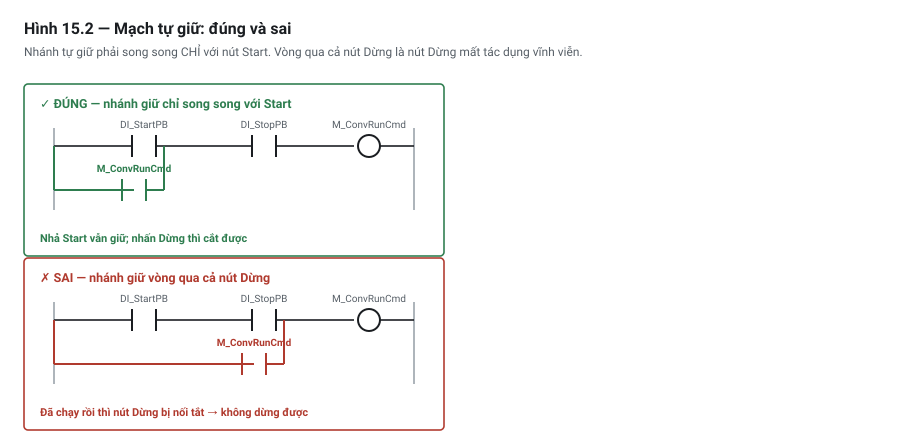

# Chương 15 — Ladder Diagram: nền tảng

> **Lát cắt máy mẫu:** 1 — chỉ dùng chuyền, chặn, nâng kẹp, cảm biến board, nút bấm, công tắc áp suất khí, đèn tháp.

---

## 15.1 Bài toán: cỗ máy chạy đúng cho tới lúc đứt một sợi dây

Một trạm chuyền có nút Dừng. Kỹ sư viết logic, chạy thử: nhấn Dừng thì chuyền dừng, nhả ra thì chạy
lại. Nghiệm thu đạt. Máy chạy sản xuất ba tháng không sự cố.

Rồi một sợi dây từ nút Dừng về tủ bị chuột cắn đứt.

Người vận hành nhấn nút Dừng. **Chuyền vẫn chạy.**

Không có lệnh nào sai. Chương trình y nguyên như lúc nghiệm thu. Cái sai nằm ở một chỗ mà rất nhiều
người viết PLC không bao giờ nghĩ tới: **tổ hợp giữa loại tiếp điểm vật lý ngoài kia và loại lệnh
trong code**. Có bốn tổ hợp. Chỉ **một** tổ hợp vừa đúng logic vừa an toàn khi đứt dây.

Chương này dạy ngôn ngữ Ladder Diagram, và trọng tâm của nó là dứt điểm bốn tổ hợp đó.

---

## 15.2 Ladder hoạt động thế nào

**Ladder Diagram (LD)** — sơ đồ hình thang — là ngôn ngữ lập trình PLC phổ biến nhất thế giới. Nó được
thiết kế để **trông giống sơ đồ mạch rơ-le**, vì thế hệ PLC đầu tiên ra đời để thay thế đúng những tủ
rơ-le đó, và người phải đọc chương trình là thợ điện chứ không phải lập trình viên.

### Giải phẫu một nấc thang

```text
   ray trái                                              ray phải
      │                                                     │
      │   DI_StartPB      DI_StopPB                          │
      ├────┤ ├──────────────┤ ├───────────────( DO_ConvRun )─┤
      │                                                     │
      │  ← ─── điều kiện ─── →              ← kết quả →      │
```

- **Hai ray dọc** — bên trái là "nguồn", bên phải là "đích". Đây là hình ảnh vay mượn từ sơ đồ rơ-le.
- **Nấc thang** *(rung)* — một dòng ngang. Mỗi nấc là một câu lệnh hoàn chỉnh.
- **Tiếp điểm** *(contact)* `┤ ├` — điều kiện, nằm bên trái.
- **Cuộn dây** *(coil)* `( )` — kết quả, nằm bên phải.

Đọc nấc thang trên: "nếu `DI_StartPB` **và** `DI_StopPB` cùng thoả thì bật `DO_ConvRun`".

### Dòng năng lượng

Cách hình dung: có một "dòng" chảy từ ray trái sang ray phải. Tiếp điểm nào thoả điều kiện thì cho
dòng đi qua; không thoả thì chặn. Dòng tới được cuộn dây thì cuộn dây bật.

Từ đó ra hai cách ghép cơ bản:

```text
NỐI TIẾP = AND                          SONG SONG = OR
                                        
  ──┤ ├───┤ ├───( )──                     ──┬─┤ ├─┬──( )──
     A     B                                │      │
                                            └─┤ ├─┘
  bật khi A VÀ B                               B
                                            bật khi A HOẶC B
```

Ghép lồng nhau thì diễn đạt được mọi biểu thức logic. Chương 24 nói kỹ về đại số Boolean và cách rút
gọn; ở đây chỉ cần nhớ: **nối tiếp là AND, song song là OR**.

### ⚠ Nhưng đây **không phải** là điện

Đây là điểm quan trọng nhất của mục này, và là chỗ hình ảnh "giống sơ đồ rơ-le" phản chủ.

Trong một tủ rơ-le thật, **mọi thứ xảy ra đồng thời**. Cấp điện vào là toàn bộ mạch phản ứng cùng lúc,
theo vật lý.

Trong PLC, **không có dòng điện nào cả**. CPU đọc từng nấc thang, tính giá trị đúng/sai, ghi kết quả,
rồi sang nấc tiếp theo — **tuần tự, từ trên xuống dưới, trong mỗi vòng quét** *(scan cycle)*. Hình ảnh
"dòng chảy" chỉ là ẩn dụ để dễ đọc.

Hệ quả trực tiếp:

| Tủ rơ-le thật | Chương trình ladder |
|---|---|
| Mọi mạch phản ứng đồng thời | Từng nấc thang chạy lần lượt, có trước có sau |
| Thứ tự vẽ trên bản vẽ không ảnh hưởng | **Thứ tự nấc thang là một phần của logic** |
| Hai cuộn dây cùng tên là hai cuộn dây thật, mắc song song | Hai cuộn dây cùng tên: cái sau đè cái trước (mục 15.4) |
| Tiếp điểm phản ánh trạng thái rơ-le ngay lúc đó | Tiếp điểm đọc **ảnh ngõ vào** đã chụp từ đầu vòng quét |

Nếu chỗ này còn mờ, quay lại Chương 10 trước khi đi tiếp. Ladder chỉ hiểu đúng được khi đã có mô hình
vòng quét trong đầu.

> ⚡ **LƯU Ý — dành riêng cho lộ trình B (thợ điện đi lên)**
> Bạn đọc ladder được ngay từ ngày đầu, và đó là lợi thế thật. Cái bẫy là bạn sẽ có xu hướng **viết
> chương trình như đi dây một tủ rơ-le**: cần thêm chức năng thì chồng thêm một nhánh. Cách đó chạy
> được với máy nhỏ và sụp đổ với máy vừa. Chương 25 chữa thói quen này bằng mô hình trạng thái.

### Hai lệnh tiếp điểm — và cái tên gây hại

Ladder có hai lệnh tiếp điểm cơ bản:

| Ký hiệu | Cách gọi phổ biến | **Thực chất nó làm gì** |
|---|---|---|
| `┤ ├` | "tiếp điểm thường mở", NO | **Cho dòng qua khi bit = 1** |
| `┤/├` | "tiếp điểm thường đóng", NC | **Cho dòng qua khi bit = 0** |

> 🔍 **BẪY — cái tên "thường mở / thường đóng" chính là nguồn gốc của mọi hiểu nhầm**
>
> Hai lệnh này **không mở, không đóng gì cả**. Chúng chỉ *kiểm tra một bit trong bộ nhớ*. Cột thứ ba
> trong bảng trên là định nghĩa đúng duy nhất — hãy nhớ cột đó, quên hai cột đầu đi.
>
> Một số hãng đặt tên theo đúng bản chất — đại ý "kiểm tra xem bit có đang bật không" và "kiểm tra xem
> bit có đang tắt không". Tên đó chính xác hơn nhiều. Nhưng ký hiệu vẽ thì ở đâu cũng như nhau, và cái
> tên "NO/NC" thì bám dai dẳng.

Vì sao cái tên này gây hại: **ngoài hiện trường cũng có tiếp điểm NO và NC** — trên nút bấm, trên cảm
biến, trên công tắc an toàn. Hai thứ trùng tên nhưng ở hai thế giới khác nhau, và người mới ghép chúng
lại thành một. Đó là toàn bộ nội dung mục tiếp theo.

---

## 15.3 Bốn tổ hợp — bảng phải thuộc

### Chuẩn bị: "trạng thái NORMAL" nghĩa là gì

Với một thiết bị ngoài hiện trường, **"normal" là lúc không có kích thích** — nút chưa ai nhấn, cảm
biến chưa thấy vật, công tắc cửa với cửa đang đóng bình thường.

- **Tiếp điểm NO vật lý**: lúc bình thường **hở** → không có dòng → **bit ngõ vào = 0**
- **Tiếp điểm NC vật lý**: lúc bình thường **kín** → có dòng → **bit ngõ vào = 1**

Và điều quyết định tất cả:

> **Đứt dây trông giống hệt "hở tiếp điểm".** Cả hai đều làm bit = 0. PLC **không có cách nào phân biệt**.

Chính chỗ này quyết định tổ hợp nào an toàn.

### Bảng 4 tổ hợp

Bài toán: một nút **Dừng**. Ta cần tín hiệu nội bộ `M_RunAllowed` = 1 khi **không** ai nhấn Dừng.

| # | Nút vật lý | Lệnh trong code | Bình thường | Khi nhấn Dừng | **Khi đứt dây** | Kết luận |
|:-:|---|---|---|---|---|---|
| 1 | **NO** | `┤ ├` | bit 0 → chặn → **không cho chạy** | bit 1 → cho chạy | bit 0 → không chạy | ❌ Logic **ngược** — phải giữ nút Dừng thì máy mới chạy |
| 2 | **NO** | `┤/├` | bit 0 → thông → cho chạy ✓ | bit 1 → chặn → dừng ✓ | bit 0 → **thông → VẪN CHẠY** | ⚠⚠ **Logic đúng nhưng NGUY HIỂM** |
| 3 | **NC** | `┤ ├` | bit 1 → thông → cho chạy ✓ | bit 0 → chặn → dừng ✓ | bit 0 → **chặn → dừng** ✓ | ✅ **ĐÚNG — dùng cái này** |
| 4 | **NC** | `┤/├` | bit 1 → chặn → không cho chạy | bit 0 → cho chạy | bit 0 → cho chạy | ❌ Vừa ngược vừa nguy hiểm |

**Tổ hợp 3 là đáp án**: nút vật lý NC, trong code dùng `┤ ├`.

### Vì sao tổ hợp 2 là tổ hợp giết người

Tổ hợp 2 **chạy đúng trong mọi lần thử nghiệm**. Nhấn thì dừng, nhả thì chạy. Nghiệm thu đạt. Nó chỉ
lộ ra vào đúng ngày sợi dây đứt — và lộ ra bằng cách **máy tiếp tục chạy khi người vận hành đang cố
dừng nó**.

Đây chính là cỗ máy ở mục 15.1.

Còn tổ hợp 3, cùng tình huống đứt dây, thì **máy dừng**. Người vận hành thấy máy dừng bất thường, gọi
bảo trì, sợi dây được nối lại. Không ai bị gì.

Nguyên tắc đằng sau có tên riêng: **thiết kế hướng an toàn khi hỏng** *(fail-safe)* — hỏng hóc phải dẫn
tới trạng thái an toàn, chứ không phải trạng thái nguy hiểm. Chương 48 khai triển đầy đủ.

> ⚠ **NGUY HIỂM**
> Quy tắc rút gọn, áp dụng cho **mọi** tín hiệu mà mất nó là phải dừng máy — nút Dừng, công tắc cửa
> bảo vệ, công tắc áp suất, phản hồi mạch an toàn:
>
> **Tiếp điểm vật lý phải là NC. Trong code dùng `┤ ├`.**
>
> Và với **dừng khẩn cấp** *(E-Stop)* thì còn một tầng nữa: nó **không được chỉ dựa vào logic PLC**,
> bất kể bạn dùng tổ hợp nào. Lý do: CPU treo thì logic chết theo, còn mối nguy thì không. Chương 47.

### ⭐⭐ Vậy tại sao ngoài thực tế lại đầy tổ hợp 2?

⚠ Bạn sẽ đi một vòng nhà máy và thấy **rất nhiều** nút Dừng đấu NO, trong code dùng `┤/├` — đúng tổ
hợp vừa bị gọi là tổ hợp giết người. ⭐ Chuyện đó là thật, và nếu không biết **vì sao**, bạn sẽ nghĩ
hoặc là sách sai, hoặc là cả ngành sai. ⚡ Không cái nào đúng cả: **lý do có thật, nhưng phần lớn
không phải lý do kỹ thuật**.

| # | Lý do thật sự | ⭐ Nó có chính đáng không |
|:-:|---|---|
| 1 | **Khối tiếp điểm trong ngăn kéo là NO** — nút nhấn bán ra thường kèm sẵn khối NO; khối NC phải đặt thêm | ⚠ Ràng buộc **có thật**, nhưng giá một khối tiếp điểm là **không đáng kể** so với hậu quả |
| 2 | ⭐ **Chép từ cỗ máy trước** | ⚡ Đây là **lý do mạnh nhất trong thực tế**, và nó không phải quyết định — nó là **quán tính** |
| 3 | **Học trên mô phỏng và trên màn hình cảm ứng** — nút vẽ trên màn hình vốn dĩ là "nhấn thì lên 1" | ⭐ Giải thích được, nhưng ⚠ nút trên màn hình **không có sợi dây để đứt**; nút vật lý thì có |
| 4 | *"Để mọi ngõ vào bằng 0 lúc nghỉ cho dễ nhìn"* trên màn theo dõi | ❌ **Nguỵ biện.** Ngõ vào NC nằm ở 1 lúc nghỉ là **đúng như thiết kế**, không phải "dính" |
| 5 | *"Ngõ vào NC lúc nào cũng có dòng, tốn điện và mòn tiếp điểm"* | ❌ **Sai về lượng.** Dòng một ngõ vào cỡ vài mA; và tiếp điểm mòn vì **đóng cắt**, không vì nằm yên ở trạng thái kín |
| 6 | ⭐ *"Dừng khẩn cấp đã là mạch cứng rồi — nút Dừng này chỉ là lệnh vận hành"* | ⭐⭐ **Đây là lý do DUY NHẤT có lập luận.** Nhưng nó có một cái bẫy, xem ngay dưới |

> ⭐⭐ **Lý do 6 đúng một nửa, và nửa sai là nửa nguy hiểm.**
>
> ⭐ Đúng ở chỗ: nếu **dừng khẩn cấp** là mạch cứng riêng (Chương 47), thì nút Dừng trên bảng điều
> khiển **không phải chức năng an toàn** theo nghĩa kỹ thuật — hỏng nó là mất sản lượng, không phải
> mất an toàn.
>
> ⚠⚠ **Sai ở chỗ: người vận hành không biết sự phân biệt đó.** Với họ, nút đỏ ghi "DỪNG" là thứ
> dừng được máy. ⚡ Dây đứt → họ nhấn → **không có gì xảy ra** → và phản xạ tiếp theo của một người
> đang vội thường là **thò tay vào máy** để gỡ cái đang kẹt.
>
> ⭐ Nghĩa là: chức năng **được định mức** của cái nút không phải là an toàn, nhưng chức năng **được
> người dùng tin tưởng** thì có. ⚠ Và tai nạn xảy ra theo cái người ta tin, không theo cái ghi trong
> hồ sơ.

### ⭐ Hai cách sửa, và cả hai đều rẻ

| Cách | Làm gì | Được gì |
|---|---|---|
| ⭐ **Tối thiểu** | Lắp **khối tiếp điểm NC** và đấu nó vào PLC — phần lớn nút nhấn công nghiệp nhận **hai khối** | Về đúng tổ hợp 3. Chi phí: một khối tiếp điểm |
| ⭐⭐ **Tốt hơn** | Đấu **cả hai khối** NO và NC vào **hai ngõ vào**, rồi kiểm trong chương trình: hai bit phải **luôn ngược nhau** | ⚡ Phát hiện được **đứt dây** và **khối tiếp điểm hỏng** — thứ mà tổ hợp 3 một mình không phát hiện được |

⭐ Hai khối tiếp điểm của **cùng một nút** đi vào **hai ngõ vào riêng**; gọi tạm là *kênh NC* và
*kênh NO*. Bình thường chúng luôn ngược nhau — nên **giống nhau là có chuyện**:

```text
    kênh NC        kênh NO                                     M_StopFault
 ──────┤ ├───────────┤ ├────────────────────────────────────────────( )───    ⚠ cùng 1: hỏng

    kênh NC        kênh NO                                     M_StopFault
 ──────┤/├──────────┤/├─────────────────────────────────────────────( )───    ⚠ cùng 0: đứt dây
```

> ⭐ **Ý tưởng này không mới — nó chính là cách giám sát cặp tiếp điểm ngược chiều mà thiết bị an
> toàn vẫn dùng** (Chương 47 mục 47.5). ⚡ Điểm đáng nói là bạn **dùng lại được ý tưởng đó cho một
> nút thường**, bằng hai ngõ vào và hai nấc thang, **không cần thiết bị an toàn nào**.
>
> ⚠ Nhưng nói cho rõ: làm vậy **không biến nút đó thành chức năng an toàn**. Nó chỉ cho bạn **biết
> khi nó hỏng** — và với một nút mà người vận hành tin tưởng, biết khi nó hỏng đã là rất nhiều.

> ⭐⭐ **Gặp tổ hợp 2 trên máy người khác thì làm gì?**
>
> ⚡ Không phải cứ thấy là phải sửa ngay — sửa một nút trên máy đang chạy sản xuất là một thay đổi
> có quy trình (Chương 53). ⭐ Nhưng **phải ghi nó lại**: vào hồ sơ bàn giao, vào bảng I/O (cột ghi
> chú), và nói với người vận hành.
>
> ⚠⚠ **Lý do phải ghi: người sau bạn sẽ mặc định là NC.** Họ đọc `DI_StopPB` trong code, thấy
> `┤/├`, và có thể "sửa lại cho đúng sách" thành `┤ ├` — ⭐ lúc đó máy **không chạy được nữa**, hoặc
> tệ hơn, họ đổi luôn cả đấu dây mà chỉ đổi một nửa.

### ⚠⚠ Giới hạn của chính bảng này — tổ hợp 3 chống được hỏng kiểu HỞ, không chống hỏng kiểu CHẬP

Cả bảng 4 tổ hợp được xây trên **một** kiểu hỏng: ⭐ **mạch bị HỞ** — đứt dây, tuột đầu cốt, tiếp
điểm mòn không đóng. Với kiểu hỏng đó, tổ hợp 3 đúng là an toàn.

⚠ Nhưng mạch điện có **kiểu hỏng thứ hai, ngược lại**:

| Kiểu hỏng | Ví dụ | Bit ngõ vào | Tổ hợp 3 xử lý được không |
|---|---|---|---|
| ⭐ **HỞ** | Đứt dây · tuột cốt · tiếp điểm không đóng | → **0** | ✅ **Có** — máy dừng |
| ⚠⚠ **CHẬP** | Hai dây chạm nhau · chập sang 24 V · ⭐ **tiếp điểm hàn dính** (Chương 3, mục 3.5) | → **1** *(kẹt ở mức "bình thường")* | ❌ **KHÔNG** — PLC thấy *"chưa ai nhấn Dừng"* mãi mãi |

> ⚠⚠ **NGUY HIỂM — đây là lý do bảng này KHÔNG đủ cho chức năng an toàn.**
>
> Với tổ hợp 3, một chỗ **chập** làm bit kẹt ở 1. Nút Dừng bấm xuống mà bit **không đổi** — và PLC
> ⚠ **không có cách nào biết**, đúng như nó không phân biệt được đứt dây với hở tiếp điểm.
>
> ⭐⭐ **Bảng 4 tổ hợp là điều kiện CẦN, không phải điều kiện ĐỦ.** Nó là cách đúng để đấu và viết
> logic cho tín hiệu dừng thông thường. ⚠ Nhưng với **chức năng an toàn** thì phải có thêm những thứ
> mà một nấc thang không làm được:
>
> | Cơ chế | Chống được gì | Ở đâu |
> |---|---|---|
> | **Hai kênh** và kiểm chéo | Hỏng một kênh | Chương 47 |
> | ⭐ **Xung kiểm tra trên ngõ ra OSSD** | ⭐ **Chập sang 24 V và chập chéo** | Chương 47, mục 47.7 |
> | ⭐ **Tiếp điểm dẫn động cưỡng bức** | ⭐ **Tiếp điểm hàn dính** — làm hỏng hóc trở nên phát hiện được | Chương 3, mục 3.5 |
>
> ⭐ Nói cách khác: mọi cơ chế an toàn ở Chương 47 tồn tại **chính vì** bảng 4 tổ hợp chỉ giải quyết
> được một nửa bài toán.

### Kiểm tra nhanh khi bạn không chắc

Ba câu hỏi, theo thứ tự:

1. **Thiết bị này mất tín hiệu thì máy nên làm gì?** Nếu câu trả lời là "phải dừng" → tiếp điểm vật lý
   NC, code dùng `┤ ├`.
2. **Cầm đồng hồ đo, ở trạng thái bình thường bit này bằng mấy?** Đo thật, đừng suy đoán từ tên gọi
   trên nhãn.
3. **Rút dây ra và thử.** Đây là phép thử duy nhất chứng minh được, và nó nằm trong danh mục thử tạo
   lỗi cố ý ở Chương 52.
4. ⚠ **Và hỏi thêm: nếu tín hiệu này bị *kẹt ở mức bình thường* thì sao?** Nếu câu trả lời là *"máy
   sẽ không dừng"* → ⭐ **đây là chức năng an toàn**, và nấc thang không đủ (Chương 47).

> 💡 **MẸO**
> Cảm biến quang, cảm biến tiệm cận thường có cả hai kiểu ngõ ra hoặc chọn được bằng cách đấu dây. Khi
> mua sắm, hãy **chọn kiểu đầu ra theo bảng 4 tổ hợp**, đừng để tới lúc đấu dây mới phát hiện mình có
> loại sai. Chương 4 nói chi tiết về các kiểu ngõ ra cảm biến.

---

## 15.4 Trên máy mẫu DP-01

Mạch cho phép chuyền chạy — dùng đúng lát cắt 1.

### Nấc 1 — mạch tự giữ Start/Stop

```text
   DI_StartPB      DI_StopPB      DI_AirOK                        M_ConvRunCmd
 ┌───┤ ├──────┬──────┤ ├────────────┤ ├──────────────────────────────( )───┐
 │            │
 │ M_ConvRunCmd
 └───┤ ├──────┘
```

Đọc: "(nhấn Start **hoặc** đã đang chạy) **và** Dừng chưa nhấn **và** khí đủ → cho phép chạy".

Nhánh song song chứa chính `M_ConvRunCmd` là **mạch tự giữ** *(seal-in / latch)*: nhả nút Start ra thì
nhánh dưới vẫn giữ cho nấc thang thông. Đây là mẫu logic phổ biến nhất trong toàn ngành điều khiển,
và nó là bản sao trực tiếp của mạch tự giữ dựng bằng rơ-le ở Chương 3.

Chú ý ba tiếp điểm đều dùng `┤ ├`:

| Tag | Tiếp điểm vật lý | Vì sao `┤ ├` |
|---|---|---|
| `DI_StartPB` | **NO** | Nút Start — mất tín hiệu thì máy **không** khởi động. Đó là hành vi an toàn. |
| `DI_StopPB` | **NC** | Tổ hợp 3. Đứt dây → dừng. |
| `DI_AirOK` | **NO** *(công tắc áp suất, kín khi đủ khí)* | Đủ khí thì bit = 1. Mất khí **hoặc** đứt dây → bit = 0 → dừng. Fail-safe. |

> ⚡ **LƯU Ý**
> `DI_AirOK` là ví dụ tốt cho thấy đừng máy móc "cứ là NC". Với công tắc áp suất, tiếp điểm **kín khi
> đủ áp** — về mặt danh mục nó là NO, nhưng về mặt fail-safe nó hành xử đúng như ta cần, vì cả "hết
> khí" lẫn "đứt dây" đều cho bit = 0. **Tiêu chí luôn là câu hỏi 1 ở mục 15.3, không phải cái nhãn.**

### Nấc 2 — chuyền chỉ chạy khi trạm 1 còn trống

```text
   M_ConvRunCmd   DI_BoardStn1                                    DO_ConvRun
 ────┤ ├─────────────┤/├──────────────────────────────────────────────( )───
```

`DI_BoardStn1` là cảm biến quang thu-phát, có board thì bit = 1. Ở đây dùng `┤/├` để diễn đạt "**chưa**
có board tại trạm 1".

Đây là chỗ dùng `┤/├` hoàn toàn chính đáng: tín hiệu này **không phải** tín hiệu an toàn. Nếu cảm biến
board đứt dây, bit = 0, chuyền tưởng trạm trống nên vẫn chạy — hậu quả là board đâm vào chặn, hỏng
board. Khó chịu, nhưng không nguy hiểm cho người.

> 💡 **MẸO**
> Phân biệt hai loại tín hiệu ngay từ khi lập bảng I/O: **tín hiệu an toàn** (mất là phải dừng, bắt
> buộc fail-safe theo tổ hợp 3) và **tín hiệu quy trình** (mất thì sai sản phẩm, xử lý bằng timeout và
> báo động). Chương 23 đưa việc phân loại này vào biểu mẫu đặc tả.

### Nấc 3 — nâng chặn

```text
   DI_BoardStn1                                                    DO_Stop1Vlv
 ────┤ ├──────────────────────────────────────────────────────────────( )───
```

### ⭐ Ghép ba nấc — một chương trình LD hoàn chỉnh

Một POU viết bằng LD có hai phần: **phần khai báo** — viết bằng chữ, giống hệt ST — và **thân** là các
nấc thang. Khối đầu là phần khai báo, chép được nguyên văn; khối sau là thân, vẽ lại trong trình soạn
thảo ladder của bạn đúng từng tiếp điểm.

```iecst
// ✔ VÍ DỤ HOÀN CHỈNH — chương trình LD của DP-01 ở lát cắt 1: phần khai báo; sơ đồ ở khối kế tiếp
VAR_GLOBAL
    DI_StartPB   : BOOL;                 // nút Start — NO
    DI_StopPB    : BOOL;                 // nút Stop — NC, bình thường bằng 1
    DI_AirOK     : BOOL;                 // công tắc áp suất — kín khi đủ khí
    DI_BoardStn1 : BOOL;                 // cảm biến board ở trạm 1
    DO_ConvRun   : BOOL;                 // cho phép chuyền chạy
    DO_Stop1Vlv  : BOOL;                 // van chặn trạm 1
END_VAR

PROGRAM Prg_ConvLd                       // thân POU là ba nấc thang ở khối kế tiếp
VAR_EXTERNAL
    DI_StartPB, DI_StopPB, DI_AirOK, DI_BoardStn1 : BOOL;
    DO_ConvRun, DO_Stop1Vlv                       : BOOL;
END_VAR
VAR
    M_ConvRunCmd : BOOL;                 // lệnh chạy đã tự giữ — CHỈ nấc 1 ghi
END_VAR
END_PROGRAM
```

```text
 Nấc 1 — tự giữ: (Start HOẶC đã chạy) VÀ Stop chưa nhấn VÀ đủ khí
   DI_StartPB      DI_StopPB      DI_AirOK                        M_ConvRunCmd
 ┌───┤ ├──────┬──────┤ ├────────────┤ ├──────────────────────────────( )───┐
 │            │
 │ M_ConvRunCmd
 └───┤ ├──────┘

 Nấc 2 — chuyền chỉ chạy khi trạm 1 còn trống
   M_ConvRunCmd   DI_BoardStn1                                    DO_ConvRun
 ────┤ ├─────────────┤/├──────────────────────────────────────────────( )───

 Nấc 3 — có board ở trạm 1 thì nâng chặn
   DI_BoardStn1                                                    DO_Stop1Vlv
 ────┤ ├──────────────────────────────────────────────────────────────( )───
```

> ⭐ **Mỗi ngõ ra một nấc, mỗi cờ một nấc** — `M_ConvRunCmd` chỉ nấc 1 ghi, `DO_ConvRun` chỉ nấc 2,
> `DO_Stop1Vlv` chỉ nấc 3 (Bẫy 1). Bộ kiểm mã của sách soát mọi tên trong sơ đồ này đều đã được khai ở
> khối trên — thiếu một dòng khai báo là không biên dịch được.

---

## 15.4b ⚠⚠ Vùng điều khiển `MCR` — và một cái tên nguy hiểm

Có một nhóm lệnh ladder mà mọi hệ đều có, sách chưa nhắc, và nó mang **một cái tên gây hiểu nhầm
chết người**: **lệnh điều khiển vùng**, thường viết là `MCR` hoặc `MC` / `MCR`.

### Nó làm gì

Hai lệnh đặt thành **một cặp**, kẹp lấy một nhóm nấc thang. Khi điều kiện của lệnh mở **sai**, toàn
bộ nhóm nấc bên trong **bị vô hiệu**:

```text
      M_ZoneEnable
   ──────┤ ├──────────────────────────( MCR bắt đầu vùng )──

        ⋮   các nấc thang bên trong vùng
        ⋮   — chỉ chạy khi M_ZoneEnable = 1

   ────────────────────────────────────( MCR kết thúc vùng )──
```

⭐ Công dụng thật của nó: **tắt nhanh một mảng lớn logic** — ví dụ cả cụm logic của một trạm đang bị
bỏ qua (Chương 51 mục 51.7b), mà không phải thêm một tiếp điểm vào từng nấc.

### ⚠⚠ Cái tên — đây mới là phần phải nhớ

`MCR` là viết tắt của **Master Control Relay**. Và trong nghề, **cùng cụm từ đó** còn chỉ một thứ
hoàn toàn khác:

| | ⭐ **Lệnh `MCR` trong chương trình** | ⚠⚠ **Mạch "master control relay" bằng PHẦN CỨNG** |
|---|---|---|
| Là cái gì | Một lệnh ladder | ⭐ Một **mạch điện thật** cắt nguồn cấp cho ngõ ra |
| Cắt cái gì | ⚠ **Không cắt gì cả** — chỉ làm logic bên trong vùng ngừng chạy | ⭐ **Cắt năng lượng** tới các cơ cấu |
| Có tác dụng khi CPU treo | ⚠⚠ **Không** — nó *là* phần mềm | ⭐ **Có** — nó không phụ thuộc CPU |
| Dùng cho an toàn được không | ⚠⚠ **TUYỆT ĐỐI KHÔNG** | Là một phần của thiết kế an toàn (Chương 47) |

> ⚠⚠ **Hai thứ trùng tên, ngược nhau về bản chất, và một trong hai liên quan tới tính mạng.**
>
> ⭐ Nhầm lẫn kinh điển: *"trạm này đã nằm trong vùng `MCR` rồi nên nó an toàn"*. ⚠⚠ **Sai.** Lệnh
> `MCR` chạy trong cùng CPU với phần còn lại của chương trình — ⭐ **CPU treo thì nó treo theo**, và
> các ngõ ra giữ nguyên trạng thái lúc đó.
>
> ⚡ Cách tự kiểm vẫn là câu hỏi ở Chương 27 mục 27.3b: *"nếu CPU treo đúng lúc này, ai bị thương?"*

### ⚠ Ba điều lệnh `MCR` không làm như người ta tưởng

| # | Tưởng là | Thực tế |
|---|---|---|
| 1 | *"Ngõ ra trong vùng bị tắt khi vùng tắt"* | ⚠ **Tuỳ hệ và tuỳ loại lệnh trong vùng.** Cuộn dây thường về 0, nhưng ⭐ **cuộn dây chốt (SET/RESET) thường GIỮ NGUYÊN** — Chương 16 |
| 2 | *"Timer trong vùng dừng đếm"* | ⚠ Hành vi **khác nhau giữa các hãng**. Có hệ timer bị đặt lại, có hệ giữ giá trị — ⭐ **phải tra, không được đoán** (Chương 17) |
| 3 | *"Vùng lồng nhau thì như ngoặc"* | ⚠ Có hệ cho lồng, có hệ không, và **số cấp lồng tối đa khác nhau**. ⭐ Vùng không đóng đúng cặp là lỗi rất khó tìm |

> ⭐⭐ **Lời khuyên thực dụng: dùng `MCR` ít thôi, và không bao giờ cho thứ gì quan trọng.**
>
> Nó tiện đúng một việc: **tắt cả một mảng logic phụ trợ**. ⚠ Nhưng nó làm cho việc đọc chương trình
> khó hẳn lên — một nấc thang trông hoàn toàn bình thường có thể **không bao giờ chạy**, và lý do
> nằm ở một dòng cách đó hai trang. ⚡ Đây cùng họ vấn đề với lệnh nhảy (Chương 27 mục 27.2b).
>
> ⭐ Thay thế rõ ràng hơn trong phần lớn trường hợp: **đưa cờ cho phép vào chuỗi điều kiện của từng
> ngõ ra**, đúng cách làm ở Phụ lục L.2. Dài hơn vài ký tự, nhưng ⭐ **đọc một nấc là biết nấc đó có
> chạy hay không**.

---

## 15.5 Bẫy thường gặp

### 🔍 BẪY 1 — Cuộn dây trùng

**Hai nấc thang cùng ghi vào một ngõ ra.**

```text
Nấc 10:   M_ConvRunCmd   ────┤ ├────────────────────( DO_ConvRun )

   … 200 nấc thang ở giữa …

Nấc 210:  M_MaintMode    ────┤/├────────────────────( DO_ConvRun )
```

Người viết nấc 210 nghĩ mình đang thêm điều kiện "không chạy khi ở chế độ bảo trì". Thực tế:

**Nấc 210 chạy sau, nên nó thắng — mọi vòng quét.** Nấc 10 coi như không tồn tại. Chuyền giờ chạy bất
cứ khi nào **không** ở chế độ bảo trì, kể cả khi chưa ai nhấn Start.

Nguyên nhân gốc nằm ở Chương 10: cả hai nấc đều ghi vào **ảnh ngõ ra**, và chỉ giá trị cuối cùng mới
được đẩy ra module ở giai đoạn 3.

**Triệu chứng nhận biết:** một điều kiện bạn vừa thêm "có vẻ không tác dụng"; hoặc một ngõ ra nhấp nháy
không giải thích được (khi hai nấc trùng nằm trong hai nhánh chương trình chạy luân phiên).

**Cách sửa** — gộp mọi điều kiện vào **một** nấc duy nhất:

```text
   M_ConvRunCmd   M_MaintMode                                      DO_ConvRun
 ────┤ ├─────────────┤/├───────────────────────────────────────────────( )───
```

**Cách phòng:** quy tắc **mỗi ngõ ra chỉ được ghi ở đúng một nơi**. Trước khi thêm điều kiện cho một
ngõ ra, dùng công cụ tham chiếu chéo *(cross-reference)* để tìm mọi chỗ đang ghi vào nó — Chương 22
hướng dẫn.

> ⚡ **LƯU Ý**
> Nhiều trình biên dịch **cảnh báo** cuộn dây trùng, nhưng mức độ khác nhau: có hãng báo lỗi chặn biên
> dịch, có hãng chỉ cảnh báo, có hãng im lặng. **Đừng trông chờ vào công cụ.** Trong một số kiến trúc
> chương trình nâng cao, ghi cùng một tag từ nhiều nơi là hợp lệ có chủ ý — nên công cụ không thể tự
> quyết được thay bạn.

### 🔍 BẪY 2 — Đọc "NC" trên nhãn rồi suy ra lệnh trong code

Người mới nhìn nhãn nút bấm ghi "NC", nghĩ "vậy trong code cũng dùng tiếp điểm NC `┤/├` cho khớp".
**Đúng bốn tổ hợp thì đó là tổ hợp 4** — vừa ngược logic vừa nguy hiểm.

Hai chữ "NC" ở hai chỗ **không liên quan tới nhau**. Ngoài hiện trường, NC mô tả trạng thái cơ khí lúc
nghỉ. Trong code, `┤/├` mô tả "cho dòng qua khi bit = 0". Không có luật nào bắt chúng phải khớp.

**Cách chữa dứt điểm:** đừng suy luận từ nhãn. Đi qua ba câu hỏi ở mục 15.3.

### 🔍 BẪY 3 — Quên nhánh tự giữ

```text
   DI_StartPB    DI_StopPB                                       M_ConvRunCmd
 ────┤ ├───────────┤ ├────────────────────────────────────────────────( )───
```

Thiếu nhánh song song. Máy chạy **đúng lúc đang giữ nút Start**, nhả ra là dừng.

Triệu chứng dễ nhận. Nhưng có biến thể khó hơn: nhánh tự giữ mắc **sai vị trí** — vòng qua cả tiếp
điểm `DI_StopPB`:

```text
 ┌───┤ ├──────┬──────┤ ├────────────────────────────────( M_ConvRunCmd )───┐
 │ DI_StartPB │   DI_StopPB
 │            │
 │ M_ConvRunCmd
 └────────────┴──── ✗ SAI: nhánh giữ vòng qua cả nút Dừng
```



*Hình 15.2 — Hai cách mắc nhánh tự giữ. Khác nhau đúng một điểm nối, hậu quả khác nhau hoàn toàn.*

Ở dạng sai này, một khi đã chạy thì **nút Dừng mất tác dụng vĩnh viễn**. Nhánh tự giữ phải song song
**chỉ với nút Start**, và mọi điều kiện dừng phải nằm **ngoài** vòng giữ đó — như nấc 1 ở mục 15.4.

### 🔍 BẪY 4 — Quên rằng thứ tự nấc thang là logic

Đã nói ở Chương 10, nhắc lại vì nó biểu hiện rõ nhất trong ladder: nếu nấc 20 ghi một bit mà nấc 5 đọc,
thì **nấc 5 đọc giá trị của vòng quét trước**. Với chuỗi dài, độ trễ cộng dồn từng vòng quét một.

Quy tắc thực dụng: **sắp xếp nấc thang theo dòng chảy dữ liệu** — tính điều kiện trước, dùng kết quả
sau. Chương 30 đưa nguyên tắc này vào quy ước cấu trúc chương trình.

### 🔍 BẪY 5 — Nhồi quá nhiều vào một nấc thang

Ladder cho phép nấc thang rộng và lồng nhiều tầng. Điều đó **không** có nghĩa là nên làm.

Một nấc thang với mười hai tiếp điểm và bốn nhánh lồng nhau thì **không ai gỡ lỗi được** — kể cả bạn,
sáu tháng sau. Khi máy hỏng lúc hai giờ sáng, thứ bạn cần là nhìn một nấc thang và biết ngay điều kiện
nào đang chặn.

Cách làm tốt hơn: tách điều kiện phức tạp thành **các bit trung gian có tên nói lên ý nghĩa**.

```text
// Thay vì một nấc thang khổng lồ:
   M_ConvPermissive  M_Stn1Clear  M_NoFault                        DO_ConvRun
 ────────┤ ├──────────────┤ ├─────────┤/├───────────────────────────────( )───
```

Ba bit trung gian được tính ở ba nấc riêng phía trên. Khi máy không chạy, bạn nhìn ba bit đó là biết
ngay cái nào sai — thay vì dò mười hai tiếp điểm.

> 💡 **MẸO**
> Đây là ứng dụng trực tiếp của kỹ thuật "chia đôi bài toán" ở Chương 51. Bạn đang **thiết kế sẵn các
> điểm đo** cho chính mình trong tương lai.

---

## 15.6 Khác biệt giữa các hãng

Ladder là ngôn ngữ trong chuẩn IEC 61131-3, nên **khái niệm giống nhau ở mọi hệ**: tiếp điểm, cuộn dây,
nối tiếp là AND, song song là OR, chạy từ trên xuống. Chuyển hệ không phải học lại ladder.

Nhưng những chi tiết sau **khác nhau thật** và sẽ làm bạn vấp khi đổi hệ.

### ⭐ Tên hai lệnh tiếp điểm — chỗ gây nhầm nhất

| Hệ | Tiếp điểm "kiểm tra bit = 1" | Tiếp điểm "kiểm tra bit = 0" | Cuộn dây |
|---|---|---|---|
| **Chuẩn IEC / CODESYS** | Tiếp điểm thường mở | Tiếp điểm thường đóng | Cuộn dây |
| **Siemens** | Tiếp điểm thường mở `-\| \|-` | Tiếp điểm thường đóng `-\|/\|-` | Cuộn dây |
| **Mitsubishi** | `LD` / `AND` / `OR` | `LDI` / `ANI` / `ORI` (chữ **I** = *inverse*) | `OUT` |
| ⚠ **Rockwell** | **XIC** — *Examine If Closed* | **XIO** — *Examine If Open* | **OTE** — *Output Energize* |

> ⚠ **Tên của Rockwell là cái tên gây hại nhất trong nghề.**
> `XIC` viết tắt của *Examine If Closed*, nhưng nó **không** hỏi "tiếp điểm ngoài kia có đóng không".
> Nó hỏi **"bit trong bộ nhớ có bằng 1 không"**. Với một nút NC đấu vào ngõ vào, bit bằng 1 khi nút
> **chưa** bị nhấn — nên `XIC` "đúng" trong khi tiếp điểm vật lý đang ở trạng thái nghỉ.
>
> Đây chính xác là nội dung mục 15.2 và là gốc của tổ hợp 2 ở mục 15.3. Người học trên hệ Rockwell
> rồi suy từ tên lệnh ra hành vi vật lý sẽ sai — và sai ở đúng chỗ nguy hiểm nhất.
>
> **Cách chữa duy nhất:** đọc lệnh tiếp điểm là *"bit này bằng 1?"*, không bao giờ đọc là *"tiếp điểm
> này đóng?"*. Quy tắc này đúng ở mọi hệ và miễn nhiễm với tên gọi.

### Các khác biệt còn lại

| Khía cạnh | Khác nhau thế nào |
|---|---|
| **Cảnh báo cuộn dây trùng** | Siemens (TIA Portal), Mitsubishi (GX Works) và Rockwell (Studio 5000) đều phát hiện và cảnh báo bit bị ghi nhiều lần — nhưng **mức độ khác nhau**: có nơi chặn biên dịch, có nơi chỉ ghi vào danh sách cảnh báo mà người ta bỏ qua. Xem Bẫy 1 |
| **Số nhánh song song / độ rộng nấc thang** | Đều có giới hạn, và giới hạn khác nhau theo hệ và theo dòng CPU. Chạm giới hạn thì phải tách nấc — thường cũng là lúc nấc đã quá phức tạp (Bẫy 5) |
| **Cách đặt tên tín hiệu** | Rockwell Logix dùng **tag có tên** là mô hình gốc, không có địa chỉ tuyệt đối kiểu truyền thống. Siemens và Mitsubishi cho dùng **cả hai** — địa chỉ tuyệt đối (`%I0.0`, `X0`) và tag có tên. Chương 11 |
| **Lệnh mở rộng trên nấc thang** | Mỗi hãng một bộ lệnh số học/so sánh/chuyển dữ liệu với tên riêng. Chương 19 nêu tên cụ thể |
| **Cuộn dây có nhớ (SET/RESET)** | Siemens `(S)`/`(R)`; Mitsubishi `SET`/`RST`; Rockwell `OTL`/`OTU`. ⚠ Hành vi khi mất điện: ở hệ IEC phụ thuộc **khai báo biến**, còn `OTL`/`OTU` của Rockwell **tự nó đã giữ được** — Chương 16, mục 16.7 |

Đối chiếu chi tiết năm hệ: **Phụ lục A2**.

> ⚡ **LƯU Ý**
> Bảng 4 tổ hợp ở mục 15.3 **không phụ thuộc hãng**. Nó là hệ quả của vật lý (đứt dây = mất dòng) và
> của định nghĩa hai lệnh tiếp điểm. Học một lần, dùng ở mọi hệ, suốt đời.

---

## 15.7 Bảng chốt

| Câu hỏi | Trả lời |
|---|---|
| ⭐ "Dòng năng lượng" trong ladder là gì | **Ẩn dụ**, không phải điện — nó là **thứ tự đánh giá logic** |
| Hai lệnh tiếp điểm | ⭐ Kiểm bit **bằng 1** · kiểm bit **bằng 0** — ⚠ tên gọi "NO/NC" trong phần mềm gây hại |
| ⭐⭐ Bảng bốn tổ hợp — đáp án | **Tiếp điểm vật lý NC, trong code dùng tiếp điểm kiểm-bằng-1** |
| ⚠⚠ Tổ hợp nguy hiểm nhất | ⭐ **NO + kiểm-bằng-0**: chạy đúng mọi lần thử, hỏng đúng ngày đứt dây |
| ⚠⚠ Giới hạn của bảng 4 tổ hợp | ⭐ Chỉ phủ **hỏng kiểu HỞ** — **không** phủ hỏng kiểu **CHẬP** (mục 15.3) |
| Cuộn dây trùng | ⭐ **Nấc cuối thắng** — và lỗi này im lặng |
| Thứ tự nấc thang | ⚠ **Là logic**, không phải cách sắp xếp cho đẹp |
| Một nấc nên chứa bao nhiêu | ⭐ Đủ để **đọc hiểu trong một lần nhìn** — nhồi nhiều là nợ cho người bảo trì |
| ⭐ Trước khi kết luận về đấu nối | **Đo thật**, đừng suy từ nhãn trên thiết bị |

---

## 15.8 Tự kiểm

1. **Viết lại bảng 4 tổ hợp từ trí nhớ.** Chỉ ra tổ hợp đúng và giải thích vì sao tổ hợp 2 nguy hiểm
   dù nó chạy đúng khi thử nghiệm.
2. Vì sao PLC **không thể** phân biệt "tiếp điểm hở" với "đứt dây"? Sự thật đó dẫn tới quy tắc thiết
   kế nào?
3. Vẽ mạch tự giữ Start/Stop **không nhìn sách**. Rồi chỉ ra: nếu mắc nhánh giữ vòng qua cả nút Dừng
   thì chuyện gì xảy ra.
4. Trong nấc 2 ở mục 15.4, `DI_BoardStn1` dùng `┤/├`. Vì sao ở đây dùng `┤/├` là chính đáng, trong khi
   dùng `┤/├` cho nút Dừng lại nguy hiểm?
5. Một đồng nghiệp thêm điều kiện mới cho `DO_ConvRun` bằng cách viết thêm một nấc thang ở cuối chương
   trình. **Dự đoán hậu quả** và giải thích bằng cơ chế của Chương 10.
6. Giải thích cho một người vừa học ladder: vì sao "ladder giống sơ đồ rơ-le" là câu nói **vừa đúng
   vừa nguy hiểm**.
7. ⚠⚠ Bảng 4 tổ hợp được xây trên **một** kiểu hỏng. Kiểu hỏng đó là gì, và ⭐ **kiểu hỏng nào bảng
    này KHÔNG giải quyết được**? Cho một ví dụ cụ thể.
8. ⭐⭐ Tổ hợp 3 đã đúng, nhưng vì sao nó vẫn **không đủ** cho một chức năng an toàn? Nêu ba cơ chế
    phải có thêm và mỗi cơ chế chống được kiểu hỏng nào.

Câu 1 và câu 4 là hai câu phân loại. Câu 1 phải trả lời được **không cần nghĩ**; câu 4 chứng tỏ bạn
hiểu tiêu chí chứ không thuộc lòng quy tắc.

---

### Chương tiếp theo

**Chương 16 — Latch, Set/Reset & bắt cạnh.** Mạch tự giữ ở chương này giữ trạng thái bằng một nhánh
song song. Có cách khác dùng lệnh SET/RESET — trông gọn hơn, nhưng hành xử **khác hẳn khi mất điện và
khi reset**. Chương 16 so sánh hai cách và chỉ ra khi nào cách gọn lại là cách sai.

---

### Nguồn tham khảo chương 15

- IEC 61131-3 — *Programmable controllers, Part 3: Programming languages*, phần ngôn ngữ Ladder Diagram
  (LD). *(tiêu chuẩn có bản quyền; chương này chỉ diễn giải ở mức khái niệm)*
- IEC 60204-1 — *Safety of machinery — Electrical equipment of machines*: nguyên tắc mạch dừng và yêu
  cầu hành vi khi hỏng, làm cơ sở cho quy tắc fail-safe ở mục 15.3.
- Tài liệu hãng về ngôn ngữ Ladder Diagram — dùng để đối chiếu khác biệt ở mục 15.6; số hiệu cụ thể ghi
  trong Phụ lục A2.
- Cấu hình I/O của DP-01 (kiểu tiếp điểm từng thiết bị) — Phụ lục J.
- ⚠ **Giới hạn của bảng 4 tổ hợp** (mục 15.3): nó chỉ phủ **hỏng kiểu hở**. Cơ chế chống **hỏng kiểu
  chập** — tiếp điểm dẫn động cưỡng bức, hai kênh, xung kiểm tra OSSD — nằm ở Chương 3 mục 3.5 và
  Chương 47 mục 47.7.

> ⚠ Nội dung fail-safe ở mục 15.3 là **nguyên tắc thiết kế**, không thay thế đánh giá rủi ro và tính
> toán mức hiệu năng cho một cỗ máy cụ thể. Chương 47 nêu rõ ranh giới đó.
