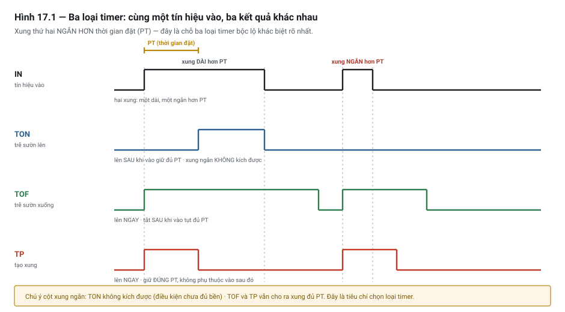

# Chương 17 — Timer: TON / TOF / TP

> **Lát cắt máy mẫu:** 1 — chuyền, chặn, nâng kẹp, cảm biến board, nút bấm, đèn tháp.

---

## 17.1 Bài toán: cỗ máy chạy tốt suốt tám tháng rồi phá một lô hàng

Một trạm kẹp board. Người viết chương trình dùng cách đơn giản nhất:

```iecst
// ✗ SAI — ĐỪNG CHÉP. Đây chính là cách viết gây ra sự cố kể bên dưới.
// Ra lệnh kẹp, chờ 2 giây, coi như đã kẹp xong
M_ClampReq := TRUE;
T_Wait(IN := TRUE, PT := T#2S);
IF T_Wait.Q THEN
    Step := Step + 1;          // ✗ chuyển bước bằng đồng hồ, không bằng phản hồi
END_IF;
```

Xy-lanh kẹp thật ra chỉ mất 0,6 giây. Hai giây là dư dả. Máy chạy tám tháng không sự cố.

Rồi bộ lọc khí đầy nước, áp suất tụt nhẹ. Xy-lanh kẹp bây giờ mất **2,4 giây**.

Chương trình vẫn đi tiếp sau đúng 2 giây — **trong khi kẹp mới đi được ba phần tư hành trình**. Bước
tiếp theo cho cơ cấu gia công chạy. Board chưa được giữ chắc, xê dịch. Cả lô hỏng.

Không có báo động nào. Với chương trình, mọi bước đều "thành công".

Nếu người viết dùng cảm biến phản hồi thay vì timer, máy đã dừng ngay từ board đầu tiên với thông báo
*"S1.20 quá thời gian — chờ DI_Clamp1Up"*, và có người đi xả nước bộ lọc.

Đây là **sai lầm phổ biến nhất trong lập trình PLC**, và cả chương này xoay quanh nó.

---

## 17.2 Ba loại timer chuẩn

Chuẩn IEC 61131-3 định nghĩa **ba** khối timer. Mọi hãng đều có cả ba, tên gọi giống nhau.



*Hình 17.1 — Cùng một tín hiệu vào, ba loại timer cho ba kết quả khác nhau.*

### TON — trễ sườn lên *(on-delay)*

Ngõ ra lên **sau khi** ngõ vào đã giữ mức 1 đủ **thời gian đặt** *(preset time, PT)*. Thời gian đã
trôi qua kể từ lúc bắt đầu đếm gọi là **thời gian đã chạy** *(elapsed time, ET)* — hầu hết hệ đều cho
bạn đọc giá trị này, và nó rất hữu ích khi chẩn đoán. Ngõ vào tụt xuống 0 thì ngõ ra tắt
**ngay lập tức** và bộ đếm về 0.

**Dùng khi:** cần một điều kiện tồn tại **liên tục** một khoảng thời gian mới coi là thật.

```iecst
// Chỉ báo mất khí khi tín hiệu mất LIÊN TỤC quá 0,5 giây
// → chống báo động giả do nhiễu hoặc dao động ngắn
T_AirFault(IN := NOT DI_AirOK, PT := T#500MS);
M_AirFault := T_AirFault.Q;
```

Đây là công dụng chính đáng và phổ biến nhất của TON: **lọc tín hiệu nhiễu** *(debounce / signal
filtering)* — chỉ chấp nhận tín hiệu sau khi nó đã ổn định đủ lâu.

### TOF — trễ sườn xuống *(off-delay)*

Ngõ ra lên **ngay** khi ngõ vào lên. Khi ngõ vào tụt, ngõ ra **còn giữ thêm** đủ thời gian đặt rồi mới tắt.

**Dùng khi:** cần kéo dài một trạng thái sau khi điều kiện đã mất.

```iecst
// Quạt hút chạy thêm 30 giây sau khi tắt nguồn nhiệt
T_FanRun(IN := M_HeaterOn, PT := T#30S);
DO_ExhaustFan := T_FanRun.Q;
```

### TP — tạo xung *(pulse)*

Ngõ ra lên khi ngõ vào có **sườn lên** *(rising edge)*, và giữ **đúng** thời gian đặt rồi tắt — **không phụ thuộc**
ngõ vào sau đó. Nhấn giữ hay nhả ra đều không đổi kết quả.

**Dùng khi:** cần một xung có độ dài xác định.

```iecst
// Còi kêu đúng 1 giây mỗi lần có báo động mới, dù báo động kéo dài bao lâu
T_Buzz(IN := M_NewAlarm, PT := T#1S);
DO_Buzzer := T_Buzz.Q;
```

### Timer giữ giá trị — phần mở rộng của hãng

Ngoài ba loại chuẩn, nhiều hãng có thêm loại **cộng dồn, giữ giá trị** khi ngõ vào mất, và cần lệnh
**đặt lại** riêng.

**Dùng khi:** cần đếm **tổng thời gian tích luỹ**, không phải thời gian liên tục — ví dụ tổng giờ chạy
của một cơ cấu, để lên lịch bảo trì (Chương 51, mục 51.11).

> ⚡ **LƯU Ý**
> Loại này **không nằm trong ba khối chuẩn**. Tên gọi và hành vi khác nhau đáng kể giữa các hãng, đặc
> biệt ở chỗ **có giữ giá trị qua mất điện hay không**. Nếu dùng, hãy tra tài liệu của đúng hệ bạn
> đang làm — xem mục 17.7.

### Bảng so sánh

| | **TON** | **TOF** | **TP** |
|---|---|---|---|
| Ngõ ra lên khi | Ngõ vào giữ 1 đủ thời gian | Ngõ vào lên — **ngay** | Sườn lên của ngõ vào — **ngay** |
| Ngõ ra tắt khi | Ngõ vào về 0 — **ngay** | Sau khi ngõ vào về 0 đủ thời gian | Hết thời gian đặt |
| Ngõ vào rung có ảnh hưởng? | ✅ Có — đếm lại từ đầu | ✅ Có | ❌ **Không** — xung đã bắt đầu là chạy hết |
| Công dụng điển hình | Lọc nhiễu, xác nhận điều kiện bền | Kéo dài trạng thái | Xung độ dài cố định |

---

### ⭐ Cùng ba timer đó, viết bằng ladder

⭐ Ba ví dụ dưới là **đúng ba ví dụ ST ở trên**, vẽ lại thành nấc thang — để đặt cạnh nhau mà so.

```text
                      ┌──────────────────┐
                      │  T_AirFault  TON │
   DI_AirOK           │                  │          M_AirFault
 ────┤/├──────────────┤ IN             Q ├──────────( )───
              T#500MS─┤ PT               │
                      └──────────────────┘

                      ┌──────────────────┐
                      │  T_FanRun   TOF  │
   M_HeaterOn         │                  │          DO_ExhaustFan
 ────┤ ├──────────────┤ IN             Q ├──────────( )───
                T#30S─┤ PT               │
                      └──────────────────┘

                      ┌──────────────────┐
                      │  T_Buzz     TP   │
   M_NewAlarm         │                  │          DO_Buzzer
 ────┤ ├──────────────┤ IN             Q ├──────────( )───
                 T#1S─┤ PT               │
                      └──────────────────┘
```

| Ký hiệu trong hộp | Nghĩa |
|---|---|
| `IN` | Ngõ vào — ⭐ chính là **điều kiện bên trái nấc thang** |
| `PT` | Thời gian đặt — thường ghi thẳng dưới `IN` |
| `Q` | Ngõ ra của timer, nối tiếp ra cuộn dây |
| `ET` | ⭐ Thời gian đã chạy — nhiều hệ cho thêm chân này, **rất đáng nối ra** để chẩn đoán |

> ⭐⭐ **Hộp timer trong ladder cho một thứ mà ST không cho: xem trực tuyến thấy `ET` chạy.**
> ⚡ Khi trình tự kẹt, mở màn theo dõi là thấy **con số đang đếm lên** — biết ngay máy đang chờ chứ
> không phải treo. ⭐ Đây là lý do đáng đưa timeout của bước ra ladder, dù phần còn lại viết bằng ST
> (Phụ lục L.18).

> ⚠⚠ **Ba cái bẫy ở mục 17.6 KHÔNG biến mất khi chuyển sang ladder** — và hai trong ba còn **khó
> thấy hơn**:
>
> | Bẫy | Ở ladder thì sao |
> |---|---|
> | Bẫy 3 — timer nằm trong nhánh không được thực thi | ⚠⚠ **Khó thấy hơn ST.** Hộp nằm trong vùng `MCR` bị tắt thì nó **không được gọi**, và nấc thang trông vẫn hoàn toàn bình thường (Chương 15 mục 15.4b) |
> | Bẫy 5 — dùng chung một thể hiện | ⚠⚠ **Rất dễ mắc hơn ST**, vì chép–dán một nấc thang mà **quên đổi tên hộp** là thao tác một giây |
> | Bẫy 2 — timer bị đặt lại ngoài ý muốn | Ở ladder nhìn ra dễ hơn: điều kiện đặt lại **chính là** phần bên trái nấc |

## 17.3 Độ phân giải và sai số

Timer trong PLC **không phải đồng hồ độc lập**. Nó được cập nhật **mỗi lần khối timer được gọi** — tức
là **một lần mỗi vòng quét** (Chương 10).

Hệ quả trực tiếp:

> **Sai số của timer ít nhất bằng một chu kỳ quét.**
>
> Với thời gian quét 10 ms, một timer đặt 50 ms có thể kết thúc ở đâu đó trong khoảng 50–60 ms. Sai số
> tương đối là **20 %**.
>
> Cùng timer đó đặt 5 giây thì sai số tương đối là **0,2 %** — không đáng kể.

Quy tắc thực dụng:

| Thời gian đặt so với chu kỳ quét | Độ tin cậy | Kết luận |
|---|---|---|
| Nhỏ hơn 1 chu kỳ quét | ❌ Không dùng được | Cần bộ đếm phần cứng hoặc ngắt |
| 1–10 lần chu kỳ quét | ⚠ Sai số lớn | Chỉ dùng khi không cần chính xác |
| Lớn hơn 100 lần chu kỳ quét | ✅ Tốt | Dùng thoải mái |

> 🔍 **BẪY — timer trong nhánh chương trình không phải lúc nào cũng chạy**
> Nếu khối timer nằm trong một nhánh `IF` **không được thực thi ở vòng quét này**, thì timer đó
> **không được cập nhật** — nó đứng yên chứ không chạy tiếp.
>
> Nhiều người tưởng timer chạy nền như đồng hồ. Không phải: nó chỉ tiến khi được gọi.
>
> Nếu cần timer chạy liên tục bất kể logic, hãy **gọi khối đó ở ngoài nhánh điều kiện**, và đưa điều
> kiện vào chân `IN` thay vì bọc cả khối trong `IF`.

---

## 17.4 Trên máy mẫu DP-01

Ba cách dùng timer chính đáng trong lát cắt này.

### Lọc tín hiệu — chống báo động giả

```iecst
// Công tắc áp suất khí dao động quanh ngưỡng khi máy nén đang nạp.
// Chỉ báo lỗi nếu mất khí LIÊN TỤC quá 500 ms.
T_AirLow(IN := NOT DI_AirOK, PT := T#500MS);
M_AirFault := T_AirLow.Q;
```

Không có TON này, máy sẽ báo lỗi mỗi lần máy nén nạp — báo động giả, và người vận hành sẽ học cách bỏ
qua báo động (Chương 44).

### Chống rung tiếp điểm nút bấm

```iecst
// Nút bấm cơ khí nảy vài lần trong vài mili-giây khi nhấn
T_StartDeb(IN := DI_StartPB, PT := T#20MS);
M_StartClean := T_StartDeb.Q;
```

### Timeout của bước — ⭐ dùng để **báo lỗi**, không để chuyển bước

Đây là cách dùng timer đúng đắn nhất trong toàn bộ chương trình trình tự:

```iecst
// ── Bước 20: nâng kẹp ──
M_Stn1_ClampReq := TRUE;

// CHUYỂN BƯỚC: bằng phản hồi thật
IF DI_Clamp1Up THEN
    Stn1_Step := 30;
END_IF;

// BÁO LỖI: bằng timer, chạy song song
T_Step20(IN := (Stn1_Step = 20), PT := T#3S);
IF T_Step20.Q THEN
    Stn1_FaultStep := 20;
    Stn1_Fault     := TRUE;      // "S1.20 quá thời gian — chờ DI_Clamp1Up" · cờ của trạm (Ch.25 mục 25.5c)
END_IF;
```

Hai khối này **làm hai việc khác nhau và không thay thế nhau**:

| | Điều kiện chuyển bước | Timer |
|---|---|---|
| Trả lời câu hỏi | *Cơ cấu đã tới đích chưa?* | *Đã trôi qua bao lâu?* |
| Nguồn thông tin | **Thế giới thật** (cảm biến) | Đồng hồ trong PLC |
| Khi mọi thứ bình thường | Đúng | Đúng |
| ⭐ Khi có sự cố | **Vẫn đúng** — không tới đích thì không chuyển | **Sai** — vẫn hết giờ như thường |

Dòng cuối là toàn bộ lý do. Hai câu hỏi trùng nhau khi mọi thứ ổn, và **tách nhau đúng lúc bạn cần
câu trả lời đúng nhất**.

---

## 17.5 Nối tầng timer

Một số hệ giới hạn thời gian đặt tối đa của một timer. Cần thời gian dài hơn thì nối tầng:

```iecst
// Ví dụ: cần 30 phút từ hai timer 15 phút
T_A(IN := M_Enable AND NOT T_B.Q, PT := T#15M);
T_B(IN := T_A.Q,                  PT := T#15M);
M_30MinDone := T_B.Q;
```

Cách khác thường gọn hơn: dùng **một timer ngắn kích một bộ đếm**:

```iecst
// Timer 1 giây tự kích lại, đếm số giây
T_Sec(IN := M_Enable AND NOT T_Sec.Q, PT := T#1S);
C_Sec(CU := T_Sec.Q, R := NOT M_Enable, PV := 1800);   // 1800 giây = 30 phút
M_30MinDone := C_Sec.Q;
```

Cách thứ hai có lợi thế: bạn **đọc được đã trôi qua bao nhiêu giây** — hữu ích khi gỡ lỗi. Bộ đếm ở
Chương 18.

> ⚡ **LƯU Ý**
> Với thời gian rất dài (hàng giờ, hàng ngày), timer không phải công cụ đúng — sai số tích luỹ và giá
> trị mất khi mất điện. Dùng **đồng hồ thời gian thực** của PLC và so sánh mốc thời gian.

---

## 17.6 Bẫy thường gặp

### 🔍 BẪY 1 — Dùng timer thay cho tín hiệu phản hồi ⭐

Bẫy trung tâm của chương và của cả cuốn sách. Đã mổ xẻ ở mục 17.1 và 17.4.

Cách nhận ra trong code của người khác: tìm mọi chỗ điều kiện chuyển bước là `T_xxx.Q`. Mỗi chỗ như
vậy là một câu hỏi cần trả lời: *"vì sao ở đây không có cảm biến xác nhận?"*

Có **một** câu trả lời chính đáng: **thật sự không có cách nào đo được**. Ví dụ: chờ keo chảy đủ, chờ
nhiệt lan toả. Khi đó timer là đúng — nhưng phải ghi comment nói rõ, và phải hiểu rằng bạn đang chấp
nhận rủi ro *"nếu quá trình chậm hơn dự kiến, máy không biết"*.

Nếu câu trả lời là *"lắp cảm biến thì tốn thêm"* — hãy so sánh với chi phí một lô hàng hỏng.

### 🔍 BẪY 2 — Timer bị đặt lại ngoài ý muốn

TON đặt lại bộ đếm **ngay** khi ngõ vào tụt xuống 0, dù chỉ một vòng quét.

Nếu điều kiện vào dao động — cảm biến rung, tín hiệu nhiễu, hoặc một điều kiện logic nhấp nháy — thì
timer **không bao giờ đếm đủ**, và triệu chứng là *"timer không bao giờ hết giờ"*.

```iecst
// ✗ Điều kiện vào nhấp nháy → timer đếm lại liên tục
T_X(IN := DI_BoardStn1 AND M_SomeFlickeringCondition, PT := T#5S);

// ✓ Lọc điều kiện trước, rồi mới đưa vào timer chính
T_Stable(IN := M_SomeFlickeringCondition, PT := T#100MS);
T_X(IN := DI_BoardStn1 AND T_Stable.Q, PT := T#5S);
```

**Cách chẩn đoán:** xem trực tuyến giá trị đếm hiện tại của timer. Nếu nó cứ nhảy về 0, bạn đã tìm ra
nguyên nhân — và vấn đề nằm ở **điều kiện vào**, không ở timer.

### 🔍 BẪY 3 — Timer nằm trong nhánh không được thực thi

Đã nêu ở mục 17.3. Timer chỉ tiến khi khối của nó được gọi. Đặt trong một nhánh `IF` không chạy thì nó
đứng yên — và triệu chứng cũng là *"timer không bao giờ hết giờ"*, nhưng nguyên nhân khác hẳn Bẫy 2.

**Cách phân biệt hai bẫy:** xem giá trị đếm hiện tại. Nhảy về 0 liên tục → Bẫy 2. Đứng im một chỗ →
Bẫy 3.

### 🔍 BẪY 4 — Đặt thời gian quá gần chu kỳ quét

Timer 20 ms trong hệ có thời gian quét 15 ms là timer không đáng tin. Xem bảng ở mục 17.3.

Và nhớ rằng thời gian quét **tăng lên** khi chương trình lớn dần — một timer đủ tin cậy hôm nay có thể
không còn đủ sau khi ai đó thêm chức năng (Chương 10).

### 🔍 BẪY 5 — Dùng chung một thể hiện timer ở nhiều chỗ

```iecst
// ✗ SAI — cùng một thể hiện T_Wait dùng cho hai bước
IF Step = 20 THEN  T_Wait(IN := TRUE, PT := T#3S);  END_IF;
IF Step = 40 THEN  T_Wait(IN := TRUE, PT := T#5S);  END_IF;
```

Mỗi khối timer có **bộ nhớ riêng gắn với thể hiện**. Dùng chung một thể hiện ở hai chỗ nghĩa là hai
chỗ đó **giẫm lên bộ nhớ của nhau** — giá trị đếm và thời gian đặt bị ghi đè mỗi vòng quét.

Mỗi chỗ cần một timer riêng phải có **một thể hiện riêng**. Nếu thấy mình cần nhiều timer giống nhau,
đó là dấu hiệu nên gói vào một khối chức năng tái dùng (Chương 27).

### 🔍 BẪY 6 — Đặt timeout theo cảm tính

Timeout quá chặt → báo động giả khi khí hơi yếu hoặc trời lạnh. Quá lỏng → mất tác dụng phát hiện.

**Cách đúng:** đo thời gian thật của cơ cấu trên máy, rồi cộng biên an toàn. Và ghi lại con số gốc để
sau này so sánh — xy-lanh chậm dần là dấu hiệu sắp hỏng (Chương 51).

### 🔍 BẪY 7 — Nhầm TON với TOF khi đọc code người khác

Hai khối chỉ khác nhau một chữ cái và làm hai việc **ngược nhau**. Khi đọc chương trình lạ, kiểm lại
đúng loại trước khi suy luận — đây là lỗi đọc nhầm rất tốn thời gian.

---

## 17.7 Khác biệt giữa các hãng

Ba khối TON, TOF, TP nằm trong chuẩn nên có ở mọi hệ hiện đại với cùng tên và cùng hành vi. Nhưng
cách **khai báo, đặt độ phân giải và đặt lại** thì khác nhau đáng kể.

| Khía cạnh | Siemens (S7-1200/1500) | Mitsubishi (FX5U / iQ-R) | Rockwell (Logix) | CODESYS / TwinCAT |
|---|---|---|---|---|
| Ba khối chuẩn | `TON` `TOF` `TP` (khối IEC) | `TON` `TOF` `TP` ở GX Works3 | `TON` `TOF` | `TON` `TOF` `TP` |
| Timer cộng dồn | `TONR` | Dải thiết bị timer chốt riêng | **`RTO`** *(Retentive Timer On)* | `TONR` ở một số thư viện |
| ⚠ Đặt lại timer cộng dồn | Chân `R` của `TONR` | Lệnh `RST` trên thiết bị timer | ⚠ **Bắt buộc lệnh `RES`** — không có `RES` thì timer không bao giờ về 0 | Chân `R` |
| Viết hằng số thời gian | `T#2S`, `T#500MS` | ⚠ Số nguyên nhân với độ phân giải — do **lệnh và thiết bị** quyết định | `.PRE` tính bằng **mili-giây**, là số nguyên | `T#2S` |
| Giá trị đang đếm | `.ET` *(elapsed time)* | Giá trị hiện tại của thiết bị `T` | `.ACC` *(accumulated)* | `.ET` |
| Cờ ngõ ra | `.Q` | Tiếp điểm cùng số hiệu với thiết bị `T` | `.DN` *(done)*, `.TT` *(timing)*, `.EN` *(enable)* | `.Q` |

### ⚠ Ba chỗ dễ vấp nhất

**1. Mitsubishi — độ phân giải KHÔNG nằm trong khối, và nó đến từ HAI nguồn.**

⚠⚠ Đây là chỗ người quen hệ khác vấp ngay: ở hệ IEC, độ phân giải là thuộc tính của khối và giá trị
đặt là một **khoảng thời gian** (`T#2s`). Ở hệ kiểu thiết bị, giá trị đặt chỉ là một **số nguyên** —
nó dài bao lâu do hai thứ khác quyết định:

| Nguồn | Ví dụ |
|---|---|
| ⭐ **Lệnh dùng để chạy bộ định thời** | `OUT` → 100 ms · `OUTH` → 10 ms · `OUTHS` → 1 ms |
| ⭐ **Kiểu / số hiệu thiết bị `T`** | Có kiểu 1 ms · 10 ms · 100 ms, và bản **giữ được** của cả ba |

```text
OUT   T5  K20   →  20 × 100 ms  =  2,0  giây
OUTH  T5  K20   →  20 ×  10 ms  =  0,2  giây
OUTHS T5  K20   →  20 ×   1 ms  =  0,02 giây
```

> ⚠⚠ **Cùng một dòng `K20`, ba kết quả cách nhau 100 lần — và code trông y hệt.**
>
> ⭐ Vì vậy `T10` đổi thành `T210` có thể đổi **cả độ phân giải lẫn hành vi khi mất điện**, mà không
> có gì trên màn hình báo cho bạn. ⚠ Đây là nguồn lỗi kinh điển khi **chuyển chương trình sang dòng
> CPU khác**, khi **đổi lệnh**, và khi **đổi số hiệu bộ định thời**.
>
> ⭐ **Luôn kiểm CẢ HAI: lệnh đang dùng và kiểu thiết bị `T`.** Chi tiết và bảng dải giá trị: Phụ lục
> A2 §A2.2.

**2. Rockwell — `RTO` cần `RES` mới về 0.** Timer cộng dồn giữ giá trị khi điều kiện mất, và **không
có cách nào khác** để xoá ngoài lệnh `RES`. Quên `RES` thì timer chạy đủ một lần rồi báo xong mãi
mãi. Ngoài ra `.PRE` là **số nguyên mili-giây**, không phải hằng số kiểu `T#`.

> ⚡ **Một cập nhật đáng biết, vì nó đang xoá dần khác biệt vừa nêu.** ⭐ Tài liệu lệnh bản 9/2025
> thêm kiểu dữ liệu **`TIMER_T`**, trong đó `.PRE` và `.ACC` mang **kiểu `TIME`** chứ không còn là
> `DINT` mili-giây, và hiển thị theo đơn vị thời gian (ngày · giờ · phút · giây · ms · µs) —
> ⭐ **không phải tự quy đổi ra mili-giây nữa**. Kiểu này có trên các dòng bộ điều khiển đời mới.
>
> ⚠ Nhưng kiểu `TIMER` cũ **vẫn tồn tại song song**, và vẫn là `DINT` mili-giây. ⭐⭐ Nên khi đọc
> chương trình, **phải nhìn kiểu của chính biến timer** — đừng suy từ tên hãng. ⚡ Lệnh `RES` xoá
> `.ACC` và các bit trạng thái cho **cả hai** kiểu.

**3. Siemens — khối IEC cần một khối dữ liệu thể hiện.** Mỗi `TON` là một thể hiện có bộ nhớ riêng,
khai báo trong khối dữ liệu. Đây là hệ quả trực tiếp của quy tắc "mỗi chỗ dùng một thể hiện riêng"
(Chương 20, Bẫy 7) — hệ ép bạn làm đúng, và đó là điều tốt.

> ⚡ Với **S7-300/400 đời cũ** bạn sẽ gặp timer kiểu `S5` (`SD`, `SS`, `SE`, `SF`) dùng định dạng
> `S5TIME` — hành vi và dải giá trị khác timer IEC. Chỉ cần biết để **đọc được chương trình cũ**;
> code mới thì dùng khối IEC.

Điểm chung không phụ thuộc hãng: **mọi hệ đều cho xem giá trị đang đếm khi trực tuyến**, và đó là
công cụ chẩn đoán ở Bẫy 2 và Bẫy 3.

Chi tiết đối chiếu năm hệ: **Phụ lục A2**.

## 17.8 Bảng chốt

| # | Kiểm | Đạt khi |
|---|---|---|
| 1 | Mọi chỗ chuyển bước bằng `T_xxx.Q` đã được rà lại | Mỗi chỗ hoặc đổi sang phản hồi, hoặc có comment giải thích vì sao không đo được |
| 2 | Mọi bước chờ cơ cấu có **timeout báo lỗi** | Có, và thông báo nêu rõ bước + tín hiệu đang chờ |
| 3 | Thời gian đặt **lớn hơn nhiều lần chu kỳ quét** | Có; đã xét cả trường hợp quét tăng về sau |
| 4 | Mỗi timer có **thể hiện riêng** | Không dùng chung |
| 5 | Timer cần chạy liên tục được gọi **ngoài nhánh điều kiện** | Có |
| 6 | Timeout đặt theo **đo thật**, không theo cảm tính | Có, và đã ghi con số gốc |
| 7 | Điều kiện vào timer đã **được lọc** nếu có khả năng dao động | Có |
| 8 | ⚠⚠ Nếu là **hệ kiểu thiết bị**: đã kiểm **cả lệnh lẫn kiểu `T`** | Có — cùng `K20` có thể chênh 100 lần |

---

## 17.9 Tự kiểm

1. Kể lại sự cố ở mục 17.1. Vì sao máy **chạy tốt tám tháng** rồi mới hỏng?
2. Phân biệt **TON, TOF, TP** — mỗi loại ngõ ra lên khi nào và tắt khi nào?
3. Loại nào **không bị ảnh hưởng** khi ngõ vào rung sau khi đã kích? Vì sao tính chất đó hữu ích?
4. Vì sao sai số của timer **ít nhất bằng một chu kỳ quét**? Timer 30 ms trong hệ quét 10 ms có đáng
   tin không?
5. Nêu **hai câu hỏi khác nhau** mà "điều kiện chuyển bước" và "timer" trả lời. Chúng trùng nhau khi
   nào và tách nhau khi nào?
6. Có **một** trường hợp dùng timer để chuyển bước là chính đáng. Đó là trường hợp nào, và bạn phải
   làm gì kèm theo?
7. Timer "không bao giờ hết giờ". Nêu **hai nguyên nhân** khả dĩ và **cách phân biệt** chúng bằng một
   phép quan sát.
8. Vì sao dùng chung một thể hiện timer ở hai chỗ là sai?
9. Timeout đặt quá chặt và quá lỏng — mỗi cái gây hậu quả gì? Cách đặt đúng?
10. Bạn đọc code của người khác và thấy `T_Wait.Q` làm điều kiện chuyển bước. **Câu hỏi đầu tiên** bạn
    phải đặt là gì?
11. ⚠⚠ Trên hệ kiểu thiết bị, dòng `OUT T5 K20` đếm bao lâu? Nêu **hai** thứ quyết định câu trả lời,
    và cho biết khoảng chênh lệch lớn nhất giữa các khả năng.

Câu 5, 6 và 7 là ba câu phân loại. Câu 5 là nguyên tắc trung tâm; câu 6 kiểm tra bạn không áp dụng
nguyên tắc một cách máy móc; câu 7 là kỹ năng chẩn đoán thật.

---

### Chương tiếp theo

**Chương 18 — Counter & đếm xung tốc độ cao.** Timer đếm thời gian; counter đếm sự kiện. Và có một
ngưỡng mà đếm bằng phần mềm không còn khả thi — chương sau cho bạn công thức để biết ngưỡng đó ở đâu.

---

### Nguồn tham khảo chương 17

- IEC 61131-3 — *Programmable controllers, Part 3: Programming languages*: định nghĩa ba khối timer
  chuẩn TP, TON, TOF và kiểu dữ liệu thời gian. *(tiêu chuẩn có bản quyền; chương này chỉ diễn giải ở
  mức khái niệm)*
- Tài liệu hãng về khối timer và timer giữ giá trị — dùng để đối chiếu khác biệt ở mục 17.7; số hiệu
  cụ thể ghi trong Phụ lục A2.
- Bảng thời gian bước của DP-01 — Phụ lục J.
- **Rockwell Automation** — *Logix 5000 Controllers General Instructions* (bản 9/2025), ch. 3
  *Timer and Counter Instructions*: phân biệt timer ⭐ **giữ được** (`RTO`, `RTOR`) với timer
  **không giữ** (`TON`, `TOF`, `TONR`, `TOFR`); ⚠ lệnh `RES` là cách xoá `.ACC` và các bit trạng
  thái; và ⭐ kiểu dữ liệu **`TIMER_T`** mới — `.PRE` / `.ACC` mang kiểu `TIME` thay cho `DINT`
  mili-giây — nền cho mục 17.7.
- **Siemens** — *S7-1200 System Manual*: khối timer IEC cần **khối dữ liệu thể hiện** riêng cho mỗi
  chỗ dùng; dùng cho điểm 3 của mục 17.7.
> ⚡ Mọi con số thời gian trong chương (0,6 s cho hành trình kẹp, 3 s timeout, 500 ms lọc khí) là **giá
> trị minh hoạ của máy mẫu**. Giá trị thật phải đo trên máy của bạn.
