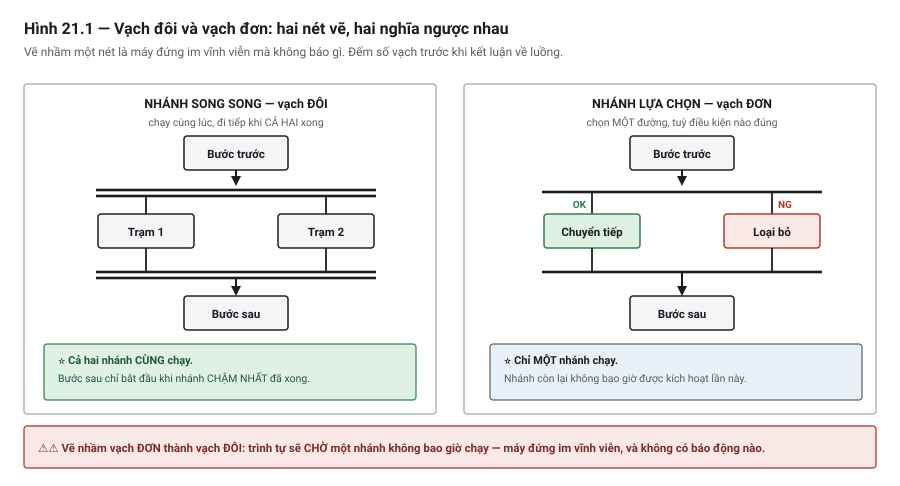

# Chương 21 — FBD, SFC (và IL — đủ để đọc di sản)

> **Lát cắt máy mẫu:** 1 — chuyền, chặn, nâng kẹp, cảm biến board, nút bấm, đèn tháp.

---

## 21.1 Ba ngôn ngữ còn lại

Chương 15 cho bạn Ladder, Chương 20 cho bạn Structured Text. Chương này hoàn tất bộ năm:

| Ngôn ngữ | Vị thế thực tế | Bạn cần biết tới mức nào |
|---|---|---|
| **FBD** | Dùng nhiều ở xử lý analog và điều khiển quá trình | **Đọc và viết được** |
| **SFC** | Dùng cho trình tự; mức phổ biến khác nhau theo hãng và theo ngành | **Đọc và viết được** |
| **IL** | ⚠ Di sản — **đã bị rút khỏi bản mới của chuẩn** | **Chỉ cần đọc hiểu** |

Ba ngôn ngữ này không thay thế LD và ST. Chúng lấp hai chỗ mà LD và ST làm kém: **luồng tín hiệu**
(FBD) và **trình tự có thứ tự trước sau** (SFC).

---

## 21.2 FBD — luồng tín hiệu đi từ trái sang phải

### Ý tưởng

Trong FBD, mỗi phép xử lý là một **khối** có chân vào bên trái và chân ra bên phải. Bạn nối chân ra
của khối này vào chân vào của khối kia. Tín hiệu chảy từ trái sang phải.

```text
   DI_AirOK ──┐
              │  ┌───────┐        ┌────────┐
   DI_EStopOK─┼──┤  AND  ├────────┤  TON   ├──── M_ReadyStable
              │  │       │        │ PT=1s  │
   DI_Door1 ──┘  └───────┘        └────────┘
```

Đọc hình trên: ba điều kiện AND với nhau, kết quả đưa vào một timer, timer giữ 1 giây rồi mới cho ra
`M_ReadyStable`. Toàn bộ ý đồ nằm trong một hình, không cần đọc chữ.

### FBD mạnh ở đâu

| Việc | Vì sao FBD hợp |
|---|---|
| **Chuỗi xử lý tín hiệu** | Quy đổi thang → lọc → so ngưỡng → ra quyết định. Mỗi bước một khối, thấy được cả đường đi |
| **Xử lý analog** | Đây là quê hương của FBD (Chương 32, Chương 35) |
| **Nối nhiều khối chức năng** | Chân ra nối thẳng vào chân vào, không cần biến trung gian |
| **Logic có nhiều đầu vào** | Một khối `AND` tám chân gọn hơn tám tiếp điểm nối tiếp |

### FBD yếu ở đâu

| Việc | Vì sao FBD dở |
|---|---|
| Logic liên động dày đặc | ⚠ Người bảo trì quen ladder đọc chậm hơn hẳn; và "dòng điện" không còn là ẩn dụ dẫn đường |
| Rẽ nhánh phức tạp | Không có `IF/ELSE` — phải mô phỏng bằng khối chọn, rất rườm |
| Tính toán chuỗi dài | Mỗi phép một khối; một công thức năm phép thành năm khối nối nhau, ST viết một dòng |
| Sơ đồ lớn | Đường nối chằng chịt còn khó đọc hơn code |
| ⚠⚠ **Có hồi tiếp** | ⭐ **Chuẩn KHÔNG quy định thứ tự thực thi** — xem cảnh báo dưới |

> ⚠⚠ **"Trái sang phải, trên xuống dưới" là GIẢ ĐỊNH HỢP LÝ, không phải bảo đảm của chuẩn.**
>
> Khi ngõ ra của một khối được đưa ngược lại làm ngõ vào cho khối **đứng trước nó**, ⭐ chuẩn
> **không** nói bộ xử lý phải làm gì — điều đó **tuỳ hiện thực của từng hãng**.
>
> ⚠ Hệ quả: cùng một sơ đồ FBD có hồi tiếp **có thể cho kết quả khác nhau trên hai hệ khác nhau**, và
> khác biệt đó ⚠⚠ **không lộ ra khi đọc sơ đồ**.
>
> ⭐ Chính vì vậy **có hãng không cho vẽ đường hồi tiếp tường minh** — để thứ tự thực thi luôn rõ ràng.
>
> ⭐⭐ **Quy tắc thực dụng:** cần hồi tiếp thì ⭐ **đưa nó qua một biến trung gian có tên**, đừng vẽ
> đường vòng lại. Khi đó thứ tự đọc–ghi rõ ràng, và nó trở về đúng bài toán quen thuộc ở Chương 10
> (thứ tự trong vòng quét). ⚠ Và **tra tài liệu hãng** trước khi tin vào bất kỳ giả định nào về thứ
> tự thực thi FBD.

### So sánh trực tiếp với ladder

Cùng một logic, hai cách vẽ:

```text
LADDER
   DI_AirOK   DI_EStopOK   DI_Door1Closed          M_Ready
──────┤ ├────────┤ ├───────────┤ ├──────────────────( )──────

FBD
   DI_AirOK ──────┐
   DI_EStopOK ────┼── AND ────────────────────────── M_Ready
   DI_Door1Closed ┘
```

Với ba điều kiện, hai cách tương đương. Khác biệt lộ ra khi:

- **Nhiều điều kiện hơn** — FBD gọn hơn, ladder phải kéo nấc thang rất dài.
- **Có khối chức năng ở giữa chuỗi** — FBD nối thẳng, ladder phải đặt hộp trên nấc rồi lấy chân ra
  qua biến trung gian.
- **Cần chẩn đoán trực tuyến** — ⭐ ladder thắng rõ ràng: người bảo trì nhìn tiếp điểm nào không sáng
  là biết đứt ở đâu, không cần hiểu ngôn ngữ.

Dòng cuối là lý do bảng phân chia ở Chương 20 mục 20.6 vẫn đặt **liên động và ngõ ra cuối cùng vào
ladder**, kể cả khi FBD gọn hơn.

---

## 21.3 SFC — ngôn ngữ sinh ra cho trình tự

### Ba thành phần

**SFC** *(Sequential Function Chart)* mô tả trình tự bằng ba thứ, và chỉ ba thứ:

| Thành phần | Là gì | Vẽ thành |
|---|---|---|
| **Bước** *(step)* | Một trạng thái của trình tự | Hình chữ nhật |
| **Chuyển tiếp** *(transition)* | Điều kiện để rời bước này sang bước kế | Vạch ngang kèm điều kiện |
| **Hành động** *(action)* | Việc làm khi đang ở một bước | Hộp gắn bên cạnh bước |

```text
        ┌──────────────────┐
        │  S10  Chờ board  │◄──────────────┐
        └────────┬─────────┘               │
                 │                         │
            ─────┼─────  DI_BoardStn1      │
                 │                         │
        ┌────────┴─────────┐               │
        │  S20  Nâng kẹp   │── N: M_Stn1_ClampReq
        └────────┬─────────┘               │
                 │                         │
            ─────┼─────  DI_Clamp1Up       │
                 │                         │
        ┌────────┴─────────┐               │
        │  S30  Gia công   │               │
        └────────┬─────────┘               │
                 │                         │
            ─────┼───── M_Stn1_ProcessDone │
                 └─────────────────────────┘
```

So với cùng trình tự viết bằng `CASE` (Chương 20, mục 20.2): SFC **thấy được toàn cảnh** — bao nhiêu
bước, đi theo đường nào, quay lại chỗ nào. Với người đọc lần đầu, đây là lợi thế lớn.

### Hai kiểu nhánh



*Hình 21.1 — Vạch đôi và vạch đơn. Hai nét vẽ gần giống nhau, nghĩa ngược nhau, và vẽ nhầm thì máy
đứng im vĩnh viễn mà không báo gì.*

**Nhánh song song** *(parallel / simultaneous divergence)* — hai nhánh chạy **cùng lúc**, và trình tự
chỉ đi tiếp khi **cả hai** đã xong:

```text
              ═══════╦═══════        ← vạch đôi = song song
                     ║
          ┌──────────╨──────────┐
      ┌───┴───┐             ┌───┴───┐
      │ Trạm 1│             │ Trạm 2│
      └───┬───┘             └───┬───┘
          └──────────┬──────────┘
              ═══════╩═══════        ← chờ CẢ HAI xong
```

**Nhánh lựa chọn** *(selective divergence)* — chọn **một** trong nhiều đường, tuỳ điều kiện nào đúng:

```text
              ───────┬───────        ← vạch đơn = lựa chọn
          ┌──────────┼──────────┐
      ─── ┼ ─ OK     ┼ ─ NG     │
      ┌───┴───┐  ┌───┴───┐
      │Chuyển │  │ Loại  │
      │ tiếp  │  │  bỏ   │
      └───────┘  └───────┘
```

> ⚠ **Vạch đôi và vạch đơn là khác biệt sống còn, và chúng trông rất giống nhau.**
> Vẽ nhầm vạch đơn thành vạch đôi nghĩa là trình tự chờ một nhánh **không bao giờ chạy** — máy đứng
> im vĩnh viễn, không báo gì. Đúng cỗ máy ở Chương 26, mục 26.1.
>
> Khi đọc SFC của người khác, **đếm số vạch** trước khi kết luận về luồng.

### Kiểu hành động

Chuẩn có nhiều **bổ ngữ hành động** *(action qualifier)*; ba cái bạn gặp nhiều nhất:

| Bổ ngữ | Nghĩa |
|---|---|
| **N** — *non-stored* | Hành động chạy **suốt thời gian** đang ở bước đó. ⚠ *"Tự tắt khi rời bước"* chỉ đúng khi hành động là **một biến BOOL** — xem lưu ý dưới bảng |
| **S** — *set* | Bật và **giữ**, kể cả sau khi rời bước — phải có `R` ở đâu đó để tắt |
| **R** — *reset* | Tắt một hành động đã `S` |

> ⚠ Dùng `S` mà quên `R` là biến thể SFC của bẫy SET/RESET ở Chương 16: một thứ được bật rồi không ai
> tắt. Quy tắc giống hệt — **mỗi `S` phải có một `R` tương ứng**, và bạn phải chỉ ra được nó ở đâu.
> ⚡ PLCopen còn đi xa hơn: **tránh** `S`/`R` — khoảng giữa `S` và `R` dài, hay có nhánh chen giữa, thì
> nhìn sơ đồ không biết hành động đang chạy hay không. Thay bằng `N` gắn vào từng bước cần nó, hoặc
> một nhánh song song giữ hành động đó (tài liệu SFC, mục 4.6 và 4.8).

> ⚠⚠ **Hành động `N` "tự tắt" — nhưng thứ nó đã GÁN thì không.**
>
> Một hành động có hai dạng. ⭐ Dạng **biến BOOL** (`N: M_Stn1_ClampReq` ở sơ đồ trên): biến đó TRUE
> khi bước hoạt động và **về FALSE khi rời bước** — đúng nghĩa "tự tắt". ⚠ Dạng **đoạn mã**
> (`DO_Clamp1Vlv := TRUE;` viết trong hành động): cái dừng là **đoạn mã**, còn giá trị nó đã gán thì **ở
> nguyên**. Sổ tay SFC của Rockwell ghi thẳng: với tuỳ chọn mặc định, khi rời bước *"mọi dữ liệu giữ
> giá trị hiện tại"* — muốn tắt thì phải tự viết lệnh tắt. CODESYS thì **chạy đoạn mã thêm một lần**
> sau khi rời bước (ở vòng quét kế tiếp) — tức một hành động `N` luôn chạy ít nhất hai lần. ⚡ Chuẩn bản 3
> để lần chạy thêm này — *lần quét cuối* *(final scan)* — là **lựa chọn của hệ**: có hoặc không, mỗi
> hệ chọn một (tài liệu SFC của PLCopen, mục 3.6).
>
> ⭐ Hệ quả thực hành: ngõ ra và yêu cầu của máy, hoặc là **hành động biến BOOL**, hoặc là **gán ở
> ngoài sơ đồ theo cờ bước** (`M_Stn1_ClampReq := S20.X OR S30.X;`) — đừng gán TRUE trong đoạn mã rồi
> tin nó tự tắt.

**Mấy bổ ngữ nữa đáng biết — mỗi cái thay được cả một khối chức năng, và một cái có bẫy:**

| Bổ ngữ | Nghĩa | ⭐ Nó thay cho cái gì |
|---|---|---|
| **P1** — *pulse, rising* | Chạy **đúng một lần** khi bước được kích hoạt | ⭐ Khối bắt cạnh `R_TRIG` (Chương 16) |
| **P0** — *pulse, falling* | Chạy **đúng một lần** khi rời bước | ⭐ Khối `F_TRIG` |
| ⚠ **P** — *pulse* | Theo chuẩn: chạy **một lần** khi bước được kích hoạt (PLCopen). ⚠⚠ Nhưng ở hệ có *lần quét cuối* như CODESYS: chạy **đúng hai lần** — một lần khi vào bước, một lần khi rời bước | ⚠ Trên hệ đó **không** thay được `R_TRIG`: đoạn `Count := Count + 1` trong hành động `P` cộng **hai** mỗi lần đi qua bước |
| **L** — *time limited* | Chạy rồi **tự dừng sau một khoảng**, hoặc khi rời bước | ⭐ Một `TP` (Chương 17) |
| **D** — *time delayed* | ⭐ **Bắt đầu sau một khoảng**, nếu lúc đó vẫn còn ở bước | ⭐ Một `TON` |

> ⚠ `P1`/`P0` có trong chuẩn và trong SFC của Rockwell; ⚠ bảng bổ ngữ trong tài liệu CODESYS **không
> liệt kê** hai bổ ngữ này. Trên hệ chỉ có `P`, "làm đúng một lần khi vào bước" viết bằng `R_TRIG` trên
> cờ bước (`TrigS20(CLK := S20.X)`, gọi ngoài sơ đồ) — đừng dùng `P` rồi tin nó chạy một lần.

Chuẩn còn vài bổ ngữ kết hợp nữa (lưu kèm trễ…). ⚠ Số bổ ngữ **thực sự được hiện thực** khác nhau
theo hãng — tra tài liệu trước khi dùng cái ngoài `N`/`S`/`R`.

> ⭐⭐ **Ý quan trọng hơn danh sách: SFC gói sẵn ba mẫu mà ở ngôn ngữ khác bạn phải tự dựng.**
> *"Làm đúng một lần"* · *"làm trong 2 giây rồi thôi"* · *"chờ 500 ms rồi mới làm"* — ở LD hay ST là
> ba khối chức năng kèm ba thể hiện riêng; ở SFC là **ba chữ cái**.

### ⭐⭐ Mỗi bước tự có hai biến — và một trong hai là timer miễn phí

Đây là thứ hữu ích nhất của SFC mà người mới không biết mình đang có. ⭐ Mỗi bước được cấp **hai biến,
tự động, không phải khai báo**:

| Biến | Kiểu | Nội dung |
|---|---|---|
| `TênBước.X` | `BOOL` | ⭐ **TRUE khi bước đang hoạt động**, FALSE khi không |
| ⭐⭐ `TênBước.T` | `TIME` | ⭐ **Thời gian đã ở trong bước** — **về `t#0s` khi VÀO bước**, rồi chạy suốt lúc bước hoạt động. ⚠ Khi **rời** bước: chuẩn cho **giữ nguyên** giá trị lúc rời — nhưng có tài liệu mô tả về 0; xem ô dưới |

> ⚠ **Coi cả hai là chỉ đọc.** Nhiều hệ báo lỗi khi chương trình gán vào chúng. ⚠ Nhưng không phải mọi
> hệ: CODESYS **cho** ghi cờ bước để ép một bước hoạt động — và chính tài liệu của nó cảnh báo làm vậy
> có thể đưa sơ đồ vào trạng thái không ổn định. Hệ cho ghi hay không — **đừng ghi**.

> ⭐⭐ **Công dụng một — timeout của bước gần như miễn phí.**
>
> Chương 17 mục 17.4 dạy: mỗi bước chờ cơ cấu phải có **timeout để báo lỗi**. Ở LD/ST điều đó nghĩa là
> một `TON` riêng cho **từng** bước. ⭐ Trong SFC thì không phải khai báo gì:
>
> ```iecst
> IF Step30_Clamp.X AND Step30_Clamp.T > T#3S THEN
>     M_Alm_ClampTimeout := TRUE;        // bước 30 chờ kẹp quá 3 giây — cờ chốt (Chương 25)
> END_IF;
> ```
>
> ⚡ Và vì `.T` **tự về 0 mỗi lần vào bước**, bạn không phải nhớ đặt lại timer — ⚠ đúng cái hay quên
> nhất khi tự dựng bằng `TON` (Chương 17, Bẫy 2).
>
> ⚠⚠ **Nhưng luôn kèm `.X`.** Theo chuẩn — tài liệu SFC của PLCopen tóm tắt ở mục 2.1 — rời bước thì
> `.T` **giữ nguyên** giá trị lúc rời, chỉ về 0 ở lần vào bước sau; Horner và bộ đếm thời gian bước của
> Rockwell làm đúng như vậy. Trên hệ như thế, một bước từng chờ 3,2 giây rồi mới đi tiếp để lại `.T` =
> 3,2 s: điều kiện thiếu `.X` **đúng mãi**, cờ lỗi **chốt lại ngay sau mỗi lần Reset**, và máy kẹt ở
> `Alarm` (Chương 25 mục 25.5c). ⚡ Giáo trình Hanssen (viết trên CoDeSys) lại mô tả `.T` về 0 khi rời
> bước — hệ của bạn theo cách nào thì cũng viết sao cho **đúng với cả hai**: thêm `.X`.

> ⭐ **Công dụng hai — `.X` là cách đúng để phần còn lại của chương trình biết trình tự đang ở đâu.**
>
> Dùng cho đèn báo, cho điều kiện liên động, cho chẩn đoán — ⚠ **thay vì tự nuôi một biến "bước hiện
> tại" song song**, thứ chắc chắn sẽ lệch với thực tế vào một ngày nào đó.
>
> ⚠ Nhưng theo chuẩn, tên bước, cờ bước và thời gian bước **chỉ có nghĩa bên trong POU chứa sơ đồ**
> (tài liệu SFC của PLCopen, mục 2.1). Muốn POU khác biết, có hai đường: xuất ra bằng **hành động biến
> BOOL** — cách ví dụ ở mục 21.6 làm với `M_Stn1_ClampReq` — hoặc dùng đường truy cập riêng của hệ:
> CODESYS cho POU khác đọc `Prg_Stn1Sfc.S20.x`. Đường thứ hai **không mang sang hệ khác được**.

> ⚠ **Một luật cấu trúc dễ vi phạm khi vẽ: không được đặt hai bước liền nhau mà không có bước chuyển
> ở giữa.** Nghe hiển nhiên, nhưng khi **chèn thêm bước vào sơ đồ có sẵn** thì đây là lỗi hay gặp —
> ⭐ may là trình biên dịch bắt được, nên nó chỉ tốn thời gian chứ không nguy hiểm.
>
> ⚡ Ngược lại, ⭐ **nhiều bước được phép hoạt động cùng lúc** — đó chính là cơ chế của nhánh song song.

### SFC mạnh ở đâu, yếu ở đâu

| ✅ Mạnh | ❌ Yếu |
|---|---|
| Trình tự tuyến tính có thứ tự rõ | ⚠ **Chế độ máy** — xem cảnh báo bên dưới |
| Thấy toàn cảnh, biết đang ở bước nào | Logic tổ hợp thuần (dùng LD) |
| Nhánh song song diễn đạt tự nhiên | Tính toán (dùng ST) |
| ⭐ Giám sát trực tuyến rất trực quan — bước đang chạy được tô sáng | Thay đổi cấu trúc trình tự tốn công vẽ lại |

> ⚠⚠ **SFC không phải câu trả lời cho máy trạng thái ở Chương 25.**
> Máy trạng thái chế độ cần đường **"từ mọi trạng thái đều nhảy được vào `Alarm`"**. Trong SFC, mỗi
> đường nhảy phải vẽ tường minh — nghĩa là từ tám bước phải vẽ tám đường về `Alarm`, và sơ đồ trở
> thành mớ bòng bong.
>
> Cách thường dùng trong thực tế: **chế độ máy bằng `CASE` hoặc LD; trình tự bên trong chế độ
> `Running` thì bằng SFC.** Chương 25 mục 25.8 và Chương 26 nói kỹ.

### Quan hệ với GRAFCET

SFC bắt nguồn từ **GRAFCET**, một phương pháp mô tả trình tự có trước, xuất phát từ Pháp. Bạn sẽ gặp
tên này trong tài liệu và trong bản vẽ của một số nhà chế tạo máy.

Điểm cần nắm: **GRAFCET là phương pháp mô tả, SFC là ngôn ngữ lập trình.** Bạn có thể vẽ GRAFCET trên
giấy để thiết kế trình tự (Chương 26) rồi hiện thực bằng bất kỳ ngôn ngữ nào — SFC, `CASE`, hay bit
trình tự trong ladder. Vẽ GRAFCET không bắt buộc bạn phải lập trình bằng SFC.

### ⭐⭐ Nên và không nên khi viết SFC

Trước hết, hai luật của **chuẩn** — không phải lời khuyên: SFC **chỉ** dùng được trong khối chức năng
và chương trình, **không** trong hàm — vì sơ đồ phải **nhớ** bước nào đang hoạt động; và một phần
của POU đã viết bằng SFC thì **cả POU** phải chia thành bước và chuyển tiếp (tài liệu SFC của PLCopen,
mục 1). Còn lại là các lựa chọn — và mỗi dòng dưới đây có một sự cố thật đứng sau:

| # | ⭐ Nên | ⚠ Không nên | Vì sao |
|:-:|---|---|---|
| 1 | Mở nhánh song song bằng vạch đôi thì **đóng bằng vạch đôi**; nhánh con bên trong đóng **trước** khi ra khỏi vùng song song | ⚠⚠ Nối từ một bước bên trong vùng song song **ra ngoài** vùng, hoặc từ ngoài **vào giữa** vùng | Một nhánh thoát ra, nhánh kia vẫn hoạt động → **nhiều bước sống cùng lúc ngoài ý muốn** *(token proliferation)*, và hành vi **tuỳ hệ**. PLCopen xếp quy tắc này mức **cao** (L7); sổ tay SFC Rockwell: *"không nối vào, ra, hay giữa một nhánh song song"* |
| 2 | Viết **hành động** bằng ST, LD hoặc FBD | Viết hành động bằng **chính SFC** (SFC lồng) | Chuẩn **không quy định** SFC con chạy thế nào; nhiều hệ chỉ chạy nó khi hành động cha đang hoạt động — SFC con không phản ứng được lúc cần. Cần máy trạng thái con thì gói vào một khối riêng (PLCopen L8) |
| 3 | Giữ mỗi sơ đồ **nhỏ** — gợi ý khoảng 32 phần tử, vừa một màn hình; lớn hơn thì tách | Một sơ đồ trăm bước | Mất đúng lợi thế lớn nhất của SFC — **nhìn thấy toàn cảnh** (PLCopen L9) |
| 4 | Điều kiện chuyển là **biểu thức thuần**: đọc, so sánh, kết hợp | Gán biến hay gọi khối **trong** điều kiện chuyển | ⭐ Chuẩn: đánh giá điều kiện chuyển **không được có tác dụng phụ** (tài liệu SFC của PLCopen, mục 2.1). CODESYS **không cho** gán hay gọi khối trong điều kiện viết thẳng trên sơ đồ; điều kiện có tác dụng phụ chạy theo thứ tự rất khó đoán |
| 5 | Nhánh lựa chọn: các điều kiện **loại trừ nhau** — muốn nhánh Y thắng nhánh X thì viết lại X thành `X AND NOT Y` | Hai điều kiện có thể cùng đúng; ⚠ gán **độ ưu tiên** cho nhánh | Mặc định nhánh **trái nhất** đang đúng thắng — nhánh nào "thắng" do **vị trí vẽ**, không do logic; độ ưu tiên đánh số thì dễ sai khi nhiều nhánh chồng nhau. PLCopen khuyên chỉ dùng điều kiện loại trừ nhau (tài liệu SFC, mục 4.3–4.4) — ví dụ ở mục 21.6 viết nhánh lỗi đúng kiểu đó: `S20.T > T#3S AND NOT DI_Clamp1Up`. Giáo trình Hanssen coi hai nhánh lựa chọn cùng kích hoạt là **lỗi** |
| 6 | Ngõ ra, yêu cầu: hành động **biến BOOL**, hoặc gán **ngoài** sơ đồ theo `.X` | Gán TRUE trong hành động đoạn mã rồi tin nó tự tắt | Giá trị đã gán **ở nguyên** khi rời bước — ngõ ra kẹt (lưu ý dưới bảng bổ ngữ) |
| 7 | Timeout bước: `S30.X AND S30.T > T#3S` | `S30.T > T#3S` một mình | Ở hệ giữ `.T` sau khi rời bước, báo động **chốt lại mãi** (mục trên) |
| 8 | Lên kế hoạch **đưa sơ đồ về bước đầu** khi Reset hay huỷ chu trình — bằng cơ chế của hệ: CODESYS có cờ `SFCInit`/`SFCReset`, Rockwell có lệnh `SFR` | ⚠ Ép bước bằng cách **ghi cờ bước** | Ghi cờ bước có thể đưa sơ đồ vào trạng thái không ổn định — chính tài liệu CODESYS cảnh báo |
| 9 | SFC cho trình tự **bên trong** chế độ `Running` | SFC cho **chế độ máy** | Mục trên: "mọi trạng thái → `Alarm`" vẽ ra thành mớ bòng bong |
| 10 | Các hành động có thể chạy trong **cùng một vòng quét** thì **độc lập**: không ghi chung một biến, không đọc thứ hành động kia vừa ghi | Hai hành động cùng sửa một biến, hay cái này dựa vào kết quả cái kia | ⭐ Chuẩn **không quy định thứ tự chạy các hành động**. Và vì *lần quét cuối*, hành động của **hai bước liền nhau** vẫn có thể chạy cùng một vòng dù không có nhánh song song — kết quả đổi theo hệ (tài liệu SFC của PLCopen, mục 3.6 và 4.7). Cùng bệnh với cuộn dây trùng (Chương 10, Bẫy 4) |

> ⭐⭐ **Dòng 6, 7 và 8 là ba dạng của cùng một câu hỏi — câu hỏi mà Chương 25 và Chương 26 cũng hỏi:**
> *"lần thứ hai đi qua đây, cái gì còn sót lại từ lần thứ nhất?"* Ngõ ra đã gán, thời gian của bước cũ,
> bước còn đang sống sau một lần dừng giữa chừng. ⚡ SFC gói sẵn nhiều thứ cho bạn — nhưng **không gói
> câu trả lời cho câu hỏi đó**.

---

## 21.4 IL — chỉ để đọc di sản

### Nó trông như thế nào

**IL** *(Instruction List)* là ngôn ngữ dạng văn bản, mỗi dòng một lệnh, làm việc trên một **thanh
ghi tích luỹ** *(accumulator)* — rất giống hợp ngữ.

```text
LD    DI_StartPB        (* nạp giá trị vào bộ tích luỹ *)
OR    M_Running         (* OR với giá trị hiện có *)
AND   DI_StopPB
AND   DI_EStopOK
ST    M_Running         (* lưu kết quả ra biến *)
```

Đoạn trên chính là mạch tự giữ Start/Stop của Chương 15, viết bằng IL.

Vài lệnh hay gặp, đủ để bạn dò được logic:

| Lệnh | Nghĩa |
|---|---|
| `LD` / `LDN` | Nạp giá trị / nạp giá trị đảo vào bộ tích luỹ |
| `ST` | Lưu bộ tích luỹ ra biến |
| `AND` / `OR` / `XOR` | Phép logic với bộ tích luỹ |
| `ANDN` / `ORN` | Như trên nhưng với giá trị đảo |
| `S` / `R` | Đặt / xoá bit |
| `JMP` / `CAL` / `RET` | Nhảy / gọi POU / trở về |

### Vì sao vẫn gặp

- **Máy cũ.** Chương trình viết những năm 1990–2000 còn chạy tốt, và không ai viết lại một thứ đang
  chạy được.
- **Vài hệ vẫn hiển thị ladder dưới dạng danh sách lệnh** khi bạn xem ở chế độ văn bản.
- **Tài liệu cũ và ví dụ cũ** trên mạng.

### ⚠ IL đã bị rút khỏi chuẩn

Bản 3 của IEC 61131-3 (2013) đánh dấu IL là **không khuyến khích**; ⚠ bản 4 (5/2025) **bỏ hẳn** chương
IL khỏi chuẩn — chuẩn giờ chỉ còn LD, FBD, ST và các phần tử SFC. ⭐ Nhưng chuẩn bỏ không có nghĩa là
hãng bỏ: mỗi hãng tự quyết định có giữ IL trong công cụ hay không. Hệ quả thực tế:

- **Đừng viết code mới bằng IL.** Không có lý do kỹ thuật nào để làm vậy hôm nay.
- **Vẫn phải đọc được nó**, vì máy cũ không biến mất theo tiêu chuẩn.
- Công cụ mới có thể không còn hỗ trợ tạo POU kiểu IL, dù vẫn mở được chương trình cũ.

> 💡 **MẸO — dò logic IL nhanh**
> Đọc từ `LD` tới `ST` gần nhất: đó là **một biểu thức trọn vẹn**. `LD` bắt đầu, các lệnh ở giữa biến
> đổi bộ tích luỹ, `ST` kết thúc và lưu kết quả. Chia chương trình thành các đoạn `LD … ST` rồi dịch
> từng đoạn sang lời — bạn sẽ dò được logic mà không cần thành thạo IL.

---

## 21.5 Bảng "bài toán nào → ngôn ngữ nào"

Bảng tổng hợp của cả Phần III, gom lại ở đây để tra:

| Bài toán | Ngôn ngữ | Lý do chính |
|---|---|---|
| Liên động, điều kiện cho phép | ⭐ **LD** | Người bảo trì chẩn đoán bằng mắt, không cần đọc code |
| Điều khiển ngõ ra cuối cùng | ⭐ **LD** | "Vì sao van không mở" phải trả lời được bằng một nấc thang |
| Chuỗi xử lý tín hiệu analog | **FBD** | Thấy được đường đi của tín hiệu |
| Nối nhiều khối chức năng | **FBD** | Chân ra nối thẳng chân vào |
| Trình tự tuyến tính, có nhánh song song | **SFC** | Sinh ra cho đúng việc này; giám sát trực quan |
| Chế độ máy (Idle / Running / Alarm…) | **ST (`CASE`)** hoặc **LD** | ⚠ SFC diễn đạt "mọi trạng thái → Alarm" rất tệ |
| Tính toán, quy đổi thang, thống kê | **ST** | Ladder và FBD đều làm kém |
| Mảng, thanh ghi dịch, vòng lặp | **ST** | LD và FBD không có vòng lặp |
| Xử lý bản tin truyền thông | **ST** | Thao tác chuỗi và mảng |
| Đọc chương trình máy đời cũ | **IL** | Không có lựa chọn |

> ⚠ **Bảng này nói cái gì *hợp về kỹ thuật*.** Câu hỏi quyết định vẫn là câu ở Chương 20 mục 20.6:
> **ai sẽ mở chương trình này ra lúc hai giờ sáng, và họ đọc được gì?** Khi hai câu trả lời mâu
> thuẫn, **người bảo trì thắng**.

---

## 21.6 Trên máy mẫu DP-01

Cùng một đoạn chức năng, ba cách viết, để bạn thấy khác biệt bằng mắt.

### Điều kiện cho phép — LD (chọn cách này)

```text
   M_Stn1_ClampReq  DI_EStopOK  DI_AirOK  DI_Door1Closed      DO_Clamp1Vlv
─────────┤ ├───────────┤ ├────────┤ ├──────────┤ ├───────────────( )──────
```

### Cùng logic đó — FBD

```text
   M_Stn1_ClampReq ─┐
   DI_EStopOK ──────┤
   DI_AirOK ────────┼── AND ──────────────────────── DO_Clamp1Vlv
   DI_Door1Closed ──┘
```

FBD gọn hơn một chút. Nhưng khi máy hỏng lúc hai giờ sáng, người bảo trì nhìn **nấc thang** thấy ngay
tiếp điểm nào không sáng. Nhìn khối `AND` bốn chân thì phải mở từng chân ra xem. **LD thắng ở đây**,
và đó là lý do bảng ở mục 21.5 xếp nó vào LD.

### Trình tự trạm 1 — SFC so với `CASE`

| | SFC | `CASE` trong ST |
|---|---|---|
| Thấy toàn cảnh | ⭐ Có — nhìn sơ đồ là biết | Phải đọc hết khối |
| Giám sát trực tuyến | ⭐ Bước đang chạy được tô sáng | Xem giá trị biến bước |
| Thêm một bước vào giữa | Vẽ lại một đoạn | Thêm một nhánh `CASE` |
| Xử lý "mọi bước → Alarm" | ❌ Phải vẽ nhiều đường | ⭐ Một lệnh gán, hoặc nhánh `ELSE` |
| Chép cho trạm 2 | Vẽ lại | ⭐ Chép khối, đổi tiền tố tên |

Với DP-01 có **hai trạm gần giống nhau**, hàng cuối là hàng quyết định: `CASE` chép và sửa dễ hơn
nhiều. Sách chọn `CASE` cho trình tự, và Chương 26 đi theo hướng đó.

Nếu máy của bạn chỉ có **một** trình tự dài, không lặp lại, và đội bảo trì quen SFC — thì SFC là lựa
chọn tốt hơn. Không có đáp án chung.

### ⭐ Trạm 1 bằng SFC — ví dụ hoàn chỉnh, ở dạng văn bản của chuẩn

SFC là ngôn ngữ đồ hoạ, nhưng chuẩn có **một dạng văn bản** tương đương từng phần tử: `INITIAL_STEP`,
`STEP`, `TRANSITION FROM … TO …`, `ACTION`. Dạng này **chép được, kiểm được** — và phần mềm đồ hoạ vẽ
lại đúng từng bước, từng chuyển tiếp của nó. ⚠ Không nhiều hệ **nhập** được dạng văn bản; với hệ chỉ có
trình soạn thảo đồ hoạ, dùng khối dưới như bản vẽ chính xác để vẽ lại.

```iecst
// ✔ VÍ DỤ HOÀN CHỈNH — trạm 1 bằng SFC, viết ở DẠNG VĂN BẢN của chuẩn IEC 61131-3
//   Phần mềm đồ hoạ vẽ lại đúng từng bước, chuyển tiếp và hành động dưới đây
VAR_GLOBAL
    DI_BoardStn1       : BOOL;
    DI_Clamp1Up        : BOOL;
    DI_Clamp1Dn        : BOOL;
    DI_ResetPB         : BOOL;
    M_Stn1_ProcessDone : BOOL;           // xử lý board xong — lát cắt sau
    M_Stn1_ClampReq    : BOOL;           // hành động BOOL: yêu cầu nâng kẹp
    M_Stn1_ConvReq     : BOOL;           // hành động BOOL: yêu cầu chuyền chạy
    M_Alm_Stn1Seq      : BOOL;           // hành động BOOL: báo động của trình tự trạm 1
END_VAR

PROGRAM Prg_Stn1Sfc
VAR_EXTERNAL
    DI_BoardStn1, DI_Clamp1Up, DI_Clamp1Dn, DI_ResetPB : BOOL;
    M_Stn1_ProcessDone                                 : BOOL;
    M_Stn1_ClampReq, M_Stn1_ConvReq, M_Alm_Stn1Seq     : BOOL;
END_VAR

INITIAL_STEP S10 :                       // chờ board — không giới hạn thời gian, CÓ CHỦ Ý
END_STEP

STEP S20 :                               // nâng kẹp
    M_Stn1_ClampReq(N);
END_STEP

STEP S30 :                               // gia công — kẹp vẫn phải giữ
    M_Stn1_ClampReq(N);                  // ⭐ cùng một hành động gắn vào HAI bước
END_STEP

STEP S40 :                               // hạ kẹp — không còn bước nào giữ M_Stn1_ClampReq
END_STEP

STEP S50 :                               // chuyển board đi
    M_Stn1_ConvReq(N);
END_STEP

STEP S90 :                               // lỗi — đứng đây tới khi người nhấn Reset
    M_Alm_Stn1Seq(N);                    // ⭐ cờ lỗi CHÍNH LÀ bước này — rời bước là tắt
END_STEP

// Trong điều kiện chuyển, `.X` là NGẦM ĐỊNH: chuyển tiếp chỉ được xét khi bước trước nó đang hoạt động
TRANSITION FROM S10 TO S20 := DI_BoardStn1;
END_TRANSITION

// Sau mỗi bước chờ là nhánh LỰA CHỌN — hai điều kiện LOẠI TRỪ nhau (bảng "nên", dòng 5)
TRANSITION FROM S20 TO S30 := DI_Clamp1Up;
END_TRANSITION
TRANSITION FROM S20 TO S90 := S20.T > T#3S AND NOT DI_Clamp1Up;
END_TRANSITION

TRANSITION FROM S30 TO S40 := M_Stn1_ProcessDone;
END_TRANSITION
TRANSITION FROM S30 TO S90 := S30.T > T#60S AND NOT M_Stn1_ProcessDone;
END_TRANSITION

TRANSITION FROM S40 TO S50 := DI_Clamp1Dn;
END_TRANSITION
TRANSITION FROM S40 TO S90 := S40.T > T#3S AND NOT DI_Clamp1Dn;
END_TRANSITION

TRANSITION FROM S50 TO S10 := NOT DI_BoardStn1;
END_TRANSITION
TRANSITION FROM S50 TO S90 := S50.T > T#10S AND DI_BoardStn1;
END_TRANSITION

// Lỗi xong: kẹp đã hạ (không bước nào giữ nó) → xả board đang dở ra, KHÔNG gia công lại
TRANSITION FROM S90 TO S50 := DI_ResetPB AND DI_Clamp1Dn;
END_TRANSITION
END_PROGRAM
```

Chương trình này áp **sáu dòng** của bảng *nên và không nên* ở mục 21.3:

| Dòng | Ở đâu trong chương trình |
|:-:|---|
| 4 | Mọi điều kiện chuyển là **biểu thức thuần** — không gán, không gọi khối |
| 5 | Sau mỗi bước chờ là nhánh lựa chọn với hai điều kiện **loại trừ nhau** (`… AND NOT DI_Clamp1Up`) |
| 6 | Mọi hành động là **biến BOOL** — `M_Stn1_ClampReq` gắn vào **hai** bước S20, S30 nên nó TRUE suốt hai bước và về FALSE đúng lúc vào S40 |
| 7 | Timeout nằm trong **điều kiện chuyển** — chỉ được xét khi bước đó đang hoạt động, nên `.T` còn sót của lần trước không bao giờ được đọc |
| 8 | Lỗi xong **không** quay về bước đầu mà đi **xả board** (S90 → S50): board đang dở không bị gia công lại |
| 10 | Mỗi biến chỉ do **một** hành động ghi. `M_Stn1_ClampReq` gắn vào hai bước nhưng vẫn là **một** hành động — chuẩn điều khiển nó bằng một khối điều khiển hành động duy nhất, nên dù hai bước cùng sống nó cũng chỉ chạy một lần mỗi vòng (tài liệu SFC của PLCopen, mục 3.6.1) |

⭐ **Ví dụ này đã được chạy thử** (đợt 63): bộ chạy thử của sách đọc chính văn bản trên và cho nó qua
ba board liền nhau, kẹp chậm sát giới hạn 3 giây, kẹp kẹt giữa hành trình, Reset khi kẹp chưa về, xử
lý không bao giờ xong, board kẹt trên chuyền. ⭐⭐ Mỗi tình huống chạy **hai lần** — một lần `.T` giữ giá
trị khi rời bước như chuẩn, một lần `.T` về 0 — và hai lần cho **cùng một chuỗi bước**: dòng 7 giữ đúng
lời hứa *"đúng với cả hai hệ"*. Cũng không lần nào hai chuyển tiếp từ một bước cùng đúng (dòng 5).
⚠ Bộ chạy thử là một mô hình, theo cách thực thi *"điển hình"* mà PLCopen mô tả; hệ của bạn có thể khác
ở chi tiết trong một vòng quét.

---

## 21.7 Khác biệt giữa các hãng

| Ngôn ngữ | Siemens | Mitsubishi | Rockwell | CODESYS / TwinCAT |
|---|---|---|---|---|
| **FBD** | Có, dùng nhiều | Có | Có | Có |
| **SFC** | **S7-GRAPH** — gói riêng | **SFC / MELSAP3** | Routine kiểu **SFC** | SFC theo chuẩn |
| ⚠ Bản quyền SFC | S7-GRAPH thường **nằm trong gói cao hơn** | Tuỳ phiên bản GX Works | Tuỳ ấn bản Studio 5000 | Có sẵn |
| **IL** | **STL** — *Statement List*, phương ngữ riêng của Siemens, mạnh hơn IL chuẩn | Danh sách lệnh của dòng FX | Không dùng | Có nhưng đã lỗi thời |

> ⚠ **Siemens STL không phải IL chuẩn.**
> STL là phương ngữ riêng, có nhiều lệnh vượt ngoài IL của chuẩn, và ở các dòng CPU cũ nó rất phổ
> biến — nhiều chương trình S7-300/400 viết hoàn toàn bằng STL. Nếu bạn tiếp quản một máy Siemens
> đời cũ, **STL là thứ bạn sẽ phải đọc**, và nó khó hơn IL chuẩn.
>
> ⚠ Ở các dòng mới hơn, STL bị hạn chế hoặc không còn khả dụng — một lý do nữa để **không viết mới**
> bằng ngôn ngữ này.

> ⚠ **Kiểm bản quyền SFC trước khi thiết kế dựa vào nó.**
> Nếu bạn thiết kế trình tự bằng SFC rồi phát hiện gói đó không có trong bản quyền của khách hàng —
> hoặc đội bảo trì của họ không mở được — thì phải viết lại. Đây là câu hỏi thuộc Chương 13, tiêu
> chí 5.

Chi tiết đối chiếu năm hệ: **Phụ lục A2**.

---

## 21.8 Bẫy thường gặp

### 🔍 BẪY 1 — Nhầm nhánh song song với nhánh lựa chọn trong SFC

**Hiện tượng:** trình tự đứng im ở một bước, không báo gì — vì đang chờ một nhánh không bao giờ chạy.
**Cách sửa:** vạch **đôi** là song song (chờ cả hai), vạch **đơn** là lựa chọn (đi một đường). Đếm số
vạch khi đọc sơ đồ của người khác.

### 🔍 BẪY 2 — Dùng bổ ngữ `S` mà quên `R`

**Hiện tượng:** một hành động bật rồi không bao giờ tắt; cơ cấu giữ nguyên trạng thái qua nhiều bước
sau đó.
**Cách sửa:** mỗi `S` phải có một `R` tương ứng, và bạn phải chỉ được nó ở đâu. Nếu chỉ cần chạy
trong lúc ở bước đó thì dùng `N`, không dùng `S`.

### 🔍 BẪY 3 — Dùng SFC cho chế độ máy

**Hiện tượng:** sơ đồ đầy đường nhảy chéo về `Alarm`; không ai đọc nổi, và thêm một trạng thái mới là
phải vẽ thêm một đường từ mọi bước.
**Cách sửa:** chế độ máy bằng `CASE` hoặc LD; SFC cho trình tự bên trong (mục 21.3, Chương 25).

### 🔍 BẪY 4 — Sơ đồ FBD quá lớn

**Hiện tượng:** đường nối chằng chịt, phải cuộn màn hình hai chiều để lần theo một tín hiệu; khó hơn
hẳn so với đọc code.
**Cách sửa:** tách thành nhiều khối nhỏ, mỗi khối một chức năng. Nếu vẫn rối thì bài toán đó có lẽ
thuộc về ST.

### 🔍 BẪY 5 — Viết code mới bằng IL hoặc STL

**Hiện tượng:** vài năm sau không ai trong đội đọc được; và công cụ mới có thể không còn hỗ trợ tạo
mới.
**Cách sửa:** IL đã bị rút khỏi chuẩn. Viết mới bằng LD, ST hoặc SFC. IL và STL chỉ để **đọc**.

### 🔍 BẪY 6 — Dùng FBD cho liên động rồi khó chẩn đoán

**Hiện tượng:** máy không chạy, người bảo trì nhìn khối `AND` tám chân mà không biết chân nào sai;
phải mở bảng theo dõi từng biến.
**Cách sửa:** liên động và ngõ ra cuối để ở LD. Đây là quy tắc, không phải sở thích (mục 21.5).

### 🔍 BẪY 7 — Thiết kế bằng SFC mà chưa kiểm bản quyền

**Hiện tượng:** thiết kế xong mới biết khách hàng không có gói SFC, hoặc đội bảo trì không mở được.
Phải viết lại.
**Cách sửa:** kiểm ở giai đoạn chọn hệ (Chương 13, tiêu chí 5), không phải lúc lập trình.

### 🔍 BẪY 8 — Tưởng vẽ GRAFCET thì bắt buộc lập trình bằng SFC

**Hiện tượng:** ép dùng SFC dù `CASE` hợp hơn với máy nhiều trạm giống nhau.
**Cách sửa:** GRAFCET là **cách mô tả**; SFC là **cách hiện thực**. Vẽ GRAFCET trên giấy rồi hiện
thực bằng ngôn ngữ nào cũng được (mục 21.3, Chương 26).

---

## 21.9 Bảng chốt

| Câu hỏi | Trả lời |
|---|---|
| FBD hợp với | Chuỗi xử lý tín hiệu, analog, nối nhiều khối chức năng |
| FBD dở với | Liên động cần chẩn đoán nhanh · rẽ nhánh phức tạp · tính toán chuỗi dài |
| Ba thành phần của SFC | **Bước · chuyển tiếp · hành động** |
| Vạch đôi trong SFC | **Song song** — chờ **cả hai** nhánh xong |
| Vạch đơn trong SFC | **Lựa chọn** — đi **một** đường |
| Bổ ngữ `N` / `S` / `R` | Chạy trong bước / bật và giữ / tắt. **Mỗi `S` phải có một `R`** |
| SFC dùng cho chế độ máy? | ❌ **Không** — dùng `CASE` hoặc LD |
| GRAFCET với SFC | GRAFCET là **cách mô tả**, SFC là **ngôn ngữ**. Không bắt buộc đi cùng nhau |
| IL | ⚠ Đã bị **rút khỏi chuẩn** — chỉ đọc, không viết mới |
| Siemens STL | Phương ngữ riêng, mạnh hơn IL chuẩn; phổ biến ở S7-300/400 đời cũ |
| ⭐⭐ Mỗi bước SFC tự có | `TênBước.X` (đang ở bước) và ⭐ **`TênBước.T` — timer sẵn, về 0 khi vào bước** — ⚠ luôn dùng kèm `.X` |
| Timeout bước trong SFC | ⭐ **Không phải khai `TON`** — dùng thẳng `.T` |
| Bổ ngữ `P1` / `L` / `D` | Thay cho `R_TRIG` / `TP` / `TON` — ⚠ `P` (không số) ở CODESYS chạy **hai lần** |
| ⚠⚠ Hành động `N` dạng đoạn mã | Giá trị đã gán **không** tự tắt khi rời bước — ngõ ra dùng hành động biến BOOL, hoặc gán ngoài sơ đồ theo `.X` |
| ⭐⭐ Nhánh song song | Đóng bằng vạch đôi; **không** nối vào, ra, hay giữa vùng song song (PLCopen L7) |
| ⚠⚠ Thứ tự thực thi FBD khi có hồi tiếp | ⭐ **Chuẩn KHÔNG quy định** — tuỳ hãng; đưa hồi tiếp qua **biến trung gian có tên** |
| Khi bảng kỹ thuật mâu thuẫn với người bảo trì | ⭐ **Người bảo trì thắng** |

---

## 21.10 Tự kiểm

1. Nêu hai nhóm việc mà FBD làm tốt hơn ladder, và hai nhóm việc FBD làm kém hơn.
2. Kể ba thành phần của SFC và nói ngắn gọn vai trò từng cái.
3. ⭐ Phân biệt nhánh song song với nhánh lựa chọn trong SFC. Vẽ nhầm thì **triệu chứng trên máy** là
   gì?
4. Ba bổ ngữ hành động `N`, `S`, `R` khác nhau thế nào? Dùng `S` mà quên `R` gây ra chuyện gì?
5. ⭐ Vì sao SFC **không** phải lựa chọn tốt cho máy trạng thái chế độ ở Chương 25?
6. GRAFCET và SFC khác nhau ở điểm nào? Vẽ GRAFCET có bắt buộc lập trình bằng SFC không?
7. Vì sao IL bị rút khỏi chuẩn, và vì sao bạn vẫn cần đọc được nó?
8. Đọc đoạn IL sau và diễn đạt bằng lời:
   `LD DI_StartPB` / `OR M_Running` / `AND DI_StopPB` / `ST M_Running`
9. Siemens STL khác IL chuẩn ở điểm nào, và vì sao điều đó quan trọng khi tiếp quản máy Siemens cũ?
10. ⭐ Với DP-01 có hai trạm gần giống nhau, vì sao sách chọn `CASE` thay vì SFC cho trình tự? Trong
    tình huống nào thì SFC lại là lựa chọn tốt hơn?
11. ⭐⭐ Mỗi bước SFC tự có hai biến nào? Nêu **hai** việc mà `.T` làm được và giải thích vì sao nó tiện
    hơn tự dựng một `TON` cho từng bước.
12. ⭐ Bổ ngữ `P1`, `L`, `D` mỗi cái thay cho khối chức năng nào ở LD/ST? ⚠ Vì sao trên CODESYS, bổ ngữ
    `P` **không** thay được `R_TRIG`?
13. ⚠⚠ Một sơ đồ FBD có đường hồi tiếp chạy đúng trên hệ A, sai trên hệ B. ⭐ Vì sao điều này **không**
    phải lỗi của hãng nào? Cách viết nào tránh được hẳn?
14. ⚠⚠ Một hành động `N` viết `DO_Clamp1Vlv := TRUE;`. Rời bước, van có tắt không? Viết lại sao cho chắc chắn
    tắt — hai cách.
15. ⚠⚠ Vì sao điều kiện timeout `S30.T > T#3S` **thiếu** `.X` có thể làm máy kẹt ở `Alarm`? Hai tài
    liệu nói ngược nhau về `.T` khi rời bước — viết thế nào để đúng với cả hai?

> Câu 3, 5 và 10 là ba câu phân loại. Câu 10 là tinh thần của cả chương: **không có ngôn ngữ nào tốt
> nhất — chỉ có ngôn ngữ hợp với bài toán này, cỗ máy này, và đội ngũ này.**

---

### Chương tiếp theo

Chương 22 — **Đọc & sửa chương trình của người khác**. Bạn đã biết cả năm ngôn ngữ. Nhưng ở công việc
thật, phần lớn thời gian không phải viết mới — mà là mở một chương trình bạn chưa từng thấy, không
có tài liệu, và phải sửa nó mà không làm hỏng thứ đang chạy.

### Nguồn tham khảo chương 21

- IEC 61131-3:2025 (bản 4) — IL không còn trong chuẩn; đối chiếu qua trang giới thiệu của IEC và bài so
  sánh bản 3 – bản 4 của Stefan Henneken (chi tiết ở nguồn của Chương 14).
- IEC 61131-3 — *Programmable controllers, Part 3: Programming languages*: định nghĩa FBD, SFC (bước,
  chuyển tiếp, hành động, bổ ngữ hành động, các kiểu nhánh) và IL. *(tiêu chuẩn có bản quyền)*
- Tài liệu về **GRAFCET** — phương pháp mô tả trình tự mà SFC bắt nguồn từ đó, có tiêu chuẩn riêng.
- Tài liệu lập trình của từng hệ trong Phụ lục A — dùng cho bảng ở mục 21.7: tên gói SFC của từng
  hãng, tình trạng bản quyền, và đặc điểm của Siemens STL.
- **Hanssen, Dag H.** — *Programmable Logic Controllers: A Practical Approach to IEC 61131-3 using
  CoDeSys*, §10.3 và ch. 12: ⭐ **chuẩn không quy định thứ tự thực thi FBD khi có hồi tiếp** (tuỳ hiện
  thực; có hãng không cho vẽ hồi tiếp tường minh); ⭐⭐ **`Step.X` và `Step.T`** — mọi bước SFC có sẵn
  cờ trạng thái và **timer nội**, cả hai chỉ đọc; bảng **bổ ngữ hành động** `N`/`S`/`R`/`P`/`L`/`D`;
  và luật **không đặt hai bước liền nhau không có bước chuyển**. ⚠ Giáo trình này ghi `.T` về 0 khi
  rời bước — ngược với chuẩn (theo PLCopen) và với Horner, Rockwell bên dưới; sách viết mã đúng với
  cả hai (đợt 62, 63).
- **PLCopen** — *Coding Guidelines v1.0* (2016), nhóm quy tắc ngôn ngữ SFC: L7 đóng đúng nhánh song
  song (mức cao), L8 không viết hành động bằng SFC, L9 giới hạn độ phức tạp một sơ đồ (gợi ý 32 phần
  tử); và danh sách tính năng bị bỏ ở bản 3 (biến chỉ báo của khối hành động).
- **PLCopen** — *Structuring with SFC: do's and don'ts*, v1.0 (2018, 59 trang; bản đầy đủ, đối chiếu
  2026-09-28): SFC *"không được coi là một ngôn ngữ lập trình"*, chỉ dùng trong khối chức năng và
  chương trình, một phần POU là SFC thì cả POU (mục 1); `.T` giữ khi rời bước và về 0 khi vào, cờ bước
  cục bộ trong POU, điều kiện chuyển không có tác dụng phụ (mục 2.1); `P` chạy một lần khi bước được
  kích hoạt, `N` có thể chạy lần cuối ngay sau khi bước tắt (mục 3.5); lần quét cuối là lựa chọn của
  hệ (mục 3.6); bốn quy tắc cho nhánh song song (mục 4.1); điều kiện loại trừ nhau, không dùng độ ưu
  tiên (mục 4.3–4.4); hành động độc lập (mục 4.7, 4.10); hạn chế `S`/`R` (mục 4.8).
- **Rockwell Automation** — *Logix 5000 Sequential Function Charts* (1756-PM006L, 9/2024): chọn cỡ
  bước; bước đầu dùng để khởi tạo; *"không nối vào, ra, hay giữa một nhánh song song"*; bộ đếm thời
  gian bước về 0 khi bước **bắt đầu** hoạt động; tuỳ chọn *Don't scan* mặc định — rời bước thì mọi dữ
  liệu **giữ giá trị**; `P1`/`P0`; lệnh `SFR` đưa sơ đồ về một bước.
- **CODESYS Online Help** — các trang *Qualifiers for Actions in SFC* (`P` chạy đúng hai lần), *SFC
  Element: Action* (hành động IEC chạy thêm một lần khi bước tắt; biến BOOL làm hành động), *Processing
  Order in SFC* (nhánh lựa chọn xét trái sang phải), *SFC Elements: Step and Transition* (điều kiện
  viết thẳng không chứa phép gán hay lời gọi khối), *Implicit Variables* (ghi cờ bước để ép bước — có
  thể mất ổn định; POU khác đọc cờ bước bằng `<POU>.<bước>.x`), *SFC flags* (`SFCInit`, `SFCReset`). Kiểm 2026-09-28.
- **Horner Automation** — trợ giúp Cscape, mục IEC SFC: `.T` giữ nguyên khi bước tắt, về 0 ở lần
  kích hoạt sau. **Fernhill Software** — trợ giúp IEC 61131-3, mục SFC Step: bảng bổ ngữ có `P1`/`P0`;
  gán vào thành phần của bước là lỗi. Kiểm 2026-09-28.

> ⚡ Nhận định "IL đã bị rút khỏi bản mới của chuẩn" là **thay đổi giữa các phiên bản tiêu chuẩn**.
> Khi cần dẫn chiếu chính thức, kiểm phiên bản IEC 61131-3 đang hiệu lực tại thị trường của bạn —
> phiên bản áp dụng có thể khác nhau tuỳ nơi và tuỳ thời điểm (B10).
