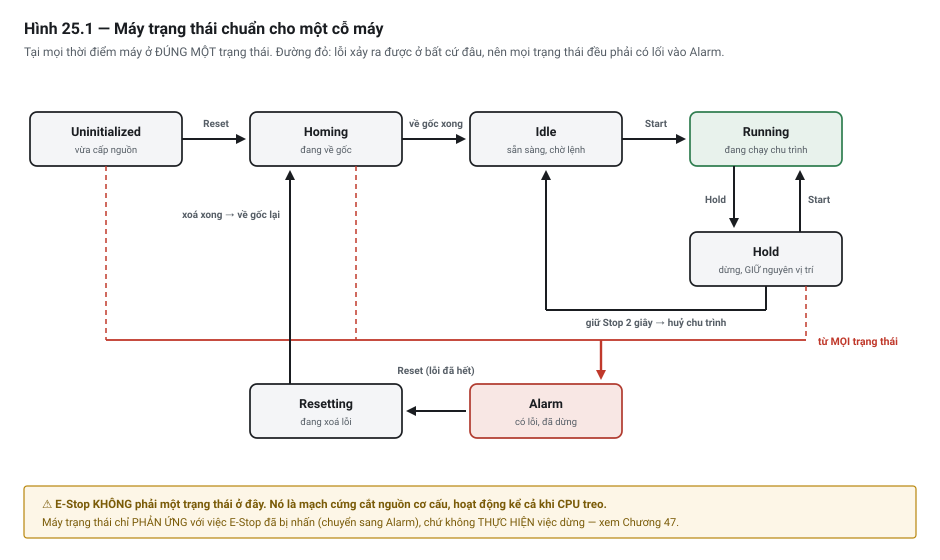

# Chương 25 — Thiết kế theo máy trạng thái

> **Lát cắt máy mẫu:** 2 — chuyền, chặn, nâng kẹp, cảm biến board, nút bấm, đèn tháp, cộng thêm mô hình
> trạng thái hai trạm và trình tự song song.

---

## 25.1 Bài toán: cỗ máy ở hai trạng thái cùng lúc

Một kỹ sư viết chương trình cho DP-01. Cách làm rất tự nhiên: mỗi tình huống một cờ.

```text
M_Running     — máy đang chạy tự động
M_Paused      — máy đang tạm dừng
M_Homing      — máy đang về gốc
M_Fault       — máy đang lỗi
```

Mỗi cờ được bật/tắt ở chỗ cần thiết. Chạy thử: tốt. Thêm chế độ tay: vẫn tốt. Thêm xử lý mất khí: vẫn
tốt. Thêm nút Reset: **bắt đầu lạ**.

Một hôm máy dừng giữa chu trình. Kỹ thuật viên mở phần mềm xem, thấy:

```text
M_Running = 1        M_Paused  = 1
M_Homing  = 0        M_Fault   = 1
```

Máy **đang chạy, đang tạm dừng, và đang lỗi — cùng một lúc**. Không ai biết nên tin cờ nào. Không ai
biết nhấn Reset thì máy sẽ làm gì.

Đây không phải lỗi lập trình cẩu thả. Đây là **hậu quả toán học tất yếu** của cách tổ chức đó: bốn cờ
độc lập sinh ra 16 tổ hợp, mà chỉ 4 tổ hợp có nghĩa. Mười hai tổ hợp còn lại là vùng chưa ai định
nghĩa — và chương trình càng lớn thì xác suất rơi vào đó càng cao.

Chương này là cách thoát khỏi vùng đó: thay vì nhiều cờ độc lập, dùng **một biến duy nhất** cho biết
máy đang ở đâu.

---

## 25.2 Máy trạng thái là gì

**Máy trạng thái** *(state machine)* là một cách mô tả hệ thống bằng ba thứ, và chỉ ba thứ:

1. **Tập trạng thái** — danh sách đầy đủ những chỗ máy có thể ở. Hữu hạn, đặt tên rõ ràng.
2. **Trạng thái hiện tại** — **đúng một** trạng thái tại mỗi thời điểm. Không hai, không không.
3. **Các chuyển tiếp** *(transition)* — từ trạng thái nào sang trạng thái nào, với điều kiện gì.

Bất biến quan trọng nhất nằm ở dòng thứ hai:

> **Tại mọi thời điểm, máy ở đúng một trạng thái.**
>
> Không phải quy ước cho gọn — đây là **tính chất được bảo đảm bởi cấu trúc dữ liệu**: nếu trạng thái
> được lưu trong *một* biến, thì việc "ở hai trạng thái cùng lúc" **không biểu diễn được**, nên không
> xảy ra được.

So sánh trực tiếp với cách dùng cờ rải rác:

| | Nhiều cờ độc lập | Một biến trạng thái |
|---|---|---|
| Số tổ hợp biểu diễn được | 2ⁿ (n cờ → 16 với 4 cờ) | Đúng bằng số trạng thái đã định nghĩa |
| Tổ hợp vô nghĩa | **Có, và nhiều hơn tổ hợp có nghĩa** | **Không tồn tại** |
| Muốn biết máy đang ở đâu | Đọc n bit rồi tự suy luận | **Đọc một biến** |
| Thêm một trạng thái mới | Thêm một cờ → số tổ hợp nhân đôi | Thêm một giá trị → tuyến tính |
| Kiểm thử | Phải thử 2ⁿ tổ hợp | Thử từng trạng thái và từng chuyển tiếp |

Cột cuối là lý do thực tế nhất. Với bốn cờ, kiểm thử đầy đủ nghĩa là thử 16 tổ hợp — và bạn sẽ không
làm. Với một biến bốn trạng thái, bạn thử bốn trạng thái. Việc đó làm được.

> 💡 **MẸO — cách nhận ra chương trình đang cần máy trạng thái**
> Nếu bạn thấy mình viết một dòng kiểu `IF M_Running AND NOT M_Paused AND NOT M_Fault THEN…` — nghĩa là
> bạn **đang tự tay dựng lại** một trạng thái từ nhiều mảnh. Đó là dấu hiệu rõ ràng: hãy đặt tên cho
> trạng thái đó và lưu nó vào một biến.

---

## 25.3 Mô hình trạng thái chuẩn cho một cỗ máy

Máy tự động hoá, dù làm gì, gần như luôn quy về **bảy trạng thái** dưới đây. Bạn có thể bớt (máy đơn
giản không cần `Hold`) nhưng hiếm khi cần thêm.



*Hình 25.1 — Bảy trạng thái và các chuyển tiếp hợp lệ. Mũi tên đỏ từ mọi trạng thái vào Alarm là điểm
mấu chốt: lỗi có thể xảy ra ở bất cứ đâu.*

| Trạng thái | Máy đang làm gì | Ra khỏi bằng cách nào |
|---|---|---|
| **Uninitialized** | Vừa cấp nguồn. Chưa biết cơ cấu đang ở đâu | Người vận hành yêu cầu về gốc |
| **Homing** | Đang đưa các cơ cấu về vị trí gốc đã biết | Về gốc xong → `Idle`; lỗi → `Alarm` |
| **Idle** | Đã về gốc, đủ điều kiện, đang chờ lệnh | Nhấn Start → `Running`; chọn tay → `Manual` |
| **Running** | Đang chạy chu trình tự động | Nhấn Hold; nhấn Stop; hoặc phát sinh lỗi |
| **Hold** | Đã dừng có kiểm soát, **giữ nguyên vị trí và sản phẩm** | Tiếp tục → `Running`; huỷ → `Idle` |
| **Alarm** | Có lỗi. Mọi chuyển động đã dừng | Xử lý xong nguyên nhân → nhấn Reset |
| **Resetting** | Đang xoá lỗi và kiểm tra điều kiện | Sạch lỗi → `Homing` (không về thẳng `Idle` — xem dưới); còn lỗi → `Alarm` |

### Ba quyết định thiết kế cần hiểu, không chỉ chép

**Vì sao `Uninitialized` tách khỏi `Idle`.** Vừa cấp nguồn, PLC **không biết** xy-lanh đang ra hay vào,
board đang nằm ở đâu. `Idle` nghĩa là "đã biết mọi thứ ở đâu và sẵn sàng chạy" — một lời hứa mà máy
chưa về gốc không giữ được. Gộp hai trạng thái này là mời máy khởi động từ một tư thế không xác định.

**Vì sao `Resetting` không về thẳng `Idle`.** Sau khi lỗi được xoá, các cơ cấu vẫn đang ở tư thế dở
dang từ lúc sự cố. `Idle` đòi hỏi đã về gốc. Nên đường đúng là `Resetting → Homing → Idle`. Đây là
một trong những chỗ người mới hay cắt ngắn, và hậu quả là **máy khởi động lại từ tư thế bất kỳ** —
Chương 28 mổ xẻ đầy đủ.

**Vì sao mọi trạng thái đều có đường vào `Alarm`.** Lỗi không xin phép. Mất khí có thể xảy ra lúc đang
`Homing`, cảm biến có thể hỏng lúc đang `Idle`. Nếu bạn chỉ cho phép `Running → Alarm` thì lỗi phát
sinh ở trạng thái khác sẽ **không có chỗ đi** — máy kẹt ở một trạng thái mà điều kiện của nó không còn
đúng nữa.

> ⚡ **LƯU Ý — `Hold` khác `Stop` ở chỗ nào**
> `Hold` là **dừng có kiểm soát, giữ nguyên hiện trạng** để chạy tiếp được: board vẫn kẹp, vị trí vẫn
> giữ, chu trình nhớ đang ở bước nào. `Stop` là **kết thúc chu trình**: nhả sản phẩm, về gốc, quay lại
> `Idle`. Hai thứ này thường bị gộp làm một, và hậu quả là người vận hành nhấn "dừng" rồi không biết
> máy sẽ giữ hay nhả board đang gia công.

> ⚠ **NGUY HIỂM**
> Không trạng thái nào ở đây là **dừng khẩn cấp**. E-Stop **không phải một trạng thái trong máy trạng
> thái** — nó là mạch cứng cắt nguồn cơ cấu, hoạt động kể cả khi CPU treo. Máy trạng thái chỉ *phản
> ứng* với việc E-Stop đã bị nhấn (chuyển sang `Alarm`), chứ **không thực hiện** việc dừng. Chương 47.

---

## 25.4 Bảng chuyển trạng thái — công cụ làm việc thật

Sơ đồ để nhìn tổng thể; **bảng để làm việc**. Bảng chuyển trạng thái là thứ bạn điền *trước khi* viết
dòng code đầu tiên, và là thứ đội kiểm thử dùng để soát.

Mỗi dòng là một chuyển tiếp, và phải trả lời đủ bốn cột:

| Từ | Điều kiện chuyển | Sang | Hành động khi vào trạng thái mới |
|---|---|---|---|
| Uninitialized | `DI_ResetPB` và không có lỗi | Homing | Bật đèn vàng; bắt đầu trình tự về gốc |
| Homing | Mọi cơ cấu báo đã ở gốc | Idle | Bật đèn vàng; xoá bước chu trình về 0 |
| Homing | Quá thời gian cho phép | Alarm | Ghi mã lỗi "về gốc quá thời gian" |
| Idle | `DI_StartPB` và cửa đóng và khí đủ | Running | Bật đèn xanh; cho phép chuyền chạy |
| Running | `DI_StopPB` (nút Hold) | Hold | Bật đèn vàng; **giữ nguyên mọi ngõ ra vị trí** |
| Running | Bất kỳ điều kiện lỗi nào | Alarm | Bật đèn đỏ + còi; cắt lệnh chuyển động |
| Hold | `DI_StartPB` | Running | Bật đèn xanh; chạy tiếp từ bước đang nhớ |
| Hold | Giữ `DI_StopPB` quá 2 giây | Idle | Nhả sản phẩm theo quy trình an toàn, về gốc |
| Alarm | Sườn lên `DI_ResetPB` | Resetting | Tắt còi; ra lệnh xoá mọi cờ lỗi (`M_ClearFaults`) |
| Resetting | Hết thời lượng xoá, **không còn cờ nào** | Homing | Bắt đầu trình tự về gốc |
| Resetting | Hết thời lượng xoá, **còn cờ chốt lại** — nguyên nhân chưa hết | Alarm | Giữ đèn đỏ; còi không kêu lại |
| **Mọi trạng thái** | Mất khí / mất mạch an toàn / lỗi cơ cấu | Alarm | Như trên |

Cột thứ tư — **hành động khi vào trạng thái** *(entry action)* — là cột người mới hay bỏ trống, và đó
là nguồn của rất nhiều lỗi. Xem Bẫy 1.

> 💡 **MẸO**
> Điền bảng này **bằng bút trên giấy, cùng với người vận hành**, trước khi mở phần mềm. Người vận hành
> sẽ hỏi những câu bạn không nghĩ tới: *"đang chạy mà mất điện thì board còn kẹp không?"*, *"nhấn Reset
> lúc còn board trong máy thì nó làm gì?"*. Mỗi câu như vậy là một dòng còn thiếu trong bảng.

---

## 25.5 Hiện thực hoá — hai cách

Máy trạng thái không phụ thuộc ngôn ngữ. Dưới đây là cùng một mô hình, viết hai kiểu.

### Cách 1 — biến trạng thái + `CASE` (Structured Text)

Cách gọn nhất khi ngôn ngữ có `CASE`.

```iecst
// Khai báo trạng thái bằng kiểu liệt kê — KHÔNG dùng số trần
TYPE E_MachineState :
    (Uninitialized, Homing, Idle, Running, Hold, Alarm, Resetting);
END_TYPE

VAR
    MachineState : E_MachineState := Uninitialized;
    T_Resetting  : TON;
END_VAR

// M_AnyFault đã được GOM ở đúng một chỗ, ngay trước đoạn này (mục 25.5c)

// ── Chuyển tiếp ưu tiên cao nhất: lỗi từ BẤT KỲ trạng thái nào ──
// Đặt TRƯỚC khối CASE để nó luôn thắng
IF M_AnyFault AND MachineState <> Alarm AND MachineState <> Resetting THEN
    MachineState := Alarm;
    DO_LampRed  := TRUE;
    DO_Buzzer   := TRUE;
    M_MotionEnable := FALSE;          // cắt mọi lệnh chuyển động
END_IF;

// Thời lượng của Resetting — gọi đúng MỘT lần, ngoài CASE (Chương 17, Bẫy 5)
T_Resetting(IN := (MachineState = Resetting), PT := T#200MS);

CASE MachineState OF

    Uninitialized:
        DO_LampYellow := TRUE;
        IF R_TRIG_Reset.Q THEN                 // bắt sườn lên nút Reset
            MachineState := Homing;
        END_IF;

    Homing:
        M_HomingRun := TRUE;                   // gọi trình tự về gốc (Ch.28)
        IF M_HomingDone THEN
            M_HomingRun := FALSE;
            M_CycleStep := 0;                  // xoá bước chu trình
            MachineState := Idle;
        END_IF;
        // timeout xử lý bên trong trình tự về gốc → chốt M_Alm_HomeTimeout (Ch.28)

    Idle:
        DO_LampYellow := TRUE;
        IF R_TRIG_Start.Q AND M_AllPermissive THEN
            MachineState := Running;
        END_IF;

    Running:
        DO_LampGreen   := TRUE;
        M_CycleEnable  := TRUE;                // cho phép trình tự chạy (Ch.26)
        IF R_TRIG_Stop.Q THEN
            M_CycleEnable := FALSE;            // dừng nhưng GIỮ nguyên vị trí
            MachineState  := Hold;
        END_IF;

    Hold:
        DO_LampYellow := TRUE;
        IF R_TRIG_Start.Q THEN
            MachineState := Running;           // chạy tiếp từ bước đang nhớ
        ELSIF T_StopHeld.Q THEN                // giữ nút Stop quá 2 giây
            MachineState := Idle;              // huỷ chu trình, về gốc
        END_IF;

    Alarm:
        DO_LampRed := TRUE;
        IF R_TRIG_Reset.Q THEN                 // chỉ cần SƯỜN LÊN — việc xét nguyên nhân
            MachineState := Resetting;         // giao cho Resetting (mục 25.5c)
        END_IF;

    Resetting:
        M_ClearFaults := TRUE;                 // mọi chủ cờ lỗi tự xoá cờ của mình…
        DO_Buzzer     := FALSE;
        IF T_Resetting.Q THEN                  // …và đã có đủ vòng quét để làm việc đó
            M_ClearFaults := FALSE;
            IF M_AnyFault THEN
                MachineState := Alarm;         // nguyên nhân còn → cờ đã chốt lại
            ELSE
                MachineState := Homing;        // KHÔNG về thẳng Idle
            END_IF;
        END_IF;

END_CASE;
```

Ba điểm đáng chú ý trong đoạn trên:

- **Khối lỗi đặt ngoài và trước `CASE`.** Nhờ vậy nó thắng mọi trạng thái, đúng như dòng cuối bảng
  chuyển trạng thái. Nếu nhét điều kiện lỗi vào từng nhánh `CASE` thì bạn phải nhớ lặp lại ở bảy chỗ,
  và sẽ quên ít nhất một chỗ.
- **Dùng kiểu liệt kê, không dùng số trần.** `MachineState := 3` không nói lên điều gì khi bạn xem
  trạng thái trực tuyến lúc hai giờ sáng; `Running` thì nói.
- **Reset chỉ cần sườn lên — việc xét nguyên nhân thuộc về `Resetting`.** Nó ra lệnh xoá, chờ đủ
  lâu cho mọi nơi giữ cờ lỗi tự xoá rồi **phát hiện lại**, sau đó mới xem còn lỗi không. Nguyên nhân
  còn thì cờ đã chốt lại → quay về `Alarm`, **một lần cho mỗi lần nhấn** — không quay vòng. ⚠⚠ Đừng
  viết `IF R_TRIG_Reset.Q AND NOT M_AnyFault`: khi cờ lỗi chỉ được xoá **bên trong** `Resetting`,
  điều kiện đó không bao giờ đúng và máy **khoá chết** ở `Alarm` (mục 25.5c).

### Cách 2 — bit trạng thái (Ladder Diagram)

Khi phải viết bằng ladder — thường vì đội bảo trì tại nhà máy chỉ đọc được ladder (xem Chương 20) —
dùng **một bit cho mỗi trạng thái**, kèm một quy tắc bắt buộc.

```text
// Mỗi trạng thái một bit
S_Uninit   S_Homing   S_Idle   S_Running   S_Hold   S_Alarm   S_Resetting
```

> ⚠ **NGUY HIỂM — quy tắc bắt buộc khi dùng bit trạng thái**
> Cách này **đưa trở lại đúng rủi ro mà máy trạng thái sinh ra để tránh**: bảy bit độc lập lại có 128
> tổ hợp. Nó chỉ an toàn nếu bạn **cưỡng chế bất biến "đúng một bit bật"** bằng cấu trúc code:
>
> - Mọi chuyển tiếp viết theo mẫu **bật bit mới, tắt bit cũ, trong cùng một nấc thang**.
> - Thêm một nấc **giám sát**: đếm số bit đang bật; khác 1 thì **chốt** một cờ lỗi riêng,
>   `M_Alm_StateInvalid`, gom vào `M_AnyFault` như mọi nguồn lỗi khác (mục 25.5c). Nấc này là lưới
>   an toàn — nó biến một lỗi logic âm thầm thành một báo động nhìn thấy được.

```text
// Nấc chuyển tiếp: Idle → Running
   S_Idle   DI_StartPB   M_AllPermissive              S_Running
 ────┤ ├───────┤ ├───────────┤ ├────────────────┬────────( S )──
                                                │
                                                └────────( R )──  S_Idle

// Nấc giám sát bất biến — luôn có, không bao giờ bỏ
   [ĐẾM số bit trạng thái đang bật] → M_StateCount
   M_ClearFaults      ─────────────────────────────( R )──  M_Alm_StateInvalid   // xoá TRƯỚC
   M_StateCount <> 1  ─────────────────────────────( S )──  M_Alm_StateInvalid   // phát hiện SAU
```

### Chọn cách nào

| | Biến + `CASE` | Bit trạng thái | ⭐ Lệnh tuần tự của hãng |
|---|---|---|---|
| Bất biến "một trạng thái" | **Được bảo đảm bởi kiểu dữ liệu** | Phải tự cưỡng chế + giám sát | ⭐ **Do chính lệnh bảo đảm** |
| Đọc trạng thái khi gỡ lỗi | Xem một biến | Xem bảy bit | Xem bước đang hoạt |
| Đội bảo trì đọc ladder | Không đọc được | **Đọc được** | ⚠ Đọc được **nếu đã quen cú pháp riêng đó** |
| Thêm trạng thái | Thêm một giá trị | Thêm một bit + sửa nấc giám sát | Thêm một bước |
| ⚠⚠ **Khả chuyển sang hãng khác** | ⭐ Cao | ⭐ **Cao nhất** — chỉ là bit và tiếp điểm | ⚠⚠ **Bằng không** |

### ⭐ Cột thứ ba là gì

Nhiều hệ có sẵn **một nhóm lệnh chuyên để viết trình tự**: bước, chuyển tiếp, và cơ chế tự tắt bước
trước khi bật bước sau. Tên gọi khác nhau theo hãng — *step ladder*, *sequencer*, *drum* — nhưng ý
tưởng giống nhau, và chúng ⭐ **làm hộ bạn đúng cái bất biến "chỉ một bước hoạt tại một thời điểm"**.

| ⭐ Được gì | ⚠ Mất gì |
|---|---|
| Bất biến được **lệnh bảo đảm**, không phải do bạn tự canh | ⚠⚠ **Khoá chặt vào hãng** — không có lệnh tương đương khi đổi hệ (Chương 14 mục 14.6b) |
| Viết nhanh, ít nấc thang hơn | ⚠ Người chưa quen cú pháp đó **không đọc được**, kể cả khi họ thạo ladder |
| Trình soạn thảo thường có màn theo dõi bước riêng | ⚠ Hành vi ở **trường hợp biên** (nhảy bước, huỷ giữa chừng, khởi động lại) **khác nhau giữa các hãng** — phải tra |

> ⭐⭐ **Khi nào nên dùng cột thứ ba:** máy sẽ **ở lại trên một nền duy nhất** suốt đời, đội bảo trì
> đã quen cú pháp đó, và trình tự **thuần tuần tự** — không có nhiều nhánh song song.
>
> ⚠ **Khi nào tránh:** làm máy để **bán cho nhiều khách dùng nhiều hãng khác nhau**, hoặc nhóm kỹ
> thuật còn đang xoay vòng giữa vài nền. ⭐ Khi đó cái giá *"khả chuyển bằng không"* là cái giá thật,
> và nó chỉ hiện ra ở dự án sau.

Tiêu chí quyết định **không phải kỹ thuật mà là tổ chức**: ai sẽ sửa cỗ máy này lúc hai giờ sáng khi
bạn không có mặt? Viết cho người đó đọc.

---

## 25.5b ⭐⭐ Bất biến nằm dưới mọi cách hiện thực — và câu hỏi ưu tiên

Hai cách ở mục trên trông rất khác nhau, nhưng ⭐ **cả hai đang cưỡng chế cùng một bất biến**. Phát
biểu nó thành một câu là cách chắc nhất để kiểm code của mình — và của người khác:

> ⭐⭐ **Một trạng thái đang BẬT nếu: nó đã bật sẵn, HOẶC vừa được một chuyển tiếp đưa vào —**
> **và nó chưa bị một chuyển tiếp nào đưa ra.**

| Vế của bất biến | Nếu quên vế này |
|---|---|
| *"đã bật sẵn"* | ⚠ Trạng thái **tắt ngay vòng quét sau** khi điều kiện vào không còn đúng |
| *"vừa được chuyển tiếp đưa vào"* | ⚠ Không bao giờ vào được trạng thái |
| ⚠⚠ *"chưa bị chuyển tiếp nào đưa ra"* | ⚠⚠ **Vào được nhưng không ra được** — đúng Bẫy 2 ở dưới |

⭐ Mỗi trạng thái cần **một** biểu thức như vậy. Khi rà code người khác, hãy tìm đủ ba vế cho từng
trạng thái — thiếu vế nào thì lỗi thuộc đúng loại ở bảng trên.

### ⚠⚠ Câu hỏi ưu tiên: hai chuyển tiếp cùng đúng trong MỘT vòng quét thì sao?

Bảng chuyển trạng thái ở mục 25.4 liệt kê các chuyển tiếp hợp lệ, nhưng nó **không trả lời** câu hỏi
này: ⚠ từ một trạng thái có hai đường ra, và **cả hai điều kiện cùng đúng ở cùng một vòng quét**.

Tình huống này **không hiếm**: nút Dừng bị nhấn đúng lúc cảm biến báo xong; báo lỗi xuất hiện đúng lúc
bước hoàn tất.

| Cách hiện thực | Chuyện gì xảy ra |
|---|---|
| ⭐ Biến + `CASE` | **Nhánh `IF` nào viết trước thì thắng** — ưu tiên có sẵn, do **thứ tự code** |
| ⚠⚠ Bit trạng thái (ladder) | ⚠ Không có ưu tiên tự nhiên — ⭐ **có thể bật hai bit, hoặc tắt cả hai** |

> ⭐⭐ **Quy tắc: ưu tiên phải là một quyết định được viết ra, không phải hệ quả tình cờ của thứ tự
> gõ code.**
>
> Với `CASE`, ⚠ **thứ tự các nhánh `IF` CHÍNH LÀ bảng ưu tiên của bạn** — dù bạn có ý thức hay không.
> ⭐ Hãy **ghi thứ tự đó ra thành comment**, và đặt chuyển tiếp *về lỗi* lên **trên cùng**.
>
> Với bit trạng thái, ⭐ phải **cưỡng chế tường minh**: điều kiện của đường ra ưu tiên thấp phải kèm
> *"và đường ưu tiên cao không đúng"*.

> ⭐ **Thứ tự ưu tiên mặc định đáng dùng**, từ cao xuống thấp:
>
> | | Chuyển tiếp |
> |---|---|
> | 1 | ⚠⚠ **Về `Alarm`** — từ bất kỳ trạng thái nào |
> | 2 | **Về `Stopping`** — người vận hành yêu cầu dừng |
> | 3 | Chuyển tiếp bình thường của quy trình |
>
> ⚡ Lý do thứ tự này: ⭐ **an toàn và ý muốn của người vận hành luôn thắng tiến độ sản xuất.**

> ⚡ **Về cái giá của cách "bit trạng thái":** nó tạo ra chương trình **dài hơn và kém hiệu quả hơn**
> so với cách viết bằng biểu thức gọn. ⭐ Nhưng nó **dễ hiểu và dễ gỡ lỗi hơn hẳn** — và với phần mềm
> máy, đó là đánh đổi **đúng**, đúng theo tiêu chí tổ chức ở mục trên: *ai sửa cỗ máy này lúc hai giờ
> sáng?*

---

## 25.5c ⭐⭐ Đường đi của lỗi — chốt ở nguồn, gom một chỗ, xoá qua `Resetting`

Máy trạng thái ở mục 25.5 **đọc** một cờ `M_AnyFault`. Nhưng nó bỏ ngỏ hai câu hỏi: **ai ghi cờ đó, và
ai xoá nó?** ⚠ Trả lời sai hai câu này thì một máy trạng thái đúng từng dòng vẫn **khoá chết**.

### Ba cách hay gặp — cùng một bài toán

Bài toán: DP-01 có ba nguồn lỗi — mất khí, một bước của trạm 1 quá giờ, trình tự về gốc quá giờ.

```iecst
// ── A · Một cờ chung, SET/RESET ──
IF NOT DI_AirOK OR T_Stn1Step.Q OR T_Home.Q THEN
    M_AnyFault := TRUE;
END_IF;
IF DI_ResetPB AND DI_AirOK AND NOT T_Stn1Step.Q AND NOT T_Home.Q THEN
    M_AnyFault := FALSE;
END_IF;

// ── B · Mỗi nguồn ghi thẳng cờ chung ──
IF T_Stn1Step.Q THEN  Stn1_Fault := TRUE;  M_AnyFault := TRUE;  END_IF;   // trong trạm 1
IF T_Home.Q     THEN  M_AnyFault := TRUE;                       END_IF;   // trong trình tự về gốc

// ── C · Mỗi nguồn MỘT cờ của riêng nó, gom MỘT chỗ, xoá qua Resetting ──
IF M_ClearFaults THEN  Stn1_Fault := FALSE;  END_IF;       // chủ cờ: xoá TRƯỚC…
IF T_Stn1Step.Q  THEN  Stn1_Fault := TRUE;   END_IF;       // …phát hiện SAU
M_AnyFault := M_Alm_AirLow OR Stn1_Fault OR M_Alm_HomeTimeout;    // đúng MỘT chỗ gán
```

| Cách | ⭐ Ưu | ⚠ Nhược |
|---|---|---|
| A — một cờ chung | Ngắn nhất | Mất thông tin *lỗi gì*. Nhánh RESET phải **liệt kê lại** mọi nguyên nhân — thêm một nguồn là sửa **hai** chỗ, quên chỗ thứ hai thì Reset xoá một lỗi còn nguyên nhân |
| B — mỗi nơi ghi thẳng | Đoạn nào cũng tự đứng được | ⚠⚠ **Nhiều nơi ghi một biến**, và **không ai xoá** — chính là thứ gây khoá chết ở dưới |
| ⭐ **C — chốt ở nguồn, gom một chỗ** | Mỗi cờ **một nơi ghi**; biết đích danh lỗi gì; thêm nguồn = thêm một cờ và một vế `OR`; ⭐ **không phụ thuộc thứ tự gọi** | Thêm một biến lệnh xoá, và `Resetting` phải kéo dài vài trăm mili-giây |

⭐ **Sách dùng cách C** — ở mọi chương về sau.

### ⚠⚠ Vì sao cách B khoá chết máy

Viết `Alarm → Resetting` với điều kiện `R_TRIG_Reset.Q AND NOT M_AnyFault`, trong khi cờ lỗi chỉ được
xoá **bên trong** `Resetting` — thì:

1. Lỗi xảy ra → cờ chốt → `M_AnyFault` = TRUE → máy vào `Alarm`.
2. Muốn rời `Alarm` phải có `NOT M_AnyFault`.
3. Muốn `M_AnyFault` về FALSE phải vào được `Resetting`.

⚡ Vòng tròn khép kín. **Máy chỉ ra khỏi `Alarm` bằng cách tắt nguồn.** Và ⚠ không phải chỉ lý thuyết:
cờ quá giờ của trạm được chốt ở một chỗ mà khi máy dừng thì **không còn được thực thi** — thân trình tự
bị cửa vào chặn lại (Chương 26), nên kể cả thêm dòng *"xoá khi nguyên nhân hết"* vào đó cũng vô ích:
dòng đó không bao giờ chạy.

> ⭐ Mô phỏng từng vòng quét ba khối — nguồn lỗi, gom, tầng máy — ở **cả sáu** thứ tự gọi có thể: cách B
> kẹt ở `Alarm` ở **cả sáu** với lỗi quá giờ, và với lỗi mất khí thì nhấn Reset một lần có thành công
> hay không **tuỳ vào thứ tự gọi**. Cách C cho đúng kết quả ở cả sáu.

### ⭐ Ba quy tắc của cách C

| # | Quy tắc | Vì sao |
|:-:|---|---|
| 1 | **Mỗi nguồn lỗi tự chốt cờ của chính nó** — `M_Alm_…` cho nguồn chung, `Stn1_Fault` cho trạm, `.Fault` cho khối cơ cấu. Không ai khác ghi vào cờ đó | Một biến, một nơi ghi (Chương 10). Và cờ nói được **lỗi gì** |
| 2 | ⭐ **`M_AnyFault` được GÁN đúng một chỗ** — phép `OR` của mọi cờ, tính lại mỗi vòng, đặt **sau** tầng cơ cấu và **trước** tầng máy. Không nguồn nào ghi thẳng `M_AnyFault` | Hai nơi cùng ghi thì phép gán chạy sau **xoá mất** lỗi của phép chạy trước |
| 3 | ⭐⭐ **Xoá đi qua `Resetting`.** Chủ cờ xoá cờ của mình **khi thấy `M_ClearFaults`**, đặt dòng xoá **trước** dòng phát hiện | Nguyên nhân còn thì cờ chốt lại ngay trong vòng đó — `Resetting` nhìn thấy và đưa máy về `Alarm`. ⭐ Việc *"nguyên nhân đã hết chưa"* giao cho **đúng nơi biết nguyên nhân** |

⭐ **Vì sao cách C không phụ thuộc thứ tự gọi:** `M_ClearFaults` kéo dài **nhiều vòng quét**
(`T_Resetting`), nên chủ cờ đứng trước hay sau tầng máy đều kịp thấy nó; và tầng máy chỉ đọc kết quả
**sau khi** lệnh xoá đã tắt. Thời lượng 200 ms ở đoạn mã trên phải **lớn hơn vài lần chu kỳ tác vụ chậm
nhất** có chứa cờ lỗi (Chương 27 mục 27.6).

### Gom lỗi trên DP-01

```iecst
// ── GOM LỖI — đúng MỘT chỗ gán M_AnyFault; chạy SAU các nguồn lỗi, TRƯỚC tầng máy ──
M_AnyFault := M_Alm_AirLow                    // nguồn chung (Phụ lục L mục L.11)
              OR Stn1_Fault OR Stn2_Fault     // tầng trạm (Chương 26)
              OR M_Alm_HomeTimeout            // trình tự về gốc (Chương 28)
              OR M_Alm_StateInvalid;          // giám sát bit trạng thái (mục 25.5)
// Chương 27 thêm cờ của các khối cơ cấu: … OR Clamp1.Fault OR …
```

> ⚡ **Quy ước cho mọi đoạn trích từ đây về sau:** mỗi nguồn lỗi chỉ viết dòng **chốt**
> (`M_Alm_… := TRUE`). Dòng **xoá** luôn theo đúng một mẫu nên sách không lặp lại —
> `IF M_ClearFaults AND <nguyên nhân đã hết> THEN M_Alm_… := FALSE; END_IF;` — đặt **trước** dòng chốt;
> và mỗi cờ mới là **một vế `OR`** thêm vào phép gom.

> ⭐ Đây chính là cách một khối cơ cấu tốt tự làm bên trong nó — *xoá trước, phát hiện sau* (khối
> `FB_Cylinder2Pos` ở Chương 27 mục 27.3). Cách C chỉ là áp đúng nguyên tắc đó cho cả cỗ máy.

---

## 25.6 Trạng thái máy tổng và trạng thái từng trạm

DP-01 có **hai trạm**. Câu hỏi tự nhiên: một máy trạng thái hay ba?

Câu trả lời: **ba** — một cho máy tổng, một cho mỗi trạm — xếp thành hai tầng.

```text
              ┌─────────────────────────────┐
              │   MachineState  (máy tổng)  │
              │   Idle / Running / Alarm …  │
              └──────────────┬──────────────┘
                             │  cho phép / cấm
              ┌──────────────┴──────────────┐
              ▼                             ▼
     ┌──────────────────┐          ┌──────────────────┐
     │  Stn1State       │          │  Stn2State       │
     │  (trạm tra keo)  │          │  (trạm sấy UV)   │
     │  Rỗng/Đang làm/  │          │  Rỗng/Đang làm/  │
     │  Chờ nhả         │          │  Chờ nhả         │
     └──────────────────┘          └──────────────────┘
```

Phân chia trách nhiệm rất rõ:

- **Máy tổng** quản lý những gì áp cho *cả cỗ máy*: đã về gốc chưa, có lỗi không, người vận hành đang
  cho phép chạy không. Nó **cho phép hoặc cấm**, không điều khiển chi tiết.
- **Trạm** quản lý *sản phẩm đang nằm ở trạm đó*: đã kẹp chưa, đã làm xong chưa, đã nhả chưa. Trạm
  chỉ chạy khi máy tổng cho phép.

Nhờ tách tầng, hai trạm **chạy song song trên hai board khác nhau** mà không giẫm chân nhau — ràng
buộc duy nhất giữa chúng là chỗ trống. Cách tổ chức tầng và cách hai trạm bắt tay là nội dung của
**Chương 27**.

> 💡 **MẸO**
> Ranh giới đúng: máy tổng **không được** biết trạm 1 đang ở bước nào. Nếu bạn thấy máy tổng phải đọc
> `Stn1Step = 4` để ra quyết định, nghĩa là trách nhiệm đã bị đặt sai tầng.

---

## 25.7 Bẫy thường gặp

### 🔍 BẪY 1 — Quên hành động khi vào trạng thái

Chuyển trạng thái được viết đúng, nhưng **quên làm gì đó khi vào trạng thái mới**. Ví dụ kinh điển:
chuyển sang `Alarm` mà quên tắt `M_CycleEnable`.

Kết quả: máy hiển thị đang lỗi, đèn đỏ sáng, còi kêu — mà **chu trình vẫn chạy tiếp**. Người vận hành
nhìn thấy hai thông tin mâu thuẫn và không biết tin cái nào.

**Cách phòng:** cột "hành động khi vào trạng thái" trong bảng chuyển trạng thái là **cột bắt buộc**.
Bảng nào để trống cột đó thì coi như chưa điền xong.

### 🔍 BẪY 2 — Trạng thái vào được nhưng không ra được

Bạn định nghĩa `Alarm`, viết điều kiện vào rất kỹ, rồi để điều kiện ra là `DI_ResetPB`. Nhưng nếu
nguyên nhân lỗi **vẫn còn**, nhấn Reset sẽ chuyển sang `Resetting` rồi lập tức quay lại `Alarm`. Máy
nhấp nháy giữa hai trạng thái mỗi vòng quét, đèn chớp loạn, và không ai hiểu chuyện gì.

Ngược lại cũng có: điều kiện ra chặt tới mức không bao giờ thoả. Máy kẹt vĩnh viễn, phải tắt nguồn.

**Cách phòng — hai việc, làm cả hai:**

1. Với **mỗi** trạng thái, tự hỏi: *"làm cách nào ra khỏi đây? Nếu điều kiện đó không bao giờ tới thì
   sao?"* Mọi trạng thái phải có ít nhất một đường ra khả thi.
2. Với trạng thái xử lý (`Homing`, `Resetting`), đặt **timeout** — quá thời gian thì sang `Alarm` với
   mã lỗi nói rõ kẹt ở đâu. Trạng thái không có đường thoát là trạng thái chưa thiết kế xong.
3. ⭐ Kích Reset bằng **sườn lên**, không bằng mức: giữ nút là đủ cho một lần thử, không phải một
   vòng lặp. Và để `Resetting` — không phải điều kiện vào của nó — quyết định còn lỗi hay không
   (mục 25.5c).

### 🔍 BẪY 3 — Nhồi trình tự vào máy trạng thái

Người mới hay tưởng mỗi *bước* của chu trình là một *trạng thái*, rồi tạo ra máy trạng thái ba mươi
trạng thái: `KepBoard`, `HaTrucZ`, `TraKeo`, `NangTrucZ`, `NhaKep`…

Đó là nhầm hai khái niệm khác nhau:

| | Trạng thái máy | Bước trình tự |
|---|---|---|
| Trả lời câu hỏi | Máy đang ở **chế độ** nào? | Chu trình đang làm **việc gì**? |
| Ai quan tâm | Người vận hành, đèn tháp, phân quyền | Chương trình, khi chạy tự động |
| Số lượng điển hình | 5–7 | 10–40 |
| Đổi khi nào | Người vận hành thao tác, hoặc có lỗi | Cơ cấu báo xong việc |

Cách đúng: **trạng thái `Running` chứa một trình tự bên trong nó**. Máy trạng thái quản lý chế độ;
trình tự bên trong quản lý các bước. Chương 26 xây phần trình tự đó.

### 🔍 BẪY 4 — Cho phép chuyển tiếp không có trong bảng

Bảng chuyển trạng thái liệt kê những chuyển tiếp **hợp lệ**. Nhưng nếu code cho phép gán
`MachineState := Idle` từ bất cứ đâu, thì bảng chỉ là tài liệu — không phải ràng buộc.

Nguy hiểm cụ thể: một đoạn code phụ nào đó đặt `MachineState := Idle` khi đang `Alarm`, và **lỗi biến
mất mà nguyên nhân còn nguyên**.

**Cách phòng:** chỉ gán `MachineState` **bên trong khối `CASE`** (hoặc trong các nấc chuyển tiếp đã
định danh). Dùng công cụ tham chiếu chéo để soát: mọi chỗ ghi vào `MachineState` phải khớp
đúng một dòng trong bảng. Đây là ứng dụng trực tiếp của quy tắc "mỗi biến chỉ được ghi ở nơi đã định"
ở Chương 10.

### 🔍 BẪY 5 — Trạng thái không phản ánh ra ngoài

Máy trạng thái chạy đúng, nhưng người vận hành **không nhìn thấy nó**. Đèn tháp bật theo một logic
riêng, màn hình hiển thị theo logic khác.

Kết quả: máy ở `Hold` mà đèn xanh vẫn sáng. Người vận hành tưởng máy đang chạy, đứng chờ, mười phút
sau mới phát hiện.

**Cách phòng:** đèn tháp và dòng trạng thái trên màn hình phải **suy ra trực tiếp từ biến trạng thái**,
không tính lại từ điều kiện khác:

```iecst
DO_LampGreen  := (MachineState = Running);
DO_LampYellow := (MachineState = Idle) OR (MachineState = Hold)
                 OR (MachineState = Homing) OR (MachineState = Uninitialized);
DO_LampRed    := (MachineState = Alarm);
```

Ba dòng, không điều kiện phụ. Đèn **không thể** nói khác biến trạng thái.

---

## 25.8 Khác biệt giữa các hãng

Khái niệm máy trạng thái **không phụ thuộc hãng** — nó là cách tổ chức tư duy, không phải tính năng
của phần mềm. Nhưng công cụ hỗ trợ thì khác nhau, và khác đủ để ảnh hưởng tới cách bạn hiện thực.

| Khía cạnh | Siemens | Mitsubishi | Rockwell | CODESYS / TwinCAT |
|---|---|---|---|---|
| **Kiểu liệt kê** *(enumeration)* | Có, khai báo trong SCL | Hạn chế hơn — thường dùng hằng số có tên | Không có kiểu liệt kê thật; dùng hằng số có tên | Có `TYPE` liệt kê đầy đủ |
| **Lệnh `CASE`** | Có trong SCL | Có trong ST của GX Works3 | Có trong routine ST | Có |
| **Ngôn ngữ SFC sẵn có** | **S7-GRAPH** | **SFC / MELSAP3** | Routine kiểu **SFC** | SFC theo chuẩn |
| **Xem trạng thái trực tuyến** | Hiện tên nếu dùng kiểu liệt kê | Thường hiện số | Hiện giá trị tag | Hiện tên nếu dùng kiểu liệt kê |

> 💡 **Hệ không có kiểu liệt kê thì làm gì?**
> Dùng **hằng số có tên**, và tuyệt đối không viết số trần trong code: `STATE_IDLE := 10`,
> `STATE_HOMING := 20`. Bạn mất khả năng hiện tên khi giám sát trực tuyến, nên bù lại bằng cách
> **hiển thị tên trạng thái trên màn hình vận hành** (Chương 44) — người vận hành và người bảo trì
> cần cái tên đó hơn bạn nhiều.

> ⚠ **Về SFC — cả ba hãng lớn đều có, nhưng nó không phải câu trả lời cho chương này.**
> SFC diễn đạt **trình tự** rất tốt (Chương 26). Nó diễn đạt **chế độ máy** kém, vì máy trạng thái ở
> chương này cần đường "từ **mọi** trạng thái đều nhảy được vào `Alarm`" — thứ mà SFC phải vẽ rất
> rườm rà. Cách thường gặp trong thực tế, và cũng là khuyến nghị của sách: **chế độ máy dùng `CASE`;
> trình tự bên trong chế độ `Running` thì dùng SFC hoặc `CASE`.**
>
> Thêm một lý do thực dụng: S7-GRAPH và các gói SFC tương đương ở hãng khác **thường nằm trong gói
> bản quyền riêng hoặc ấn bản phần mềm cao hơn**. Kiểm trước khi thiết kế dựa vào nó (Chương 13).

Chi tiết đối chiếu năm hệ: **Phụ lục A1**.

## 25.9 Bảng chốt — dùng khi thiết kế máy mới

| Bước | Việc phải làm | Xong khi |
|---|---|---|
| 1 | Liệt kê **tập trạng thái** | Có 5–7 trạng thái, mỗi cái đặt tên bằng một từ người vận hành hiểu |
| 2 | Vẽ **sơ đồ chuyển tiếp** | Mọi trạng thái có ít nhất một đường vào và một đường ra |
| 3 | Điền **bảng chuyển trạng thái** đủ 4 cột | Không dòng nào để trống cột "hành động khi vào" |
| 4 | Thêm dòng **"mọi trạng thái → Alarm"** | Đã liệt kê hết các nguồn lỗi |
| 5 | Đặt **timeout** cho mọi trạng thái xử lý | `Homing`, `Resetting` đều có |
| 6 | Chọn cách hiện thực | Theo tiêu chí *ai sẽ bảo trì*, không theo sở thích |
| 7 | Nối **đèn tháp và màn hình** thẳng vào biến trạng thái | Không có logic đèn riêng |
| 8 | Soát **mọi chỗ ghi vào biến trạng thái** | Khớp đúng số dòng của bảng |
| 9 | ⭐⭐ Kiểm **bất biến** đủ ba vế cho từng trạng thái | Đã bật · vừa được đưa vào · chưa bị đưa ra |
| 10 | ⚠⚠ **Viết ra thứ tự ưu tiên** của các chuyển tiếp | `Alarm` → `Stopping` → quy trình; có comment |
| 11 | Với bit trạng thái: **cưỡng chế ưu tiên tường minh** | Đường ưu tiên thấp kèm *"và đường cao không đúng"* |
| 12 | ⭐⭐ Soát **đường đi của lỗi** | Mỗi nguồn chốt cờ riêng; `M_AnyFault` gán **đúng một chỗ**; `Resetting` xoá (mục 25.5c) |

---

## 25.10 Tự kiểm

1. Giải thích cho một đồng nghiệp: vì sao bốn cờ độc lập **chắc chắn** sẽ dẫn tới trạng thái vô nghĩa,
   còn một biến trạng thái thì không? Trả lời bằng **con số**, không bằng cảm tính.
2. Vẽ lại **bảy trạng thái và các chuyển tiếp** không nhìn sách.
3. Vì sao `Resetting` đi tới `Homing` chứ **không** về thẳng `Idle`? Hậu quả nếu cắt ngắn là gì?
4. Vì sao **mọi** trạng thái đều phải có đường vào `Alarm`? Cho một ví dụ lỗi phát sinh ngoài `Running`.
5. Phân biệt **trạng thái máy** với **bước trình tự** — cho một ví dụ của mỗi loại trên DP-01.
6. Bạn phải viết bằng ladder vì đội bảo trì chỉ đọc được ladder. **Hai việc bắt buộc** để cách bit
   trạng thái không quay lại đúng vấn đề của cờ rải rác là gì?
7. Máy đang `Hold` mà đèn xanh vẫn sáng. Nguyên nhân gốc nằm ở đâu, và sửa thế nào cho lỗi này **không
   thể** tái diễn?
8. ⭐⭐ Phát biểu **bất biến** mà mọi cách hiện thực máy trạng thái đều phải cưỡng chế. Thiếu mỗi
    trong ba vế thì sinh ra lỗi gì?
9. ⚠⚠ Từ một trạng thái có hai đường ra, cả hai điều kiện cùng đúng ở **cùng một vòng quét**. Với
    `CASE` thì cái nào thắng? Với **bit trạng thái** thì sao? ⭐ Nêu cách cưỡng chế ưu tiên cho cách
    thứ hai.
10. ⭐ Vì sao chuyển tiếp **về `Alarm`** phải đứng trên cùng trong thứ tự ưu tiên?

Câu 1 và câu 3 là hai câu phân loại. Câu 1 kiểm tra bạn hiểu *vì sao* chứ không chỉ *làm thế nào*; câu
3 kiểm tra bạn có phản xạ về an toàn khi khởi động lại — thứ Chương 28 sẽ khai triển.

---

### Chương tiếp theo

**Chương 26 — Thiết kế theo lưu đồ & bit trình tự.** Chương này dựng khung *chế độ* của máy. Bên trong
trạng thái `Running` còn một chu trình gồm hàng chục bước — Chương 26 xây phần đó, kèm cách xử lý nhánh
song song và cách phát hiện bế tắc bằng timeout từng bước.

---

### Nguồn tham khảo chương 25

- IEC 61131-3 — *Programmable controllers, Part 3: Programming languages*: lệnh `CASE`, kiểu liệt kê,
  và ngôn ngữ SFC. *(tiêu chuẩn có bản quyền; chương này chỉ diễn giải ở mức khái niệm)*
- IEC 60204-1 — *Safety of machinery — Electrical equipment of machines*: phân biệt các loại lệnh dừng
  và yêu cầu về khởi động lại có chủ ý — cơ sở cho quyết định `Resetting → Homing` ở mục 25.3.
- Đặc tả trình tự và danh sách chức năng an toàn của DP-01 — Phụ lục J.
- **Hugh Jack** — *Automating Manufacturing Systems with PLCs*, ch. 12 *State Based Design*: ba cách
  chuyển sơ đồ trạng thái sang ladder (**block logic** · **state equations** · **state-transition
  equations**), ⭐⭐ **bất biến của phương trình trạng thái** (mục 25.5b), và ⚠ **ladder có ưu tiên**
  khi nhiều chuyển tiếp cùng đúng. Cũng là nguồn cho đánh đổi *"dài hơn và kém hiệu quả hơn, nhưng dễ
  hiểu và dễ gỡ lỗi hơn"* của cách bit trạng thái.

> ⚡ Bảy trạng thái ở mục 25.3 là **mô hình thực dụng đã được rút gọn cho máy tự động hoá rời rạc**,
> không phải một mô hình chuẩn hoá bắt buộc. Máy của bạn có thể cần bớt hoặc thêm — điều bắt buộc là
> *một biến, một trạng thái*, không phải con số bảy.
