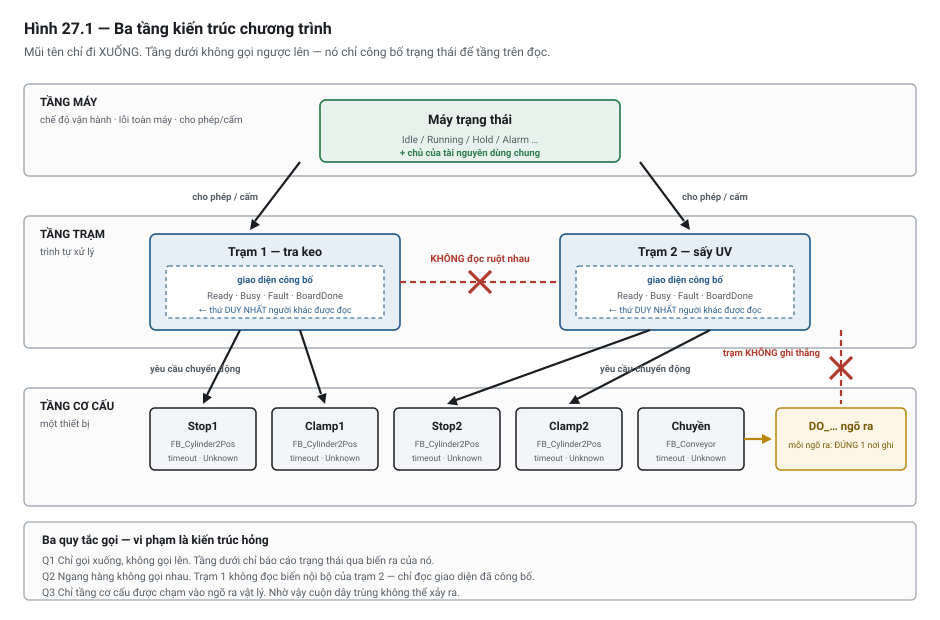

# Chương 27 — Kiến trúc chương trình cho máy nhiều trạm

> **Lát cắt máy mẫu:** 2 — chuyền, chặn, nâng kẹp, cảm biến board, nút bấm, đèn tháp, hai trạm, trình
> tự song song, công thức sản phẩm.

---

## 27.1 Chỗ chương trình sụp đổ khi máy lớn lên

Chương 25 cho bạn mô hình trạng thái, Chương 26 cho bạn trình tự các bước. Với **một trạm**, hai thứ
đó là đủ — chương trình gọn, đọc được, sửa được.

Rồi máy có **trạm thứ hai**.

Cách tự nhiên nhất là chép trình tự trạm 1 sang, đổi tên tag, thêm điều kiện để hai trạm không giẫm
chân nhau. Chạy được. Rồi thêm chế độ tay cho từng trạm. Rồi thêm xử lý khi trạm 2 lỗi mà trạm 1 vẫn
chạy. Rồi thêm trạm thứ ba.

Đến lúc nào đó, hiện tượng sau xuất hiện — và nó là **triệu chứng đặc trưng** của kiến trúc sai:

> **Sửa một thứ ở trạm 1 làm hỏng một thứ ở trạm 2, mà không ai giải thích được vì sao.**

Nguyên nhân không nằm ở chỗ nào cụ thể trong code. Nó nằm ở chỗ **hai trạm biết quá nhiều về nhau**.
Trạm 1 đọc bước hiện tại của trạm 2 để quyết định; trạm 2 ghi thẳng vào một cờ mà trạm 1 dùng; cả hai
cùng điều khiển chuyền. Mỗi liên kết như vậy là một sợi dây vô hình, và số sợi dây tăng theo bình
phương số trạm.

Chương này là cách tổ chức chương trình để số sợi dây đó **không tăng** khi máy lớn lên.

---

## 27.2 Ba tầng — và quy tắc gọi

Cách tổ chức đã được kiểm chứng là chia chương trình thành **ba tầng**, mỗi tầng một loại trách nhiệm.



*Hình 27.1 — Ba tầng và hướng gọi. Mũi tên chỉ đi xuống; tầng dưới không bao giờ gọi ngược lên.*

| Tầng | Trách nhiệm | Trả lời câu hỏi | Ví dụ ở DP-01 |
|---|---|---|---|
| **Máy** *(machine)* | Chế độ vận hành, lỗi toàn máy, cho phép/cấm | *Máy có được phép chạy không?* | Máy trạng thái ở Chương 25 |
| **Trạm** *(station)* | Trình tự xử lý **sản phẩm đang ở trạm đó** | *Board ở trạm này đang ở bước nào?* | Trạm tra keo, trạm sấy |
| **Cơ cấu** *(device)* | Điều khiển **một** thiết bị vật lý | *Xy-lanh này ra hay vào?* | Kẹp trạm 1, chặn trạm 1, chuyền |

### Ba quy tắc gọi — vi phạm là kiến trúc hỏng

> **Q1 — Chỉ gọi xuống, không gọi lên.**
> Máy gọi trạm. Trạm gọi cơ cấu. Cơ cấu **không** gọi trạm; trạm **không** gọi máy. Tầng dưới chỉ
> *báo cáo trạng thái* qua các biến ra của nó, và tầng trên đọc.

> **Q2 — Ngang hàng không gọi nhau.**
> Trạm 1 **không** gọi trạm 2, không đọc biến nội bộ của trạm 2. Muốn phối hợp thì đi qua tầng trên,
> hoặc qua một giao diện đã công bố (mục 27.4).

> **Q3 — Chỉ tầng cơ cấu được chạm vào ngõ ra vật lý.**
> Không dòng nào trong tầng trạm hay tầng máy được viết `DO_Clamp1Vlv := …`. Trạm chỉ nói *"kẹp ơi,
> đi ra"*; việc bật van là của khối cơ cấu.

Quy tắc Q3 nghe hình thức, nhưng nó là quy tắc **trả lại nhiều nhất**:

- Cuộn dây trùng (Chương 15, Bẫy 1) **không thể xảy ra** — chỉ có đúng một nơi ghi vào mỗi ngõ ra.
- Muốn biết vì sao một van bật, bạn mở đúng một khối, không phải dò cả chương trình.
- Thêm liên động chống va chạm thì thêm vào một chỗ, áp cho mọi người gọi.

---

## 27.3 Tầng cơ cấu — khối tái dùng

Mỗi loại cơ cấu viết **một lần** thành một **khối chức năng** *(function block, FB)*, rồi tạo nhiều
**thể hiện** *(instance)* cho từng cơ cấu cụ thể.

DP-01 ở lát cắt này có bốn xy-lanh hai vị trí (chặn ×2, kẹp ×2). Chúng khác nhau ở tag, giống nhau ở
hành vi. Vậy viết một khối:

```text
FUNCTION_BLOCK FB_Cylinder2Pos
VAR_INPUT
    Extend      : BOOL;      // yêu cầu đi ra (giữ mức, không phải xung)
    AtExtend    : BOOL;      // cảm biến báo đã ra
    AtRetract   : BOOL;      // cảm biến báo đã về
    TimeoutMs   : TIME;      // thời gian tối đa cho một hành trình
    Enable      : BOOL;      // tầng máy cho phép chuyển động
END_VAR
VAR_OUTPUT
    Valve       : BOOL;      // lệnh ra van  ← chỉ khối này ghi ngõ ra
    Done        : BOOL;      // đã tới đích
    Fault       : BOOL;      // quá thời gian, hoặc tư thế không hợp lệ
    Unknown     : BOOL;      // đang ở giữa chừng — cả hai cảm biến đều tắt
END_VAR
VAR
    T_Move      : TON;
END_VAR

// ── Tư thế không xác định: cả hai cảm biến cùng tắt (Chương 28, Bẫy 1)
Unknown := NOT AtExtend AND NOT AtRetract;

// ── Tư thế vô lý: cả hai cảm biến cùng bật → chắc chắn hỏng cảm biến
IF AtExtend AND AtRetract THEN
    Fault := TRUE;                        // không bao giờ tự xoá — cần Reset
END_IF;

// ── Lệnh ra van: chỉ khi tầng máy cho phép
Valve := Extend AND Enable AND NOT Fault;

// ── Đã tới đích chưa — kiểm cảm biến ĐÍCH, không suy từ cảm biến kia
Done := (Extend AND AtExtend) OR (NOT Extend AND AtRetract);

// ── Timeout: đang được lệnh mà chưa tới đích
T_Move(IN := Enable AND NOT Done, PT := TimeoutMs);
IF T_Move.Q THEN
    Fault := TRUE;
END_IF;
```

Rồi tạo bốn thể hiện:

```iecst
VAR
    Stop1  : FB_Cylinder2Pos;
    Clamp1 : FB_Cylinder2Pos;
    Stop2  : FB_Cylinder2Pos;
    Clamp2 : FB_Cylinder2Pos;
END_VAR

// Gọi mỗi vòng quét — tầng cơ cấu chạy TRƯỚC tầng trạm
Clamp1(Extend    := M_Stn1_ClampReq,
       AtExtend  := DI_Clamp1Up,
       AtRetract := DI_Clamp1Dn,
       TimeoutMs := T#3S,
       Enable    := M_MotionEnable);
DO_Clamp1Vlv := Clamp1.Valve;             // ← đúng MỘT dòng ghi vào ngõ ra này
```

Bốn thứ bạn được ngay khi viết như vậy, mà cách viết rải rác không cho:

1. **Timeout tự động cho mọi cơ cấu.** Viết một lần, bốn cơ cấu đều có. Cách rải rác thì bạn sẽ quên
   ít nhất một cái.
2. **Phát hiện tư thế "giữa chừng"** ở mọi cơ cấu, không sót.
3. **Phát hiện cảm biến hỏng** — cả hai cùng bật là tình huống vật lý bất khả, nên chắc chắn là hỏng.
   Rất ít người viết kiểm tra này khi code rải rác.
4. **Một cửa duy nhất để thêm liên động.** Cần chặn chuyển động khi mất khí? Thêm vào `Enable`, một
   chỗ, áp cho cả bốn.

> 💡 **MẸO — tín hiệu vào của khối cơ cấu nên là mức, không phải xung**
> `Extend` giữ mức 1 suốt thời gian muốn xy-lanh ở vị trí ra. Nếu dùng xung, khối phải tự nhớ trạng
> thái, và bạn vừa tạo thêm một chỗ để mất đồng bộ. Mức thì tự đồng bộ: mất lệnh là về vị trí lò xo.

---

## 27.4 Đồng bộ giữa hai trạm — không được chờ bận

Hai trạm của DP-01 chạy song song trên hai board khác nhau. Chúng cần phối hợp đúng **một** việc: trạm
1 chỉ được nhả board sang khi **trạm 2 đang trống**.

### Cách sai — trạm 1 nhìn vào ruột trạm 2

```iecst
// ✗ SAI — trạm 1 đọc biến nội bộ của trạm 2
IF Stn2_Step = 0 AND NOT DI_BoardStn2 THEN
    // nhả board sang
```

Vì sao sai, kể cả khi nó chạy:

- Trạm 1 giờ **phụ thuộc vào cách đánh số bước bên trong trạm 2**. Ai đó chèn thêm một bước vào trạm 2
  và đổi `Step 0` thành `Step 1` → trạm 1 hỏng, mà lỗi hiện ra ở trạm 1 chứ không ở nơi vừa sửa.
- Không ai đọc code trạm 2 mà biết được **có người khác đang phụ thuộc vào nó**.
- Đây chính là những "sợi dây vô hình" ở mục 27.1.

### Cách đúng — trạm 2 công bố một giao diện

Mỗi trạm công bố một **tập biến ra nhỏ, ổn định**, và đó là **thứ duy nhất** người khác được đọc:

```iecst
// Giao diện công bố của trạm 2 — coi như hợp đồng, hạn chế thay đổi
Stn2_Ready      : BOOL;     // sẵn sàng nhận board mới
Stn2_Busy       : BOOL;     // đang xử lý
Stn2_Fault      : BOOL;     // trạm này có lỗi
Stn2_BoardDone  : BOOL;     // board đã xử lý xong, chờ chuyển đi
```

Bên trong trạm 2, cứ đổi bao nhiêu bước tuỳ ý — miễn là bốn biến trên vẫn đúng nghĩa. Trạm 1 chỉ đọc:

```iecst
// ✓ ĐÚNG — đọc giao diện đã công bố, không đọc ruột
IF Stn1_BoardDone AND Stn2_Ready THEN
    M_Stn1_ReleaseBoard := TRUE;
END_IF;
```

> ⚡ **LƯU Ý — "chờ bận" trong PLC nghĩa là gì**
> Trong lập trình thông thường, *chờ bận (busy-wait)* là vòng lặp quay tại chỗ đến khi điều kiện đúng.
> Trong PLC, viết vòng lặp như vậy **treo CPU** (Chương 20) — nên bạn sẽ không gặp dạng đó.
>
> Dạng nguy hiểm ở PLC là dạng **ẩn**: một trạm đứng yên ở một bước, mỗi vòng quét lại kiểm tra biến
> nội bộ của trạm khác. Nó không treo CPU, nhưng tạo ra đúng cái ràng buộc mà chờ bận tạo ra — **hai
> khối dính chặt vào nhau**. Cách chữa là như trên: chờ trên một **giao diện**, không chờ trên ruột.

### Ai quyết định khi có tranh chấp

Chuyền là tài nguyên **dùng chung**: cả hai trạm đều có lúc cần nó chạy. Nếu mỗi trạm tự bật
`DO_ConvRun` thì đó là cuộn dây trùng, và tệ hơn — hai trạm có thể yêu cầu ngược nhau.

Quy tắc: **tài nguyên dùng chung do tầng trên quản lý**. Hai trạm chỉ *yêu cầu*:

```iecst
// Mỗi trạm nêu yêu cầu
M_Stn1_ConvReq : BOOL;
M_Stn2_ConvReq : BOOL;

// Tầng máy quyết định — đúng MỘT nơi ghi vào ngõ ra chuyền
DO_ConvRun := (M_Stn1_ConvReq OR M_Stn2_ConvReq)
              AND M_MotionEnable
              AND (MachineState = Running OR MachineState = Homing);
```

---

## 27.5 Bài toán pipeline của DP-01

Đây là lý do DP-01 được thiết kế có hai trạm (Chương 1): nó buộc bạn gặp bài toán mà máy một trạm
không có.

### Hai trạm, hai board, một chỗ trống

Ở chế độ chạy ổn định, trong máy luôn có **hai board cùng lúc**: board A đang được xử lý ở trạm 1
trong khi board B đang được xử lý ở trạm 2. Ràng buộc duy nhất giữa hai trạm là: **board A chỉ đi sang
được khi trạm 2 đã nhả board B**.

Hệ quả về năng suất — và đây là điều nhiều người ngạc nhiên:

> **Chu kỳ của máy nhiều trạm bằng chu kỳ của trạm CHẬM NHẤT, không phải tổng các trạm.**

Nếu trạm 1 mất 8 giây và trạm 2 mất 12 giây, thì máy cho ra một board mỗi **12 giây** (cộng thời gian
chuyển), chứ không phải 20 giây. Trạm 2 là **nút cổ chai** *(bottleneck)*. Cải tiến trạm 1 xuống 5
giây **không làm máy nhanh hơn chút nào**. Chương 55 khai triển đầy đủ cách tính và cách tìm nút cổ chai.

### Bốn tình huống phải xử lý

Chạy ổn định thì đơn giản. Bốn tình huống sau mới là chỗ code phải đúng:

| Tình huống | Điều gì xảy ra | Trạm 1 phải làm gì |
|---|---|---|
| **Đổ đầy** *(startup)* — máy vừa chạy, chưa có board nào | Trạm 2 trống, chưa có gì để chờ | Chạy bình thường |
| **Xả cạn** *(shutdown)* — không còn board mới vào | Trạm 1 rỗng, trạm 2 vẫn còn board đang xử lý | Không được báo "hết việc" cho tới khi trạm 2 xong |
| **Trạm 2 chậm hơn** | Trạm 1 xong sớm, phải chờ | Giữ board, **không** nhả; báo `Stn1_BoardDone` và chờ `Stn2_Ready` |
| **Trạm 2 lỗi** | Trạm 2 dừng, board kẹt ở đó | Trạm 1 **không được** nhả board sang. Tuỳ chính sách: dừng cả máy, hoặc cho trạm 1 giữ board và chờ |

> 🔍 **BẪY — quên tình huống xả cạn**
> Người viết hay chỉ nghĩ tới chạy ổn định. Khi người vận hành nhấn dừng và không có board mới vào,
> trạm 1 rỗng và báo "xong việc" — máy tưởng đã hết, chuyển sang `Idle`, **trong khi trạm 2 vẫn còn
> một board đang xử lý dở**. Board đó bị bỏ lại trong máy.
>
> Điều kiện đúng để coi là hết việc: **mọi trạm đều rỗng**, không phải "trạm đầu rỗng".

---

## 27.6 Tác vụ — khi nào tách, khi nào đừng

**Tác vụ** *(task)* là một khối thực thi có chu kỳ riêng. Câu hỏi thường gặp: nên chia chương trình
thành nhiều tác vụ không?

**Câu trả lời mặc định: không.** Một tác vụ chu kỳ duy nhất là đủ cho gần như mọi máy cỡ DP-01.

Vì sao mặc định là không:

- Nhiều tác vụ đưa lại **tranh chấp giữa các khối** (Chương 10, Bẫy 5). Một tác vụ nhanh có thể đọc
  dữ liệu do tác vụ chậm ghi dở, và lỗi loại đó cực khó tái hiện.
- Thứ tự thực thi trở nên **khó suy luận**.
- Lợi ích thường được kỳ vọng — "chạy song song cho nhanh" — **không có thật** ở PLC một lõi: tổng
  thời gian không giảm, chỉ được chia nhỏ ra.

Khi nào tách là chính đáng:

| Lý do | Ví dụ |
|---|---|
| Có phần **thật sự cần chu kỳ nhanh hơn** phần còn lại | Vòng điều khiển cần cập nhật mỗi 1 ms trong khi máy chạy 10 ms |
| Có phần **chậm và không cấp bách**, kéo dài thời gian quét | Ghi log, xử lý chuỗi ký tự, trao đổi dữ liệu với hệ thống trên |
| Có phần chạy theo **sự kiện**, không theo chu kỳ | Xử lý ngắt từ bộ đếm tốc độ cao |

Nếu tách, quy tắc bắt buộc: **dữ liệu đi qua ranh giới tác vụ phải qua một vùng đệm rõ ràng**, không
đọc chéo biến trực tiếp.

### Thứ tự gọi trong một tác vụ

Trong tác vụ duy nhất, thứ tự gọi các khối **là một phần của thiết kế** (Chương 10):

```text
1. Đọc và xử lý tín hiệu vào     (lọc, bắt cạnh, tính cờ điều kiện)
2. Tầng cơ cấu                    (các FB xy-lanh — tính Done/Fault)
3. Tầng máy                       (máy trạng thái — dùng Fault vừa tính)
4. Tầng trạm                      (trình tự — dùng Done vừa tính, ra yêu cầu)
5. Gom yêu cầu → ghi ngõ ra       (đúng một nơi cho mỗi ngõ ra)
6. Hiển thị, đèn tháp, ghi log
```

Thứ tự này không tuỳ ý. Tầng cơ cấu chạy **trước** để `Done` và `Fault` là của **vòng quét này**; nếu
gọi sau, tầng trạm sẽ dùng giá trị của vòng quét trước và mọi phản ứng chậm thêm một chu kỳ.

---

## 27.7 Bẫy thường gặp

### 🔍 BẪY 1 — Chép trình tự trạm 1 sang làm trạm 2

Cách nhanh nhất, và là cách sinh ra máy không bảo trì được. Sáu tháng sau, hai bản chép đã lệch nhau:
một bên được sửa lỗi, bên kia không. Không ai nhớ chúng từng giống nhau.

**Cách đúng:** nếu hai trạm cùng loại, viết **một khối trạm** rồi tạo hai thể hiện, đúng như cách làm
với khối cơ cấu. Nếu hai trạm khác loại (như DP-01: tra keo và sấy), viết hai khối riêng nhưng **cùng
một giao diện công bố** — cùng bốn biến `Ready/Busy/Fault/BoardDone`. Nhờ giao diện giống nhau, tầng
máy đối xử với mọi trạm như nhau.

### 🔍 BẪY 2 — Tầng trạm ghi thẳng ngõ ra

```iecst
// ✗ SAI — trạm chạm thẳng vào van
IF Stn1_Step = 20 THEN
    DO_Clamp1Vlv := TRUE;
END_IF;
```

Vi phạm Q3. Hậu quả: nếu chế độ tay cũng ghi vào van đó thì có cuộn dây trùng; và liên động chống va
chạm phải lặp lại ở mọi chỗ.

```iecst
// ✓ ĐÚNG — trạm nêu yêu cầu, khối cơ cấu thực hiện
IF Stn1_Step = 20 THEN
    M_Stn1_ClampReq := TRUE;
END_IF;
```

### 🔍 BẪY 3 — Giao diện trạm phình to

Bắt đầu bằng bốn biến. Rồi có người cần biết thêm một thứ, thêm biến thứ năm. Rồi thứ sáu. Sau một
năm, giao diện có hai mươi biến và trạm lại **hở ruột** như cũ.

**Cách phòng:** coi giao diện là **hợp đồng**. Thêm biến vào giao diện là một quyết định thiết kế, phải
tự hỏi: *"người ngoài có thật sự cần biết điều này, hay họ chỉ đang muốn nhìn trộm vào ruột?"* Thường
là vế sau, và câu trả lời đúng là sửa lại chỗ gọi chứ không mở rộng giao diện.

### 🔍 BẪY 4 — Tài nguyên dùng chung không có chủ

Hai trạm cùng cần chuyền. Cả hai cùng ghi `DO_ConvRun`. Kết quả: cuộn dây trùng, và trạm chạy sau thắng.

Mọi tài nguyên mà **nhiều hơn một trạm** cần đến — chuyền, nguồn khí, đèn tháp, kết nối lên hệ thống
trên — phải có **đúng một chủ ở tầng máy**. Các trạm chỉ nêu yêu cầu.

### 🔍 BẪY 5 — Tầng máy biết quá nhiều về trạm

Ngược lại với Bẫy 3 nhưng cùng bản chất:

```iecst
// ✗ SAI — tầng máy đọc bước bên trong trạm
IF Stn1_Step = 40 AND Stn2_Step = 10 THEN
    DO_LampYellow := TRUE;
END_IF;
```

Tầng máy chỉ được biết trạm **rỗng / bận / lỗi**, không được biết trạm đang ở bước nào. Nếu bạn thấy
tầng máy cần biết số bước, nghĩa là **trách nhiệm đã đặt sai tầng** — việc đó thuộc về trạm.

### 🔍 BẪY 6 — Tách tác vụ để "cho nhanh"

Đã nêu ở mục 27.6. Nhắc lại ở đây vì đây là quyết định **khó sửa về sau**: một khi chương trình đã chia
tác vụ và dữ liệu đọc chéo lẫn nhau, gộp lại rất tốn công. Mặc định một tác vụ; chỉ tách khi có **yêu
cầu định lượng về thời gian** viết ra được thành con số.

---

## 27.8 Bảng chốt — kiểm tra kiến trúc

Dùng bảng này khi rà soát chương trình của mình hoặc của người khác.

| # | Câu hỏi kiểm tra | Đạt khi |
|---|---|---|
| 1 | Mỗi ngõ ra vật lý được ghi ở **mấy nơi**? | Đúng một |
| 2 | Có dòng nào ở tầng trạm/máy ghi thẳng `DO_…` không? | Không |
| 3 | Trạm A có đọc biến nội bộ của trạm B không? | Không — chỉ đọc giao diện công bố |
| 4 | Tầng máy có đọc số bước của trạm không? | Không |
| 5 | Mọi cơ cấu cùng loại có dùng **chung một khối** không? | Có |
| 6 | Mọi cơ cấu có **timeout** và phát hiện **tư thế giữa chừng** không? | Có — nằm trong khối, không sót cái nào |
| 7 | Tài nguyên dùng chung có **đúng một chủ** không? | Có, ở tầng máy |
| 8 | Thứ tự gọi có đúng **cơ cấu → máy → trạm → ghi ngõ ra** không? | Có |
| 9 | Có bao nhiêu tác vụ? Mỗi tác vụ thêm có **lý do định lượng** không? | Một, trừ khi có con số biện minh |
| 10 | Điều kiện "hết việc" có kiểm **mọi trạm** không? | Có — không chỉ trạm đầu |

---

## 27.9 Tự kiểm

1. Nêu **ba quy tắc gọi** giữa các tầng, và giải thích quy tắc Q3 trả lại lợi ích gì.
2. Vì sao trạm 1 đọc `Stn2_Step = 0` là sai, dù đoạn code đó **chạy đúng** ở thời điểm viết?
3. Khối `FB_Cylinder2Pos` cho bạn **bốn thứ** mà code rải rác không cho. Kể đủ bốn.
4. Vì sao cả hai cảm biến của một xy-lanh cùng bật là tình huống phải báo lỗi ngay, chứ không phải là
   một tư thế bình thường?
5. Trạm 1 mất 8 giây, trạm 2 mất 12 giây. Máy cho ra một board mỗi bao nhiêu giây? Nếu cải tiến trạm 1
   xuống 5 giây thì năng suất đổi thế nào — **vì sao**?
6. Mô tả tình huống **xả cạn** và cho biết điều kiện đúng để máy coi là đã hết việc.
7. Hai trạm cùng cần chuyền chạy. Ai được ghi vào `DO_ConvRun`, và hai trạm làm gì?
8. Khi nào tách tác vụ là chính đáng? Nêu **một lý do đúng** và **một lý do sai** thường gặp.

Câu 2 và câu 5 là hai câu phân loại. Câu 2 kiểm tra bạn phân biệt được *chạy đúng* với *thiết kế đúng*;
câu 5 kiểm tra bạn hiểu nút cổ chai — thứ quyết định mọi quyết định cải tiến năng suất về sau.

---

### Chương tiếp theo

**Chương 28 — Chế độ vận hành & phục hồi sau lỗi.** Kiến trúc đã có, trình tự đã có. Còn một câu hỏi
chưa trả lời: khi máy dừng giữa chừng ở một tư thế bất kỳ, làm cách nào đưa nó về gốc mà không phá gì?
Đó là bài toán khó nhất của nghề này.

---

### Nguồn tham khảo chương 27

- IEC 61131-3 — *Programmable controllers, Part 3: Programming languages*: khối chức năng, thể hiện,
  đơn vị tổ chức chương trình, và mô hình tác vụ. *(tiêu chuẩn có bản quyền; chương này chỉ diễn giải
  ở mức khái niệm)*
- Tài liệu hãng về tổ chức tác vụ, chương trình và khối tái dùng — dùng để đối chiếu khác biệt; số hiệu
  cụ thể ghi trong Phụ lục A1.
- Cấu hình cơ cấu và đặc tả trình tự hai trạm của DP-01 — Phụ lục J.

> ⚡ Ba tầng ở mục 27.2 là **cách tổ chức thực dụng đã được kiểm chứng cho máy tự động hoá rời rạc**,
> không phải một kiến trúc chuẩn hoá bắt buộc. Máy rất nhỏ có thể gộp tầng trạm vào tầng máy; máy rất
> lớn có thể cần thêm tầng dây chuyền phía trên. Điều bắt buộc là **ba quy tắc gọi**, không phải con
> số ba.
