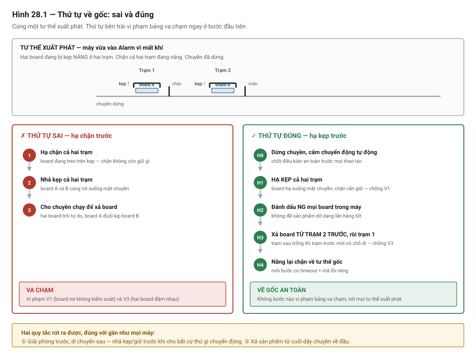

# Chương 28 — Chế độ vận hành & phục hồi sau lỗi

> **Lát cắt máy mẫu:** 2 — chuyền, chặn, nâng kẹp, cảm biến board, nút bấm, đèn tháp, hai trạm, trình
> tự song song, công thức sản phẩm.

---

## 28.1 Bài toán: máy hỏng đúng lúc khởi động lại

Áp suất khí tụt. DP-01 phát hiện, chuyển sang `Alarm`, dừng mọi chuyển động. Đúng như thiết kế.

Lúc đó trong máy có **hai board**: board A đang bị **kẹp nâng lên** ở trạm tra keo, board B đang **kẹp
ở trạm sấy**. Chặn của cả hai trạm đang nâng.

Kỹ thuật viên xử lý nguồn khí, khí trở lại bình thường, nhấn Reset. Chương trình xoá lỗi và **chạy tiếp
từ bước đang dở**. Bước đó là *"nhả kẹp, hạ chặn, chuyển board sang trạm sau"*.

Máy nhả kẹp trạm 1. Board A rơi xuống mặt chuyền. Máy hạ chặn. Chuyền chạy.

Board A trôi tự do sang trạm 2 — nơi board B **vẫn đang bị kẹp**. Hai board đâm nhau. Cả hai hỏng, cơ
cấu kẹp trạm 2 lệch, mất bốn giờ sửa.

Không có lệnh nào sai. Trình tự chạy đúng như đã viết. Cái thiếu là một câu hỏi mà người viết chưa bao
giờ đặt ra: **khi máy dừng ở một tư thế bất kỳ, làm cách nào đưa nó về vị trí gốc mà không phá gì?**

Đó là câu hỏi khó nhất của nghề này, và chương này dành để trả lời nó.

---

## 28.2 Vì sao "về gốc" khó hơn "chạy"

**Về gốc** *(homing / return to home position)* là đưa mọi cơ cấu về một tư thế **đã biết chắc**
*(known state)*, để từ đó chu trình có thể bắt đầu. Đừng nhầm nó với **phục hồi sau lỗi** *(fault
recovery)*: về gốc là một phần của phục hồi, không phải toàn bộ. Và cũng đừng nhầm với **chạy tiếp
từ chỗ dở** *(resume)* — hai việc khác hẳn nhau, mục 28.5 nói kỹ.

Khi viết chu trình tự động, bạn **biết máy đang ở đâu**: chu trình bắt đầu từ trạng thái gốc, mỗi bước
dẫn tới bước sau, và mỗi bước biết cơ cấu đang ở tư thế nào.

Khi máy dừng vì sự cố, mọi giả định đó **biến mất**:

| Khi chạy chu trình | Khi phải về gốc sau sự cố |
|---|---|
| Biết cơ cấu đang ở đâu | **Không biết** — có thể ở giữa hành trình |
| Biết có bao nhiêu sản phẩm và ở đâu | **Không chắc** — có thể có board ở cả hai trạm, hoặc một, hoặc không |
| Biết bước tiếp theo an toàn | **Không biết** — bước tiếp theo được thiết kế cho tư thế bình thường |
| Chỉ có một đường đi | **Nhiều tư thế xuất phát khác nhau** |

Nói cách khác: chu trình tự động là một **đường**, còn về gốc là một **hàm phải đúng với mọi điểm xuất
phát**. Đó là bài toán khó hơn hẳn, và nó là chỗ phân biệt người viết PLC có kinh nghiệm với người mới.

> ⚡ **LƯU Ý — vì sao không thể "chạy tiếp từ bước đang dở"**
> Cách làm ở mục 28.1 — nhấn Reset rồi chạy tiếp từ bước đang nhớ — nghe rất hợp lý và **sai một cách
> nguy hiểm**. Nó giả định rằng tư thế máy vẫn đúng như lúc bước đó bắt đầu. Nhưng giữa lúc dừng và
> lúc nhấn Reset, có thể đã có người mở cửa, gỡ board bằng tay, đẩy xy-lanh, hoặc đơn giản là mất khí
> làm cơ cấu tụt về vị trí khác. **Giả định đó không còn giá trị.**

---

## 28.3 Các chế độ vận hành

Trước khi bàn về gốc, phải rõ máy có những chế độ nào và mỗi chế độ **cho phép làm gì**.

| Chế độ | Máy làm gì | Ai được dùng | Điều kiện bắt buộc |
|---|---|---|---|
| **Auto** | Chạy chu trình tự động, lặp liên tục | Người vận hành | Đã về gốc, không lỗi, cửa đóng |
| **Manual** | Điều khiển từng cơ cấu bằng nút riêng | Kỹ thuật viên | Không ở `Running`; có ràng buộc liên động |
| **Jog** | Cơ cấu chạy **chỉ khi đang giữ nút**, nhả là dừng | Kỹ thuật viên | Như Manual |
| **Home** | Chạy trình tự về gốc | Kỹ thuật viên hoặc tự động khi cần | Cửa đóng, khí đủ |
| **Dry-run** | Chạy chu trình **không có sản phẩm**, để kiểm tra trình tự | Kỹ thuật viên | Đã về gốc; máy phải **biết** đang chạy khô |

### Ba nguyên tắc về chế độ

**Một — chuyển chế độ phải có kiểm soát.** Không được chuyển từ `Auto` sang `Manual` giữa lúc cơ cấu
đang chuyển động. Chuyển chế độ đi qua trạng thái trung gian: dừng chu trình → về `Idle` → mới đổi.

**Two — Manual không có nghĩa là bỏ hết liên động.** Đây là hiểu nhầm nguy hiểm nhất về chế độ tay.
Ở `Manual`, người vận hành được chọn *thứ tự* thao tác, nhưng **các liên động chống va chạm vẫn phải
còn nguyên**:

```iecst
// Ở Manual, nút "hạ chặn trạm 1" chỉ tác dụng khi kẹp đã hạ
Cmd_ManStop1Down  AND  M_ModeManual  AND  DI_Clamp1Dn   →   DO_Stop1Vlv := FALSE
                                          ▲
                                          └── liên động KHÔNG được bỏ
```

Nếu bỏ liên động ở chế độ tay, bạn đã biến chế độ tay thành công cụ phá máy. Người dùng chế độ tay
thường là người đang sửa máy — tức là đang ở tình huống dễ nhầm nhất.

**Ba — máy phải biết mình đang chạy khô.** Ở `Dry-run`, chu trình chạy nhưng **không có board**. Nếu
chương trình không biết điều đó, mọi bước chờ cảm biến board sẽ timeout và báo lỗi. Cần một cờ
`M_DryRun` mà các bước chờ sản phẩm kiểm tra:

```iecst
IF DI_BoardStn1 OR M_DryRun THEN
    Step := Step + 1;
END_IF;
```

> ⚠ **NGUY HIỂM**
> `M_DryRun` là một cờ **rất nguy hiểm nếu quên tắt**. Máy sẽ chạy hết chu trình mà không cần sản phẩm
> — nghĩa là nó bỏ qua mọi kiểm tra "có board không". Hai biện pháp bắt buộc:
> - Cờ này **tự tắt** khi chuyển ra khỏi `Dry-run` hoặc khi máy vào `Alarm`.
> - Trong lúc `Dry-run`, đèn tháp và màn hình phải hiển thị rõ ràng khác với chạy thật.

---

### ⭐ Ba nguyên tắc đó bằng ladder

⭐ Nguyên tắc **"chế độ tay vẫn giữ nguyên liên động"** dễ nói, và ⚠ **rất hay bị vi phạm** — vì ở
chế độ tay người ta có xu hướng viết thẳng từ nút ra van. Nấc thang đúng trông như sau:

```text
  M_ManualMode  M_Jog_ClampUp  M_Itf_ClampUp  M_AllPermissive     DO_Clamp1Vlv
 ─────┤ ├────────────┤ ├────────────┤/├────────────┤ ├───────────────( )───
```

> ⭐⭐ **Tiếp điểm thứ ba và thứ tư là toàn bộ nội dung của nguyên tắc này.** ⚡ Bỏ `M_Itf_ClampUp`
> đi thì nấc vẫn chạy, máy vẫn nhúc nhích, và **không ai phát hiện** cho tới lần va chạm đầu tiên.
> ⭐ Ở ladder, thiếu một tiếp điểm là **nhìn ra được**; ở ST, thiếu một vế `AND` thì không.

⭐ Và nấc giám sát **chỉ một chế độ được bật**:

```text
  M_AutoMode    M_ManualMode                                      M_ModeFault
 ─────┤ ├────────────┤ ├──────────────────────────────────────────────( )───

  M_AutoMode    M_ManualMode                                      M_ModeFault
 ─────┤/├───────────┤/├──────────────────────────────────────────────( )───
```

> ⭐ Hai nấc cùng ghi vào `M_ModeFault`: nấc trên bắt **cả hai cùng bật**, nấc dưới bắt **không cái
> nào bật**. ⚠⚠ Nhưng ⭐ **đây chính là cuộn dây trùng** mà Chương 15 Bẫy 1 cấm — nấc sau ghi đè nấc
> trước. Cách đúng là **gộp hai điều kiện vào một nấc** bằng nhánh song song, hoặc dùng một cờ trung
> gian cho mỗi nấc rồi `OR` lại.
>
> ⚡ Tôi để nguyên hai nấc sai ở đây **có chủ ý**: nó là ví dụ đắt giá cho thấy ⭐ **ladder đọc dễ
> không có nghĩa là ladder khó sai** — và cuộn dây trùng là lỗi ladder phổ biến nhất.

## 28.4 Về gốc — thứ tự suy ra từ phân tích, không phải tuỳ ý

Đây là phần cốt lõi của chương.

### Bước 1 — Liệt kê mọi thứ có thể đang ở tư thế bất kỳ

Với DP-01 ở lát cắt này:

| Cơ cấu | Các tư thế có thể | Cảm biến cho biết |
|---|---|---|
| Chặn trạm 1 | nâng / hạ / **giữa chừng** | `DI_Stop1Up`, `DI_Stop1Dn` |
| Kẹp trạm 1 | nâng / hạ / **giữa chừng** | `DI_Clamp1Up`, `DI_Clamp1Dn` |
| Chặn trạm 2 | nâng / hạ / giữa chừng | `DI_Stop2Up`, `DI_Stop2Dn` |
| Kẹp trạm 2 | nâng / hạ / giữa chừng | `DI_Clamp2Up`, `DI_Clamp2Dn` |
| Chuyền | chạy / dừng | `DO_ConvRun` |
| Board | 0, 1 hoặc 2 board trong máy, ở vị trí bất kỳ | `DI_BoardStn1`, `DI_BoardStn2` |

> 🔍 **BẪY — quên tư thế "giữa chừng"**
> Xy-lanh không chỉ có hai tư thế. Khi mất khí giữa hành trình, nó dừng ở đâu đó ở giữa — và **cả hai
> cảm biến đều báo 0**. Nếu code của bạn viết `IF NOT DI_Clamp1Up THEN (coi như đã hạ)` thì bạn đang
> nhầm "giữa chừng" thành "đã hạ". Luôn kiểm tra **cảm biến đích đang bật**, đừng suy ra từ cảm biến
> kia đang tắt.

### Bước 2 — Liệt kê mọi va chạm có thể xảy ra

Với mỗi cặp cơ cấu, hỏi: *cái này chuyển động trong khi cái kia đang ở tư thế nào thì hỏng?*

| # | Nếu làm việc này… | …trong khi… | Hậu quả |
|---|---|---|---|
| V1 | Hạ chặn trạm 1 | kẹp trạm 1 vẫn nâng (board đang treo) | Board rơi xuống chuyền không kiểm soát, trôi tự do |
| V2 | Cho chuyền chạy | kẹp bất kỳ trạm nào vẫn nâng | Board bị nâng không đi được; board mới từ máy trước đâm vào |
| V3 | Chuyển board từ trạm 1 sang | trạm 2 vẫn còn board | **Hai board đâm nhau** — sự cố ở mục 28.1 |
| V4 | Nhả kẹp | chặn đã hạ và chuyền đang chạy | Board trôi qua trạm không dừng lại được |

Bảng này là **kết quả của việc ngồi nghĩ**, không phải thứ suy ra được từ code. Nó phải làm trước khi
viết trình tự về gốc, và nên làm cùng với người thiết kế cơ khí.

### Bước 3 — Suy ra thứ tự về gốc

Thứ tự về gốc phải **không vi phạm bảng va chạm ở bất kỳ điểm xuất phát nào**.



*Hình 28.1 — Cùng một tình huống xuất phát, hai thứ tự về gốc. Thứ tự bên trái vi phạm V1 và V3 ngay
ở bước đầu.*

Thứ tự đúng cho DP-01:

```iecst
Bước H0 — Dừng chuyền, cấm mọi chuyển động tự động
          DO_ConvRun := FALSE

Bước H1 — HẠ KẸP cả hai trạm  (giải phóng board xuống mặt chuyền)
          chờ DI_Clamp1Dn AND DI_Clamp2Dn        timeout 3 s
          ▸ vì sao trước: hạ chặn khi kẹp còn nâng = vi phạm V1

Bước H2 — Xử lý board dở dang  (xem mục 28.6)
          đánh dấu NG mọi board đang có trong máy

Bước H3 — Đẩy board ra theo THỨ TỰ TỪ CUỐI VỀ ĐẦU
          H3a: hạ chặn trạm 2, chạy chuyền tới khi DI_BoardStn2 = 0
          H3b: hạ chặn trạm 1, chạy chuyền tới khi DI_BoardStn1 = 0
          ▸ vì sao từ cuối: xả trạm 2 trước thì trạm 1 mới có chỗ đi — tránh V3

Bước H4 — Nâng lại chặn cả hai trạm về tư thế gốc
          chờ DI_Stop1Up AND DI_Stop2Up          timeout 3 s

Bước H5 — Dừng chuyền, báo đã về gốc
          M_HomingDone := TRUE
```

Ba quyết định trong trình tự trên, mỗi cái đều truy về một dòng của bảng va chạm:

| Quyết định | Chống va chạm nào |
|---|---|
| Hạ **kẹp trước**, hạ chặn sau | V1 — board rơi không kiểm soát |
| Dừng chuyền **trước tiên**, chỉ chạy lại khi kẹp đã hạ | V2, V4 |
| Xả board **từ trạm cuối về trạm đầu** | V3 — hai board đâm nhau |

> 💡 **MẸO — quy tắc chung rút ra được**
> Hai nguyên tắc này đúng với gần như mọi máy, không riêng DP-01:
> - **Giải phóng trước, di chuyển sau.** Nhả kẹp/giữ trước khi cho bất cứ thứ gì chuyển động.
> - **Xả sản phẩm từ cuối dây chuyền về đầu.** Trạm sau phải trống thì trạm trước mới có chỗ đi.

### Bước 4 — Timeout cho mọi bước

Mỗi bước về gốc phải có **thời gian tối đa**. Quá thời gian → quay lại `Alarm` với mã lỗi **nói rõ kẹt
ở bước nào**:

```iecst
IF HomingStep = 1 AND T_StepTimeout.Q THEN
    FaultCode  := 'HOME-01: kẹp không hạ được trong 3 giây';
    M_AnyFault := TRUE;
END_IF;
```

Không có timeout thì trình tự về gốc kẹt vĩnh viễn ở một bước, và không ai biết bước nào — người sửa
phải đọc code để đoán. Với timeout có mã lỗi, màn hình nói thẳng chỗ kẹt.

---

## 28.4b ⭐⭐ Về gốc cho TRỤC — hai tín hiệu, hai vai trò

Mục trên bàn về gốc cho **xy-lanh** — cơ cấu chỉ có hai tư thế, cảm biến báo tới nơi là xong. Với
**trục điều khiển vị trí** (Chương 37) thì khác hẳn: trục dừng được ở **vô số vị trí**, nên câu hỏi
*"gốc nằm ở đâu"* phải được trả lời bằng một trình tự riêng.

### Vì sao cần HAI tín hiệu chứ không phải một

| Tín hiệu | Vai trò | Độ chính xác |
|---|---|---|
| ⭐ **Cữ báo gần gốc** *(near-point dog)* | *"Sắp tới rồi — giảm tốc đi"* | ⚠ **Thô** — chỉ cần đúng vài mi-li-mét |
| ⭐⭐ **Tín hiệu điểm không** *(zero signal)* | *"ĐÚNG điểm này là gốc"* | ⭐ **Tinh** — thường là **kênh Z của encoder** (Chương 18, mục 18.5b) |

⭐ Trình tự chuẩn, giống nhau ở mọi hệ dù tên gọi khác:

```text
   1. Chạy theo CHIỀU VỀ GỐC ở tốc độ về gốc  (nhanh)
   2. Gặp cữ báo gần gốc  →  GIẢM TỐC xuống tốc độ bò
   3. Chạy ở TỐC ĐỘ BÒ, chờ tín hiệu điểm không
   4. Gặp điểm không  →  DỪNG.  Vị trí này = gốc
   5. (Tuỳ chọn) chờ hết thời gian dừng  →  báo về gốc xong
```

> ⭐⭐ **Vì sao phải có bước bò chậm — và vì sao nó quyết định độ lặp lại.**
>
> Dừng từ tốc độ cao thì quãng đường dừng phụ thuộc **tốc độ lúc đó, tải, và ma sát** — ba thứ đều
> thay đổi. ⭐ Bò chậm làm quãng đường dừng nhỏ tới mức **không còn đáng kể**, nên lần nào cũng dừng ở
> đúng một chỗ.
>
> ⭐ Cùng lý do đó, ⚠ **luôn về gốc theo CÙNG MỘT CHIỀU**: khe hở cơ khí *(backlash)* làm vị trí dừng
> khác nhau tuỳ chiều tới.

> ⚠⚠ **Hệ quả cho việc mua sắm và đấu tủ — quyết định ở giai đoạn thiết kế, không sửa được bằng phần
> mềm:** cần **hai** thứ, và cả hai phải có mặt trong bảng I/O từ đầu (Chương 23):
>
> | | |
> |---|---|
> | 1 | ⭐ Một **cảm biến cữ gần gốc** trên hành trình, đấu vào ngõ vào **cữ báo** của module hoặc driver |
> | 2 | ⭐ Một **tín hiệu điểm không** — thường lấy kênh Z của encoder, ⚠ **phải chọn encoder CÓ kênh Z** |

### ⭐ Về gốc "nhanh" — và điều kiện để nó hợp lệ

Sau khi đã về gốc bằng cữ và điểm không **một lần**, hệ đã **biết địa chỉ của gốc**. Từ đó có thể về
gốc kiểu thứ hai: ⭐ **chạy định vị tuyệt đối tới địa chỉ gốc**, ⚠ **không dùng cữ, không dùng điểm
không** — nên nhanh hơn nhiều.

| | ⭐ Về gốc bằng cảm biến | Về gốc nhanh |
|---|---|---|
| Dùng gì | ⭐ **Cữ + điểm không** | Địa chỉ gốc đã nhớ |
| Tốc độ | Chậm — có bước bò | ⭐ **Nhanh** |
| ⭐⭐ Còn đúng khi nào | ⭐ **Luôn luôn** | ⚠⚠ **Chỉ khi vị trí CHƯA từng mất** |

> ⚠⚠ **Đây là chỗ dễ dùng sai nhất, và hậu quả là trục đi tới một vị trí sai mà máy tin là đúng.**
>
> ⭐ **Sau mất điện với encoder gia số, vị trí ĐÃ MẤT** (Chương 18, mục 18.6) — lúc đó ⚠⚠ **bắt buộc
> về gốc bằng cảm biến**, không được dùng về gốc nhanh.
>
> ⭐ **Quy tắc: về gốc nhanh chỉ dùng khi máy vẫn có điện và không có lỗi trục kể từ lần về gốc trước.**
> Mọi trường hợp còn lại — bật máy, sau lỗi trục, sau khi nhả phanh bằng tay — ⭐ **về gốc bằng cảm
> biến**.
>
> ⚡ Cách kiểm rẻ nhất: giữ một cờ *"vị trí còn tin được"*, ⭐ **xoá nó ở mọi chỗ có thể làm mất vị
> trí**, và chỉ cho phép về gốc nhanh khi cờ đó còn đúng.

---

## 28.5 Chạy tiếp hay huỷ chu trình

Sau khi lỗi được xử lý, máy có hai đường đi. **Chọn đường nào là quyết định của khách hàng, không phải
của người lập trình** — nhưng người lập trình phải trình bày rõ đánh đổi để khách hàng chọn được.

| | **Huỷ chu trình** (khuyến nghị mặc định) | **Chạy tiếp từ chỗ dừng** |
|---|---|---|
| Cách làm | Về gốc, xả hết sản phẩm, bắt đầu chu trình mới | Khôi phục tư thế, chạy tiếp từ bước đang nhớ |
| Sản phẩm dở dang | Bỏ, đánh dấu NG | Cố cứu |
| Rủi ro va chạm | **Thấp** — về gốc đã xử lý mọi tư thế | **Cao** — giả định tư thế còn đúng |
| Độ phức tạp code | Vừa | **Rất cao** — phải khôi phục đúng cho từng bước |
| Hợp với | Sản phẩm rẻ, chu trình ngắn | Sản phẩm rất đắt, chu trình rất dài |

> ⚠ **NGUY HIỂM**
> Chạy tiếp từ chỗ dừng chỉ chấp nhận được khi **cả ba** điều sau đúng:
> 1. Máy có đủ cảm biến để **xác minh** tư thế thật, không phải nhớ tư thế cũ.
> 2. Có ràng buộc kiểm tra: nếu tư thế thật khác tư thế đã nhớ thì **bắt buộc chuyển sang huỷ chu trình**.
> 3. Đã phân tích va chạm cho **từng bước** có thể dừng ở đó, không chỉ vài bước.
>
> Thiếu bất kỳ điều nào — chọn huỷ chu trình. Một sản phẩm hỏng rẻ hơn một cỗ máy hỏng rất nhiều.

Ở DP-01, `Hold` (dừng có chủ ý, máy vẫn lành) thì chạy tiếp được. Còn `Alarm` (dừng vì sự cố, tư thế
không chắc chắn) thì **luôn đi qua về gốc** — đó chính là lý do Chương 25 quy định `Resetting → Homing`
chứ không về thẳng `Idle`.

---

## 28.6 Sản phẩm dở dang — thứ hay bị quên nhất

Board A ở mục 28.1 đã được kẹp, và có thể đã được xử lý một phần trước khi máy dừng. Nó **không phải
hàng tốt và cũng không phải phôi mới**. Nếu bạn xả nó ra chuyền như hàng bình thường, nó sẽ đi tiếp
xuống các công đoạn sau và cuối cùng tới tay khách hàng.

Đây là loại lỗi tệ nhất trong sản xuất điện tử: **không có triệu chứng tại chỗ**. Không ai thấy gì bất
thường cho tới khi sản phẩm hỏng ngoài thị trường.

Quy tắc bắt buộc:

> ⚠ **NGUY HIỂM**
> Mọi sản phẩm có mặt trong máy tại thời điểm sự cố phải được coi là **NG cho tới khi chứng minh được
> ngược lại**. Không có trạng thái "chắc là vẫn tốt".

Ba cách xử lý, chọn theo điều kiện máy:

| Cách | Làm gì | Hợp khi |
|---|---|---|
| **Đánh dấu và xả riêng** | Xả board ra một vị trí riêng, không vào chuyền chính | Có chỗ chứa riêng |
| **Đánh dấu trong dữ liệu** | Ghi board này là NG để công đoạn sau loại ra | Có hệ thống truy xuất (Chương 42) |
| **Yêu cầu lấy ra bằng tay** | Máy dừng, báo màn hình *"lấy board ở trạm 1 ra rồi nhấn xác nhận"* | Máy nhỏ, không có cơ cấu xả riêng |

Cách thứ ba nghe thủ công nhưng thường là cách **đúng nhất cho máy vừa và nhỏ** — vì nó đưa quyết định
cho con người, và con người nhìn được board có bất thường không.

> 💡 **MẸO**
> Ghi rõ số lượng và vị trí sản phẩm dở dang **lên màn hình**, đừng chỉ ghi vào log. Người vận hành cần
> biết *phải lấy mấy board ra và ở đâu* trước khi họ nhấn Reset.

---

## 28.7 Bẫy thường gặp

### 🔍 BẪY 1 — Suy tư thế từ cảm biến đối diện

```iecst
// ✗ SAI
IF NOT DI_Clamp1Up THEN
    // coi như kẹp đã hạ  → SAI khi kẹp đang ở giữa chừng
```

Xy-lanh mất khí giữa hành trình làm **cả hai cảm biến cùng báo 0**. Code trên hiểu nhầm thành "đã hạ"
và cho bước tiếp theo chạy.

```iecst
// ✓ ĐÚNG — kiểm tra cảm biến ĐÍCH đang bật
IF DI_Clamp1Dn THEN
    // kẹp thật sự đã hạ
```

Và nếu cần phát hiện tư thế giữa chừng để báo lỗi:

```iecst
M_Clamp1Unknown := NOT DI_Clamp1Up AND NOT DI_Clamp1Dn;
```

### 🔍 BẪY 2 — Trình tự về gốc chỉ đúng với một điểm xuất phát

Người viết thử về gốc từ tư thế "vừa chạy xong chu trình bình thường" — trường hợp dễ nhất — rồi kết
luận là xong.

**Cách kiểm đúng:** liệt kê các tư thế xuất phát có thật và thử **từng cái**:

| Tư thế xuất phát | Cách tạo ra để thử |
|---|---|
| Kẹp nâng, có board | Dừng máy giữa chu trình bằng nút Stop |
| Kẹp giữa chừng | **Ngắt khí** giữa lúc kẹp đang lên |
| Có board ở cả hai trạm | Cho hai board vào rồi dừng |
| Không có board nào | Chạy hết rồi dừng |
| Board nằm giữa hai trạm | Đặt board bằng tay lên chuyền rồi bật máy |

Danh sách này thuộc về **danh mục ca kiểm thử** ở Chương 50, và việc thử nó là bắt buộc trước nghiệm thu.

### 🔍 BẪY 3 — Về gốc bỏ qua liên động vì "đang về gốc mà"

Có người nghĩ trình tự về gốc là đặc biệt nên được phép bỏ liên động. Ngược lại: **về gốc là lúc tư thế
máy không chắc chắn nhất**, nên là lúc liên động cần thiết nhất.

Mọi ràng buộc chống va chạm phải còn nguyên trong trình tự về gốc. Cái được nới ở đây là *thứ tự thao
tác*, không phải *điều kiện an toàn*.

### 🔍 BẪY 4 — Reset xoá lỗi khi nguyên nhân còn nguyên

Người vận hành nhấn Reset khi khí vẫn chưa đủ. Nếu code chỉ kiểm tra `DI_ResetPB` mà không kiểm tra
nguyên nhân, máy sẽ vào `Resetting` → `Homing` → phát hiện lại thiếu khí → `Alarm`. Vòng lặp này chạy
mỗi vòng quét, đèn chớp loạn.

Điều kiện Reset phải là: **`sườn lên nút Reset` VÀ `nguyên nhân đã hết`**. Đã nêu ở Chương 25, nhắc lại
vì đây là chỗ nó gây hậu quả rõ nhất.

### 🔍 BẪY 5 — Không ghi lại tư thế lúc xảy ra sự cố

Máy vào `Alarm`, người vận hành xử lý, nhấn Reset, máy về gốc. Xong. Nhưng **không ai biết lúc đó máy
đang ở tư thế nào** — thông tin quan trọng nhất để tìm nguyên nhân gốc đã mất.

**Cách phòng:** khi vào `Alarm`, chụp lại một "ảnh" trạng thái vào vùng nhớ giữ được: bước chu trình,
tư thế mọi cơ cấu, số board trong máy, mã lỗi, thời điểm. Việc này gần như miễn phí và cứu bạn rất
nhiều giờ ở Chương 51.

### 🔍 BẪY 6 — Quên tắt cờ chạy khô

Đã nêu ở mục 28.3. Đưa vào đây vì nó là bẫy **của chế độ**, và hậu quả xuất hiện muộn: máy chạy sản
xuất thật mà vẫn bỏ qua kiểm tra có board, cho ra hàng loạt sản phẩm không được xử lý.

---

## 28.8 Bảng chốt — quy trình thiết kế trình tự về gốc

| Bước | Việc | Xong khi |
|---|---|---|
| 1 | Liệt kê **mọi cơ cấu** và mọi tư thế có thể, **kể cả "giữa chừng"** | Bảng đầy đủ, mỗi cơ cấu ghi rõ cảm biến nào cho biết tư thế |
| 2 | Lập **bảng va chạm** — cặp cơ cấu nào xung đột với nhau | Đã hỏi *"làm X trong khi Y ở tư thế nào thì hỏng?"* cho mọi cặp |
| 3 | Suy **thứ tự về gốc** từ bảng va chạm | Mỗi bước dẫn được về ít nhất một dòng của bảng va chạm |
| 4 | Áp hai quy tắc chung: **giải phóng trước, di chuyển sau**; **xả từ cuối về đầu** | Đã kiểm |
| 5 | Đặt **timeout + mã lỗi riêng** cho từng bước | Mã lỗi nói được kẹt ở bước nào |
| 6 | Quyết định **huỷ chu trình hay chạy tiếp** — trình bày đánh đổi cho khách hàng | Có văn bản ghi lựa chọn |
| 7 | Định nghĩa **cách xử lý sản phẩm dở dang** | Không có đường nào để sản phẩm dở dang lẫn vào hàng tốt |
| 9 | ⭐ Với **trục**: đã có **cữ báo gần gốc** và **tín hiệu điểm không** trong bảng I/O | Cả hai có mặt từ giai đoạn thiết kế — không sửa được bằng phần mềm |
| 10 | ⭐ Về gốc trục luôn theo **cùng một chiều**, có **bước bò chậm** | Có — đó là thứ quyết định độ lặp lại |
| 11 | ⚠⚠ Có cờ *"vị trí còn tin được"*, và **về gốc nhanh chỉ dùng khi cờ đó đúng** | Cờ bị xoá ở **mọi** chỗ có thể làm mất vị trí |
| 8 | Lập **danh sách tư thế xuất phát** để kiểm thử | Có ít nhất 5 tư thế, gồm cả tư thế giữa chừng |

---

## 28.9 Tự kiểm

1. Kể lại sự cố ở mục 28.1 và chỉ ra **hai dòng của bảng va chạm** đã bị vi phạm.
2. Vì sao **hạ kẹp trước rồi mới hạ chặn**, chứ không ngược lại?
3. Vì sao **xả board từ trạm cuối về trạm đầu**, chứ không từ đầu về cuối?
4. Xy-lanh kẹp mất khí giữa hành trình. `DI_Clamp1Up` và `DI_Clamp1Dn` cùng bằng 0. Đoạn code
   `IF NOT DI_Clamp1Up THEN …` sẽ hiểu tình huống này thế nào, và hậu quả là gì?
5. Nêu **ba điều kiện bắt buộc** để được phép chọn "chạy tiếp từ chỗ dừng" thay vì huỷ chu trình.
6. Một board đã được kẹp và xử lý dở khi máy dừng. Vì sao **không được** xả nó ra như hàng bình thường,
   và ba cách xử lý là gì?
7. Ở chế độ Manual, cái gì được nới lỏng và cái gì **tuyệt đối không** được nới lỏng?
8. Liệt kê **năm tư thế xuất phát** cần thử khi nghiệm thu trình tự về gốc, kèm cách tạo ra từng tư thế.
9. ⭐⭐ Về gốc một **trục** cần **hai** tín hiệu. Nêu tên và **vai trò** của mỗi cái, và cho biết cái
    nào cần chính xác cao.
10. ⭐ Vì sao trình tự về gốc phải có **bước bò chậm**, và vì sao phải luôn về gốc **theo cùng một
    chiều**?
11. ⚠⚠ Phân biệt **về gốc bằng cảm biến** với **về gốc nhanh**. Sau khi mất điện với encoder gia số,
    được dùng cái nào? ⭐ Nêu cách kiểm rẻ nhất để không dùng nhầm.

Câu 2, 3 và 7 là ba câu phân loại. Trả lời được cả ba nghĩa là bạn đã có phản xạ *suy thứ tự từ phân
tích va chạm* — thứ phân biệt người viết được máy chạy an toàn với người viết được máy chạy.

---

### Chương tiếp theo

**Chương 29 — Công thức sản phẩm & quản lý tham số.** Máy đã biết chạy và biết phục hồi. Nhưng máy điện
tử hiếm khi chạy một mã hàng — Chương 29 xử lý bài toán nhiều mã hàng trên cùng một máy, và vì sao việc
kiểm tra công thức hợp lệ thuộc về PLC chứ không thuộc về hệ thống cấp trên.

---

### Nguồn tham khảo chương 28

- IEC 60204-1 — *Safety of machinery — Electrical equipment of machines*: phân loại lệnh dừng, yêu cầu
  về **khởi động lại phải có chủ ý** *(intentional restart)* — cơ sở cho nguyên tắc ở mục 28.5.
  *(tiêu chuẩn có bản quyền)*
- ISO 12100 — *Safety of machinery — General principles for design*: phân tích mối nguy làm nền cho
  bảng va chạm ở mục 28.4.
- Đặc tả trình tự, danh sách cơ cấu và chức năng an toàn của DP-01 — Phụ lục J.
- **Mitsubishi MELSEC iQ-F FX5 Positioning Control** §3.2 *OPR Control* — nguồn cho mục 28.4b: trình
  tự ⭐ **tốc độ về gốc → cữ báo gần gốc → tốc độ bò → tín hiệu điểm không → dừng**, thời gian dừng
  tuỳ chọn, và ⭐ **về gốc nhanh** bằng định vị tuyệt đối tới địa chỉ gốc đã thiết lập — ⚠ **không dùng
  cữ và điểm không**. *(Tên gọi khác nhau giữa các hãng; cơ chế giống nhau.)*

> ⚠ Bảng va chạm và trình tự về gốc trong chương là **ví dụ dạy học cho DP-01 ở lát cắt 2**. Máy thật
> có thêm cơ cấu và thêm dạng năng lượng sẽ có bảng va chạm dài hơn — và bảng đó phải do người thiết kế
> máy lập, không chép từ sách.
