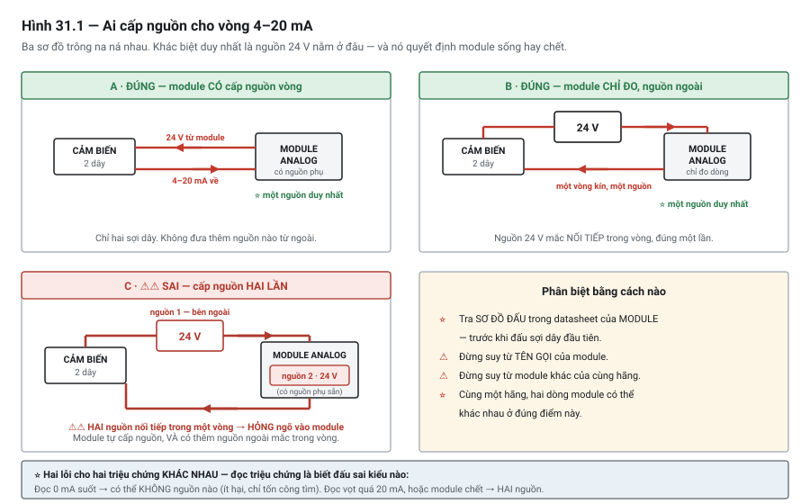

# Chương 31 — Tín hiệu analog & vòng dòng 4–20 mA

> **Lát cắt máy mẫu:** 3 — thêm analog (áp suất, nhiệt độ, cường độ UV) và trục gantry XY+Z.

---

## 31.1 Bài toán: cảm biến áp suất báo 0 bar suốt một ca

Trạm tra keo có một cảm biến áp suất đo áp keo tại đầu tra. Tín hiệu 0–10 V, dải 0–6 bar.

Một buổi sáng, màn hình báo **0,0 bar**. Người vận hành nhìn thấy con số đó và kết luận: hệ keo mất
áp. Gọi bảo trì. Bảo trì kiểm bơm keo, kiểm van điều áp, kiểm đường ống — tất cả bình thường. Đồng hồ
áp cơ khí gắn trên đường ống chỉ **4,2 bar**.

Sau hai giờ, tìm ra: **một sợi dây tín hiệu bị đứt** trong máng cáp, do rung.

Câu hỏi đáng giá: với tín hiệu 0–10 V, PLC đọc được **0 V**. Nhưng 0 V nghĩa là gì?

| 0 V có thể là | |
|---|---|
| Áp suất thật sự bằng 0 | Có thể |
| Dây tín hiệu đứt | Có thể |
| Cảm biến mất nguồn | Có thể |
| Cảm biến hỏng | Có thể |

**Bốn tình huống, một con số.** PLC không có cách nào phân biệt.

Nếu cảm biến đó dùng **4–20 mA**, câu chuyện khác hẳn: áp bằng 0 cho **4 mA**, còn dây đứt cho **0
mA**. Hai con số khác nhau, và PLC phân biệt được ngay — miễn phí, không cần thêm thiết bị nào.

Chương này về vì sao chuẩn tín hiệu analog trong công nghiệp lại là 4–20 mA, và về những thứ đi kèm
mà người ta hay đấu sai.

---

## 31.2 Tín hiệu analog khác tín hiệu số ở đâu

Tới Chương 30, mọi tín hiệu bạn làm việc đều là **số** *(digital)*: có hoặc không, 0 hoặc 1.

**Tín hiệu analog** mang một **giá trị liên tục**: áp suất là 4,2 bar, nhiệt độ là 63,5 °C, cường độ
UV là 142 mW/cm².

| | Tín hiệu số | Tín hiệu analog |
|---|---|---|
| Mang gì | Một bit | Một **giá trị** trong dải |
| Nhiễu ảnh hưởng thế nào | Ít — chỉ cần phân biệt hai mức cách xa nhau | ⚠ **Nhiều** — nhiễu cộng thẳng vào giá trị đọc được |
| Đứt dây | Đọc thành 0 (thường là an toàn nếu thiết kế đúng — Chương 15) | ⚠ Đọc thành một **giá trị trông hợp lý** |
| Cần gì ở PLC | Ngõ vào số | **Module analog** — chọn lúc mua (Chương 8) |

Hai hàng cuối là hai bài toán mà cả chương này và Chương 32 xoay quanh.

---

## 31.3 ⭐ Vì sao 4 mA chứ không 0 mA

Đây là mục quan trọng nhất chương, và câu trả lời rất gọn.

```text
   Dòng đo được:    0 mA ──────── 4 mA ──────────────────── 20 mA
                      │             │                          │
                   ĐỨT DÂY      giá trị 0%                giá trị 100%
                  (lỗi mạch)     (áp = 0 bar)             (áp = 6 bar)
                      └── vùng LỖI ──┘└──── vùng ĐO ĐƯỢC ──────┘
```

**Điểm đầu dải không phải 0.** Nhờ vậy, dải giá trị hợp lệ (4–20 mA) **tách hẳn** khỏi trạng thái lỗi
(0 mA). Người ta gọi đây là **điểm không sống** *(live zero)*.

### Nó cho bạn cái gì

| Chẩn đoán | Điều kiện |
|---|---|
| **Đứt dây** hoặc mất nguồn cảm biến | Dòng ≈ 0 mA — dưới ngưỡng khoảng 3,6 mA |
| Cảm biến báo **lỗi nội bộ** | Nhiều cảm biến chủ động đưa dòng ra ngoài dải, ví dụ dưới 3,6 mA hoặc trên 21 mA |
| **Giá trị vượt dải đo** | Dòng hơi ngoài 4–20 mA nhưng còn trong vùng hợp lệ mở rộng |
| Đo bình thường | 4–20 mA |

### ⭐⭐ Bảng dải NAMUR — và một phân biệt rất dễ bỏ sót

Khuyến nghị **NAMUR** gán ý nghĩa chẩn đoán cụ thể cho từng dải dòng nằm ngoài 4–20 mA:

| Dòng đo được | Ý nghĩa |
|---|---|
| ⚠ **≤ 3,6 mA** | **Cảm biến hỏng** — hướng thấp |
| ⚠ 3,6 – 3,8 mA | Cảm biến **tự phát hiện** mình hỏng, chủ động báo ra |
| ⭐⭐ **3,8 – 4,0 mA** | ⭐ **ĐO DƯỚI DẢI — không phải lỗi!** Đại lượng thật đang thấp hơn điểm đầu thang |
| ⭐ 20,5 – 21,0 mA | ⭐ **Đo trên dải** — cũng không phải lỗi |
| ⚠ **≥ 21,0 mA** | **Cảm biến hỏng** — hướng cao |

⭐ Cảm biến tuân NAMUR khi hoạt động bình thường sẽ **giữ dòng trong khoảng 3,8 mA đến dưới 21 mA**.

> ⭐⭐ **Hàng đáng chú ý nhất là 3,8–4,0 mA, và nó là chỗ rất nhiều chương trình làm sai.**
>
> Cách viết ẩu là: *"dưới 4 mA thì báo lỗi cảm biến"*. ⚠ Với cách đó, mỗi lần đại lượng thật **hạ
> xuống hơi dưới điểm đầu thang** — chuyện hoàn toàn bình thường — máy sẽ **báo lỗi cảm biến giả**.
>
> | Cách xử lý | Kết quả |
> |---|---|
> | ⚠ Ngưỡng lỗi đặt ở **4,0 mA** | ⭐ **Báo động giả** khi đo dưới dải; người vận hành học cách bỏ qua báo động (Ch.43) |
> | ⭐ Ngưỡng lỗi đặt ở **3,6 mA**, vùng 3,8–4,0 coi là **đo dưới dải** | Phân biệt được **"cảm biến hỏng"** với **"giá trị thấp"** |
>
> ⭐ Đây là ví dụ điển hình cho luận điểm ở mục tiếp theo: **chuẩn cho bạn khả năng phân biệt, chương
> trình phải thật sự phân biệt** — và phân biệt **đúng ngưỡng**.

*(Đối chiếu: Kuphaldt — Lessons in Industrial Instrumentation, mục NAMUR signal levels. ⚠ Ngưỡng
chính xác và cách cảm biến báo lỗi **khác nhau theo thiết bị** — tra datasheet.)*

> ⭐ **Đây là chẩn đoán MIỄN PHÍ.** Không thêm dây, không thêm thiết bị, không thêm chi phí — chỉ nhờ
> chọn đúng chuẩn tín hiệu. Ít quyết định kỹ thuật nào có tỉ lệ lợi ích trên chi phí tốt như vậy.

### ⚠ Nhưng bạn phải viết code để dùng nó

Chuẩn cho bạn khả năng phân biệt. **Chương trình phải thật sự phân biệt.**

```iecst
// ✗ SAI — quy đổi thẳng, mất hết thông tin chẩn đoán
AirPressBar := (REAL_TO_... quy đổi từ giá trị thô);

// ✓ ĐÚNG — kiểm dải trước, quy đổi sau
IF RawAirPress < RAW_3MA6 THEN
    M_AirPressSensorFault := TRUE;      // đứt dây hoặc cảm biến lỗi
    // ⚠ KHÔNG dùng giá trị này cho điều khiển
ELSIF RawAirPress > RAW_21MA THEN
    M_AirPressSensorFault := TRUE;      // vượt dải trên
ELSE
    M_AirPressSensorFault := FALSE;
    AirPressBar := ...;                 // quy đổi — Chương 32
END_IF;
```

> ⚠⚠ **NGUY HIỂM — giá trị analog lỗi phải được xử lý tường minh**
> Khi cờ lỗi cảm biến lên, chương trình **không được dùng giá trị đó** cho bất kỳ quyết định điều
> khiển nào. Dùng giá trị cuối cùng còn hợp lệ cũng **không an toàn** — vì bạn không biết thực tế đã
> thay đổi thế nào từ lúc đó.
>
> Hành vi đúng phụ thuộc chức năng: dừng máy, chuyển sang chế độ an toàn, hoặc cấm chạy. Đây là quyết
> định thuộc phân tích ở Chương 48, và nó phải nằm trong đặc tả (Chương 23), không phải do người lập
> trình tự nghĩ ra lúc viết code.

---

## 31.4 Vì sao dùng dòng, không dùng áp

Câu hỏi thứ hai: nếu chỉ cần "điểm không sống" thì tại sao không dùng 2–10 V?

Vì **dòng chống nhiễu tốt hơn áp trên đường dài** — và lý do nằm ở vật lý.

### Ba lý do

**1. Sụt áp trên dây không ảnh hưởng dòng.**

Dây có điện trở (Chương 3, mục 3.2). Với tín hiệu áp, điện trở dây tạo ra sụt áp, nên giá trị ở đầu
nhận **thấp hơn** giá trị cảm biến phát ra — và sai lệch càng lớn khi dây càng dài.

Với vòng dòng, cảm biến **điều chỉnh để duy trì đúng dòng đã định**, bất kể điện trở dây. Dòng đi qua
mọi điểm của một mạch nối tiếp là **như nhau**. Sụt áp trên dây không đổi được điều đó.

**2. Trở kháng thấp của vòng làm nhiễu khó cảm ứng vào.**

Nhiễu điện từ cảm ứng vào dây tín hiệu như một nguồn áp nhỏ. Mạch trở kháng cao (tín hiệu áp) biến
nguồn áp nhỏ đó thành sai lệch đáng kể. Mạch trở kháng thấp (vòng dòng) làm nhiễu đó gần như không
tạo được dòng — nên ảnh hưởng nhỏ hơn nhiều.

**3. Đứt dây phân biệt được** — mục 31.3.

### Khi nào 0–10 V chấp nhận được

Không phải lúc nào cũng cần 4–20 mA:

| Dùng 0–10 V được khi | Vì sao |
|---|---|
| **Dây rất ngắn** — trong cùng tủ, dưới vài mét | Sụt áp và nhiễu không đáng kể |
| **Đi cùng cáp có chống nhiễu, tách xa cáp động lực** | Nguồn nhiễu chính đã bị loại |
| **Thiết bị chỉ có ngõ 0–10 V** | Không có lựa chọn — nhiều biến tần, van điều áp điện tử chỉ có loại này |
| **Ngõ ra từ PLC ra thiết bị** | Xem bên dưới |

> 💡 **Ngõ ra analog hay là 0–10 V hơn ngõ vào.**
> Lý do thực tế: rất nhiều thiết bị nhận lệnh — biến tần, van điều áp điện tử, bộ điều khiển công
> suất — chỉ có ngõ vào 0–10 V. Và chúng thường nằm **trong cùng tủ** với PLC, nên đường dây ngắn.
>
> Trên DP-01, mọi ngõ vào analog quan trọng là 4–20 mA, còn ngõ ra là 0–10 V — đúng theo mẫu này
> (mục 31.7).

> ⚠ **Với ngõ ra 0–10 V, mất tín hiệu KHÔNG phân biệt được.** Dây đứt thì thiết bị nhận đọc 0 V, tức
> là "đặt 0 %". Nếu 0 % là trạng thái an toàn thì tốt; nếu không thì phải có biện pháp khác — ví dụ
> tín hiệu cho phép riêng bằng ngõ ra số (Chương 48).

---

## 31.5 Hai dây, ba dây, bốn dây — ai cấp nguồn cho vòng

Đây là chỗ đấu sai nhiều nhất, và đấu sai thì hoặc không đọc được gì, hoặc hỏng thiết bị.

### Vòng dòng hai dây

**Hai dây** *(loop-powered / 2-wire)*: cảm biến lấy nguồn **từ chính vòng dòng**. Chỉ có hai sợi dây,
và chúng vừa cấp nguồn vừa mang tín hiệu.

```text
   +24V ────┬──────────────────┐
            │                  │
        [ CẢM BIẾN 2 DÂY ]     │
            │                  │
            └──── vòng ────► [ ngõ vào analog PLC ]
                                 (có điện trở đo)
                                     │
   0V ───────────────────────────────┘
```

Cảm biến hoạt động như một **van điều tiết dòng**: nó điều chỉnh dòng chảy qua chính nó trong khoảng
4–20 mA, tuỳ giá trị đo. Dòng 4 mA cũng chính là dòng tối thiểu để mạch bên trong cảm biến sống.

> ⭐ **Đây là lý do sâu hơn cho con số 4 mA:** cảm biến hai dây cần một dòng tối thiểu để tự nuôi
> mình. Nếu điểm đầu dải là 0 mA thì ở giá trị đo bằng 0, cảm biến sẽ **không có điện để hoạt động**.

### Ba dây và bốn dây

| | **Hai dây** | **Ba dây** | **Bốn dây** |
|---|---|---|---|
| Nguồn cho cảm biến | ⭐ Từ **chính vòng** | Nguồn riêng, dùng chung dây 0 V với tín hiệu | Nguồn riêng, tín hiệu **cách ly hoàn toàn** |
| Số dây | 2 | 3 | 4 |
| Đi dây | Đơn giản nhất | Trung bình | Nhiều nhất |
| ⚠ Vòng lặp đất | Ít rủi ro | Có rủi ro — dùng chung 0 V | Ít rủi ro nhất |
| Hay gặp ở | Cảm biến áp suất, mức | Cảm biến có màn hình, cần công suất lớn hơn | Thiết bị đo chính xác |

### ⚠ Ai cấp nguồn cho vòng — câu hỏi phải hỏi trước khi đấu

Với vòng hai dây, nguồn có thể đến từ **module analog của PLC** hoặc từ **nguồn ngoài**:

| Kiểu module | Nghĩa là |
|---|---|
| **Có cấp nguồn vòng** *(loop-powered input / có nguồn phụ)* | Module tự cấp 24 V cho vòng. Đấu cảm biến hai dây thẳng vào |
| **Không cấp nguồn vòng** *(passive input)* | Module chỉ **đo** dòng. Phải đưa nguồn 24 V vào vòng từ ngoài |

> ⚠⚠ **NGUY HIỂM CHO THIẾT BỊ — hai lỗi đấu nối kinh điển**
>
> **1. Cấp nguồn hai lần.** Module tự cấp nguồn vòng, và bạn lại đưa thêm 24 V từ ngoài vào. Kết quả:
> dòng vượt xa 20 mA — hỏng ngõ vào module, có thể hỏng cả cảm biến.
>
> **2. Không cấp nguồn lần nào.** Module là loại chỉ đo, và bạn đấu cảm biến hai dây thẳng vào. Kết
> quả: không có gì hoạt động, đọc 0 mA. Ít nguy hiểm hơn nhưng tốn thời gian tìm.
>
> **Cách phòng:** tra **sơ đồ đấu trong datasheet của module** trước khi đấu sợi dây đầu tiên. Sơ đồ
> nói rõ có nguồn hay không — đừng suy từ tên gọi, và đừng suy từ module khác của cùng hãng.



*Hình 31.1 — Ba cách đấu vòng 4–20 mA. Hai cách đúng khác nhau ở chỗ nguồn nằm trong module hay
ngoài; cách sai có hai nguồn nối tiếp trong cùng một vòng, và nguồn thứ hai nằm khuất bên trong
module nên sơ đồ đấu ngoài không cho thấy nó.*

> ⭐ **Hình 31.1 vẽ cả ba cách đấu cạnh nhau** vì trên bản vẽ chúng trông na ná: cũng hai sợi dây,
> cũng một cảm biến, cũng một module. ⚠ Khác biệt duy nhất là **nguồn 24 V nằm ở đâu** — và với ô C
> thì nguồn thứ hai **nằm bên trong module**, nên nhìn sơ đồ đấu ngoài không thấy nó.

### ⚠ Điện trở tải tối đa của vòng

Vòng dòng hai dây có một giới hạn thường bị quên: **tổng điện trở của vòng không được vượt một giá
trị tối đa**, do nguồn cấp phải đủ áp để đẩy 20 mA qua toàn bộ vòng.

Tổng điện trở gồm: điện trở đo của module, điện trở dây (cả đi lẫn về), và điện trở của mọi thiết bị
khác mắc nối tiếp trong vòng.

**Triệu chứng khi vượt giới hạn** — và nó rất đặc trưng:

> Giá trị đọc **đúng ở phần dưới của dải, sai ở phần trên**. Ví dụ: 0–3 bar đọc đúng, trên 4 bar thì
> giá trị "kẹt" không tăng nữa.
>
> Lý do: ở dòng thấp, sụt áp trên vòng nhỏ, nguồn đủ. Ở dòng cao, sụt áp lớn hơn, nguồn không đủ đẩy
> — dòng không lên được tới mức cần.

Datasheet cảm biến ghi điện trở tải tối đa cho phép ở điện áp nguồn tương ứng. Với dây dài hoặc nhiều
thiết bị trong vòng, **phải tính**.

---

## 31.6 Chống nhiễu — đi dây và nối vỏ

Tín hiệu analog nhạy với nhiễu hơn tín hiệu số rất nhiều, vì nhiễu **cộng thẳng vào giá trị**.

### Bốn quy tắc đi dây

| Quy tắc | Vì sao |
|---|---|
| ⭐ **Dùng cáp có vỏ chống nhiễu** *(shielded cable)* cho mọi tín hiệu analog | Vỏ chắn trường điện từ bên ngoài |
| ⭐ **Tách xa cáp động lực** — cáp biến tần, cáp động cơ, cáp hàn | Đây là nguồn nhiễu mạnh nhất trong tủ và trên máy |
| **Cắt ngang chứ đừng đi song song** khi buộc phải giao nhau | Giao nhau vuông góc thì ghép nhiễu nhỏ nhất |
| **Dùng đôi dây xoắn** *(twisted pair)* | Nhiễu cảm ứng vào hai sợi gần bằng nhau và triệt tiêu bớt |

### ⭐ Nối vỏ chống nhiễu ở **một đầu**

Đây là quy tắc mà người mới hay làm sai vì nó có vẻ phản trực giác.

```text
   ✓ ĐÚNG — nối đất MỘT đầu, thường ở phía tủ
   [cảm biến] ═══════════ vỏ ═══════════ [tủ] ──┴── đất
                                          ↑
                                    chỉ nối ở đây

   ✗ SAI — nối đất HAI đầu
   [cảm biến] ──┬── vỏ ──────────────── [tủ] ──┬── đất
              đất                              đất
                └──── dòng chạy vòng qua vỏ ───┘
```

Nối vỏ ở **cả hai đầu** tạo ra một **vòng lặp đất** *(ground loop)*: nếu điện thế đất ở hai đầu chênh
nhau — chuyện rất bình thường trong một nhà máy — thì có **dòng chạy trong vỏ**. Dòng đó sinh ra
nhiễu, tức là vỏ chống nhiễu trở thành **nguồn nhiễu**.

Nối một đầu thì vỏ vẫn chắn được trường điện từ, nhưng không có đường cho dòng chạy vòng.

> 💡 **Nối đầu nào?** Thường là **phía tủ**, vì ở đó có thanh đất tốt và việc thi công dễ kiểm soát.
> Quan trọng hơn việc chọn đầu nào là **thống nhất trong toàn máy** và **ghi vào bản vẽ** — để người
> sửa sau không vô tình nối thêm đầu thứ hai.

> ⚠ Nhiễu analog là loại lỗi **chập chờn**, xuất hiện theo hoạt động của thiết bị khác — biến tần
> chạy tải nặng, máy hàn bên cạnh hoạt động. Triệu chứng: giá trị đọc **nhảy** hoặc **run**, thường
> đúng lúc một thiết bị khác chạy. Chương 49 và Chương 51 nói kỹ cách truy.

---

## 31.7 Trên máy mẫu DP-01

Các tín hiệu analog của lát cắt 3, và **lý do chọn chuẩn** cho từng cái:

| Tag | Tín hiệu | Vì sao chọn chuẩn đó |
|---|---|---|
| `AI_AirPress` — áp khí cấp máy | **4–20 mA**, 2 dây | ⭐ Cần phân biệt "hết khí" với "đứt dây" — đây chính là bài toán ở mục 31.1, và mất khí là điều kiện an toàn |
| `AI_GluePress` — áp keo tại đầu tra | **4–20 mA**, 2 dây | Ảnh hưởng trực tiếp chất lượng sản phẩm; đọc sai mà không biết thì hỏng cả lô |
| `AI_UvIntensity` — cường độ đèn UV | **0–10 V** | Cảm biến đặt trong buồng sấy, dây ngắn, đi trong máng riêng. ⚠ Nhưng xem ghi chú bên dưới |
| `AO_GluePressSet` — đặt áp keo | **0–10 V** | Van điều áp điện tử chỉ nhận 0–10 V; nằm trong tủ |
| `AO_ConvSpeed` — đặt tốc độ chuyền | **0–10 V** | Ngõ vào biến tần; trong tủ (Chương 36) |
| `AO_UvPower` — đặt công suất đèn UV | **0–10 V** | Bộ điều khiển công suất chỉ nhận 0–10 V |

> ⚠ **`AI_UvIntensity` là chỗ đáng cân nhắc lại.**
> Cường độ UV giảm dần theo tuổi bóng đèn, và đó là **lỗi mà máy không tự phát hiện được** nếu không
> đo (Chương 48, mục 48.6) — sản phẩm thiếu độ bám keo không có triệu chứng tại chỗ.
>
> Với một phép đo quan trọng như vậy, việc **không phân biệt được "cường độ 0" với "đứt dây"** là một
> điểm yếu thật. Nếu có bản 4–20 mA của cảm biến này, nên chọn nó — dù dây ngắn.
>
> Đây là ví dụ cho thấy quyết định chọn chuẩn tín hiệu **không chỉ dựa vào chiều dài dây**, mà dựa
> vào **hậu quả của việc đọc sai mà không biết**.

### Xử lý lỗi cảm biến analog trên DP-01

```iecst
// Áp khí: điều kiện an toàn — mất tín hiệu phải CẤM CHẠY
IF M_AirPressSensorFault THEN
    M_CanStart := FALSE;
    M_AnyFault := TRUE;           // dừng, không đoán
END_IF;

// Cường độ UV: suy giảm dần — mức "cảnh báo, vẫn chạy" (Chương 48, mục 48.6)
IF M_UvSensorFault THEN
    M_AnyFault := TRUE;           // mất phép đo chất lượng → không được chạy tiếp
ELSIF UvIntensity < RecipeUvMinWarn THEN
    M_UvLowWarn := TRUE;          // còn đo được, chỉ là đang yếu → cảnh báo
END_IF;
```

Chú ý khác biệt giữa hai khối: **mất phép đo** và **phép đo cho giá trị thấp** là hai chuyện khác
nhau, và chúng dẫn tới hai phản ứng khác nhau. Gộp chúng làm một là mất thông tin.

---

## 31.8 Khác biệt giữa các hãng

Chuẩn 4–20 mA và 0–10 V là **chuẩn công nghiệp chung**, không phụ thuộc hãng. Cái khác nhau là module
và cách cấu hình.

| Khía cạnh | Điều cần biết |
|---|---|
| ⚠ **Module có cấp nguồn vòng không** | Khác nhau theo từng mã module, **kể cả trong cùng một hãng**. Tra sơ đồ đấu trong datasheet — đây là chỗ đấu sai gây hỏng thiết bị (mục 31.5) |
| Chọn kiểu tín hiệu | Có module chọn bằng **phần mềm** (dòng hay áp, dải nào); có module chọn bằng **cầu nối phần cứng** hoặc bằng cách đấu vào chân khác nhau. ⚠ Kiểm trước khi đấu |
| Số kênh và độ phân giải | Khác nhau nhiều; ảnh hưởng trực tiếp tới Chương 32 |
| Phát hiện đứt dây | Nhiều module có **bit trạng thái kênh** báo ngoài dải — ⭐ dùng nó thay vì tự so ngưỡng, nếu có |
| Chống nhiễu tích hợp | Một số module có lọc số cấu hình được; ⚠ lọc mạnh thì đáp ứng chậm hơn |
| Cách ly kênh | Có module cách ly từng kênh, có module chỉ cách ly cả nhóm. Ảnh hưởng bài toán vòng lặp đất |

> 💡 **Nếu module có bit trạng thái báo đứt dây, hãy dùng nó.** Nó chính xác hơn việc tự so ngưỡng
> trong chương trình, và nó phân biệt được nhiều loại lỗi hơn. Việc tự so ngưỡng ở mục 31.3 là phương
> án nền, dùng khi module không cung cấp bit đó.

Chi tiết đối chiếu năm hệ: **Phụ lục A1**.

---

## 31.9 Bẫy thường gặp

### 🔍 BẪY 1 — Dùng 0–10 V cho phép đo quan trọng ở xa

**Hiện tượng:** đứt dây đọc thành 0 và **không phân biệt được với giá trị thật bằng 0** — đúng cỗ máy
ở mục 31.1. Hai giờ đi tìm nhầm chỗ.
**Cách sửa:** 4–20 mA cho mọi phép đo mà **đọc sai không biết** sẽ gây hậu quả (mục 31.3).

### 🔍 BẪY 2 — Có 4–20 mA nhưng không kiểm dải trong chương trình

**Hiện tượng:** chuẩn tín hiệu đã cho khả năng phân biệt đứt dây, nhưng chương trình quy đổi thẳng —
nên **mất hết lợi ích** đã trả tiền để có.
**Cách sửa:** kiểm ngoài dải **trước** khi quy đổi; hoặc dùng bit trạng thái kênh của module
(mục 31.3, 31.8).

### 🔍 BẪY 3 — Dùng giá trị analog khi cờ lỗi cảm biến đang lên

**Hiện tượng:** máy điều khiển theo một con số rác, hoặc theo giá trị cũ đã không còn đúng.
**Cách sửa:** ⚠ khi cờ lỗi lên, **không dùng giá trị đó** cho quyết định điều khiển. Hành vi thay thế
phải nằm trong đặc tả (mục 31.3, Chương 48).

### 🔍 BẪY 4 — Cấp nguồn vòng hai lần

**Hiện tượng:** dòng vượt xa 20 mA; hỏng ngõ vào module và có thể hỏng cảm biến.
**Cách sửa:** tra **sơ đồ đấu trong datasheet module** trước khi đấu (mục 31.5).

### 🔍 BẪY 5 — Vượt điện trở tải tối đa của vòng

**Hiện tượng:** rất đặc trưng — giá trị **đúng ở phần dưới dải, kẹt ở phần trên**.
**Cách sửa:** tính tổng điện trở vòng (module + dây + thiết bị nối tiếp) và so với giới hạn trong
datasheet cảm biến ở điện áp nguồn đang dùng (mục 31.5).

### 🔍 BẪY 6 — Nối vỏ chống nhiễu ở cả hai đầu

**Hiện tượng:** giá trị analog nhiễu **nặng hơn** so với khi không nối vỏ — vì vỏ đã thành nguồn
nhiễu.
**Cách sửa:** nối **một đầu**, thường phía tủ; thống nhất toàn máy và **ghi vào bản vẽ** (mục 31.6).

### 🔍 BẪY 7 — Đi cáp analog song song cáp động lực

**Hiện tượng:** giá trị nhảy hoặc run **đúng lúc biến tần chạy tải nặng**; lỗi chập chờn không tái
hiện được khi máy chạy không tải.
**Cách sửa:** tách máng, hoặc ít nhất tách khoảng cách; giao nhau thì cắt vuông góc (mục 31.6,
Chương 49).

### 🔍 BẪY 8 — Quên rằng ngõ ra 0–10 V mất tín hiệu không phân biệt được

**Hiện tượng:** dây tới biến tần đứt, biến tần đọc 0 V và hiểu là "đặt 0 %" — máy dừng êm ru mà PLC
tin rằng nó đang ra lệnh chạy.
**Cách sửa:** kết hợp một tín hiệu cho phép riêng bằng ngõ ra số, và **giám sát phản hồi** thay vì
tin lệnh (mục 31.4, Chương 48).

### 🔍 BẪY 9 — Gộp "mất phép đo" với "giá trị thấp"

**Hiện tượng:** cảm biến hỏng bị báo như "giá trị đang thấp", nên người vận hành xử lý sai hướng —
đi chỉnh quy trình thay vì thay cảm biến.
**Cách sửa:** hai điều kiện, hai thông báo, hai mức phản ứng (mục 31.7).

---

## 31.10 Bảng chốt

| Câu hỏi | Trả lời |
|---|---|
| ⭐⭐ Ngưỡng báo lỗi cảm biến đặt ở đâu | **3,6 mA** — ⚠ **KHÔNG phải 4,0 mA** |
| ⭐ Vùng 3,8–4,0 mA nghĩa là gì | **Đo dưới dải — không phải lỗi.** Đặt ngưỡng ở 4,0 sẽ sinh **báo động giả** |
| Vì sao đầu dải là **4 mA** | ⭐ Tách **vùng lỗi** (0 mA) khỏi **vùng đo** — và cảm biến 2 dây cần dòng tối thiểu để sống |
| Tên gọi của ý tưởng đó | **Điểm không sống** *(live zero)* |
| Chẩn đoán miễn phí gồm | Đứt dây · mất nguồn cảm biến · lỗi nội bộ · vượt dải |
| ⚠ Điều kiện để có chẩn đoán đó | **Chương trình phải kiểm dải** trước khi quy đổi |
| Khi cờ lỗi analog lên | ⚠ **Không dùng giá trị đó** cho điều khiển |
| Vì sao dùng dòng thay vì áp | Sụt áp dây không ảnh hưởng · trở kháng thấp ít nhiễu · phân biệt đứt dây |
| 0–10 V dùng được khi | Dây ngắn, trong tủ, có chống nhiễu — hoặc thiết bị chỉ có loại đó |
| Ngõ ra analog thường là | **0–10 V** — vì thiết bị nhận thường chỉ có loại này |
| Cảm biến 2 dây lấy nguồn từ | ⭐ **Chính vòng dòng** |
| Trước khi đấu vòng dòng, hỏi gì | ⚠ **Module có cấp nguồn vòng không?** — tra sơ đồ datasheet |
| Cấp nguồn hai lần thì | ⚠⚠ Hỏng ngõ vào module |
| Vượt điện trở tải vòng — triệu chứng | Đúng ở **phần dưới dải**, kẹt ở phần trên |
| Nối vỏ chống nhiễu | ⭐ **Một đầu**, thường phía tủ — ghi vào bản vẽ |
| Nối hai đầu thì | **Vòng lặp đất** — vỏ thành nguồn nhiễu |
| Chọn chuẩn tín hiệu dựa vào | Không chỉ chiều dài dây — mà **hậu quả của việc đọc sai mà không biết** |

---

## 31.11 Tự kiểm

1. ⭐ Với tín hiệu 0–10 V, giá trị đọc được là 0 V. Nêu **bốn** nguyên nhân có thể, và giải thích vì
   sao PLC không phân biệt được chúng.
2. Vì sao điểm đầu dải của vòng dòng là 4 mA chứ không phải 0 mA? Nêu **hai** lý do khác nhau.
3. Nêu bốn loại chẩn đoán mà chuẩn 4–20 mA cho bạn "miễn phí". Điều kiện gì để thật sự có chúng?
4. ⭐ Chương trình đọc giá trị analog và cờ lỗi cảm biến đang lên. Được phép dùng giá trị đó không?
   Được phép dùng giá trị hợp lệ cuối cùng không? Vì sao?
5. Nêu ba lý do dòng chống nhiễu tốt hơn áp trên đường dài.
6. Khi nào 0–10 V là lựa chọn chấp nhận được? Vì sao ngõ ra analog thường là 0–10 V hơn ngõ vào?
7. Cảm biến hai dây lấy nguồn từ đâu? Điều đó liên quan thế nào tới con số 4 mA?
8. ⭐ Nêu hai lỗi đấu nối kinh điển với vòng dòng hai dây. Lỗi nào gây hỏng thiết bị, và phòng bằng
   cách nào?
9. Giá trị analog đọc đúng ở 0–3 bar nhưng "kẹt" khi vượt 4 bar. Nguyên nhân khả dĩ nhất là gì?
10. ⭐ Vì sao nối vỏ chống nhiễu ở **cả hai đầu** lại làm nhiễu **nặng hơn**?
11. Trên DP-01, vì sao `AI_AirPress` dùng 4–20 mA còn `AO_ConvSpeed` dùng 0–10 V?
12. ⭐ `AI_UvIntensity` đang dùng 0–10 V vì dây ngắn. Nêu lập luận vì sao nên cân nhắc lại — và tiêu
    chí nào quan trọng hơn chiều dài dây khi chọn chuẩn tín hiệu?

> Câu 1, 4, 8, 10 và 12 là năm câu phân loại. Câu 12 là tinh thần của cả chương: **chọn chuẩn tín
> hiệu không phải bài toán đi dây — mà là bài toán "đọc sai mà không biết thì mất gì".**

⭐⭐ **Bổ sung.** Theo bảng dải NAMUR, dòng đo được **3,9 mA** nghĩa là gì? Nếu chương trình đặt
ngưỡng báo lỗi cảm biến ở **4,0 mA** thì chuyện gì xảy ra, và vì sao hậu quả của nó nối tới Chương 43?

---

### Chương tiếp theo

Chương 32 — **Từ giá trị thô tới đại lượng kỹ thuật**. Bạn đã có tín hiệu điện đúng chuẩn và đã biết
phát hiện khi nó hỏng. Chương sau biến con số thô mà module trả về thành **bar, °C, mW/cm²** — và nói
về độ phân giải, thứ quyết định phép đo của bạn có ý nghĩa tới chữ số thập phân nào.

### Nguồn tham khảo chương 31

- IEC 61131-2 — *Programmable controllers, Part 2: Equipment requirements and tests*: yêu cầu với ngõ
  vào/ra analog của PLC, dải tín hiệu chuẩn và đặc tính. *(tiêu chuẩn có bản quyền)*
- IEC 60381-1 và -2 — *Analogue signals for process control systems*: chuẩn hoá tín hiệu dòng một
  chiều (trong đó có 4–20 mA) và tín hiệu áp cho hệ điều khiển quá trình.
- IEC 60204-1 — *Safety of machinery — Electrical equipment of machines*: yêu cầu đi dây, chống nhiễu
  và nối đất — nền cho mục 31.6.
- **Datasheet module analog** của hệ bạn dùng — dùng cho ⚠ **sơ đồ đấu và câu hỏi có cấp nguồn vòng
  hay không**, độ phân giải, bit trạng thái kênh, và tuỳ chọn lọc.
- **Datasheet cảm biến** — dùng cho điện trở tải tối đa của vòng ở điện áp nguồn tương ứng, và hành vi
  báo lỗi ngoài dải.
- Bảng I/O của DP-01 — Phụ lục J; bảng ở mục 31.7 lấy từ đó.

> ⚡ Các ngưỡng phát hiện lỗi nêu ở mục 31.3 (khoảng 3,6 mA và 21 mA) là **giá trị thường gặp**, không
> phải giá trị chuẩn hoá áp dụng cho mọi thiết bị. Ngưỡng thật phải lấy từ **datasheet của cảm biến
> và của module** đang dùng — một số thiết bị dùng ngưỡng khác, và một số dùng dải mở rộng
> (ví dụ 3,8–20,5 mA) để phân biệt "vượt dải đo" với "lỗi mạch".
