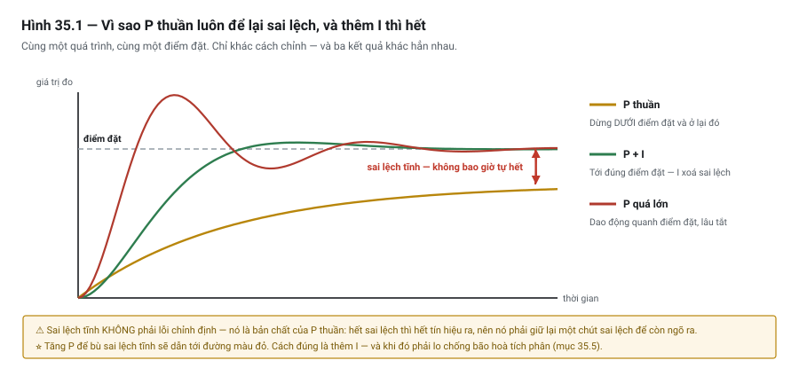

# Chương 35 — Điều khiển PID trên PLC

> **Lát cắt máy mẫu:** 3 — thêm analog (áp suất, nhiệt độ, cường độ UV) và trục gantry XY+Z servo.

---

## 35.1 Bài toán: vòng PID chạy đúng, nhiệt độ vẫn dao động

Kỹ sư viết một vòng PID điều khiển nhiệt độ bộ gia nhiệt keo. Chỉnh định theo một quy trình đọc được
trên mạng, thấy nhiệt độ bám điểm đặt khá tốt trên màn hình. Bàn giao.

Ba tuần sau, chất lượng keo không ổn định. Ghi log lại thì thấy nhiệt độ **dao động chậm quanh điểm
đặt**, biên độ khoảng ±3 °C, chu kỳ vài phút — thứ mà nhìn màn hình theo thời gian thực **không thấy
được**, vì nó trôi quá chậm.

Có ba nguyên nhân cùng góp phần, và cả ba đều là nội dung chương này:

- Vòng PID chạy với chu kỳ **100 ms**, trong khi module nhiệt độ chỉ cập nhật **500 ms** một lần
  (Chương 33, mục 33.11) — bốn trong năm lần tính dựa trên cùng một giá trị cũ.
- Hệ số **I** đặt quá mạnh cho một quá trình chậm như gia nhiệt.
- Không có chống **bão hoà tích phân**, nên mỗi lần khởi động từ nguội, vòng điều khiển vọt lố rồi
  mất rất lâu mới ổn định.

Nhưng câu hỏi đáng giá nhất lại là câu chưa ai hỏi: **có cần PID ở đây không?**

Chương này trả lời cả hai — cách viết PID cho đúng, và cách nhận ra khi nào **không nên** viết nó.

---

## 35.2 Vòng hở và vòng kín

| | **Vòng hở** *(open loop)* | **Vòng kín** *(closed loop)* |
|---|---|---|
| Cách làm | Ra lệnh, tin rằng nó xảy ra | Ra lệnh, **đo kết quả**, điều chỉnh lệnh |
| Cần gì | Chỉ cơ cấu chấp hành | Cơ cấu chấp hành **+ phép đo** |
| Bù được nhiễu không | ❌ Không | ✅ Có |
| Ví dụ trên DP-01 | `AO_ConvSpeed` — đặt 70 %, tin rằng chuyền chạy đúng tốc độ | Nhiệt độ keo — đo, so, chỉnh |

> ⭐ **Vòng kín chính là nguyên tắc "giám sát phản hồi thay vì tin lệnh" (Chương 48) áp cho đại lượng
> liên tục.** Bạn đã dùng nó với tín hiệu số từ Chương 17: ra lệnh nâng kẹp rồi **chờ cảm biến xác
> nhận**. PID là cùng ý tưởng đó, nhưng thay vì chờ một bit, nó **liên tục điều chỉnh** theo sai lệch.

### Ba đại lượng của mọi vòng điều khiển

| Ký hiệu | Tên | Là gì |
|---|---|---|
| **SP** | *Setpoint* — điểm đặt | Giá trị bạn muốn — 60 °C |
| **PV** | *Process Value* — giá trị quá trình | Giá trị đo được — 57 °C |
| **CV** | *Control Value* / *Output* — giá trị điều khiển | Lệnh ra cơ cấu — công suất gia nhiệt 40 % |

Và **sai lệch** *(error)*: `e = SP − PV`. Toàn bộ PID là các cách khác nhau để biến `e` thành `CV`.

---

## 35.3 ⭐ Khi nào on/off là đủ — và PID là làm phức tạp vô ích

Đặt mục này **trước** phần giải thích PID là cố ý. Rất nhiều vòng PID trong thực tế lẽ ra không nên
tồn tại.

### Điều khiển on/off có trễ

Cách đơn giản nhất: bật khi thấp, tắt khi cao, với một **vùng chết** (Chương 32, mục 32.7):

```iecst
// Gia nhiệt on/off: bật dưới 58 °C, tắt trên 62 °C
IF GlueTempX10 < 580 THEN
    DO_HeaterOn := TRUE;
ELSIF GlueTempX10 > 620 THEN
    DO_HeaterOn := FALSE;
END_IF;                          // giữa 58 và 62: GIỮ NGUYÊN
```

Bốn dòng. Không hệ số nào để chỉnh. Không có gì để hỏng.

Kết quả: nhiệt độ **dao động đều đặn** trong dải 58–62 °C. Đó là **đặc tính**, không phải lỗi.

### Bảng quyết định

| Dùng **on/off** khi | Dùng **PID** khi |
|---|---|
| ⭐ Dao động trong vùng chết **chấp nhận được** | Cần bám điểm đặt **sát** |
| Cơ cấu chỉ có hai trạng thái (rơ-le gia nhiệt, van đóng/mở) | Cơ cấu điều khiển được **liên tục** (0–100 %) |
| Quá trình **chậm**, quán tính lớn | Quá trình nhanh, hoặc nhiễu tải thay đổi nhiều |
| ⭐ Không ai trong đội biết chỉnh PID | Có người chỉnh được và **bảo trì được** |
| Đóng cắt thường xuyên **không hại cơ cấu** | ⚠ Đóng cắt hại cơ cấu (Chương 9, mục 9.3) |

> ⭐ **Hàng thứ tư là hàng thật nhất và ít được nói nhất.**
> Một vòng PID chỉnh định sai còn tệ hơn một vòng on/off đơn giản. Và nếu người bảo trì tại nhà máy
> không biết PID hoạt động thế nào, thì khi quá trình thay đổi — đổi loại keo, đổi mùa, thay bộ gia
> nhiệt — **không ai chỉnh lại được**, và họ sẽ vô hiệu hoá nó theo cách nào đó.
>
> Đây là cùng một câu hỏi với Chương 20 mục 20.6: **ai sẽ bảo trì cái này?**

### ⚠ On/off và tuổi thọ cơ cấu

Điều khiển on/off làm cơ cấu **đóng cắt liên tục**. Với điện trở gia nhiệt qua rơ-le, hãy làm phép
tính ở Chương 9 mục 9.3 — vài giây một lần, suốt ngày, suốt năm.

Ba cách xử lý:

- **Mở rộng vùng chết** — ít đóng cắt hơn, đổi lại dao động lớn hơn.
- **Dùng cơ cấu không có tiếp điểm cơ khí** — rơ-le bán dẫn hoặc bộ điều khiển công suất.
- **Chuyển sang PID** với ngõ ra liên tục — nếu dao động thật sự không chấp nhận được.

---

## 35.4 P — và vì sao nó **luôn** để lại sai lệch

### P làm gì

**Tỉ lệ** *(Proportional)*: ngõ ra tỉ lệ với sai lệch hiện tại.

```text
CV = Kp × e
```

Sai lệch lớn → tác động mạnh. Sai lệch nhỏ → tác động nhẹ. Trực giác, và hiệu quả.



*Hình 35.1 — Cùng một quá trình, cùng một điểm đặt, ba cách chỉnh. Đường vàng dừng lại dưới điểm đặt
và ở lại đó; đường xanh tới đúng nơi; đường đỏ là hậu quả của việc tăng P để bù sai lệch tĩnh.*

### ⭐ Vì sao P thuần luôn để lại sai lệch tĩnh

Đây là điểm mà nhiều người dùng PID nhiều năm vẫn không nắm chắc, và nó suy ra trực tiếp từ công thức.

Xét bộ gia nhiệt keo. Để **giữ** keo ở 60 °C, cần một công suất gia nhiệt nhất định — giả sử 30 % —
để bù nhiệt thất thoát ra môi trường.

Bây giờ giả sử vòng P đã đưa nhiệt độ tới đúng 60 °C. Khi đó `e = 0`, nên:

```text
CV = Kp × 0 = 0
```

**Ngõ ra bằng 0.** Không gia nhiệt. Nhiệt độ **tụt xuống**.

Nhiệt độ tụt làm `e` tăng, nên `CV` tăng, nên nhiệt độ lên lại. Hệ ổn định ở một điểm mà `Kp × e`
đúng bằng công suất cần thiết — tức là **`e` khác 0**.

> ⭐ **Kết luận: bộ điều khiển P thuần luôn dừng lại ở một sai lệch khác 0**, gọi là **sai lệch tĩnh**
> *(steady-state offset)*. Đó không phải lỗi chỉnh định — đó là **hệ quả toán học** của việc ngõ ra
> tỉ lệ với sai lệch.
>
> Tăng `Kp` làm sai lệch nhỏ đi, nhưng ⚠ tăng quá thì hệ **dao động** rồi mất ổn định. Không thể xoá
> sai lệch bằng cách tăng `Kp`.

---

## 35.5 I — xoá sai lệch, và cái giá của nó

### I làm gì

**Tích phân** *(Integral)*: cộng dồn sai lệch theo thời gian.

```text
CV_I = Ki × ∑(e × Δt)
```

Chừng nào `e` còn khác 0, phần tích phân còn **tiếp tục tăng** — nên ngõ ra tiếp tục tăng cho tới khi
`e` về 0. Đúng lúc đó phần tích phân **giữ nguyên giá trị**, và giá trị đó chính là 30 % công suất
cần thiết ở mục 35.4.

> ⭐ **I chính là bộ nhớ của vòng điều khiển.** Nó "học" được mức ngõ ra cần thiết để giữ điểm đặt, và
> đó là lý do nó xoá được sai lệch tĩnh mà P không xoá nổi.

### ⚠⚠ Cái giá: bão hoà tích phân

Đây là bẫy nguy hiểm nhất của PID trên PLC.

**Kịch bản**: bật máy từ nguội. Nhiệt độ 20 °C, điểm đặt 60 °C, sai lệch 40 °C.

```text
   Sai lệch lớn kéo dài  →  phần tích phân CỘNG DỒN mãi
   →  CV tính ra = 400 %  (!)
   →  Nhưng cơ cấu chỉ chạy được tối đa 100 %
   →  Nhiệt độ lên tới 60 °C, e = 0
   →  ⚠ Phần tích phân vẫn đang ở mức tương ứng 400 %
   →  Cơ cấu vẫn chạy 100 % — nhiệt độ VỌT LÊN 75 °C
   →  Phải mất rất lâu sai lệch âm mới "xả" hết phần tích phân
```

Hiện tượng này gọi là **bão hoà tích phân** *(integral windup)*, và triệu chứng của nó rất đặc trưng:

> **Vọt lố lớn sau mỗi lần khởi động từ xa điểm đặt, hoặc sau mỗi lần cơ cấu bị chặn** — trong khi
> lúc chạy ổn định thì vòng điều khiển hoạt động tốt.

### Chống bão hoà

Nguyên tắc: **ngừng cộng dồn khi ngõ ra đã chạm giới hạn**.

```iecst
// ── Tính phần tích phân, có chống bão hoà ──
CvRaw := KpTerm + IntegralTerm;

// ⭐ Chỉ cộng dồn khi ngõ ra CHƯA bão hoà, hoặc khi sai lệch đẩy nó về phía trong dải
IF (CvRaw < CV_MAX AND CvRaw > CV_MIN)
   OR (CvRaw >= CV_MAX AND Error < 0)
   OR (CvRaw <= CV_MIN AND Error > 0) THEN
    IntegralTerm := IntegralTerm + (Ki * Error * CycleMs) / 1000;
END_IF;

// Kẹp ngõ ra — luôn luôn (Chương 32, mục 32.4)
Cv := CvRaw;
IF Cv > CV_MAX THEN Cv := CV_MAX; END_IF;
IF Cv < CV_MIN THEN Cv := CV_MIN; END_IF;
```

> ⚠ **Hai điều kiện `OR` ở trên không thừa.** Nếu chỉ ngừng cộng dồn khi bão hoà mà không cho phép
> cộng ngược, vòng điều khiển sẽ **kẹt** ở trạng thái bão hoà — không thoát ra được. Hai vế `OR` cho
> phép phần tích phân **giảm** khi sai lệch đã đổi dấu.
>
> 💡 Khối PID dựng sẵn của các hãng đều có chống bão hoà. **Đây là một lý do rất mạnh để dùng khối
> sẵn có thay vì tự viết** — mục 35.9.

---

## 35.6 D — và vì sao thường tắt

**Vi phân** *(Derivative)*: phản ứng theo **tốc độ thay đổi** của sai lệch.

```text
CV_D = Kd × (Δe / Δt)
```

Ý tưởng: nếu sai lệch đang giảm nhanh, giảm bớt tác động trước để khỏi vọt lố. Nó là thành phần
**đoán trước**.

### ⚠ Vì sao trong thực tế nó thường bằng 0

| Lý do | Giải thích |
|---|---|
| ⭐ **Khuếch đại nhiễu** | D nhìn vào **thay đổi**. Tín hiệu analog luôn có nhiễu, và nhiễu chính là thay đổi nhanh — D biến nhiễu nhỏ thành dao động lớn ở ngõ ra |
| **Quá trình chậm không cần** | Gia nhiệt, mức chất lỏng, áp suất trong bình lớn — quán tính đã tự làm việc của D |
| **Khó chỉnh** | Thêm một hệ số nữa vào bài toán vốn đã khó |
| ⚠ **Cú nhảy khi đổi điểm đặt** | Đổi SP đột ngột làm `e` nhảy bậc → D cho một xung rất lớn |

> **Quy tắc thực dụng: bắt đầu với `Kd = 0`.** Phần lớn vòng điều khiển trên máy tự động hoá chạy tốt
> với **PI**. Chỉ thêm D khi bạn đã có PI hoạt động và vẫn cần cải thiện, **và** tín hiệu đủ sạch.
>
> 💡 Nhiều khối PID cho phép D tác động lên **PV thay vì lên `e`** — cách này loại bỏ cú nhảy khi đổi
> điểm đặt. Nếu buộc phải dùng D, hãy tìm tuỳ chọn đó.

---

## 35.6b ⚠⚠ Hai thứ phải kiểm TRƯỚC khi chỉnh định

Chỉnh định giỏi đến đâu cũng vô nghĩa nếu hai thứ dưới đây sai. Cả hai đều **không phải tham số
chỉnh** — chúng là **cấu hình**, và cả hai đều gây hậu quả rất khác nhau.

### Một — ⚠⚠ Chiều tác động: thuận hay nghịch

Bộ điều khiển phải biết: **đại lượng đo tăng thì ngõ ra phải tăng hay giảm?**

| Chiều | Nghĩa | Ví dụ |
|---|---|---|
| **Thuận** *(direct-acting)* | Đo **tăng** → ngõ ra **tăng** | Điều khiển làm mát: nóng hơn thì mở lạnh nhiều hơn |
| ⭐ **Nghịch** *(reverse-acting)* | Đo **tăng** → ngõ ra **giảm** | ⭐ **Gia nhiệt**: nóng hơn thì giảm công suất |

> ⚠⚠ **NGUY HIỂM — đặt sai chiều tác động làm vòng điều khiển CHẠY LOẠN.**
>
> Với bộ gia nhiệt keo của DP-01, nếu đặt nhầm thành **thuận**:
>
> ```text
> Nhiệt độ tăng  →  ngõ ra tăng  →  cấp nhiệt nhiều hơn  →  nhiệt độ tăng nữa  →  …
> ```
>
> ⭐ Đó là **phản hồi dương**. Vòng điều khiển không dao động quanh điểm đặt — nó **chạy thẳng tới
> giới hạn** và ở đó. ⚠ Với thiết bị gia nhiệt, hậu quả có thể là hỏng sản phẩm, hỏng thiết bị, hoặc
> cháy.
>
> ⭐⭐ **Triệu chứng nhận ra ngay:** ngõ ra **bám chặt 0 % hoặc 100 %** và không bao giờ rời khỏi đó,
> bất kể chỉnh `Kp` thế nào. ⚠ Nếu thấy triệu chứng này, **đừng chỉnh định tiếp** — kiểm chiều tác
> động trước.
>
> ⚡ **Bảo vệ bắt buộc:** vòng gia nhiệt phải có **giới hạn nhiệt độ độc lập** với PID — một bộ bảo
> vệ quá nhiệt cắt nguồn không đi qua bộ điều khiển (Chương 48).

### Hai — ⚠ Đơn vị của khâu tích phân: hai cách nói NGƯỢC nhau

Cùng một mức tác động tích phân được ghi bằng **hai đơn vị nghịch đảo nhau**:

| Cách ghi | Ý nghĩa | ⭐ Số LỚN nghĩa là |
|---|---|---|
| **Phút / lần lặp** *(minutes per repeat)* | Thời gian tích phân | ⭐ Tác động tích phân **YẾU hơn** |
| **Lần lặp / phút** *(repeats per minute)* | Độ lợi tích phân | ⭐ Tác động tích phân **MẠNH hơn** |

> ⚠⚠ **Hai cách ghi này là NGHỊCH ĐẢO của nhau — nên chép nhầm là sai theo cấp số.**
>
> Giá trị `2` mang nghĩa hoàn toàn khác nhau:
>
> ```text
> 2 phút/lần lặp   →  tác động chậm, hiền
> 2 lần lặp/phút   →  tác động nhanh gấp 4 lần cách trên
> ```
>
> ⭐ Đây là lý do **không được chép tham số PID từ máy này sang máy khác** — kể cả khi hai bộ điều
> khiển trông giống nhau (Phụ lục A2 mục A2.7).
>
> ⭐⭐ **Việc phải làm trước khi chỉnh:** mở tài liệu bộ điều khiển và ⭐ **xác định nó dùng đơn vị
> nào**. Nhiều bộ cho phép **chọn** đơn vị — nghĩa là hai máy cùng model vẫn có thể khác nhau.
>
> ⚡ Khâu vi phân cũng có chuyện tương tự, nhưng ít gây nhầm hơn vì thường chỉ có một đơn vị (phút).

*(Đối chiếu: Kuphaldt — Lessons in Industrial Instrumentation, mục về tác động tích phân và đơn vị
minutes-per-repeat / repeats-per-minute; và mục về thiết bị direct-acting / reverse-acting.)*

> ⚖ **NGOÀI HIỆN TRƯỜNG**
> **Người ta làm gì:** chép bộ tham số PID từ một máy "chị em" đang chạy tốt sang máy mới — gần như ai
> cũng làm.
> **Vì sao:** chỉnh định từ đầu mất cả buổi, còn máy kia đang chạy được.
> **Ranh giới:** câu *"không được chép"* ở trên nói tuyệt đối để chặn cách làm nguy hiểm nhất: **chép
> rồi coi như xong**. Chép làm **điểm xuất phát** thì chấp nhận được, với ba điều kiện: cùng model và
> **đơn vị khâu tích phân đã xác minh** trên cả hai bộ, không suy ra từ việc cùng model (phần Hai);
> cùng **chiều tác động** (phần Một); và sau đó vẫn **chỉnh lại có đồ thị** trên chính máy này (mục
> 35.10, Bẫy 7) — tải, cảm biến, đường ống không bao giờ giống hệt. Giữa hai hệ **khác hãng** thì không
> có điểm xuất phát nào: chỉnh lại từ đầu (Phụ lục A2 mục A2.7).

---

## 35.7 ⚠ Chu kỳ vòng điều khiển

Đây là lỗi đầu tiên trong ba lỗi ở mục 35.1, và nó đặc thù cho PLC.

### Vòng PID phải chạy đều đặn

Công thức tích phân và vi phân đều chứa `Δt`. Nếu vòng chạy lúc nhanh lúc chậm, hai thành phần đó
tính sai.

```iecst
// ✗ SAI — gọi PID ở chương trình chính, Δt = thời gian quét (biến động)
PID_GlueTemp(...);
```

```iecst
// ✓ ĐÚNG — gọi trong tác vụ chu kỳ cố định, hoặc theo một xung định kỳ
IF TrigPidTick.Q THEN            // xung đều đặn, ví dụ 500 ms
    // ⭐ CỐ Ý gọi trong nhánh: khối PID lấy Δt = CycleMs, nên PHẢI chạy đúng một lần mỗi nhịp
    PID_GlueTemp(..., CycleMs := 500);
END_IF;
```

> ⚠ **Thời gian quét KHÔNG cố định** (Chương 10, Chương 20 mục 20.5). Dùng nó làm `Δt` nghĩa là hệ số
> hiệu dụng của vòng điều khiển **thay đổi theo tải chương trình** — và vòng đã chỉnh tốt hôm nay có
> thể dao động sau khi ai đó thêm chức năng vào tháng sau.

### ⭐ Chu kỳ vòng so với tốc độ cập nhật của phép đo

Đây là lỗi ở mục 35.1, và nó tinh vi hơn.

> **Chạy vòng PID nhanh hơn tốc độ cập nhật của cảm biến là vô ích — và có hại.**

Module nhiệt độ cập nhật 500 ms mỗi kênh (Chương 33, mục 33.11). Chạy PID 100 ms nghĩa là:

- Bốn trong năm lần tính dựa trên **cùng một giá trị cũ** → phần D thấy `Δe = 0` rồi đột ngột thấy
  một bước nhảy → xung nhiễu vào ngõ ra.
- Phần I cộng dồn **năm lần** cho một phép đo → tác động tích phân mạnh gấp năm lần dự kiến.

**Quy tắc:** chu kỳ vòng PID ≥ tốc độ cập nhật phép đo, và thường nên là **vài lần chậm hơn hằng số
thời gian của quá trình**.

| Quá trình | Chu kỳ vòng hợp lý |
|---|---|
| Nhiệt độ (chậm, hằng số thời gian hàng phút) | 500 ms – vài giây |
| Áp suất trong bình | 100 – 500 ms |
| Lưu lượng (nhanh) | 50 – 100 ms |
| Vị trí, tốc độ trục | ⚠ Không dùng PID tự viết — dùng bộ điều khiển chuyển động (Chương 37) |

---

## 35.8 Chuyển chế độ êm và chống vọt khi đổi điểm đặt

### Chuyển chế độ êm

Khi chuyển từ **Manual** (người đặt ngõ ra bằng tay) sang **Auto** (PID điều khiển), nếu không xử lý
thì phần tích phân đang ở một giá trị bất kỳ, và ngõ ra **nhảy đột ngột**.

> **Chuyển chế độ êm** *(bumpless transfer)*: khi rời Manual, nạp phần tích phân bằng **giá trị ngõ
> ra hiện tại** — để lần tính đầu tiên ở Auto cho ra đúng giá trị đang có, rồi mới điều chỉnh dần.

```iecst
IF TrigManualToAuto.Q THEN
    IntegralTerm := CvManual;      // ⭐ nạp bằng ngõ ra đang có
END_IF;
```

⚠ Cùng logic áp cho **mọi** lần vòng điều khiển bị dừng rồi chạy lại — sau lỗi, sau khi máy về gốc,
sau khi đổi công thức.

### Đổi điểm đặt từ từ

Đổi SP đột ngột — ví dụ từ 60 lên 70 °C khi đổi mã hàng — tạo một bước nhảy trong `e`, gây vọt lố và
kích phần D.

> 💡 **Dùng đoạn dốc điểm đặt** *(setpoint ramp)*: thay vì nhảy thẳng, cho SP tăng dần vài độ mỗi
> phút. Vòng điều khiển theo kịp, không vọt lố, và cơ cấu không bị sốc.
>
> Với DP-01, đổi công thức chỉ được phép khi máy đã xả hết và ở `Idle` (Chương 29, mục 29.5) — nên
> vòng nhiệt có thời gian đi lên từ từ trước khi bắt đầu sản xuất. **Đây là ví dụ hai quyết định
> thiết kế ở hai chương khác nhau hỗ trợ nhau.**

---

## 35.9 ⭐ Bộ điều khiển rời hay PID trên PLC

Câu hỏi thiết kế mà máy mẫu DP-01 đặt ra: nhiệt độ keo được điều khiển bởi một **bộ điều khiển nhiệt
độ rời** nối RS-485 (Phụ lục J §J.1), không phải bởi PID viết trong PLC. Vì sao?

| | **Bộ điều khiển rời** | **PID trên PLC** |
|---|---|---|
| Chỉnh định | ⭐ Thường có **tự chỉnh định** *(auto-tune)* rất tốt | Tự viết thì phải chỉnh tay; khối sẵn có thường cũng có auto-tune |
| Chuyên biệt | ⭐ Thiết kế riêng cho nhiệt độ — xử lý sẵn can nhiệt/RTD, ngõ ra xung | Cần module analog + logic ngõ ra |
| Chạy độc lập | ⭐ **Vẫn giữ nhiệt khi PLC dừng** hoặc đang nạp chương trình | Dừng theo PLC |
| Người bảo trì | ⭐ Chỉnh trên mặt máy, **không cần phần mềm lập trình** | Cần phần mềm và quyền |
| Tích hợp với trình tự | ⚠ Qua truyền thông — thêm một lớp có thể hỏng | ⭐ Trực tiếp, không có lớp trung gian |
| Số điểm đo nhiều | ⚠ Mỗi điểm một bộ — tốn chỗ và tiền | ⭐ Rẻ hơn khi nhiều vòng |
| Ghi log và truy xuất | ⚠ Phải đọc về qua truyền thông | ⭐ Có sẵn trong PLC |
| Chi phí | Cao hơn cho một vòng | Rẻ hơn khi đã có module analog |

> ⭐ **Quy tắc thực dụng:**
> - **Một hoặc hai vòng nhiệt độ, quan trọng, đội bảo trì cần chỉnh được** → **bộ điều khiển rời**.
> - **Nhiều vòng, hoặc vòng gắn chặt với trình tự, hoặc cần ghi log chi tiết** → **PID trên PLC**.
>
> Với DP-01: một vòng nhiệt độ duy nhất, quan trọng với chất lượng, và người vận hành cần chỉnh được
> khi đổi loại keo → **bộ điều khiển rời**. Hàng "vẫn giữ nhiệt khi PLC dừng" cũng có giá trị thật:
> bộ gia nhiệt mất cả chục phút để đạt nhiệt, nên mỗi lần nạp lại chương trình mà nhiệt tụt là mất
> thời gian sản xuất.

### ⚠ Dù dùng bộ điều khiển rời, PLC vẫn phải giám sát

Giao việc điều khiển cho thiết bị khác **không** có nghĩa là quên nó đi:

```iecst
// PLC đọc về qua RS-485 (Chương 38, 39) và tự kiểm
M_GlueTempFault := M_TempCtrlCommFault              // mất truyền thông
                OR (GlueTempX10 < RecipeTempMinX10)  // ngoài dải cho phép
                OR (GlueTempX10 > RecipeTempMaxX10)
                OR M_TempCtrlAlarm;                  // bộ điều khiển tự báo lỗi

M_CanStart := ... AND NOT M_GlueTempFault;
```

> ⚠⚠ **Mất truyền thông với bộ điều khiển nhiệt là một trạng thái phải xử lý tường minh.**
> Bộ điều khiển vẫn đang giữ nhiệt — nhưng **PLC không còn biết nhiệt độ là bao nhiêu**. Chạy tiếp
> trong trạng thái mù là chấp nhận rủi ro chất lượng mà không đo được. Đây là cùng bài toán với mất
> kết nối I/O phân tán (Chương 8, mục 8.5; Chương 48, mục 48.5).

---

## 35.10 Chỉnh định thực dụng — từng bước

> ⚠⚠ **Trước bước 1: kiểm chiều tác động và đơn vị khâu tích phân** (mục 35.6b). Chỉnh định một
> vòng đặt sai chiều tác động là việc vô ích — và nguy hiểm.

Không cần lý thuyết điều khiển để chỉnh một vòng PID trên máy. Quy trình dưới đây đủ dùng cho phần
lớn vòng nhiệt độ và áp suất.

> ⚠ **Chuẩn bị trước khi chỉnh:**
> - Ghi lại **bộ hệ số hiện tại** — để quay lui được.
> - Bảo đảm **an toàn**: chỉnh định làm quá trình dao động, và dao động đó có thể vượt xa dải bình
>   thường. ⚠⚠ **Bảo vệ quá nhiệt phải ĐỘC LẬP với vòng điều khiển** — một rơ-le nhiệt hoặc bộ bảo
>   vệ riêng cắt nguồn gia nhiệt, không đi qua PLC và không đi qua bộ điều khiển đang chỉnh. Lý do:
>   thứ bạn đang chỉnh chính là thứ có thể sai. Đây là nguyên tắc chung của IEC 60204-1 và của
>   Chương 48 — **bảo vệ không được nằm trong cái nó bảo vệ**.
> - Có cách **ghi và xem đồ thị** PV theo thời gian. ⭐ Không có đồ thị thì bạn đang chỉnh mù —
>   dao động chậm như ở mục 35.1 **không nhìn thấy được** trên màn hình thời gian thực.

| Bước | Việc | Dấu hiệu xong |
|---|---|---|
| 1 | Đặt `Ki = 0`, `Kd = 0`. Chỉ còn P | — |
| 2 | Tăng `Kp` dần cho tới khi PV bắt đầu **dao động nhẹ** quanh SP | Thấy dao động rõ |
| 3 | ⭐ **Giảm `Kp` xuống khoảng một nửa** giá trị vừa tìm | Hết dao động, còn sai lệch tĩnh |
| 4 | Tăng `Ki` dần cho tới khi sai lệch tĩnh **bị xoá trong thời gian chấp nhận được** | PV về đúng SP |
| 5 | ⚠ Nếu vọt lố quá nhiều: **giảm `Ki`**, đừng vội thêm D | Vọt lố trong mức chấp nhận |
| 6 | Chỉ khi thật cần và tín hiệu sạch: tăng `Kd` từ 0, rất nhẹ | Đáp ứng nhanh hơn, không thêm nhiễu |
| 7 | ⭐ **Thử nhiễu tải thật** — mở cửa buồng, thêm keo lạnh, đổi mã hàng | Vòng phục hồi hợp lý |
| 8 | Ghi lại bộ hệ số **và điều kiện thử** vào tài liệu máy | Có hồ sơ |

> ⭐ **Bước 7 là bước hay bị bỏ và quan trọng nhất.**
> Chỉnh trong điều kiện tĩnh chỉ chứng minh vòng ổn định khi không có gì xảy ra. Máy thật luôn có
> nhiễu tải — và một vòng chỉnh "đẹp" ở trạng thái tĩnh có thể dao động dữ dội khi có nhiễu.

> 💡 **Auto-tune có dùng được không?** Có, và nó thường cho điểm khởi đầu tốt. Nhưng ⚠ nó chỉ chỉnh
> theo điều kiện **tại thời điểm chạy auto-tune**. Chạy auto-tune trên máy nguội, không tải, rồi đem
> vào sản xuất với tải thật là cách rất phổ biến để có một vòng điều khiển hoạt động kém.

---

## 35.11 Trên máy mẫu DP-01

| Vòng | Cách làm | Vì sao |
|---|---|---|
| **Nhiệt độ keo** | ⭐ **Bộ điều khiển rời**, PLC giám sát qua RS-485 | Mục 35.9 — một vòng, quan trọng, người vận hành cần chỉnh được, giữ nhiệt khi PLC dừng |
| **Áp keo** | ⭐ **Vòng hở** — `AO_GluePressSet` đặt van điều áp | Van điều áp điện tử **đã có vòng kín bên trong nó**. Thêm PID ở PLC là chồng hai vòng — mục 35.12, Bẫy 8 |
| **Tốc độ chuyền** | **Vòng hở** — `AO_ConvSpeed` tới biến tần | Biến tần tự lo phần điều khiển tốc độ (Chương 36) |
| **Công suất đèn UV** | **Vòng hở**, có giám sát | Đặt công suất theo công thức; `AI_UvIntensity` dùng để **phát hiện suy giảm**, không để điều chỉnh |
| **Vị trí gantry** | ⚠ **Không dùng PID tự viết** | Bộ điều khiển servo đã có vòng vị trí riêng (Chương 37) |

> ⭐ **Nhận xét đáng chú ý: DP-01 gần như không có vòng PID nào do PLC chạy.**
>
> Đó không phải thiếu sót — đó là kết quả của việc **mỗi thiết bị đã tự lo phần điều khiển liên tục
> của nó**: biến tần lo tốc độ, servo drive lo vị trí, van điều áp lo áp, bộ điều khiển nhiệt lo nhiệt
> độ. PLC lo **trình tự và phối hợp**.
>
> Đây là kiến trúc rất phổ biến ở máy lắp ráp, và nó đúng với vai trò của PLC nêu ở Chương 2: PLC
> mạnh về **logic rời rạc và trình tự**, không phải về điều khiển liên tục.
>
> ⚠ Nhưng nó **không** có nghĩa là bạn không cần hiểu PID. Bạn cần hiểu để: chỉnh định các bộ điều
> khiển rời, đọc hiểu chúng đang làm gì, chẩn đoán khi chúng hoạt động kém, và ⭐ **nhận ra khi nào
> mình đang vô tình chồng hai vòng lên nhau**.

### Câu hỏi `AI_UvIntensity` — vì sao không đóng vòng

Cường độ UV đo được có thể dùng để **tự động tăng công suất đèn khi nó suy giảm**. Nghe hợp lý. Nhưng:

> ⚠⚠ **Đóng vòng ở đây sẽ GIẤU MẤT sự suy giảm.**
> Đèn yếu dần, vòng điều khiển tự tăng công suất bù vào, cường độ giữ nguyên — và **không ai biết đèn
> sắp hết tuổi thọ** cho tới khi công suất chạm 100 % và không bù được nữa. Khi đó bạn không còn thời
> gian chuẩn bị.
>
> Cách đúng: **giữ vòng hở, và giám sát cả hai con số** — công suất đặt *và* cường độ đo được. Tỉ số
> giữa chúng chính là chỉ số sức khoẻ của đèn, và nó cho cảnh báo sớm (Chương 12, mục 12.5;
> Chương 48, mục 48.6).

Đây là ví dụ rất rõ của một nguyên tắc chung: **tự động bù một suy giảm có thể xoá mất tín hiệu cảnh
báo về chính suy giảm đó.**

---

## 35.12 Bẫy thường gặp

### 🔍 BẪY 1 — Dùng PID khi on/off là đủ

**Hiện tượng:** thêm ba hệ số phải chỉnh, thêm một thứ có thể hỏng, mà kết quả không tốt hơn đáng kể.
Vài năm sau không ai chỉnh lại được.
**Cách sửa:** bảng quyết định ở mục 35.3. Hỏi trước: **dao động trong vùng chết có chấp nhận được
không?**

### 🔍 BẪY 2 — Gọi PID ở chương trình chính

**Hiện tượng:** vòng chỉnh tốt hôm nay **dao động sau khi ai đó thêm chức năng** — vì `Δt` đổi.
**Cách sửa:** gọi trong tác vụ chu kỳ cố định, hoặc theo xung định kỳ, và truyền `Δt` đúng (mục 35.7).

### 🔍 BẪY 3 — Chạy vòng nhanh hơn tốc độ cập nhật cảm biến

**Hiện tượng:** phần I tác động mạnh gấp nhiều lần dự kiến; phần D sinh xung nhiễu. Vòng dao động
chậm, khó thấy trên màn hình thời gian thực.
**Cách sửa:** chu kỳ vòng ≥ tốc độ cập nhật phép đo (mục 35.7, Chương 33 mục 33.11).

### 🔍 BẪY 4 — Không chống bão hoà tích phân

**Hiện tượng:** ⭐ rất đặc trưng — **vọt lố lớn sau mỗi lần khởi động từ nguội**, hoặc sau mỗi lần cơ
cấu bị chặn, trong khi chạy ổn định thì tốt.
**Cách sửa:** ngừng cộng dồn khi ngõ ra bão hoà, **và cho phép cộng ngược** (mục 35.5). Hoặc dùng
khối PID sẵn có.

### 🔍 BẪY 5 — Thêm D cho tín hiệu nhiễu

**Hiện tượng:** ngõ ra **giật liên tục**; cơ cấu chấp hành làm việc nhiều mà quá trình không tốt hơn.
**Cách sửa:** bắt đầu với `Kd = 0`; phần lớn vòng chạy tốt với PI (mục 35.6).

### 🔍 BẪY 6 — Không chuyển chế độ êm

**Hiện tượng:** ngõ ra **nhảy đột ngột** khi chuyển Manual → Auto; cơ cấu bị sốc.
**Cách sửa:** nạp phần tích phân bằng ngõ ra hiện tại trước khi vào Auto (mục 35.8).

### 🔍 BẪY 7 — Chỉnh định không có đồ thị

**Hiện tượng:** vòng "trông ổn" trên màn hình nhưng dao động chậm với chu kỳ vài phút — đúng cỗ máy ở
mục 35.1.
**Cách sửa:** ⭐ ghi và xem đồ thị PV theo thời gian. Không có đồ thị thì đang chỉnh mù (mục 35.10).

### 🔍 BẪY 8 — Chồng hai vòng điều khiển lên nhau

Viết PID trên PLC để điều khiển một thiết bị **đã có vòng kín bên trong** — van điều áp điện tử, biến
tần ở chế độ điều khiển tốc độ, bộ điều khiển nhiệt rời.

**Hiện tượng:** hai vòng "đánh nhau"; hệ dao động theo cách khó hiểu, và chỉnh vòng ngoài không cải
thiện được.
**Cách sửa:** ⭐ **biết thiết bị của mình đã tự điều khiển tới đâu.** Nếu nó đã đóng vòng, PLC chỉ nên
**đặt điểm đặt** và giám sát (mục 35.11).

### 🔍 BẪY 9 — Auto-tune ở điều kiện không đại diện

**Hiện tượng:** vòng hoạt động kém trong sản xuất dù auto-tune báo thành công.
**Cách sửa:** chạy auto-tune ở điều kiện **gần với sản xuất thật** nhất có thể; sau đó vẫn phải thử
nhiễu tải (bước 7, mục 35.10).

### 🔍 BẪY 10 — Đóng vòng lên một đại lượng đang dùng để chẩn đoán

**Hiện tượng:** ⚠⚠ hệ tự bù suy giảm, và **cảnh báo sớm biến mất** — bạn chỉ biết khi đã hết dư địa
bù.
**Cách sửa:** giữ vòng hở và **giám sát cả lệnh lẫn kết quả**; tỉ số giữa chúng là chỉ số sức khoẻ
(mục 35.11).

### 🔍 BẪY 11 — Giao vòng cho bộ điều khiển rời rồi quên giám sát

**Hiện tượng:** mất truyền thông với bộ điều khiển; nó vẫn giữ nhiệt nhưng **PLC không còn biết nhiệt
độ**, và máy chạy tiếp trong trạng thái mù.
**Cách sửa:** xử lý mất truyền thông tường minh, và đưa vào điều kiện cho phép chạy (mục 35.9).

---

## 35.13 Bảng chốt

| Câu hỏi | Trả lời |
|---|---|
| ⚠⚠ Kiểm gì TRƯỚC khi chỉnh định | **Chiều tác động** (thuận/nghịch) và **đơn vị khâu tích phân** |
| ⭐ Đặt sai chiều tác động → triệu chứng | Ngõ ra **bám chặt 0 % hoặc 100 %**, chỉnh `Kp` không đổi gì |
| ⚠ Vì sao không chép tham số PID giữa hai máy | **phút/lần lặp** và **lần lặp/phút** là **nghịch đảo nhau** |
| Ba đại lượng của vòng điều khiển | **SP** điểm đặt · **PV** giá trị đo · **CV** ngõ ra |
| Hỏi trước khi viết PID | ⭐ **On/off có đủ không?** |
| On/off đủ khi | Dao động trong vùng chết chấp nhận được · cơ cấu hai trạng thái · ⭐ **đội bảo trì không chỉnh được PID** |
| P thuần luôn để lại gì | ⭐ **Sai lệch tĩnh** — hệ quả toán học, không phải lỗi chỉnh định |
| Xoá sai lệch tĩnh bằng | **I** — nó là bộ nhớ của vòng điều khiển |
| Cái giá của I | ⚠⚠ **Bão hoà tích phân** |
| Triệu chứng bão hoà | ⭐ **Vọt lố sau mỗi lần khởi động từ xa điểm đặt** |
| Chống bão hoà | Ngừng cộng dồn khi bão hoà, **và cho phép cộng ngược** |
| Bắt đầu với `Kd` bằng | ⭐ **0** — phần lớn vòng chạy tốt với PI |
| D gặp vấn đề với | **Nhiễu** — nó khuếch đại thay đổi nhanh |
| Gọi PID ở đâu | **Tác vụ chu kỳ cố định**, không ở chương trình chính |
| Chu kỳ vòng so với cảm biến | ⭐ **≥ tốc độ cập nhật phép đo** |
| Manual → Auto | **Nạp phần tích phân bằng ngõ ra hiện tại** |
| Đổi điểm đặt lớn | Dùng **đoạn dốc**, không nhảy bậc |
| Bộ điều khiển rời hợp khi | Ít vòng · quan trọng · đội bảo trì cần chỉnh · cần chạy độc lập với PLC |
| Dù dùng bộ rời, PLC vẫn phải | ⚠ **Giám sát** — mất truyền thông là trạng thái phải xử lý |
| Chỉnh định — bước hay bị bỏ nhất | ⭐ **Thử nhiễu tải thật** |
| Chỉnh định không có gì thì mù | **Đồ thị PV theo thời gian** |
| ⚠ Đừng đóng vòng lên | Đại lượng đang dùng để **chẩn đoán suy giảm** |
| ⚠ Đừng chồng vòng lên | Thiết bị **đã có vòng kín bên trong** |

---

## 35.14 Tự kiểm

1. Phân biệt vòng hở với vòng kín. Nêu một ví dụ mỗi loại trên DP-01.
2. ⭐ Chứng minh bằng lập luận rằng bộ điều khiển **P thuần** luôn dừng ở sai lệch khác 0. Vì sao tăng
   `Kp` không xoá được nó?
3. Thành phần **I** xoá sai lệch tĩnh bằng cách nào? Vì sao nói nó là "bộ nhớ của vòng điều khiển"?
4. ⭐ Mô tả **bão hoà tích phân** bằng một kịch bản cụ thể. Triệu chứng đặc trưng của nó là gì?
5. Viết điều kiện chống bão hoà. Vì sao chỉ "ngừng cộng dồn khi bão hoà" là **chưa đủ**?
6. Nêu bốn lý do `Kd` thường bằng 0 trong thực tế. Lý do nào là chính?
7. ⭐ Module nhiệt độ cập nhật 500 ms, vòng PID chạy 100 ms. Nêu **hai** hậu quả cụ thể.
8. Vì sao không được gọi khối PID ở chương trình chính? Điều gì làm vòng đã chỉnh tốt bỗng dao động
   sau vài tháng?
9. **Chuyển chế độ êm** là gì, và thực hiện thế nào?
10. Nêu bốn tiêu chí chọn giữa **bộ điều khiển rời** và **PID trên PLC**. Với DP-01, chọn cái nào và
    vì sao?
11. Dù đã giao vòng nhiệt cho bộ điều khiển rời, PLC vẫn phải làm gì? Mất truyền thông thì sao?
12. ⭐ Vì sao **không** nên đóng vòng điều khiển công suất đèn UV theo cường độ đo được? Nêu nguyên
    tắc tổng quát đằng sau.
13. Trong quy trình chỉnh định, bước nào hay bị bỏ nhất và vì sao nó quan trọng?
14. ⭐ DP-01 gần như không có vòng PID nào do PLC chạy. Vì sao đó **không** phải thiếu sót? Và vì sao
    bạn vẫn cần hiểu PID?

> Câu 2, 4, 7, 12 và 14 là năm câu phân loại. Câu 12 là tinh thần của cả chương: **tự động bù một suy
> giảm có thể xoá mất tín hiệu cảnh báo về chính suy giảm đó.**

⚠⚠ **Bổ sung.** Bộ gia nhiệt keo được đặt nhầm thành **tác động thuận**. Mô tả điều gì xảy ra và
vì sao đó là **phản hồi dương**. Triệu chứng nào cho phép nhận ra ngay mà không cần chỉnh định?

⚠ **Bổ sung.** Vì sao `2 phút/lần lặp` và `2 lần lặp/phút` cho hai hành vi rất khác nhau? Điều đó
nói gì về việc chép tham số PID từ máy khác?

---

### Chương tiếp theo

Chương 36 — **Động cơ & biến tần**. Bạn đã biết điều khiển đại lượng liên tục. Chương sau về cơ cấu
chấp hành liên tục phổ biến nhất trên máy: động cơ ba pha và biến tần — và về việc biến tần đã tự lo
những gì, để bạn không chồng thêm một vòng nữa lên nó.

### Nguồn tham khảo chương 35

- IEC 61131-3 — *Programmable controllers, Part 3: Programming languages*: khối chức năng và cách tổ
  chức tác vụ chu kỳ. *(tiêu chuẩn có bản quyền)*
- IEC 60204-1 — *Safety of machinery — Electrical equipment of machines*: yêu cầu bảo vệ thiết bị và
  mạch — nền cho nguyên tắc **bảo vệ quá nhiệt phải độc lập với vòng điều khiển** (mục 35.10).
- Tài liệu **khối PID** của hệ đang dùng — dùng cho: dạng công thức cụ thể (khác nhau giữa các hãng),
  cách khai báo hệ số, cơ chế chống bão hoà và chuyển chế độ êm dựng sẵn, và tuỳ chọn cho D tác động
  lên PV.
- Tài liệu **bộ điều khiển nhiệt độ rời** — dùng cho auto-tune, bản đồ thanh ghi Modbus (Chương 39),
  và mã lỗi của thiết bị.
- Bảng I/O, bảng công thức và bảng số liệu đã chốt của DP-01 — Phụ lục J.

> ⚡ **Cảnh báo về hệ số PID.** Dạng công thức PID **khác nhau giữa các hãng**: có hệ dùng dạng chuẩn
> với `Kp`, `Ti`, `Td` (thời gian tích phân và vi phân, đơn vị thời gian); có hệ dùng dạng song song
> với `Kp`, `Ki`, `Kd` (hệ số thuần). ⚠ **Hệ số của hệ này không dùng được cho hệ kia** — chép sang
> sẽ cho hành vi hoàn toàn khác. Đọc tài liệu để biết khối của bạn dùng dạng nào trước khi chỉnh.
>
> ⚡ Quy trình chỉnh định ở mục 35.10 là **quy trình thực dụng của nghề**, không phải phương pháp
> chuẩn hoá. Nó đủ cho phần lớn vòng nhiệt độ và áp suất trên máy tự động hoá. Với quá trình khó — có
> trễ vận chuyển lớn, phi tuyến mạnh, hoặc nhiều vòng ảnh hưởng nhau — cần phương pháp bài bản hơn và
> thường cần người chuyên về điều khiển quá trình.
