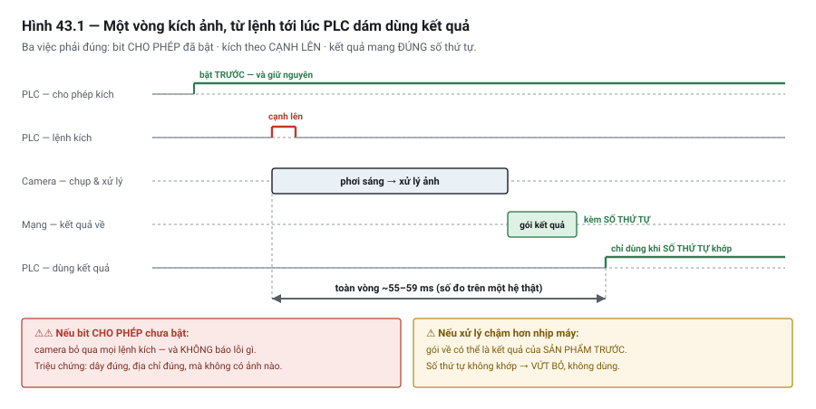

# Chương 43 — Tích hợp vision với PLC

> **Lát cắt máy mẫu:** 4 — thêm mạng: mã 2D, MES, SMEMA, màn hình vận hành, và bộ điều khiển nhiệt độ
> keo nối RS-485.
>
> ⚠ **DP-01 không có hệ thị giác.** Đây là quyết định thiết kế có chủ đích (Phụ lục J §J.1, mục 3):
> máy mẫu đã đủ phức tạp, và thêm vision không dạy thêm nguyên tắc điều khiển nào. Chương này dùng
> **ví dụ riêng**, và mục 43.9 nói rõ nếu cần thì DP-01 sẽ ghép với vision thế nào.

---

## 43.1 Bài toán: camera 40 triệu để đếm sản phẩm

Một trạm cần biết có sản phẩm ở vị trí hay không. Người thiết kế chọn một hệ thị giác — camera, đèn,
phần mềm xử lý, tổng cộng khoảng bốn mươi triệu đồng và ba tuần cấu hình.

Hệ chạy được. Nhưng:

- Mỗi lần đổi màu sản phẩm phải chỉnh lại tham số.
- Ánh sáng phòng thay đổi theo giờ làm kết quả không ổn định, phải che chắn thêm.
- Người bảo trì không ai chỉnh được, phải gọi nhà cung cấp.
- Sau một năm, phần mềm cần bản quyền gia hạn.

Một **cảm biến quang thu-phát** giá vài trăm nghìn làm đúng việc đó: có vật hay không có vật. Không
tham số, không ánh sáng, không bản quyền, và bất kỳ thợ điện nào cũng thay được.

> ⭐ **Câu hỏi đầu tiên của chương này không phải "tích hợp vision thế nào" — mà là "có cần vision
> không".** Mục 43.2 trả lời trước khi bàn tới kỹ thuật.

---

## 43.2 ⭐ Khi nào vision là quá mức cần thiết

| Nếu bài toán là | Dùng cái này |
|---|---|
| Có vật hay không có vật | ⭐ **Cảm biến quang** (Chương 4) |
| Vật ở đúng vị trí chưa | ⭐ Cảm biến quang, hoặc cảm biến tiệm cận |
| Đo một khoảng cách | ⭐ **Cảm biến khoảng cách** (Chương 33, mục 33.6) |
| Đọc một mã | ⭐ **Đầu đọc mã** (Chương 42) — rẻ hơn và ổn định hơn camera vạn năng |
| Phân biệt hai loại sản phẩm khác nhau rõ về kích thước | Cảm biến quang + cơ cấu gá |
| ⭐ **Đo vị trí và góc xoay của vật đặt tự do** | **Vision** |
| ⭐ **Kiểm ngoại quan** — vết xước, thiếu linh kiện, sai cực tính | **Vision** |
| ⭐ **Đọc ký tự in** | **Vision** |
| Nhiều phép kiểm khác nhau trên cùng một ảnh | **Vision** |

> ⭐ **Ba câu hỏi trước khi chọn vision:**
>
> **1. Có cảm biến rẻ tiền nào làm được việc này không?** Nếu có, gần như luôn nên dùng nó.
>
> **2. Ai sẽ chỉnh lại khi đổi sản phẩm?** ⚠ Hệ vision cần chỉnh định lại khi sản phẩm đổi màu, đổi
> kích thước, đổi nhà cung cấp. Nếu không ai trong nhà máy làm được, bạn đang tạo ra một điểm phụ
> thuộc nhà cung cấp lâu dài.
>
> **3. Điều kiện ánh sáng có kiểm soát được không?** ⚠ Ánh sáng phòng thay đổi là kẻ thù số một của
> vision. Không che chắn được thì hệ sẽ không ổn định.
>
> Câu 2 là cùng câu hỏi với Chương 20 mục 20.6, Chương 35 mục 35.3 và Chương 34 mục 34.7: **ai sẽ duy
> trì cái này?**

---

## 43.3 ⭐ Ranh giới trách nhiệm

Khi đã quyết dùng vision, điều quan trọng nhất là **chia việc cho đúng**.

```text
   ┌──────────────────┐                    ┌──────────────────┐
   │   HỆ VISION      │                    │       PLC        │
   │                  │                    │                  │
   │  Xử lý ảnh       │  ── kết quả ────►  │  Điều phối       │
   │  QUYẾT ĐỊNH:     │   OK/NG            │  QUYẾT ĐỊNH:     │
   │  - đạt hay không │   toạ độ X, Y      │  - làm gì tiếp   │
   │  - lệch bao nhiêu│   góc θ            │  - dừng? loại?   │
   └──────────────────┘                    └──────────────────┘
        ⭐ Ranh giới là VÀI BIT VÀ VÀI CON SỐ — không phải hình ảnh
```

| Bên | Làm gì | ⚠ Không làm gì |
|---|---|---|
| **Hệ vision** | Chụp, xử lý ảnh, ra kết luận | ⚠ Không điều khiển cơ cấu; không quyết định trình tự |
| **PLC** | Kích chụp, nhận kết quả, quyết định hành động | ⚠ **Không xử lý ảnh** |

> ⭐ **Đây chính là nguyên tắc "mỗi bên làm việc mình giỏi" ở Chương 2 mục 2.4.**
> PLC không sinh ra để xử lý ảnh; hệ vision không sinh ra để điều khiển trình tự. Ranh giới rõ ràng
> làm cả hai bên đơn giản hơn, và **thay được từng bên độc lập**.

> ⚠ **Đừng để hệ vision điều khiển cơ cấu trực tiếp.**
> Nhiều hệ vision có ngõ ra số và có thể bật một van. Cám dỗ là để nó tự loại sản phẩm NG cho nhanh.
> Nhưng khi đó **trình tự của máy nằm ở hai chỗ**, và không ai đọc được toàn bộ logic ở một nơi —
> cùng vấn đề với Chương 22 mục 22.3 (ai ghi vào tag này).

---

## 43.4 ⭐ Kích chụp — vì sao trigger phần cứng chính xác hơn

Đây là điểm kỹ thuật quan trọng nhất của chương.

### Hai cách kích

| Cách | Cơ chế | Độ chính xác thời điểm |
|---|---|---|
| ⭐ **Trigger phần cứng** | Một ngõ ra số của PLC nối thẳng vào chân trigger của camera | ⭐ **Cao và xác định** |
| **Trigger bằng lệnh mạng** | PLC gửi bản tin "chụp đi" qua mạng | ⚠ Trễ **biến động** |

### Vì sao khác biệt quan trọng

Với vật đang **đứng yên**, vài mili-giây trễ không sao.

Với vật đang **chuyển động**, hoặc với chu trình chặt, trễ biến động làm ảnh chụp **ở vị trí khác
nhau mỗi lần** — và kết quả đo toạ độ sai theo.

```text
   Vật chạy 200 mm/s
   Trễ trigger biến động ±10 ms  →  vị trí chụp lệch ±2 mm
```

> ⭐ **Trigger phần cứng đi thẳng, không qua vòng quét của bên nhận, không qua hàng đợi mạng.**
> Nó là cùng lập luận với công tắc giới hạn đi thẳng vào drive (Chương 37, mục 37.6) và với bắt tay
> bằng tín hiệu cứng (Chương 41, mục 41.5): **việc cần chính xác về thời điểm thì đừng cho nó đi qua
> một tầng có độ trễ biến động.**

> ⚠ **Nhưng trigger phần cứng vẫn chịu ảnh hưởng của vòng quét PLC.**
> Ngõ ra số chỉ được ghi ở giai đoạn 3 của vòng quét (Chương 10). Nếu cần độ chính xác cao hơn thời
> gian quét, phải dùng:
> - **Ngõ ra so sánh của bộ đếm tốc độ cao** — kích khi encoder tới đúng vị trí (Chương 18, mục 18.5);
> - hoặc **cảm biến quang kích thẳng** vào camera, PLC chỉ cho phép.

### Chụp lúc vật đứng yên

Cách đơn giản và đáng tin nhất: **dừng vật lại rồi mới chụp**.

```iecst
CASE Step OF
    30: // Đưa vật tới vị trí chụp
        IF DI_AtInspectPos THEN
            Step := 40;
        END_IF;

    40: // ⭐ Chờ vật ĐỨNG YÊN HẲN trước khi chụp
        T_Settle(IN := TRUE, PT := T#100MS);     // chờ hết rung
        IF T_Settle.Q THEN
            DO_CameraTrigger := TRUE;             // ⭐ trigger phần cứng
            Step := 50;
        END_IF;

    50: // Chờ kết quả
        DO_CameraTrigger := FALSE;
        IF M_VisionResultReady THEN
            Step := 60;
        END_IF;
END_CASE;
```

> ⭐ **Bước 40 — chờ hết rung — là bước hay bị bỏ và gây kết quả không ổn định.**
> Cơ cấu vừa dừng vẫn còn dao động cơ khí. Chụp ngay lúc đó cho ảnh **nhoè** hoặc **lệch**, và triệu
> chứng là "thỉnh thoảng đo sai" — rất khó chẩn đoán.
>
> ⚠ Thời gian chờ phải **đo**, không đoán: cho cơ cấu dừng rồi chụp liên tiếp nhiều ảnh, xem sau bao
> lâu kết quả ổn định.

---

## 43.5 Nhận kết quả

### Ba loại kết quả

| Loại | Nội dung | PLC dùng để |
|---|---|---|
| **Kết luận** | OK / NG, kèm mã lý do | Quyết định đi tiếp hay loại |
| ⭐ **Toạ độ lệch** | ΔX, ΔY, Δθ so với vị trí chuẩn | Bù vào lệnh chuyển động (Chương 37) |
| **Số đo** | Kích thước, số lượng, điểm chất lượng | Ghi log, phân tích xu hướng |

### Mẫu trao đổi

```iecst
// Kết quả về qua mạng — dùng mẫu Execute/Done (Chương 38, mục 38.8)
IF M_VisionResultReady THEN
    // ⭐ 1. Kiểm tính hợp lệ TRƯỚC khi dùng
    IF VisionSeqNo <> ExpectedSeqNo THEN
        M_VisionMismatch := TRUE;                 // ⚠ kết quả của ảnh khác!
    ELSIF NOT VisionValid THEN
        M_VisionNoResult := TRUE;
    ELSE
        // 2. Kết quả hợp lệ — dùng được
        M_PartOk := VisionPassed;
        OffsetXX100 := VisionOffsetXX100;
        OffsetYX100 := VisionOffsetYX100;
        OffsetThX100 := VisionOffsetThX100;
        M_VisionOk := TRUE;
    END_IF;
END_IF;
```

> ⭐⭐ **Số thứ tự ảnh là chi tiết quan trọng nhất của mục này.**
> Nếu hệ vision xử lý chậm hơn nhịp máy, hoặc nếu có một ảnh bị bỏ qua, thì kết quả về **có thể là của
> sản phẩm trước**. PLC dùng nó cho sản phẩm hiện tại — và sai theo cách **không phát hiện được**.
>
> Cách chống: mỗi lần kích, PLC gửi hoặc ghi lại một **số thứ tự**; kết quả trả về phải mang số thứ tự
> đó. Không khớp thì **vứt bỏ**, không dùng.
>
> Đây là cùng bài toán với "ghép đúng dữ liệu với đúng board" ở Chương 41 mục 41.6, và với thanh ghi
> dịch ở Chương 19 mục 19.6.

### ⚠ Kẹp giá trị bù trước khi dùng

```iecst
// ⚠⚠ Bù toạ độ là lệnh chuyển động — PHẢI kẹp trong dải
IF ABS(OffsetXX100) > MAX_OFFSET_X100
   OR ABS(OffsetYX100) > MAX_OFFSET_X100 THEN
    M_PartOk := FALSE;                            // lệch quá nhiều → NG, không bù
    M_NgReason := NG_TOO_FAR_OFF;
ELSE
    TargetXX100 := NominalXX100 + OffsetXX100;    // bù
END_IF;
```

> ⚠⚠ **Một giá trị bù sai làm cơ cấu đi tới chỗ không ai muốn.**
> Hệ vision có thể trả về toạ độ vô lý nếu nó nhận nhầm vật khác trong ảnh, hoặc nếu hiệu chỉnh sai.
> **Luôn kẹp trong dải** (Chương 32, mục 32.4), và lệch quá nhiều thì **coi là NG** thay vì cố bù.

---

## 43.5b ⭐ Ba thứ chỉ lộ ra khi đo trên máy thật

Ba mục trên là **cơ chế**. Mục này là ba con số và một cái bẫy mà chỉ hệ chạy thật mới cho thấy.



*Hình 43.1 — Một vòng kích–kết quả. Ba việc phải đúng cùng lúc: bit cho phép đã bật, kích theo cạnh
lên, và kết quả mang đúng số thứ tự.*

### ⚠⚠ Bẫy — camera có bit CHO PHÉP KÍCH riêng, và khi nó tắt thì kích không có tác dụng

Nhiều hệ vision có **hai** thứ khác nhau:

| Tín hiệu | Vai trò |
|---|---|
| ⭐ **Cho phép kích** *(trigger enable)* | Bật chế độ nhận lệnh kích. ⚠ Phải **đặt lên 1 trước** |
| **Kích** *(trigger)* | Lệnh chụp thật, thường theo **cạnh lên** |

> ⚠⚠ **Khi bit cho phép chưa bật, camera BỎ QUA mọi lệnh kích — và không báo lỗi gì.**
>
> ⭐ Triệu chứng: mọi thứ trông đúng — dây đúng, địa chỉ đúng, PLC vẫn phát xung kích đều đặn — mà
> **không có ảnh nào được chụp**. Người ta đi kiểm cáp và cấu hình mạng, trong khi nguyên nhân là
> **một bit chưa bật**.
>
> ⭐ **Cách phòng:** đưa bit cho phép kích vào **trình tự khởi động** của máy (Chương 28) và **giám
> sát nó** như một điều kiện cho phép chạy — thay vì đặt tay một lần rồi quên.
>
> ⚡ Đây là cùng loại lỗi với **cưỡng bức quên gỡ** (Chương 51): ⭐ **một trạng thái do người đặt, tồn
> tại vô hình, và không có gì nhắc lại.**

### ⭐ Độ trễ thật của một vòng kích–kết quả

Số đo từ một hệ camera thông minh nối PLC qua Ethernet công nghiệp, chế độ trao đổi tuần hoàn:

| Loại kiểm tra | Thời gian từ kích tới có kết quả ở PLC |
|---|---|
| Kiểm đơn giản | ⭐ **~55 ms** (độ lệch ~6 ms) |
| Phân loại phức tạp hơn | ⭐ **~59 ms** (độ lệch ~8 ms) |
| ⭐ Khi mạng bị chiếm ~50 % băng thông | Trễ tăng ⭐ **dưới 6 %** |

> ⭐ **Dùng con số này thế nào:** không phải để chép vào thiết kế của bạn, mà để có **bậc độ lớn** khi
> tính nhịp máy ở mục 43.8 — ⭐ **hàng chục mili-giây**, không phải vài mili-giây và cũng không phải
> vài trăm.
>
> ⚠ Và lưu ý cột cuối: nó cho thấy mạng công nghiệp **giữ được tính tất định** ở mức tải đó — nhưng
> ⭐ **đó là một phép đo trên một hệ cụ thể**, không phải bảo đảm cho hệ của bạn (Chương 40).

### ⭐⭐ Giảm báo lỗi giả bằng cách chụp nhiều lần — và cái giá của nó

⚠ **Báo lỗi giả** *(false positive)* — hàng tốt bị kết luận là lỗi — tốn tiền theo cách âm thầm:
sản phẩm tốt bị loại, và lòng tin vào hệ thống giảm dần cho tới lúc có người tắt nó đi.

⭐ Một cách xử lý ở **tầng PLC**, không đụng vào chương trình camera:

```text
   Kích 3 lần trên CÙNG một sản phẩm
        → PLC đệm 3 kết quả liên tiếp
        → Kết luận theo ĐA SỐ  (2/3)
```

| | |
|---|---|
| ⭐ Kết quả đo được | Tỉ lệ báo lỗi giả giảm từ **7,5 %** xuống **5,4 %** — giảm khoảng **28 %** |
| ⚠⚠ Cái giá | **Ba lần chụp thay vì một** — cộng thẳng vào chu kỳ (mục 43.8) |
| ⭐ Khi nào đáng | Khi **loại nhầm hàng tốt đắt hơn** thời gian chu kỳ tăng thêm |
| ⚠ Khi nào KHÔNG đáng | Khi nhịp máy là nút cổ chai (Chương 55) — ⭐ lúc đó hãy **sửa nguyên nhân**: chiếu sáng, gá, ngưỡng |

> ⚠⚠ **Đọc kỹ chiều của phép đo này: nó giảm báo lỗi GIẢ, không phải giảm bỏ sót lỗi thật.**
>
> ⭐ Biểu quyết theo đa số làm hệ **khoan dung hơn** — nên nó cũng có thể ⚠ **cho lọt một lỗi thật xuất
> hiện ở một trong ba ảnh**. Với hàng mà lọt lỗi là không chấp nhận được, ⭐ **đây là đánh đổi sai
> hướng**, và câu hỏi đúng vẫn là *"vì sao ba ảnh của cùng một vật lại cho ba kết quả khác nhau?"*

> ⭐ **Nguyên nhân gốc của kết quả không ổn định gần như luôn nằm ở đây:** ⚠ **chiếu sáng dao động**.
> Trong phép đo trên, ánh sáng thay đổi làm báo lỗi giả tăng thêm **2–3 %**. ⭐ Bao che chắn sáng và
> khống chế nguồn sáng rẻ hơn nhiều so với mọi thủ thuật ở tầng PLC.

---

## 43.6 Hiệu chỉnh toạ độ camera và toạ độ máy

Hệ vision đo bằng **pixel**. Cơ cấu chuyển động theo **mi-li-mét**. Cần một phép chuyển đổi.

**Hiệu chỉnh** *(calibration)* là việc xác định phép chuyển đổi đó — ở mức khái niệm, nó gồm ba thứ:

| Thành phần | Xử lý gì |
|---|---|
| **Tỉ lệ** | Một pixel ứng bao nhiêu mi-li-mét |
| **Xoay** | Camera có thể không song song hoàn hảo với trục máy |
| **Gốc toạ độ** | Điểm 0 của camera ứng với điểm nào của máy |

Cách làm thực tế: đặt một **tấm chuẩn hiệu chỉnh** có các điểm ở khoảng cách đã biết, cho hệ vision
nhận diện, và nó tự tính phép chuyển đổi.

> ⚠⚠ **Hiệu chỉnh mất hiệu lực khi bất cứ thứ gì trong chuỗi quang học thay đổi:**
> camera bị va chạm, ống kính bị chỉnh, khoảng cách camera–vật đổi, hoặc đồ gá bị dịch.
>
> Ba việc bắt buộc:
> - ⭐ **Cố định camera chắc chắn** — bằng giá cứng, không bằng khớp điều chỉnh được dễ dàng.
> - ⭐ **Có cách kiểm hiệu chỉnh còn đúng không** — đặt một vật chuẩn ở vị trí đã biết và xem hệ đo ra
>   bao nhiêu. Làm định kỳ, và **sau mọi lần chạm vào camera**.
> - **Ghi hồ sơ hiệu chỉnh** — ngày, người làm, kết quả (Chương 32, mục 32.8).

> 💡 **Kiểm hiệu chỉnh nên là một mục trong danh sách bảo trì phòng ngừa** (Chương 51). Hiệu chỉnh
> sai không gây báo lỗi — nó chỉ làm mọi phép đo lệch một cách nhất quán, giống hệt bài toán RTD 2 dây
> ở Chương 33 mục 33.4.

---

## 43.7 ⚠ Khi vision không trả lời

Cùng nguyên tắc với mất truyền thông ở Chương 38 mục 38.9, nhưng có một khác biệt quan trọng.

| Tình huống | Nghĩa là | Xử lý |
|---|---|---|
| **Vision trả về NG** | ⭐ Hệ hoạt động tốt, sản phẩm hỏng | Loại sản phẩm — đây là **thành công** |
| ⚠ **Vision không trả lời** | Mất kết nối, hệ treo, hoặc chưa xong | **Không biết** sản phẩm ra sao |
| ⚠ **Vision báo không xử lý được** | Không tìm thấy vật, ảnh quá tối/sáng | **Không biết** — nhưng có thông tin chẩn đoán |

> ⭐⭐ **"NG" và "không biết" là hai thứ khác nhau, và phải xử lý khác nhau.**
>
> - **NG** → loại sản phẩm, đếm vào tỉ lệ lỗi, tiếp tục chạy.
> - **Không biết** → ⚠ **không được coi là OK, cũng không nên coi là NG**. Sản phẩm chưa được kiểm.
>
> Coi "không biết" là NG thì bạn vứt hàng tốt và tỉ lệ lỗi thống kê sai. Coi nó là OK thì hàng chưa
> kiểm đi ra khách hàng.
>
> Cách đúng thường là: **dừng và báo người**, hoặc **đưa sản phẩm vào chỗ chờ xử lý riêng**. Đây là
> quyết định thuộc đặc tả (Chương 23).

```iecst
IF M_VisionOk THEN
    IF M_PartOk THEN
        Step := 60;                    // đi tiếp
    ELSE
        M_PartIsNg := TRUE;            // NG thật — loại
        Step := 90;
    END_IF;
ELSIF M_VisionNoResult OR M_VisionTimeout THEN
    // ⚠⚠ KHÔNG BIẾT — không phải OK, không phải NG
    M_PartUnknown := TRUE;
    M_AnyFault := TRUE;
    M_FaultCode := 430;                // "vision không cho kết quả"
    // sản phẩm này cần người xử lý
END_IF;
```

> ⚠ **Nếu tỉ lệ "không biết" tăng dần**, đó là cảnh báo sớm: ống kính bẩn, đèn yếu, hoặc sản phẩm lô
> mới khác lô cũ. Đếm và theo dõi (Chương 42, mục 42.4).

---

## 43.8 Chu kỳ và ảnh hưởng tới nhịp máy

Xử lý ảnh mất thời gian — từ vài chục tới vài trăm mili-giây tuỳ độ phức tạp.

| Chiến lược | Nghĩa | Khi nào dùng |
|---|---|---|
| **Chờ kết quả rồi mới đi tiếp** | Trình tự dừng chờ | ⭐ Đơn giản nhất; hợp khi chu kỳ dư dả |
| **Chụp ở trạm này, dùng kết quả ở trạm sau** | Xử lý song song với việc khác | Chu kỳ chặt; ⚠ cần số thứ tự chặt chẽ (mục 43.5) |
| **Chụp nhiều vật, xử lý theo lô** | Hiệu quả hơn | ⚠ Phức tạp; dữ liệu phải khớp thứ tự |

> ⚠ **Thời gian xử lý ảnh phải đo, không lấy từ catalogue.**
> Con số trong tài liệu thường là điều kiện lý tưởng. Thời gian thật phụ thuộc số phép kiểm, độ phân
> giải, và độ phức tạp của ảnh. ⭐ **Đo trên vật thật, ở điều kiện thật**, rồi mới tính vào chu kỳ
> (Chương 55).

---

## 43.9 Nếu DP-01 cần vision

Theo quyết định ở Phụ lục J §J.1, DP-01 **không có** hệ thị giác. Nhưng nếu sau này cần — ví dụ board
được đặt tự do trên băng tải thay vì được gá chính xác — thì kiến trúc sẽ là:

| Hạng mục | Quyết định |
|---|---|
| Việc của vision | ⭐ **Đo vị trí và góc board**, trả về ΔX, ΔY, Δθ |
| Việc của PLC | Bù giá trị đó vào toạ độ đường keo, rồi ra lệnh gantry (Chương 37) |
| Kích chụp | ⭐ **Trigger phần cứng**, sau khi board đã kẹp và **đứng yên** |
| Kết nối kết quả | Mạng chung (Chương 40) |
| ⭐ Số thứ tự ảnh | **Bắt buộc** — ghép kết quả với đúng board |
| Kẹp giá trị bù | ⚠ **Bắt buộc**; lệch quá dải → NG, không bù |
| Vision không trả lời | ⚠ **Không biết** ≠ NG — dừng và báo người (mục 43.7) |
| Hiệu chỉnh | Kiểm định kỳ, và sau mọi lần chạm camera |

```iecst
// Bù toạ độ đường keo theo kết quả vision
IF M_VisionOk AND M_PartOk THEN
    FOR i := 1 TO PathPointCount DO
        // ⭐ Bù dịch chuyển; xoay cần phép biến đổi đầy đủ hơn
        PathX[i] := ActiveRecipe.PathX[i] + OffsetXX100;
        PathY[i] := ActiveRecipe.PathY[i] + OffsetYX100;
    END_FOR;
END_IF;
```

> ⚠ **Đoạn trên chỉ bù dịch chuyển, chưa bù xoay.** Bù góc cần phép biến đổi toạ độ đầy đủ, và với
> đường keo nhiều điểm thì phải áp cho từng điểm quanh một tâm xoay. Đây là chỗ nhiều hệ vision cung
> cấp sẵn phép biến đổi, hoặc bộ điều khiển chuyển động hỗ trợ **hệ toạ độ dịch chuyển được**
> (Chương 37).

> ⭐ **Nhận xét: thêm vision vào DP-01 sẽ làm chu kỳ dài thêm.**
> Với chu kỳ mục tiêu 12 giây đã sát trần (Phụ lục J §J.1), thời gian chụp và xử lý phải nằm gọn trong
> phần chu kỳ của trạm 1 — và trạm 1 còn phải chạy hết đường keo. Đây là chỗ Chương 55 sẽ phải tính
> lại nếu quyết thêm vision.

---

## 43.10 Khác biệt giữa các hãng

| Khía cạnh | Điều cần biết |
|---|---|
| Loại hệ vision | **Cảm biến vision** (đơn giản, cấu hình sẵn) · **camera thông minh** (xử lý trong camera) · **hệ PC** (mạnh nhất, phức tạp nhất) |
| Giao thức tới PLC | Giao thức riêng của hãng, hoặc ⭐ **Modbus TCP** / **EtherNet/IP** / **PROFINET** — kiểm thiết bị hỗ trợ gì |
| ⚠ Định dạng kết quả | Rất khác nhau — chuỗi, thanh ghi, cấu trúc riêng. ⚠ **Phải theo tài liệu** |
| Trigger | ⭐ Gần như mọi hệ đều có **ngõ vào trigger phần cứng** — dùng nó |
| Công cụ cấu hình | Phần mềm riêng của hãng; ⚠ **cần bản quyền và cần người biết dùng** (mục 43.2, câu 2) |
| Lưu ảnh | ⭐ Nhiều hệ lưu được ảnh của sản phẩm NG — **rất quý khi phân tích nguyên nhân** |
| Hiệu chỉnh | Quy trình và tấm chuẩn khác nhau; ⚠ ghi hồ sơ |

> ⭐ **Nếu hệ vision lưu được ảnh sản phẩm NG, hãy bật tính năng đó.**
> Khi có khiếu nại chất lượng, một ảnh của board bị loại nói nhiều hơn mọi con số — và nó ghép được
> với dữ liệu truy xuất ở Chương 42.

---

## 43.11 Bẫy thường gặp

### 🔍 BẪY 1 — Dùng vision cho việc cảm biến rẻ tiền làm được

**Hiện tượng:** ⭐ đúng cỗ máy ở mục 43.1 — chi phí cao, phải chỉnh lại khi đổi sản phẩm, không ai
trong nhà máy bảo trì được.
**Cách sửa:** ba câu hỏi ở mục 43.2. Câu 2 — **ai sẽ chỉnh lại** — thường là câu quyết định.

### 🔍 BẪY 2 — Kích chụp bằng lệnh mạng khi vật đang chuyển động

**Hiện tượng:** kết quả đo toạ độ **lệch khác nhau mỗi lần**; không tái hiện được.
**Cách sửa:** ⭐ **trigger phần cứng**; và tốt nhất là **dừng vật rồi mới chụp** (mục 43.4).

### 🔍 BẪY 3 — Chụp ngay khi cơ cấu vừa dừng

**Hiện tượng:** "thỉnh thoảng đo sai" — vì cơ cấu còn dao động. Rất khó chẩn đoán.
**Cách sửa:** chờ hết rung; thời gian chờ phải **đo**, không đoán (mục 43.4).

### 🔍 BẪY 4 — Không dùng số thứ tự ảnh

**Hiện tượng:** ⚠⚠ kết quả của sản phẩm **trước** được dùng cho sản phẩm **hiện tại** — sai theo cách
không phát hiện được.
**Cách sửa:** ⭐ mỗi lần kích mang một số thứ tự; kết quả không khớp thì **vứt bỏ** (mục 43.5).

### 🔍 BẪY 5 — Không kẹp giá trị bù toạ độ

**Hiện tượng:** ⚠⚠ hệ vision nhận nhầm vật khác, trả toạ độ vô lý, và cơ cấu **đi tới chỗ không ai
muốn**.
**Cách sửa:** kẹp trong dải; lệch quá nhiều → **NG, không bù** (mục 43.5).

### 🔍 BẪY 6 — Coi "không trả lời được" là NG

**Hiện tượng:** vứt hàng tốt, và tỉ lệ lỗi thống kê **sai** — che mất vấn đề thật của hệ vision.
**Cách sửa:** ⭐⭐ "không biết" ≠ NG. Xử lý riêng, theo đặc tả (mục 43.7).

### 🔍 BẪY 7 — Coi "không trả lời được" là OK

**Hiện tượng:** ⚠⚠ sản phẩm **chưa được kiểm** đi ra khách hàng.
**Cách sửa:** như trên — dừng và báo người (mục 43.7).

### 🔍 BẪY 8 — Để hệ vision điều khiển cơ cấu trực tiếp

**Hiện tượng:** trình tự nằm ở hai chỗ; không ai đọc được toàn bộ logic ở một nơi.
**Cách sửa:** ranh giới trách nhiệm ở mục 43.3 — vision **quyết định**, PLC **điều phối**.

### 🔍 BẪY 9 — Không kiểm hiệu chỉnh định kỳ

**Hiện tượng:** ⚠ mọi phép đo lệch một cách **nhất quán** sau khi camera bị va chạm — không có báo
lỗi nào.
**Cách sửa:** kiểm bằng vật chuẩn định kỳ và sau mọi lần chạm camera (mục 43.6).

### 🔍 BẪY 10 — Lấy thời gian xử lý từ catalogue

**Hiện tượng:** chu kỳ máy dài hơn tính toán; phát hiện muộn khi đã chạy thử.
**Cách sửa:** ⭐ **đo trên vật thật, điều kiện thật** (mục 43.8, Chương 55).

### 🔍 BẪY 11 — Không kiểm soát ánh sáng môi trường

**Hiện tượng:** kết quả đổi theo giờ trong ngày, hoặc khi mở cửa xưởng.
**Cách sửa:** che chắn; dùng chiếu sáng riêng đủ mạnh để lấn át ánh sáng môi trường (mục 43.2, câu 3).

---

## 43.12 Bảng chốt

| Câu hỏi | Trả lời |
|---|---|
| Câu hỏi đầu tiên về vision | ⭐ **Có cần vision không?** |
| Ba câu hỏi trước khi chọn | Có cảm biến rẻ làm được không · ⭐ **ai chỉnh lại** · ánh sáng kiểm soát được không |
| Vision hợp với | Vị trí và góc vật đặt tự do · kiểm ngoại quan · đọc ký tự |
| Ranh giới trách nhiệm | Vision **quyết định**; PLC **điều phối** |
| Ranh giới là gì | ⭐ **Vài bit và vài con số** — không phải hình ảnh |
| Kích chụp bằng gì | ⭐ **Trigger phần cứng** |
| Trước khi chụp | ⭐ **Chờ vật đứng yên hẳn** — thời gian phải **đo** |
| ⭐⭐ Ghép kết quả với sản phẩm | **Số thứ tự ảnh** — không khớp thì vứt bỏ |
| Giá trị bù toạ độ | ⚠ **Luôn kẹp**; lệch quá dải → **NG, không bù** |
| Hiệu chỉnh mất hiệu lực khi | Camera bị chạm, ống kính chỉnh, khoảng cách đổi |
| Kiểm hiệu chỉnh | Định kỳ **và sau mọi lần chạm camera** |
| ⭐⭐ "NG" và "không trả lời được" | **Hai thứ khác nhau** — xử lý khác nhau |
| "Không biết" xử lý thế nào | ⚠ Không phải OK, không phải NG — **dừng và báo người** |
| Thời gian xử lý ảnh | ⭐ **Đo trên vật thật**, không lấy catalogue |
| ⚠⚠ Kích không có tác dụng, không báo lỗi | ⭐ Kiểm **bit CHO PHÉP KÍCH** — đưa vào trình tự khởi động |
| ⭐ Bậc độ lớn của một vòng kích–kết quả | **Hàng chục mili-giây** (đo được ~55–59 ms) |
| Giảm báo lỗi giả bằng chụp nhiều lần | ⭐ Biểu quyết 2/3 giảm ~28 % — ⚠⚠ **giá là ba lần chụp** |
| ⚠⚠ Biểu quyết đa số làm hệ | **Khoan dung hơn** — có thể **lọt lỗi thật**; sai hướng nếu lọt lỗi là không chấp nhận được |
| Ảnh sản phẩm NG | ⭐ **Lưu lại** — rất quý khi phân tích nguyên nhân |

---

## 43.13 Tự kiểm

1. ⭐ Nêu ba câu hỏi phải trả lời trước khi chọn hệ vision. Câu nào thường quyết định nhất, và nó liên
   hệ với những chương nào khác?
2. Kể bốn bài toán mà cảm biến rẻ tiền làm tốt hơn vision, và bốn bài toán chỉ vision làm được.
3. Phát biểu ranh giới trách nhiệm giữa PLC và hệ vision. Ranh giới đó gồm những gì?
4. ⭐ Vì sao **trigger phần cứng** chính xác hơn trigger bằng lệnh mạng? Nêu một tình huống mà khác
   biệt đó gây sai kết quả.
5. Trigger phần cứng vẫn chịu ảnh hưởng của cái gì? Khi cần chính xác hơn nữa thì dùng gì?
6. Vì sao phải **chờ hết rung** trước khi chụp? Triệu chứng khi bỏ bước này là gì?
7. ⭐⭐ Vì sao cần **số thứ tự ảnh**? Mô tả hậu quả khi không có, và liên hệ với hai chương khác có
   cùng bài toán.
8. ⚠ Vì sao phải kẹp giá trị bù toạ độ? Lệch quá dải thì nên làm gì?
9. Hiệu chỉnh camera gồm ba thành phần nào? Nó mất hiệu lực khi nào, và phát hiện bằng cách nào?
10. ⭐⭐ Phân biệt "vision trả về NG" với "vision không trả lời được". Vì sao **cả hai cách xử lý sai**
    — coi là OK và coi là NG — đều có vấn đề?
11. Vì sao **không** nên để hệ vision điều khiển cơ cấu trực tiếp?
12. Vì sao thời gian xử lý ảnh phải **đo** thay vì lấy từ catalogue?
13. ⚠⚠ PLC phát xung kích đều đặn, dây và địa chỉ đều đúng, mà **không có ảnh nào được chụp**, cũng
    không có lỗi. ⭐ Nghi gì đầu tiên, và cách phòng lâu dài là gì?
14. ⭐ Biểu quyết 2/3 giảm báo lỗi giả khoảng 28 %. ⚠⚠ Nêu **hai** cái giá, và một loại sản phẩm mà
    đánh đổi này **đi sai hướng**.

> Câu 1, 4, 7 và 10 là bốn câu phân loại. Câu 10 là tinh thần của cả chương: **"hỏng" và "không biết"
> là hai trạng thái khác nhau — và gộp chúng lại là cách chắc chắn để đưa ra quyết định sai.**

---

### Chương tiếp theo

Chương 44 — **HMI/SCADA: thiết kế màn hình vận hành**. Bạn đã nối máy với thiết bị và với hệ thống
trên. Chương sau về giao diện với **người** — phân cấp màn hình, thiết kế cảnh báo, và vì sao "mọi
thứ đều báo động" nghĩa là không có báo động nào.

### Nguồn tham khảo chương 43

- **Tài liệu hệ vision** đang dùng — dùng cho ⚠ **định dạng kết quả**, giao thức, cách kích, quy trình
  hiệu chỉnh, và ⚠ **thời gian xử lý thật**.
- IEC 61131-2 — *Programmable controllers, Part 2*: đặc tính ngõ ra số dùng cho trigger phần cứng.
  *(tiêu chuẩn có bản quyền)*
- Bảng I/O và số liệu đã chốt của DP-01 — Phụ lục J §J.1, mục 3 (quyết định không đưa vision vào máy
  mẫu).
- ⭐ **Maślanka, Jancarczyk & Rysinski** — *Integration of Machine Vision and PLC-Based Control for
  Scalable Quality Inspection in Industry 4.0*, **Sensors** 25(20):6383, 2025 *(truy cập mở, CC BY;
  DOI 10.3390/s25206383 — bản PDF có trong bộ tài liệu)*: nghiên cứu tình huống camera thông minh nối PLC qua Ethernet công nghiệp —
  ⚠ **bit cho phép kích** phải bật trước, ⭐ **độ trễ đo được ~55–59 ms** và tăng dưới 6 % khi mạng
  chiếm 50 % băng thông, và ⭐⭐ **biểu quyết đa số ba lần chụp ở tầng PLC** giảm báo lỗi giả từ 7,5 %
  xuống 5,4 %. ⚠ Nhóm tác giả cũng nêu giới hạn: bộ dữ liệu nhỏ, **nhạy với dao động chiếu sáng**
  (+2–3 % báo lỗi giả), chưa kiểm chứng ở quy mô dây chuyền đầy đủ — nền cho mục 43.5b.

> ⚡ Nội dung về **hiệu chỉnh toạ độ** ở mục 43.6 được trình bày **ở mức khái niệm** — đủ để bạn hiểu
> chuyện gì đang xảy ra, biết khi nào nó mất hiệu lực, và biết phải kiểm gì. Phép toán đầy đủ của
> biến đổi toạ độ, hiệu chỉnh méo ống kính, và hiệu chỉnh nhiều mặt phẳng thuộc về tài liệu chuyên
> ngành thị giác máy, nằm ngoài phạm vi cuốn sách này.
>
> ⚠ Phần lớn công việc **cấu hình phép kiểm** trong hệ vision — chọn công cụ, đặt ngưỡng, huấn luyện
> mẫu — cũng nằm ngoài phạm vi sách. Chương này tập trung vào **giao diện giữa PLC và hệ vision**,
> vốn là phần thuộc trách nhiệm của người lập trình PLC.
