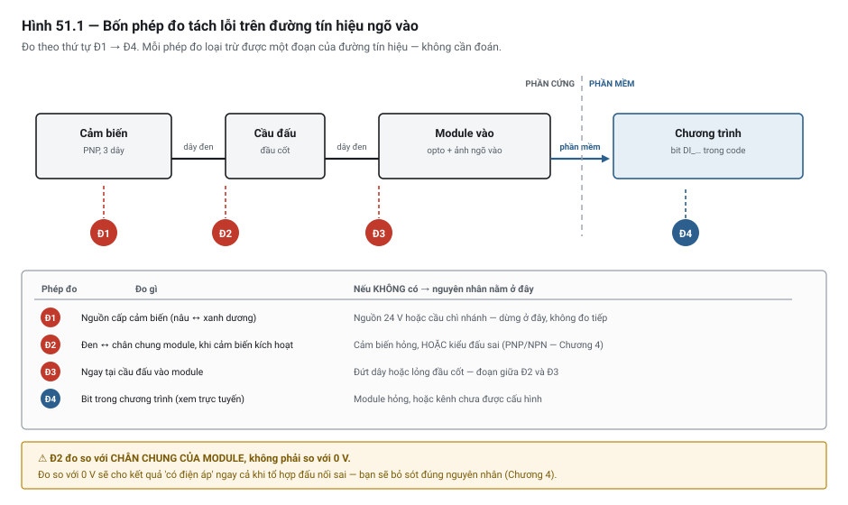

# Chương 51 — Xử lý sự cố: quy trình chẩn đoán có hệ thống

> **Lát cắt máy mẫu:** 5 — máy đầy đủ, gồm cả mạch an toàn, analog, chuyển động và mạng.

---

## 51.1 Hai người thợ, cùng một cỗ máy

Máy dừng. Một ngõ ra không tác động. Hai người được gọi tới.

**Người thứ nhất** mở phần mềm, nhìn chương trình, thấy một nấc thang khả nghi. Sửa thử. Không được.
Nghi cảm biến, thay cảm biến. Không được. Nghi module, tháo module ra lắp lại. Máy chạy — nhưng hai
ngày sau hỏng lại. Tổng cộng ba giờ, thay hai linh kiện, **không biết nguyên nhân**.

**Người thứ hai** hỏi ba câu (*máy có bao giờ chạy đúng không? · gần đây thay đổi gì? · lỗi liên tục
hay chập chờn?*), rồi đo bốn điểm theo thứ tự. Mười hai phút sau: một đầu cốt lỏng ở cầu đấu. Siết
lại. Ghi vào nhật ký bảo trì. Máy không hỏng lại.

Khác biệt không phải kinh nghiệm hay trực giác. Người thứ hai **có quy trình**; người thứ nhất **đoán**.

Chương này là quy trình đó. Nó là chương dài nhất của sách, vì nó là việc bạn sẽ làm nhiều nhất sau
khi đi làm.

> ⚠ **NGUY HIỂM — đọc trước khi làm bất cứ thứ gì trong chương này**
> Chẩn đoán sự cố nghĩa là **làm việc trên máy đang có điện, có khí, có thể chuyển động bất ngờ**.
> Ba điều tuyệt đối:
> - **Không bao giờ đấu tắt một liên động hay mạch an toàn để "thử cho nhanh"**, kể cả trong một phút.
> - Trước khi chạm vào bất cứ đầu dây nào, **cắt điện và khoá theo quy trình LOTO** — trừ khi phép đo
>   bắt buộc phải làm lúc có điện, và khi đó phải dùng dụng cụ đúng cấp và có người thứ hai biết bạn
>   đang làm gì.
> - Trước khi cấp điện lại hoặc gỡ cưỡng bức, **kiểm tra không có ai trong vùng máy**.
>
> Nội dung chương là **kỹ thuật chẩn đoán**, không thay thế quy trình an toàn lao động của nhà máy bạn.

---

## 51.2 Hai nguyên tắc

### Nguyên tắc 1 — Bắt đầu từ ngõ ra bị lỗi và truy ngược

Người mới có xu hướng bắt đầu từ **nguyên nhân họ nghi ngờ**. Người có kinh nghiệm bắt đầu từ **triệu
chứng quan sát được**, rồi đi ngược về phía nguyên nhân.

Chuỗi truy ngược, luôn theo thứ tự này:

```text
① Triệu chứng máy      "kẹp trạm 1 không lên"
        ↓
② Ngõ ra nào lẽ ra phải tác động?          DO_Clamp1Vlv
        ↓
③ Ngõ ra đó trong CHƯƠNG TRÌNH có lên không?   xem trực tuyến
        ↓
④ Ngõ ra đó trên MODULE có lên không?          đèn LED + đo điện áp
        ↓
⑤ Tín hiệu tới THIẾT BỊ có không?              đo tại cuộn van
        ↓
⑥ Thiết bị có phản ứng không?                   nghe/sờ van, xem xy-lanh
```

Mỗi bước chia bài toán làm đôi. Sau bước ③ bạn đã biết lỗi nằm ở **phần mềm** hay **phần cứng** — và
đó là quyết định quan trọng nhất, vì hai nửa cần hai bộ công cụ khác nhau.

> 💡 **MẸO**
> Nếu bạn thấy mình đang mở chương trình ra đọc **trước khi** biết ngõ ra có lên hay không, hãy dừng
> lại. Bạn đang bỏ qua bước ③ — bước rẻ nhất và chia đôi bài toán hiệu quả nhất.

### Nguyên tắc 2 — Chia đôi bài toán, đừng đoán

Với một chuỗi n điểm, đoán tuần tự mất trung bình n/2 phép thử. Chia đôi mất log₂(n). Với chuỗi 8 điểm:
4 phép thử so với 3 — chưa khác mấy. Với hệ thống 100 điểm: 50 so với 7.

Cách áp dụng: **luôn đo ở giữa chuỗi trước**, không đo từ đầu.

Và quy tắc đi kèm, quan trọng không kém:

> **Mỗi lần chỉ thay đổi một thứ.**
>
> Thay ba thứ rồi máy chạy — bạn không biết thứ nào đã sửa nó, và hai thứ kia có thể vừa gây ra một
> vấn đề mới chưa lộ ra. Ghi lại từng thay đổi trước khi làm thay đổi tiếp theo.

---

## 51.3 Ba câu hỏi mở đầu — hỏi trước khi cầm đồng hồ

Ba câu này mất ba mươi giây và thường thu hẹp bài toán hơn cả giờ đo đạc.

| Câu hỏi | Nếu trả lời là… | Thì tập trung vào… |
|---|---|---|
| **Máy có bao giờ chạy đúng không?** | Chưa bao giờ | Sai từ thiết kế/lắp đặt: đấu nhầm, chọn sai thiết bị, logic sai từ đầu |
| | Trước chạy được | Cái gì đó **đã thay đổi** — xem câu 2 |
| **Gần đây có thay đổi gì không?** | Có sửa chương trình | So sánh với bản sao lưu trước đó |
| | Có thay linh kiện | Kiểm đúng loại, đúng thông số, đấu đúng |
| | Có đổi mã hàng | Công thức sản phẩm, tham số |
| | Không có gì | Hỏng do hao mòn hoặc môi trường — xem mục 51.8 |
| **Lỗi liên tục hay chập chờn?** | Liên tục | Dễ — đo trực tiếp được |
| | Chập chờn | ⚠ Khó nhất. Đi thẳng tới mục 51.8, đừng ngồi canh |

> ⚡ **LƯU Ý**
> Câu *"gần đây có thay đổi gì không?"* thường nhận được câu trả lời **"không"** — và câu đó sai trong
> phần lớn trường hợp. Người ta không coi việc *thay một cảm biến cùng loại*, *nới một con vít*, hay
> *sửa một dòng cho ca đêm chạy được* là "thay đổi". Hỏi lại cụ thể: *ai đã đụng vào máy này trong ba
> ngày qua, và làm gì?*

---

## 51.4 Bảng tra 2 phút — định hướng trước khi có quy trình

Khi bạn vừa tới máy và cả xưởng đang chờ, bạn cần **định hướng**, chưa cần quy trình. Bảng này để
dùng trong hai phút đầu.

| Kiểm | Nếu **có** | Nếu **không** → nghi ở đây |
|---|---|---|
| **1. Có nguồn không?** đèn nguồn trên PLC và module | → 2 | Aptomat, cầu chì, biến áp, bộ nguồn 24 V |
| **2. CPU có ở RUN không?** đèn trạng thái CPU | → 3 | Đọc mã lỗi CPU trong phần mềm; công tắc RUN/STOP; watchdog (Chương 10) |
| **3. Ngõ vào liên quan có lên không?** | → 4 | Thiết bị hiện trường, dây, module vào, kiểu đấu NPN/PNP (Chương 4) |
| **4. Ngõ ra liên quan có lên không?** | → 5 | Logic chương trình — sang mục 51.7 |
| **5. Mạng có thông không?** | Phần cứng lành → **lỗi ở logic hoặc tham số** | Cáp, địa chỉ, tham số giao thức, switch |

### Sáu nhóm lỗi

Mọi sự cố PLC rơi vào một trong sáu nhóm. Xác định nhóm là bước định hướng đầu tiên.

| Nhóm | Dấu hiệu | Đi tới mục |
|---|---|---|
| **Nguồn** | Không có đèn nào sáng; thiết bị chập chờn theo tải | 51.4 mục 1, 51.8 |
| **CPU** | CPU không ở RUN; có mã lỗi hệ thống; thời gian quét bất thường | 51.5 |
| **I/O** | Một kênh không phản ứng; đèn module không khớp thực tế | 51.6 |
| **Truyền thông** | Thiết bị báo mất kết nối; dữ liệu không cập nhật | 51.6 |
| **Chương trình** | Phần cứng lành, ngõ vào đúng, mà ngõ ra không lên | 51.7 |
| **Môi trường** | ⚠ Chập chờn, không tái hiện được, liên quan nhiệt độ hoặc thiết bị khác chạy | 51.8 |

---

## 51.5 Bộ công cụ — và khi nào cần cái nào

Không cần mua hết ngay. Bảng này xếp theo thứ tự nên có.

| Ưu tiên | Công cụ | Dùng để | Ghi chú chọn mua |
|---|---|---|---|
| **1** | **Đồng hồ vạn năng** *(multimeter)* | Đo điện áp, thông mạch, điện trở | Chọn loại **True RMS**, có chức năng **ghi min/max**, cấp an toàn phù hợp điện áp máy |
| **2** | **Ampe kìm** *(clamp meter)* | Đo dòng **không cần cắt mạch** | Cần đo được **cả AC và DC**; có bắt dòng khởi động thì tốt |
| **3** | Phần mềm lập trình + cáp | Xem trực tuyến, đọc mã lỗi, tham chiếu chéo | Là công cụ mạnh nhất — xem mục 51.7 |
| **4** | **Bộ mô phỏng vòng 4–20 mA** | Phát và đo tín hiệu analog, tách lỗi cảm biến khỏi lỗi module | Có cả chế độ phát và chế độ đo |
| **5** | **Máy kiểm tra cáp mạng** | Kiểm cáp Ethernet công nghiệp: đứt, đảo đôi, dài quá | Rẻ, và loại trừ được cả một nhóm lỗi |
| **6** | **Súng đo nhiệt hồng ngoại** | Tìm điểm nóng: đầu cốt lỏng, thiết bị quá tải | Đầu cốt lỏng nóng lên trước khi hỏng hẳn |
| **7** | **Máy hiện sóng** *(oscilloscope)* | Nhìn dạng sóng, bắt nhiễu và xung ngắn | Chỉ cần khi nghi nhiễu hoặc tín hiệu tốc độ cao |
| **8** | **Bộ phân tích giao thức** | Xem gói tin thật trên mạng công nghiệp | Khi mọi thứ khác đã loại trừ |
| **9** | **Megôm kế** *(insulation tester)* | Đo cách điện cáp và cuộn dây | ⚠ Điện áp thử cao — **phải cách ly thiết bị điện tử trước** |

> ⚠ **NGUY HIỂM — hai sai lầm dùng dụng cụ có thể gây tai nạn**
> - **Đo dòng bằng thang đo điện áp, hoặc ngược lại.** Đặt đồng hồ ở thang dòng rồi mắc song song với
>   nguồn là tạo ngắn mạch qua chính đồng hồ. Luôn kiểm thang đo **trước khi** chạm que đo.
> - **Dùng megôm kế khi chưa cách ly thiết bị điện tử.** Điện áp thử vài trăm vôn sẽ phá module PLC,
>   biến tần, cảm biến. Tháo rời trước, không có ngoại lệ.

---

## 51.6 Đèn LED — nói gì và **không** nói gì

Đèn trên module là công cụ chẩn đoán rẻ nhất, và cũng là công cụ bị hiểu sai nhiều nhất.

### Đèn kênh I/O nói gì

| Loại đèn | Nói lên điều gì | **Không** nói lên điều gì |
|---|---|---|
| Đèn kênh **ngõ vào** | Module đã nhận tín hiệu ở kênh đó | Chương trình có đọc đúng bit đó không; kênh có được cấu hình chưa |
| Đèn kênh **ngõ ra** | Module đã được **lệnh** bật kênh đó | Tải có thật sự hoạt động không; dây ra có đứt không |
| Đèn trên **cảm biến** | Cảm biến đã phát hiện vật | Tín hiệu có tới được PLC không (Chương 4, Bẫy 1) |

> 🔍 **BẪY — ba cái đèn cùng sáng mà máy vẫn không chạy**
> Đèn cảm biến sáng, đèn kênh vào sáng, đèn kênh ra sáng — mà cơ cấu không động. Cả ba đèn đều **đúng**:
> tín hiệu đã đi hết chuỗi tới lệnh ngõ ra. Vấn đề nằm **sau** đèn ngõ ra: dây từ module tới cuộn van
> đứt, cuộn van cháy, hoặc mất khí.
>
> Đèn ngõ ra báo **lệnh**, không báo **kết quả**. Đây chính là phiên bản phần cứng của nguyên tắc
> "giám sát phản hồi thay vì tin lệnh" ở Chương 48.

### Đèn trạng thái CPU

Mọi hãng đều có một nhóm đèn báo trạng thái CPU, thường gồm: nguồn, đang chạy, có lỗi, hoạt động mạng.
**Ý nghĩa từng kiểu nhấp nháy khác nhau giữa các hãng** — và đây là chỗ bạn **phải tra tài liệu của
đúng CPU đang dùng**, không suy đoán.

> 💡 **MẸO**
> In bảng ý nghĩa đèn của đúng CPU trên máy bạn, ép nhựa, dán trong cánh tủ. Lúc cần tra là lúc bạn
> không có mạng và không có thời gian tìm tài liệu.

### Bốn phép đo tách lỗi cảm biến / dây / module / nguồn

Khi một ngõ vào không lên, bốn phép đo này tách được nguyên nhân — làm theo thứ tự:



*Hình 51.1 — Bốn điểm đo trên đường tín hiệu. Mỗi phép đo loại trừ được một đoạn.*

| # | Đo gì | Ở đâu | Kết luận |
|---|---|---|---|
| **Đ1** | Điện áp nguồn cấp cho cảm biến | Tại chân nâu–xanh của cảm biến | Không có → lỗi **nguồn/cầu chì nhánh**, dừng ở đây |
| **Đ2** | Điện áp tín hiệu khi kích hoạt cảm biến | Giữa dây đen và **chân chung của module** | Không có → lỗi **cảm biến** hoặc **kiểu đấu sai** (Chương 4) |
| **Đ3** | Điện áp tại **chân module** | Ngay tại cầu đấu vào module | Đ2 có mà Đ3 không → **đứt dây / lỏng đầu cốt** |
| **Đ4** | Bit trong chương trình | Xem trực tuyến | Đ3 có mà bit không lên → lỗi **module** hoặc **cấu hình kênh** |

Chú ý phép đo Đ2 đo **so với chân chung của module**, không phải so với 0 V. Đây là điểm mà Chương 4
đã nhấn mạnh, và là chỗ phân biệt tổ hợp đấu nối sai với thiết bị hỏng.

---

## 51.7 Công cụ phần mềm — mạnh hơn đồng hồ

Khi đã xác định lỗi nằm ở phần mềm (bước ③ ở mục 51.2), phần mềm lập trình là công cụ mạnh nhất bạn có.

| Chức năng | Dùng để | Câu hỏi nó trả lời |
|---|---|---|
| **Xem trực tuyến** | Nhìn giá trị bit/biến khi chương trình chạy | "Điều kiện nào đang chặn?" |
| **Tham chiếu chéo** *(cross-reference)* | Liệt kê **mọi nơi** một tag được đọc và được ghi | "Còn ai đang ghi vào ngõ ra này?" ⭐ |
| **So sánh chương trình** | Đối chiếu bản đang chạy với bản sao lưu | "Có ai sửa gì không?" |
| **Đồ thị xu hướng** *(trend)* | Ghi giá trị theo thời gian | "Giá trị này nhảy lúc nào, có trùng với sự kiện gì?" |
| **Thống kê thời gian quét** | Xem quét nhỏ nhất / lớn nhất | "Có phải chương trình vừa phình ra không?" (Chương 10) |
| **Bộ đệm lỗi hệ thống** | Danh sách lỗi CPU có dấu thời gian | "CPU đã ghi nhận chuyện gì?" |
| ⭐ **Quét đơn** *(single scan)* | Thực thi **đúng một vòng quét** rồi dừng | ⭐⭐ *"Ở vòng quét này, nấc nào đổi trạng thái?"* |
| ⭐ **Chế độ thử** *(TEST mode)* | Chạy chương trình **với ngõ ra bị vô hiệu** | *"Logic có đúng không — mà máy không động?"* |

> ⭐⭐ **Quét đơn là công cụ duy nhất cho lỗi phụ thuộc THỨ TỰ.**
>
> Xem trực tuyến cho bạn giá trị **sau khi cả vòng quét đã chạy xong** — nên với lỗi kiểu *"nấc 5 đọc
> giá trị của vòng quét trước"* (Chương 15, Chương 10), ⚠ **màn hình trực tuyến trông hoàn toàn bình
> thường**. Chỉ khi cho chạy **từng vòng quét một** và nhìn giá trị đổi sau mỗi lần, thứ tự mới lộ ra.
>
> ⚠ Nhiều người không biết mình có công cụ này — ⭐ **tra tài liệu phần mềm lập trình của bạn**.

**Tham chiếu chéo là chức năng bị dùng ít nhất so với giá trị của nó.** Nó trả lời trong ba giây câu
hỏi mà đọc code mất một giờ: *ngoài chỗ này, còn ai ghi vào biến này nữa không?* — tức là phát hiện
cuộn dây trùng (Chương 15) và vi phạm quy tắc "một nơi ghi" (Chương 27).

### Cưỡng bức I/O — công cụ hữu ích nhất và nguy hiểm nhất

**Cưỡng bức** *(force)* là ép một ngõ vào hoặc ngõ ra về một giá trị, bất kể thực tế. Nó cho phép
kiểm tra một đoạn mạch mà không cần tạo ra điều kiện thật.

> ⚠⚠ **NGUY HIỂM**
> Cưỡng bức **vô hiệu hoá mối liên hệ giữa chương trình và thế giới thật**. Một ngõ ra bị cưỡng bức
> sẽ tác động **bất kể logic an toàn nói gì**. Một ngõ vào bị cưỡng bức làm chương trình tin vào một
> điều không có thật.
>
> **Quên gỡ cưỡng bức là một trong những nguyên nhân tai nạn phổ biến nhất trong ngành này.** Máy được
> giao cho sản xuất với một liên động đang bị ép "OK", và không ai biết.

#### ⭐⭐ Cưỡng bức ngõ VÀO và ngõ RA **không giống nhau** — và đây là chỗ hay hiểu sai nhất

Hai thao tác nghe như một, nhưng ⚠ **cơ chế khác hẳn**, nên hậu quả và cách dùng cũng khác:

| | ⚠⚠ **Cưỡng bức ngõ VÀO** | **Cưỡng bức ngõ RA** |
|---|---|---|
| Tác động vào | ⭐ **Bit trong bảng ảnh ngõ vào** | ⭐ **Chỉ đúng cái chân ngõ ra đó** |
| Thời điểm | Ngay **sau kỳ đọc ngõ vào** | Lúc xuất ra module |
| Bảng ảnh ngõ ra | — | ⭐ **Không bị đổi** |
| ⚠ Lan tới đâu | ⚠⚠ **MỌI chỗ trong chương trình dùng bit đó** | ⭐ **Không lan** — chương trình chạy y như cũ |
| Nghĩa là | Chương trình chạy **như thể thiết bị hiện trường thật sự ở trạng thái đó** | Thiết bị tác động, nhưng **logic không biết** |

> ⭐⭐ **Hệ quả thực tế, dễ vấp cả hai chiều:**
>
> | Tình huống | Chuyện gì xảy ra |
> |---|---|
> | Bạn ép một ngõ ra để **thử van** | ⚠ Van kêu, nhưng **mọi nấc thang đang nhìn bit ngõ ra đó vẫn thấy nó bằng 0** — logic phía sau không chạy theo |
> | Bạn ép một ngõ vào để **thử một đoạn logic** | ⚠⚠ Nó lan **khắp chương trình** — kể cả vào các nấc liên động mà bạn không định đụng tới |
>
> ⭐ **Vì vậy cưỡng bức ngõ VÀO nguy hiểm hơn cưỡng bức ngõ RA**, dù nghe thì ngược lại: ép ngõ ra chỉ
> làm một cơ cấu chạy; ⚠⚠ **ép ngõ vào làm cả chương trình tin vào một thế giới không có thật**.
>
> ⚡ Và nó giải thích một hiện tượng hay làm người ta bối rối: *"tôi ép ngõ ra rồi mà đèn báo trên màn
> hình vẫn tắt"*. ⭐ **Đúng như thiết kế** — màn hình đọc bit trong bảng ảnh, còn cưỡng bức chỉ chạm
> tới chân ra.

> ⚠ **Có hệ phân biệt "đã CÀI cưỡng bức" với "đã BẬT cưỡng bức" — hai trạng thái riêng, hiển thị
> riêng.** Đó là một lớp an toàn, nhưng cũng là một cái bẫy: ⚠⚠ **tắt cưỡng bức không có nghĩa là đã
> gỡ nó** — lần bật tiếp theo, mọi cưỡng bức cũ sống lại. ⭐ Khi bàn giao máy, phải **gỡ**, không phải
> **tắt**.

Quy trình bắt buộc — bốn việc, không bỏ việc nào:

1. **Ghi lại trước khi force**: cưỡng bức cái gì, giá trị gì, vì sao, ai làm, lúc mấy giờ.
2. **Báo cho mọi người quanh máy.** Không ai được ở trong vùng máy khi có cưỡng bức đang hoạt động.
3. **Gỡ ngay sau khi xong phép thử** — không để qua giờ nghỉ, không để qua ca.
4. **Kiểm tra danh sách cưỡng bức trước khi bàn giao máy.** Mọi hãng đều có chức năng liệt kê các
   cưỡng bức đang hoạt động — đây là mục bắt buộc trong danh mục nghiệm thu (Chương 52).
   ⚠⚠ **Kiểm cả cưỡng bức "đã cài nhưng đang tắt"**, không chỉ cưỡng bức đang tác động.

> 💡 **MẸO**
> Nhiều PLC có đèn hoặc cờ báo "đang có cưỡng bức". Đưa cờ đó lên **màn hình vận hành và đèn tháp** —
> ví dụ đèn vàng nhấp nháy kiểu riêng. Khi ấy việc quên gỡ trở nên **nhìn thấy được**, thay vì ẩn
> trong phần mềm.

---

## 51.7b ⭐⭐ Cờ bỏ qua thiết kế sẵn — thứ duy nhất thay thế được việc cưỡng bức

Mục 51.7 nói cưỡng bức *(forcing)* nguy hiểm thế nào và phải gỡ ra sao. Nhưng nó chưa trả lời câu hỏi
đứng ngay sau đó, và là câu hỏi thật của người vận hành lúc hai giờ sáng:

> *"Camera trạm 2 hỏng, phụ tùng mai mới về. Tôi vẫn phải ra hàng đêm nay. Làm sao?"*

⚠⚠ **Nếu chương trình không trả lời được câu này, người ta sẽ tự trả lời — bằng cưỡng bức, bằng sửa
trực tuyến, hoặc bằng cách rút một sợi dây.** Cả ba đều tệ hơn thứ lẽ ra nên có.

### Bỏ qua là một yêu cầu chức năng, không phải một sự cố

Máy sản xuất thật **luôn** có lúc phải chạy thiếu một thứ gì đó: một camera hỏng, một đầu đọc mã mất
kết nối, máy chủ cấp trên bảo trì nên không nhận được dữ liệu tải lên, một trạm phải tháo ra sửa.

⭐ Vì vậy **"bỏ qua" (bypass) phải được thiết kế vào chương trình từ đầu** — thành một tập cờ có tên,
có chỗ hiển thị, có ghi nhật ký. Khi ấy việc bỏ qua trở thành một **thao tác được kiểm soát** thay vì
một mẹo cá nhân.

| Cái gì nên có cờ bỏ qua | Vì sao |
|---|---|
| ⭐ **Từng trạm** | Trạm hỏng thì bỏ trạm, chuyền vẫn chạy qua |
| ⭐ **Từng camera, từng đầu đọc mã** | Thiết bị phụ trợ hỏng không nên làm dừng cả máy |
| ⭐ **Việc tải dữ liệu lên cấp trên** | Máy chủ bảo trì — máy không có lỗi gì cả (Chương 45) |
| **Liên kết với máy tính điều khiển** | Mất kết nối PC không đồng nghĩa máy hỏng (Chương 43) |
| **Từng ô khay, từng vị trí trên mâm** | Một ô hỏng không làm bỏ cả khay |
| **Còi báo** | Đêm khuya, xưởng trống — tắt còi là hợp lý, và nên tắt **có kiểm soát** |
| ⚠ Từng cảm biến của một cơ cấu | Chấp nhận được **với điều kiện** ở mục dưới |

### Bốn yêu cầu bắt buộc của một cờ bỏ qua

| # | Yêu cầu | Vì sao |
|---|---|---|
| 1 | ⭐⭐ **Nhìn thấy được, không cần đi tìm** | Hiện ngay màn hình chính: *"Đang bỏ qua: 2 mục"*. ⚠ Cờ bỏ qua chôn trong trang cài đặt tầng ba là cưỡng bức đội lốt |
| 2 | ⭐ **Có phân quyền** | Bỏ qua một trạm không phải thao tác của người vận hành (Chương 44 mục 44.4) |
| 3 | ⭐⭐ **Ghi nhật ký: ai bật, lúc nào, bỏ qua cái gì** | Khi lô hàng bị trả về, đây là thứ duy nhất trả lời được *"lô đó máy đang chạy ở trạng thái nào"* |
| 4 | ⚠ **Đánh dấu sản phẩm làm ra trong lúc bỏ qua** | Board đi qua trạm kiểm mà camera đang bị bỏ qua thì ⚠⚠ **nó chưa được kiểm** — dữ liệu truy xuất phải nói đúng điều đó (Chương 42) |

> ⭐⭐ **Yêu cầu số 4 là yêu cầu hay bị quên nhất, và là yêu cầu tốn kém nhất khi quên.**
>
> Bỏ qua camera rồi vẫn ghi *"đã kiểm — OK"* vào hồ sơ truy xuất là **ghi một điều không đúng sự
> thật**. ⚠ Lúc có sự cố chất lượng, hồ sơ đó sẽ được dùng để chứng minh máy đã kiểm — và nó sẽ dẫn
> việc điều tra đi sai hướng suốt nhiều ngày.

### ⚠⚠ Một ranh giới không được nhập nhằng

> ⚠⚠ **Cờ bỏ qua cho thiết bị an toàn — cửa an toàn, rèm quang — KHÔNG thuộc danh sách trên và không
> được nằm chung một chỗ với chúng.**
>
> Việc tạm vô hiệu hoá một thiết bị bảo vệ có tên riêng là **muting**, có yêu cầu thiết kế riêng, và
> ⭐ **phải do người có thẩm quyền thiết kế** — xem Chương 47 mục 47.7.
>
> ⚠ Đặt *"bỏ qua cửa an toàn"* cùng bảng với *"bỏ qua còi báo"* là đã sai ngay từ cách trình bày:
> nó dạy người dùng rằng hai thứ đó cùng một loại. **Chúng không cùng một loại.**

### Bỏ qua cảm biến của cơ cấu — chấp nhận được khi nào

Cho phép bỏ qua **một** cảm biến vị trí của xy-lanh là việc thường gặp, và có lý: cảm biến hỏng lúc
nửa đêm, xy-lanh vẫn tốt.

⚠ Nhưng nó đổi bản chất của cơ cấu đó: từ **có xác nhận** thành **chạy mù theo thời gian**. Ba điều
kiện tối thiểu:

| | |
|---|---|
| 1 | ⚠ **Phải thay bằng một thời gian chờ cố định**, không phải bỏ luôn phép kiểm |
| 2 | ⚠⚠ **Không áp dụng cho cơ cấu mà sai vị trí gây hư hỏng hoặc nguy hiểm** — trục đứng có tải treo, kẹp giữ sản phẩm nặng |
| 3 | ⭐ **Phải tự hết khi khởi động lại máy**, không được là biến giữ qua mất điện |

> ⚡ **Điều kiện 3 là điều kiện phân biệt "bỏ qua" với "sửa vĩnh viễn".** Một cờ bỏ qua sống sót qua
> mất điện sẽ ở lại đó ba năm, và không ai còn nhớ vì sao nó bật. ⭐ Cùng lý do với cờ *đã về gốc* ở
> Chương 37 mục 37.3: **thứ mô tả một tình trạng tạm thời thì không được giữ.**

### Đưa lên đèn tháp

⭐ Mẹo ở mục 51.7 (đèn vàng nháy khi còn cưỡng bức) áp y hệt cho cờ bỏ qua — và ở đây nó còn quan
trọng hơn, vì cờ bỏ qua **được phép tồn tại lâu**, nên càng dễ bị quên. Một cỗ máy đang chạy với ba
cờ bỏ qua bật phải **trông khác** một cỗ máy chạy đủ chức năng, nhìn từ xa.

> ⚖ **NGOÀI HIỆN TRƯỜNG — cờ bỏ qua nằm chung vùng nhớ giữ qua mất điện.**
> **Người ta làm gì:** một chương trình máy đang chạy mà tôi đọc được mã gom **mọi** thứ của hệ thống —
> trạng thái, đèn, báo động **và cả bộ cờ bỏ qua** — vào một cấu trúc duy nhất, đặt ở một địa chỉ cố
> định trong vùng **giữ được qua mất điện**. Danh sách bỏ qua trên màn hình của nó còn có cả mục
> *"bỏ qua cửa an toàn"* và *"bỏ qua dừng khẩn"*, nằm cạnh *"bỏ qua còi"*.
> **Vì sao:** màn hình đọc ghi theo địa chỉ, nên một cấu trúc ở một chỗ là gọn nhất; và người ta muốn
> số liệu đếm, tham số còn nguyên sau khi tắt máy — cả cấu trúc được giữ cho chắc.
> **Ranh giới:** điều kiện 3 ở trên không đổi — ⚠ cờ bỏ qua **phải tự hết khi khởi động lại**. Giữ
> chung cấu trúc thì **xoá bộ cờ bỏ qua ở vòng quét đầu** (Phụ lục M mục M.4), hoặc tách nó sang một cấu
> trúc **không giữ**; ✅ đạt khi tắt rồi bật máy, màn hình chính báo *"đang bỏ qua: 0 mục"*. ⚠⚠ Còn
> hai mục bỏ qua cửa an toàn và dừng khẩn thì không có cách đặt nào làm chúng hợp lệ trong một chương
> trình thường — đúng ranh giới ở mục này; gặp chúng khi nhận máy thì báo người có thẩm quyền về an
> toàn, đừng tự sửa cũng đừng dùng.

---

## 51.8 Lỗi chập chờn — bốn nguyên nhân vật lý hay bị bỏ sót

Lỗi chập chờn là loại khó nhất: nó không có mặt khi bạn tới, và nó quay lại khi bạn vừa đi.

> ⚡ **LƯU Ý — đừng ngồi canh**
> Ngồi chờ lỗi tái hiện là cách lãng phí thời gian nhất. Thay vào đó: **đặt bẫy bằng ghi log**, rồi đi
> làm việc khác. Ghi lại giá trị nghi ngờ mỗi khi nó đổi, kèm dấu thời gian; hoặc dùng đồ thị xu hướng
> chạy nền; hoặc thêm một đoạn code chụp trạng thái khi điều kiện lỗi xuất hiện (Chương 28, Bẫy 5).

Bốn nguyên nhân vật lý dưới đây gây ra phần lớn lỗi chập chờn, và **ba cái sau gần như không tài liệu
nhập môn nào nhắc tới**.

### ① Vòng lặp đất và chênh điện thế

Hai điểm được coi là "đất" nhưng thực ra chênh nhau vài vôn. Dòng chạy qua vỏ chống nhiễu hoặc dây tín
hiệu, gây nhiễu — nặng nhất khi thiết bị công suất lớn đóng cắt.

**Dấu hiệu:** lỗi xuất hiện đúng lúc một thiết bị khác khởi động. Tín hiệu analog nhảy theo nhịp máy khác.

**Cách kiểm:** đo điện áp **giữa hai điểm đất** ở hai đầu cáp, lúc máy chạy. Khác 0 đáng kể → có vòng
lặp đất. Cách xử lý ở Chương 49.

### ② Nhiễu điện từ từ biến tần, servo, máy hàn

Các thiết bị này đóng cắt dòng lớn ở tần số cao, phát ra nhiễu vào cáp chạy song song gần đó.

**Dấu hiệu:** lỗi chỉ xảy ra khi biến tần đang tăng/giảm tốc, hoặc khi máy hàn ở gần hoạt động. Ngõ
vào "tự lên" mà không có tín hiệu thật.

**Cách kiểm:** cho thiết bị nghi ngờ chạy/dừng trong khi theo dõi tín hiệu. Nếu tương quan rõ → nhiễu.

### ③ Chu kỳ nóng-nguội làm mỏi đầu nối

Đây là nguyên nhân **bị bỏ sót nhiều nhất**. Máy nóng lên khi chạy, nguội đi khi nghỉ. Kim loại giãn
nở và co lại. Sau hàng nghìn chu kỳ, một đầu cốt siết chưa đủ chặt sẽ **lỏng dần**.

**Dấu hiệu đặc trưng:** lỗi xuất hiện **sau vài giờ chạy**, biến mất sau khi máy nghỉ qua đêm. Hoặc
chỉ xảy ra vào ca chiều khi xưởng nóng nhất.

**Cách kiểm:** dùng **súng đo nhiệt hồng ngoại** quét các cầu đấu khi máy đang chạy tải. Đầu cốt lỏng
có điện trở tiếp xúc cao hơn nên **nóng hơn các đầu cốt lân cận** — thường nóng hơn trước khi hỏng hẳn
hàng tuần. Đây là lý do súng đo nhiệt xứng đáng nằm trong bộ công cụ.

### ④ Tụ trong bộ nguồn lão hoá

Tụ điện trong bộ nguồn 24 V mất dần điện dung theo thời gian và nhiệt độ. Nguồn vẫn cho đúng 24 V khi
tải nhẹ, nhưng **sụt áp khi có tải đột ngột** — ví dụ lúc nhiều van cùng tác động.

**Dấu hiệu:** lỗi xảy ra đúng lúc nhiều cơ cấu hoạt động cùng lúc. Máy chạy tốt lúc mới lắp, xấu dần
sau vài năm.

**Cách kiểm:** dùng đồng hồ có chức năng **ghi giá trị nhỏ nhất** (min), đo điện áp 24 V trong lúc
máy chạy chu trình đầy đủ. Nếu min tụt xuống dưới ngưỡng cho phép của module → nghi bộ nguồn.

> 💡 **MẸO**
> Chức năng ghi min/max của đồng hồ là chức năng hữu ích nhất cho lỗi chập chờn, và là lý do nên chọn
> đồng hồ có nó ngay từ đầu. Kẹp que đo, để máy chạy, đi làm việc khác, quay lại đọc min.

---

### ⭐ Bảng chốt bốn nguyên nhân — phân biệt bằng CÂU HỎI "KHI NÀO"

⭐ Bốn nguyên nhân trên nghe giống nhau khi đọc rời. ⚡ Nhưng chúng **tách nhau rất rõ theo THỜI
ĐIỂM xuất hiện** — và đó là câu hỏi đầu tiên nên hỏi người vận hành:

| | Lỗi xuất hiện **KHI NÀO** | Nguyên nhân nghi trước | ⭐ Kiểm bằng | Chữa ở |
|---|---|---|---|---|
| ① | ⭐ **Đúng lúc thiết bị khác khởi động** | Vòng lặp đất | Đo điện áp **giữa hai điểm đất** lúc máy chạy | Chương 49 |
| ② | ⭐ **Khi biến tần tăng/giảm tốc**, hoặc có máy hàn gần | Nhiễu điện từ | Cho thiết bị nghi ngờ chạy/dừng, xem tương quan | Chương 49 |
| ③ | ⭐⭐ **Sau vài giờ chạy** — hết sau một đêm nghỉ; hoặc chỉ ca chiều | ⚠ **Mỏi đầu nối do nóng-nguội** | **Súng đo nhiệt** quét cầu đấu khi đang tải | Siết lại, thay đầu cốt |
| ④ | ⭐ **Khi nhiều cơ cấu tác động cùng lúc**; nặng dần qua vài năm | Tụ nguồn lão hoá | Đo 24 V **lúc có tải đột ngột**, không đo lúc rảnh | Thay bộ nguồn (Chương 3) |

> ⭐⭐ **Hàng ③ là hàng đáng nhớ nhất, vì nó có dấu hiệu thời gian mà ba hàng kia không có:** *"chạy
> buổi sáng thì tốt, chiều thì lỗi"* hoặc *"cứ sau ba tiếng là bị"*. ⚡ Nghe thấy mô tả kiểu đó thì
> ⭐ **đừng tìm trong chương trình** — hãy cầm súng đo nhiệt.
>
> ⚠ Và cả bốn nguyên nhân đều **không nằm trong chương trình PLC**. Đó chính là lý do mục này tồn
> tại: người lập trình bị gọi tới vì *"máy lỗi"*, rồi mất hai ngày đọc code cho một đầu cốt lỏng.

---

## 51.9 Bảng triệu chứng → nguyên nhân → phép kiểm

Bảng tra nhanh. Dùng khi bạn đã biết triệu chứng và cần đường ngắn nhất tới nguyên nhân.

### Nhóm nguồn và CPU

| Triệu chứng | Nguyên nhân khả dĩ | Phép kiểm xác nhận |
|---|---|---|
| Không đèn nào sáng | Mất nguồn tổng; aptomat nhảy; cầu chì đứt | Đo điện áp vào tủ, rồi sau aptomat |
| CPU không vào RUN | Có lỗi hệ thống; công tắc ở STOP; thiếu cấu hình phần cứng | ⭐ Đọc **bộ đệm chẩn đoán** — cách đọc và vì sao đọc trước khi mở code: **Phụ lục M.6** |
| CPU tự chuyển sang STOP khi chạy | Watchdog quá thời gian quét; lỗi truy cập bộ nhớ | Xem quét lớn nhất; đọc mã lỗi kèm dấu thời gian |
| Máy tự khởi động lại ngẫu nhiên | Sụt áp nguồn 24 V; nhiễu; lỏng đầu cốt nguồn | Đo min điện áp 24 V khi tải nặng (mục 51.8 ④) |
| Thời gian quét tăng dần theo thời gian | Rò rỉ bộ nhớ; vòng lặp phụ thuộc dữ liệu | So sánh quét lớn nhất với con số lúc bàn giao |

### Nhóm ngõ vào

| Triệu chứng | Nguyên nhân khả dĩ | Phép kiểm xác nhận |
|---|---|---|
| Một ngõ vào không bao giờ lên | Kiểu đấu sai (NPN/PNP); đứt dây; cảm biến hỏng; kênh chưa cấu hình | Bốn phép đo Đ1–Đ4 ở mục 51.6 |
| Ngõ vào **không bao giờ về 0** | Dòng rò cảm biến 2 dây; nhiễu cảm ứng từ cáp động lực; module hỏng | Rút dây tín hiệu: bit vẫn 1 → module; bit về 0 → đo áp trên dây vừa rút |
| Cả nhóm ngõ vào chết cùng lúc | Mất chân chung của nhóm; cầu chì nhánh 24 V | Đo điện áp tại chân chung |
| Ngõ vào lên chậm hoặc trễ | Thời gian lọc đặt quá lớn; cảm biến chậm | Xem cấu hình lọc kênh (Chương 10) |
| Ngõ vào rung nhiều lần cho một lần tác động | Rung tiếp điểm cơ khí | Xem đồ thị xu hướng; thêm chống rung (Chương 18) |

### Nhóm ngõ ra

| Triệu chứng | Nguyên nhân khả dĩ | Phép kiểm xác nhận |
|---|---|---|
| Đèn ngõ ra sáng, tải không chạy | Đứt dây ra; cuộn dây cháy; mất nguồn tải; mất khí | Đo điện áp **tại cuộn van**, không phải tại module |
| Ngõ ra không lên dù logic đúng | Cuộn dây trùng (Chương 15); cưỡng bức còn sót | **Tham chiếu chéo** + kiểm danh sách cưỡng bức |
| Ngõ ra nhấp nháy | Hai nấc thang ghi ngược nhau; điều kiện dao động quanh ngưỡng | Tham chiếu chéo; thêm vùng chết (Chương 32) |
| Module ngõ ra nóng bất thường | Quá dòng; tải cảm không có mạch dập | Đo dòng bằng ampe kìm; kiểm mạch dập (Chương 5) |
| Ngõ ra rơ-le dính | Tiếp điểm hàn dính do đóng cắt tải cảm | Cắt điện, đo thông mạch ở trạng thái nghỉ |

### Nhóm analog

| Triệu chứng | Nguyên nhân khả dĩ | Phép kiểm xác nhận |
|---|---|---|
| Giá trị analog nhảy loạn | Nhiễu; vỏ chống nhiễu nối hai đầu; cáp chạy cạnh cáp động lực | Đo bằng bộ mô phỏng vòng: thay cảm biến bằng nguồn phát chuẩn |
| Giá trị luôn ở đáy hoặc đỉnh thang | Đứt dây; đấu ngược cực; sai cấu hình dải đo | Đo dòng vòng bằng đồng hồ nối tiếp |
| Giá trị lệch so với đồng hồ chuẩn | Chưa hiệu chuẩn; sai hệ số quy đổi | So sánh với nguồn phát chuẩn; kiểm công thức scale (Chương 32) |
| Giá trị trôi theo nhiệt độ | Cảm biến/module trôi nhiệt; đầu cốt lỏng | Ghi xu hướng nhiều giờ, đối chiếu nhiệt độ tủ |

### Nhóm truyền thông

| Triệu chứng | Nguyên nhân khả dĩ | Phép kiểm xác nhận |
|---|---|---|
| Thiết bị báo mất kết nối | Cáp; địa chỉ trùng; sai tham số; switch | Kiểm cáp trước (rẻ nhất), rồi địa chỉ, rồi tham số |
| Dữ liệu sai lệch giá trị | Sai offset địa chỉ base-0/base-1; sai thứ tự word (Chương 39) | Đọc một thanh ghi đã biết giá trị, đối chiếu |
| Kết nối rớt ngẫu nhiên | Nhiễu; cáp gần cáp động lực; thiếu điện trở đầu cuối | Đếm lỗi truyền trong thống kê mạng |
| Mạng chậm dần khi thêm thiết bị | Quá tải băng thông; chu kỳ hỏi vòng quá ngắn | Xem tải mạng; nới chu kỳ |

### Nhóm chương trình và trình tự

| Triệu chứng | Nguyên nhân khả dĩ | Phép kiểm xác nhận |
|---|---|---|
| Máy đứng im, không báo gì | Trình tự kẹt ở bước chờ không có timeout (Chương 26) | Xem biến bước hiện tại của từng trạm |
| Chu trình dừng giữa chừng | Timeout bước; mất điều kiện cho phép | Đọc `FaultStep` và mã lỗi |
| Máy chạy sai sau khi đổi mã hàng | Công thức sai; chưa nạp công thức (Chương 29) | So sánh tham số đang chạy với công thức mong muốn |
| Máy chạy đúng ở Manual, sai ở Auto | Liên động chỉ có ở một chế độ; điều kiện chuyển chế độ | So sánh điều kiện hai chế độ |
| Sau Reset máy làm việc lạ | Chạy tiếp từ bước dở thay vì về gốc (Chương 28) | Kiểm đường `Resetting → Homing` |

---

## 51.10 Sửa hay thay

Khi đã tìm ra linh kiện hỏng, còn một quyết định nữa.

| Yếu tố | Nghiêng về **sửa** | Nghiêng về **thay** |
|---|---|---|
| Có sẵn hàng thay thế trong kho | Không | Có |
| Thời gian dừng máy đang tính bằng tiền | Không gấp | **Gấp** |
| Nguyên nhân hỏng đã rõ | Rõ và cục bộ | Chưa rõ |
| Thiết bị còn được sản xuất | Còn | **Hết vòng đời** → xem dưới |
| Có người đủ năng lực sửa | Có | Không |

### Thiết bị hết vòng đời

Khi một module hỏng và **không còn được sản xuất**, bạn có ba đường:

1. **Mua hàng tồn kho hoặc hàng tân trang.** Nhanh nhất, nhưng chỉ là hoãn — lần sau vẫn gặp lại.
   Nếu chọn đường này, **mua dự phòng luôn**.
2. **Thay bằng đời mới cùng hãng.** Thường cần đổi cấu hình, đôi khi đổi chương trình. Kiểm kỹ tương
   thích tập lệnh và thời gian quét (Chương 56).
3. **Nâng cấp cả hệ.** Đắt và lâu, nhưng nếu máy còn chạy nhiều năm nữa thì đây thường là quyết định
   đúng về tổng chi phí.

> 💡 **MẸO**
> Đừng đợi tới lúc hỏng mới biết thiết bị đã hết vòng đời. **Rà soát tình trạng vòng đời của các linh
> kiện chính mỗi năm một lần**, và mua dự phòng cho những cái sắp ngừng sản xuất. Việc này mất một
> buổi và tránh được những lần dừng máy dài ngày.

---

## 51.11 Bảo trì phòng ngừa nhìn từ PLC

PLC biết nhiều thứ về sức khoẻ của máy mà không ai hỏi tới. Bốn thứ gần như miễn phí để thu thập:

| Ghi lại | Phát hiện được | Cách dùng |
|---|---|---|
| **Số lần tác động** của mỗi cơ cấu | Cơ cấu sắp hết tuổi thọ | Cảnh báo bảo dưỡng theo số lần, không theo lịch |
| **Thời gian hành trình** của mỗi xy-lanh | Xy-lanh chậm dần → sắp kẹt hoặc rò khí | Ghi xu hướng; ⚡ **nhắc** khi vượt khoảng 1,5 lần mốc nghiệm thu — nửa đường tới giới hạn báo lỗi (Phụ lục O mục O.7) |
| **Thời gian quét lớn nhất** | Chương trình phình ra sau khi ai đó sửa | So với con số lúc bàn giao (Chương 10) |
| **Điện áp 24 V nhỏ nhất** khi tải nặng | Bộ nguồn lão hoá (mục 51.8 ④) | Cảnh báo trước khi gây lỗi chập chờn |

Điểm chung: cả bốn đều là **xu hướng theo thời gian**, không phải giá trị tức thời. Một xy-lanh mất
0,8 giây thay vì 0,5 giây không phải lỗi — nhưng xu hướng tăng đều trong ba tháng là dấu hiệu rõ ràng.

### ⚠ Và bảo trì cho chính bộ điều khiển — thứ hay bị quên vì "PLC có hỏng bao giờ đâu"

Bảng trên là PLC **giám sát máy**. Còn bản thân PLC cũng cần bảo trì, chỉ vài việc nhưng bỏ qua thì
hỏng theo kiểu khó đoán:

| Việc | Vì sao | ⭐ Tần suất |
|---|---|---|
| ⭐ **Kiểm và thay phin lọc của tủ** | Không khí sạch lưu thông trong tủ | ⚠ **Đừng chờ tới kỳ bảo trì máy mới kiểm** — tuỳ độ bụi khu vực |
| ⚠⚠ **Không để bụi bám lên module** | ⭐ CPU và module I/O **không được thiết kế kín bụi**; bụi bám cánh tản nhiệt **chặn thoát nhiệt** → mạch hoạt động sai | Theo môi trường |
| Kiểm siết lại đầu nối | Chu kỳ nóng–nguội làm mỏi mối nối (mục 51.8) | Theo lịch máy |
| Thay pin nuôi bộ nhớ | Hết pin → mất dữ liệu giữ được, âm thầm (Chương 18, mục 18.6) | Theo khuyến cáo hãng |

> ⭐⭐ **Hai nguyên tắc lập lịch, và cả hai đều thực dụng:**
>
> | | |
> |---|---|
> | 1 | ⭐ **Ghép lịch bảo trì PLC vào lịch bảo trì máy** — để máy chỉ dừng **một lần**, không dừng hai lần |
> | 2 | ⚠ **Tần suất phụ thuộc MÔI TRƯỜNG, không phải phụ thuộc PLC** — ⭐ môi trường càng khắc nghiệt thì càng phải thường xuyên |
>
> ⚡ Nguyên tắc 2 giải thích vì sao không có con số chung: cùng một CPU đặt trong phòng điều khiển
> sạch và đặt cạnh máy cắt kim loại là **hai lịch bảo trì khác hẳn nhau** (Chương 7, Chương 8).

---

## 51.12 Khi nào dừng tự sửa và gọi người khác

Biết dừng cũng là một kỹ năng.

> ⚠ **NGUY HIỂM — dừng ngay và gọi người có thẩm quyền khi:**
> - Sự cố liên quan tới **mạch an toàn hoặc chức năng an toàn** — E-Stop, khoá cửa, rèm quang, STO.
>   **Không tự sửa, không tự thử, không đấu tắt.** Chương 47.
> - Bạn thấy mình đang cân nhắc **bỏ qua một liên động** để thử.
> - Có **dấu hiệu quá nhiệt, mùi khét, hoặc vết cháy** trong tủ.
> - Sự cố liên quan tới **điện áp cao hơn cấp bạn được phép làm việc**.

Ngoài ra, nên gọi người khác khi:

- Đã qua **hai giờ** mà chưa thu hẹp được về một nhóm lỗi — thường bạn đang mắc kẹt trong một giả định
  sai, và người khác nhìn vào sẽ thấy ngay.
- Cần **sửa chương trình** mà bạn không phải người viết và không có tài liệu.
- Nguyên nhân đã rõ nhưng cách sửa vượt quá thẩm quyền hoặc kỹ năng của bạn.

> 💡 **MẸO**
> Khi bàn giao cho người khác, đưa **những gì đã loại trừ**, không chỉ triệu chứng. *"Tôi đã đo Đ1–Đ3
> đều tốt, tham chiếu chéo không có cuộn dây trùng, không có cưỡng bức"* tiết kiệm cho người sau nửa
> giờ — và đó là lý do phải ghi lại từng bước ngay khi làm.

---

## 51.13 Bẫy thường gặp — sai lầm của chính người chẩn đoán

Các mục trước nói về lỗi của máy. Mục này nói về lỗi của **người đi sửa** — và chúng tốn thời gian
nhiều hơn hẳn.

### 🔍 BẪY 1 — Đoán thay vì đo

Người thứ nhất ở mục 51.1. Biểu hiện: *"chắc là cảm biến, thay thử xem"*. Mỗi lần thay thử là một
lần **mua thông tin bằng tiền và thời gian**, trong khi phép đo cho cùng thông tin đó gần như miễn phí.

Quy tắc: **không thay bất cứ thứ gì trước khi có một phép đo chỉ vào nó.**

### 🔍 BẪY 2 — Thay nhiều thứ cùng lúc

Máy chạy lại sau khi bạn siết ba đầu cốt, thay một cảm biến và nạp lại chương trình. Bạn **không biết
cái nào đã sửa nó** — nên không học được gì, không ghi lại được gì, và hai thay đổi kia có thể vừa
tạo ra một vấn đề mới chưa lộ.

Mỗi lần một thay đổi. Ghi lại. Thử. Rồi mới sang cái tiếp theo.

### 🔍 BẪY 3 — Bỏ qua lịch sử và tài liệu

Bắt đầu đo ngay mà không hỏi *"máy này đã hỏng kiểu này bao giờ chưa?"* và không mở nhật ký bảo trì.
Rất nhiều sự cố là **lặp lại của một sự cố cũ** — và lần trước ai đó đã mất ba giờ tìm ra nguyên nhân.

Ba mươi giây đọc nhật ký có thể thay thế ba giờ đó.

### 🔍 BẪY 4 — Dừng lại ở triệu chứng, không tìm nguyên nhân gốc

Đầu cốt lỏng → siết lại → máy chạy → xong. Nhưng **vì sao nó lỏng?** Nếu do rung, nó sẽ lỏng lại. Nếu
do chu kỳ nhiệt (mục 51.8 ③), các đầu cốt khác cũng sắp lỏng.

Sửa triệu chứng làm máy chạy hôm nay. Sửa nguyên nhân làm nó không hỏng lại.

### 🔍 BẪY 5 — Không kiểm đủ sau khi sửa

Sửa xong, thấy cơ cấu hoạt động, tuyên bố xong. Chưa kiểm: chu trình đầy đủ có chạy không, các chức
năng khác có bị ảnh hưởng không, và **có còn cưỡng bức nào đang bật không**.

Sau mỗi lần sửa, chạy tối thiểu **một chu trình đầy đủ** và kiểm danh sách cưỡng bức.

### 🔍 BẪY 6 — Bỏ qua quy trình an toàn vì "chỉ một phút"

Bẫy nguy hiểm nhất trong danh sách. Áp lực thời gian làm người ta bỏ LOTO, đấu tắt một liên động, hoặc
thò tay vào máy chưa cô lập năng lượng.

**Áp lực thời gian không phải là lý do.** Nếu quy trình an toàn làm việc sửa chậm tới mức không chấp
nhận được, thì vấn đề là ở thiết kế máy (Chương 47, mục 47.10) — và đó là thứ phải sửa, không phải
quy trình.

### 🔍 BẪY 7 — Tin vào đèn thay vì tin vào phép đo

Đã nêu ở mục 51.6. Đèn báo **lệnh**, không báo **kết quả**. Ba đèn cùng sáng vẫn có thể là máy hỏng.

### 🔍 BẪY 8 — Không ghi lại gì

Sửa xong, đi về. Không ai — kể cả bạn, sáu tháng sau — biết đã xảy ra chuyện gì và đã làm gì.

Ghi lại tốn ba phút và là thứ biến kinh nghiệm cá nhân thành **tài sản của cả đội**. Nó cũng là nguyên
liệu để mở rộng bảng triệu chứng ở mục 51.9 thành bảng của riêng bạn.

---

## 51.14 Bảng chốt — quy trình 8 bước

| Bước | Việc | Công cụ | Xong khi |
|---|---|---|---|
| **1** | Thu thập thông tin — **ba câu hỏi mở đầu** | Hỏi người vận hành | Biết lỗi liên tục hay chập chờn, có thay đổi gì không |
| **2** | Kiểm tra an toàn và trạng thái hệ thống | Mắt, quy trình LOTO | Đã an toàn để làm việc; biết máy đang ở trạng thái nào |
| **3** | Kiểm **nguồn** | Đồng hồ | Điện áp mọi cấp đúng, kể cả **giá trị min khi tải nặng** |
| **4** | Kiểm **trạng thái CPU** và bộ đệm lỗi | Phần mềm | Biết CPU có ghi nhận lỗi gì không |
| **5** | Kiểm **I/O** — bốn phép đo Đ1–Đ4 | Đồng hồ + phần mềm | Đã tách được lỗi ở cảm biến / dây / module / cấu hình |
| **6** | Kiểm **truyền thông** | Kiểm cáp, phần mềm | Cáp → địa chỉ → tham số, theo thứ tự đó |
| **7** | Phân tích **logic** | Tham chiếu chéo, xem trực tuyến, trend | Biết điều kiện nào đang chặn |
| **8** | Kiểm **thiết bị hiện trường** | Đo tại thiết bị | Đo tại cuộn dây/cơ cấu, không đo tại module |
| **✓** | **Ghi lại**: triệu chứng · đã loại trừ gì · nguyên nhân · cách sửa | Nhật ký bảo trì | Người sau đọc được mà không cần hỏi bạn |
| ⚠⚠ **✓** | ⭐ **GỠ mọi cưỡng bức** — không phải tắt | Danh sách cưỡng bức | Danh sách **rỗng**, kể cả loại đã cài mà đang tắt |

---

## 51.15 Tự kiểm

1. Nêu **nguyên tắc số một** của chương và sáu bước của chuỗi truy ngược.
2. Vì sao bước ③ (*ngõ ra trong chương trình có lên không*) là bước chia đôi bài toán hiệu quả nhất?
3. **Ba câu hỏi mở đầu** là gì? Vì sao câu *"gần đây có thay đổi gì không?"* thường nhận câu trả lời sai?
4. Đèn cảm biến sáng, đèn kênh vào sáng, đèn kênh ra sáng — mà cơ cấu không động. **Ba đèn đều đúng.**
   Vấn đề ở đâu, và nguyên tắc nào ở Chương 48 giải thích chuyện này?
5. Mô tả **bốn phép đo Đ1–Đ4**. Vì sao Đ2 phải đo so với **chân chung của module**, không phải so với 0 V?
6. Nêu **bốn nguyên nhân vật lý** của lỗi chập chờn, và **dấu hiệu đặc trưng** của từng cái.
7. Lỗi xuất hiện sau vài giờ chạy và biến mất sau khi máy nghỉ qua đêm. Nghi cái gì, và **kiểm bằng
   dụng cụ nào**?
8. Nêu **bốn việc bắt buộc** trong quy trình cưỡng bức I/O. Vì sao quên gỡ cưỡng bức nguy hiểm đến vậy?
9. Chức năng phần mềm nào trả lời câu hỏi *"còn ai đang ghi vào ngõ ra này?"* — và nó phát hiện được
   lỗi nào ở Chương 15 và Chương 27?
10. Kể **bốn tình huống phải dừng tự sửa và gọi người có thẩm quyền ngay**.
11. ⭐⭐ Cưỡng bức ngõ **vào** và ngõ **ra** khác nhau ở cơ chế nào? Cái nào **lan** ra cả chương
    trình, và vì sao điều đó làm nó nguy hiểm hơn?
12. ⚠ Bạn ép một ngõ ra để thử van. Van kêu, nhưng đèn báo trên màn hình vẫn tắt. ⭐ Đây là lỗi hay
    là **đúng thiết kế**? Giải thích.
13. ⚠⚠ Vì sao khi bàn giao máy phải **gỡ** cưỡng bức chứ không được chỉ **tắt**?

Câu 4, 6 và 8 là ba câu phân loại. Câu 4 kiểm tra bạn phân biệt được *lệnh* với *kết quả*; câu 6 là
kiến thức mà phần lớn người trong nghề học bằng cách trả giá; câu 8 là câu về an toàn — trả lời không
trôi chảy thì đừng dùng cưỡng bức.

---

### Chương tiếp theo

**Chương 52 — Chạy thử & bàn giao.** Chương này dạy sửa máy đã hỏng. Chương 52 dạy cách **tránh** phần
lớn những lỗi đó ngay từ lúc chạy thử — bằng một thứ mà nhiều người bỏ qua: **thử tạo lỗi cố ý**.

---

### Nguồn tham khảo chương 51

- IEC 61131-2 — *Programmable controllers, Part 2: Equipment requirements and tests*: đặc tính điện của
  ngõ vào/ra, ngưỡng mức 0/mức 1 — nền cho các phép đo ở mục 51.6. *(tiêu chuẩn có bản quyền)*
- IEC 60204-1 — *Safety of machinery — Electrical equipment of machines*: yêu cầu an toàn khi làm việc
  trên trang bị điện của máy — nền cho cảnh báo ở mục 51.1 và 51.12.
- Tài liệu hãng về **mã lỗi hệ thống và ý nghĩa đèn trạng thái** — ⚠ khác nhau đáng kể giữa các hãng,
  **bắt buộc tra đúng CPU đang dùng**; số hiệu tài liệu ghi trong Phụ lục A1.
- Cấu hình I/O và bảng thời gian bước của DP-01 — Phụ lục J.
- **Petruzella, Frank D.** — *Programmable Logic Controllers* *(nội dung dẫn có ở **cả bản 6th ed. lẫn bản 2025**)* §9.6 *Forcing External I/O Addresses* — nguồn cho
  ⭐ **sự khác nhau giữa cưỡng bức ngõ vào và ngõ ra**: ép ngõ vào tác động vào **bảng ảnh ngõ vào**
  nên **lan khắp chương trình**; ép ngõ ra chỉ tác động **đúng chân ra**, bảng ảnh ngõ ra không đổi
  nên chương trình chạy y như cũ (mục 51.7).
- **Bryan, L.A. & Bryan, E.A.** — *Programmable Controllers: Theory and Implementation*, ch. 20 §20-6 *PLC System
  Maintenance*: ⭐ **bảo trì phòng ngừa cho chính bộ điều khiển** — phin lọc tủ, ⚠⚠ bụi bám cánh tản
  nhiệt **chặn thoát nhiệt**, và hai nguyên tắc lập lịch: ⭐ **ghép vào lịch bảo trì máy** và ⭐ **tần
  suất theo môi trường**. §20-7 cho công cụ **quét đơn** *(single scan)* — nền cho mục 51.7 và 51.11.

> ⚠ Bảng triệu chứng ở mục 51.9 là **điểm khởi đầu**, không phải danh sách đầy đủ. Cách mở rộng tốt
> nhất: sau mỗi lần sửa xong, thêm một dòng vào bảng của chính bạn — triệu chứng thật, nguyên nhân
> thật, phép kiểm đã dùng. Sau một năm, bảng đó có giá trị hơn bất kỳ cuốn sách nào.
