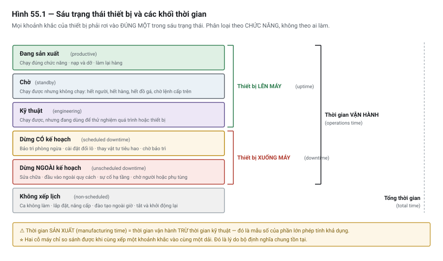

# Chương 55 — Tính chu kỳ máy & năng suất

> **Lát cắt máy mẫu:** 5 — máy đầy đủ, hai trạm nối tiếp, đã chạy sản xuất.

---

## 55.1 Bài toán: cỗ máy nhanh gấp đôi mà sản lượng không đổi

Một cỗ máy hai trạm. Trạm 1 mất 4 giây, trạm 2 mất 12 giây. Khách hàng muốn nhanh hơn.

Đội kỹ thuật tối ưu trạm 1: đổi xi-lanh nhanh hơn, tăng tốc độ trục, rút thời gian từ **4 giây xuống
2 giây**. Nhanh gấp đôi. Ai cũng hài lòng.

Sản lượng sau khi cải tiến: **không đổi**.

> ⭐⭐ **Vì trạm 2 vẫn mất 12 giây, và mỗi board vẫn phải đi qua trạm 2.**
>
> Toàn bộ công sức đổ vào một trạm **không phải nút cổ chai**. Máy nhả ra một board mỗi 12 giây trước
> khi cải tiến, và một board mỗi 12 giây sau khi cải tiến.

Chương này về việc **biết trước** điều đó — bằng số học đơn giản, và bằng dữ liệu mà PLC đã có sẵn.

---

## 55.2 Chu kỳ và sản lượng

### Định nghĩa

| Khái niệm | Nghĩa |
|---|---|
| ⭐ **Chu kỳ máy** *(cycle time)* | Khoảng thời gian giữa **hai sản phẩm liên tiếp ra khỏi máy** |
| Thời gian gia công của một trạm | Trạm đó mất bao lâu cho một sản phẩm |
| ⭐ **Sản lượng giờ** *(UPH — units per hour)* | Số sản phẩm ra trong một giờ |

```text
UPH  =  3600  ÷  chu kỳ máy (giây)
```

> ⚠ **Chu kỳ máy KHÔNG phải thời gian một sản phẩm đi hết máy.**
>
> Một board có thể mất 16 giây để đi từ đầu tới cuối DP-01 — nhưng nếu máy nhả ra một board mỗi 12
> giây thì chu kỳ máy là **12 giây**, không phải 16.
>
> ⭐ Thời gian đi hết máy gọi là **thời gian thông qua** *(throughput time)*. Nó quan trọng với việc
> khác — bao nhiêu sản phẩm đang nằm trong máy, mất bao lâu để xả hết máy khi đổi lô — nhưng **không**
> quyết định sản lượng.

### ⭐ Nhầm lẫn này gây ra gì

| Nhầm | Hậu quả |
|---|---|
| Cộng thời gian các trạm lại | ⭐ Báo sản lượng **thấp hơn thực tế** → mất hợp đồng |
| Lấy trạm nhanh nhất | ⚠ Hứa sản lượng **cao hơn thực tế** → không nghiệm thu được |
| ⭐ **Lấy trạm chậm nhất** | ⭐⭐ **Đúng** — với máy nối tiếp có đệm giữa các trạm |

---

## 55.3 ⭐⭐ Nút cổ chai

### Vì sao chu kỳ bằng trạm chậm nhất

Với máy nhiều trạm nối tiếp, các trạm làm việc **song song trên các sản phẩm khác nhau**: trong lúc
trạm 2 xử lý board A, trạm 1 đã xử lý board B.

```text
Thời gian →
Trạm 1 (4 s):  [A][B][C][D][E][F]...   ← chờ nhiều
Trạm 2 (12 s): [·····A·····][·····B·····][·····C·····]
Ra máy:                     A            B            C
                            └── 12 s ────┘
```

⭐ Máy nhả sản phẩm theo nhịp của **trạm chậm nhất** — trạm đó gọi là **nút cổ chai** *(bottleneck)*.

```text
Chu kỳ máy  =  thời gian của trạm CHẬM NHẤT   (không phải tổng)
```

> ⭐⭐ **Hệ quả thực dụng, và là ý quan trọng nhất chương:**
>
> | Cải tiến ở đâu | Kết quả |
> |---|---|
> | ⭐ **Nút cổ chai** | ⭐ **Sản lượng tăng** |
> | Trạm bất kỳ khác | ⚠ **Sản lượng không đổi** — đúng cỗ máy ở mục 55.1 |
>
> Trước khi tối ưu bất cứ thứ gì, hãy **tìm ra nút cổ chai**. Tối ưu chỗ khác là công sức đổ đi.

### ⭐ Nút cổ chai di chuyển

Sau khi bạn cải tiến nút cổ chai, **một trạm khác trở thành nút cổ chai**.

Với ví dụ ở trên: rút trạm 2 từ 12 giây xuống 5 giây thì chu kỳ mới là **5 giây** (trạm 2 vẫn chậm
nhất). Rút tiếp xuống 3 giây thì chu kỳ là **4 giây** — nút cổ chai đã chuyển sang trạm 1.

> ⭐ **Nghĩa là: cải tiến nút cổ chai có giới hạn lợi ích rõ ràng.** Rút trạm 2 xuống dưới 4 giây
> **không còn tăng sản lượng nữa**, trừ khi bạn cũng cải tiến trạm 1.
>
> Biết trước điều này giúp bạn dừng đúng lúc — và giúp bạn trả lời câu "làm nhanh nữa được không?"
> bằng số, chứ không bằng cảm giác.

### ⚠ Điều kiện để công thức đúng

| Điều kiện | Nếu không có thì sao |
|---|---|
| ⭐ **Có chỗ đệm giữa các trạm** | ⚠ Không có đệm thì các trạm **khoá lẫn nhau** — xem bên dưới |
| Thời gian chuyển sản phẩm nhỏ so với thời gian gia công | Nếu không, phải cộng nó vào |
| Các trạm chạy độc lập, không dùng chung tài nguyên | Dùng chung một robot thì phải tính khác |

> ⚠⚠ **Máy không có đệm — trường hợp của DP-01.**
>
> Nếu board đi thẳng từ trạm 1 sang trạm 2 mà **không có chỗ chờ**, thì trạm 1 xong sớm cũng phải
> **giữ board lại** cho tới khi trạm 2 rảnh. Chu kỳ vẫn bằng trạm chậm nhất, nhưng ⭐ **phải cộng thêm
> thời gian chuyển board** vì việc chuyển không chồng lấn được với gia công:
>
> ```text
> Chu kỳ  =  thời gian trạm chậm nhất  +  thời gian chuyển giữa các trạm
> ```
>
> Đây là lý do một chỗ đệm cho **đúng một board** giữa hai trạm thường là cải tiến rẻ nhất và hiệu
> quả nhất trên máy nối tiếp.

---

## 55.4 ⭐ Tính lý thuyết so với đo thật

### Tính lý thuyết — làm khi thiết kế

Cộng các động tác trong trạm nút cổ chai:

```text
Trạm 2 (sấy UV) của DP-01:
  Board vào vị trí, kẹp              1,0 s
  Đèn UV bật, sấy                    8,0 s
  Đèn tắt, chờ nguội                 1,0 s
  Nhả kẹp, board ra                  1,0 s
  ─────────────────────────────────────────
  Tổng                              11,0 s
```

> ⚠ **Con số lý thuyết luôn lạc quan hơn thực tế.** Nó bỏ qua: thời gian đáp ứng cảm biến, thời gian
> quét PLC, gia tốc thật của cơ cấu, độ trễ van khí, và những khoảng chờ nhỏ mà không ai nghĩ tới.
>
> ⭐ **Thực tế thường cao hơn lý thuyết 10–30 %.** Khi báo sản lượng cho khách, hãy nói rõ con số của
> bạn là lý thuyết hay đo thật.

### ⭐⭐ Đo thật bằng PLC — dữ liệu gần như miễn phí

Đây là ý mà rất ít người khai thác: **PLC đã biết mọi mốc thời gian rồi**, chỉ cần ghi lại.

| Đo gì | Cách |
|---|---|
| ⭐ **Thời gian mỗi bước** | Ghi giá trị đồng hồ khi vào bước, trừ khi ra bước |
| ⭐ **Chu kỳ máy thật** | Khoảng thời gian giữa hai lần sản phẩm ra |
| ⭐⭐ **Thời gian CHỜ của từng trạm** | ⭐ **Số quan trọng nhất** — xem bên dưới |
| Thời gian dừng máy và lý do | Ghi kèm mã báo động (Chương 44) |

```text
// Đo thời gian một bước — mẫu giả lệnh, xem Chương 26 về trình tự
KHI vào bước:      MocBatDau[buoc] := DongHoHeThong
KHI ra khỏi bước:  ThoiGianBuoc[buoc] := DongHoHeThong - MocBatDau[buoc]
                   NẾU ThoiGianBuoc[buoc] > KyLuc[buoc] THÌ
                       KyLuc[buoc] := ThoiGianBuoc[buoc]
```

> ⭐ **Lưu ba con số cho mỗi bước, không phải một:** lần gần nhất · trung bình · ⭐ **lớn nhất**.
>
> Giá trị **lớn nhất** là thứ giải thích vì sao sản lượng thực tế thấp hơn tính toán. Trung bình
> 8 giây nhưng thỉnh thoảng 20 giây — cái 20 giây đó ăn mất sản lượng, và nó vô hình trong số trung
> bình.

### ⭐⭐ Thời gian chờ — số quan trọng nhất

Với mỗi trạm, đo **bao nhiêu phần trăm thời gian nó đang chờ** thay vì đang làm việc.

| Kết quả | Nghĩa |
|---|---|
| ⭐ Trạm chờ **gần 0 %** | ⭐⭐ **Đây là nút cổ chai** |
| Trạm chờ nhiều | Còn dư năng lực — ⚠ **đừng tối ưu ở đây** |

> ⭐⭐ **Đây là cách tìm nút cổ chai bằng dữ liệu thay vì bằng phỏng đoán.** Nó tốn khoảng mười dòng
> lệnh cho mỗi trạm, và nó trả lời dứt điểm câu hỏi mà cả đội có thể tranh luận cả buổi.
>
> Và nó bắt được thứ mà tính toán không bắt được: một trạm chờ 40 % thời gian **vì máy phía trước
> không cấp đủ hàng** — nút cổ chai nằm ngoài máy của bạn.

---

## 55.5 ⭐ Tối ưu bằng song song hoá

Sau khi biết nút cổ chai, cách rẻ nhất để rút chu kỳ **không phải mua thiết bị nhanh hơn** — mà là
làm nhiều việc cùng lúc.

### Tìm việc chồng lấn được

| Câu hỏi | Ví dụ trên DP-01 |
|---|---|
| ⭐ **Động tác nào không phụ thuộc động tác nào?** | Gantry về vị trí xuất phát **trong lúc** băng tải đưa board tiếp theo vào |
| Việc nào làm được **trước** khi cần? | Đọc mã vạch board tiếp theo trong lúc board hiện tại đang sấy |
| Việc nào làm được **sau** khi đã nhả sản phẩm? | Thổi sạch đầu kim tra keo |
| ⭐ Có chờ nào **không cần thiết** không? | Chờ cố định 500 ms "cho chắc" — ⭐ thay bằng **chờ tín hiệu thật** |

> ⭐⭐ **Hàng cuối đáng soát lại trên mọi máy.** Những khoảng `Timer 500 ms` rải rác trong chương
> trình — thêm vào lúc chạy thử để "cho chắc" và không ai gỡ ra — cộng lại thành vài giây mỗi chu kỳ.
>
> Mỗi cái thay được bằng một tín hiệu phản hồi thật (Chương 9, mục 9.6) vừa **nhanh hơn** vừa **an
> toàn hơn** — vì nó biết khi cơ cấu **không** tới nơi, còn bộ định thì không.

### ⚠ Ranh giới không được vượt

| ⚠ Không bao giờ song song hoá | Vì sao |
|---|---|
| ⚠⚠ **Kiểm tra an toàn** | Chương 47 — không có ngoại lệ về năng suất |
| ⚠ **Xác nhận vị trí trước khi chuyển động** | Chương 37 — bỏ qua để tiết kiệm 200 ms là cách gây va chạm |
| ⚠ Khoá liên động giữa các cơ cấu | Chương 22 |
| Chờ nhiệt độ / thời gian của quá trình vật lý | ⭐ Keo cần thời gian cứng; rút ngắn thì **hỏng sản phẩm**, không phải tăng năng suất |

> ⚠⚠ **Hàng cuối là cái bẫy tinh vi nhất.** Rút thời gian sấy UV từ 8 giây xuống 6 giây thì chu kỳ
> giảm thật — nhưng nếu keo chưa cứng đủ thì bạn vừa tăng sản lượng **hàng lỗi**.
>
> ⭐ Thời gian của một quá trình vật lý là **yêu cầu của quá trình**, không phải một tham số tối ưu.
> Muốn rút nó thì phải đổi quá trình — đèn mạnh hơn, keo khác — chứ không phải đổi chương trình.

---

## 55.6 ⚠ Thời gian chết ngoài chu kỳ

Chu kỳ tính được không phải sản lượng thật. Giữa các chu kỳ có những thứ ăn mất thời gian:

| Nguồn | Ghi chú |
|---|---|
| ⭐ **Chờ máy trước / máy sau** | Máy của bạn nhanh không giúp gì nếu chuyền không cấp đủ |
| Đổi lô, đổi công thức | ⭐ Cộng thời gian **xả hết máy** — đây là lúc *thời gian thông qua* mới quan trọng |
| Nạp vật tư | Keo, board, khay |
| ⭐ **Dừng do lỗi** | Chương 43 — ⭐ **thường là nguồn mất mát lớn nhất** |
| Bảo trì | Chương 53 |
| Khởi động đầu ca | Về gốc, làm nóng, chạy thử |

> ⭐⭐ **Trên rất nhiều máy, "dừng do lỗi" ăn nhiều sản lượng hơn toàn bộ công sức tối ưu chu kỳ.**
>
> Một máy có chu kỳ 12 giây mà dừng 30 phút mỗi ca vì kẹt board thì việc rút chu kỳ xuống 11 giây
> (tăng 9 %) kém giá trị hơn nhiều so với việc **hết kẹt board**.
>
> ⭐ Đây là lý do Chương 44 (báo động có ích) và mục 55.7 (OEE) quan trọng ngang mục 55.3.

---

## 55.7 Nhập môn OEE

**OEE** *(Overall Equipment Effectiveness — hiệu suất thiết bị tổng thể)* gộp ba tổn thất thành một
con số:

```text
OEE  =  Khả dụng  ×  Hiệu suất  ×  Chất lượng
```

| Thành phần | Ý nghĩa | Công thức |
|---|---|---|
| **Khả dụng** *(availability)* | Máy chạy được bao nhiêu so với thời gian dự định | Thời gian chạy ÷ thời gian dự định |
| **Hiệu suất** *(performance)* | Chạy nhanh bằng bao nhiêu so với chu kỳ thiết kế | (Chu kỳ lý thuyết × số SP) ÷ thời gian chạy |
| **Chất lượng** *(quality)* | Bao nhiêu phần trăm đạt | Số đạt ÷ tổng số làm ra |

### Ví dụ trên DP-01

```text
Ca 8 giờ = 480 phút; nghỉ theo kế hoạch 30 phút → dự định 450 phút
Dừng do lỗi 45 phút          → chạy 405 phút
Chu kỳ thiết kế 12 s → lý thuyết 405 × 60 ÷ 12 = 2025 board
Thực tế làm ra 1800 board, trong đó 36 board lỗi

Khả dụng  = 405 / 450   = 0,90
Hiệu suất = 1800 / 2025 = 0,89
Chất lượng= 1764 / 1800 = 0,98
OEE       = 0,90 × 0,89 × 0,98 = 0,78  →  78 %
```

> ⭐ **Giá trị của OEE không nằm ở con số 78 %, mà ở ba con số thành phần.**
>
> Chúng nói cho bạn biết **đầu tư công sức vào đâu**: ở đây khả dụng và hiệu suất đều kéo xuống
> tương đương, còn chất lượng đã tốt. Nếu chỉ nhìn "78 %", bạn không biết phải làm gì.

### ⚠⚠ Vì sao con số OEE dễ bị bóp méo

Đây là phần sách này bắt buộc phải nói, vì OEE hay bị dùng làm chỉ tiêu đánh giá con người:

| Cách bóp méo | Kết quả |
|---|---|
| ⭐ **Khai thời gian "dự định" ngắn lại** | Dừng máy chuyển thành "không dự định chạy" → khả dụng đẹp lên |
| ⭐ **Lấy chu kỳ thiết kế bằng chu kỳ thực tế** | ⭐⭐ **Hiệu suất luôn xấp xỉ 100 %** — chỉ số mất hết ý nghĩa |
| Không tính dừng ngắn | ⚠ Dừng dưới 2 phút "không đáng kể" — nhưng chúng cộng lại rất lớn |
| Đếm hàng sửa lại là hàng đạt | Chất lượng đẹp lên |
| So OEE giữa các máy khác nhau | ⚠ Vô nghĩa nếu định nghĩa khác nhau |

> ⚠⚠ **Cách bóp méo thứ hai là phổ biến nhất và nguy hiểm nhất**, vì nó trông hoàn toàn hợp lý: "lấy
> chu kỳ máy thực tế làm chuẩn". Sau đó hiệu suất luôn ~100 % và **không ai còn nhìn thấy tổn thất
> tốc độ nữa**.
>
> ⭐ **Chu kỳ dùng để tính hiệu suất phải là chu kỳ THIẾT KẾ, cố định**, ghi rõ ở đâu ra, và ⚠ **không
> được đổi để làm đẹp chỉ số**.

> ⭐⭐ **Điều quan trọng nhất về OEE, nói thẳng:** nó là công cụ để **tìm chỗ cải tiến**, không phải
> để chấm điểm con người. Khi nó bị dùng để chấm điểm, người ta sẽ tối ưu **con số** thay vì tối ưu
> **máy** — và bạn mất luôn công cụ.
>
> Là người lập trình, việc của bạn là làm cho số liệu **trung thực và tự động** (PLC không có động cơ
> làm đẹp báo cáo), rồi nói rõ định nghĩa mình dùng.

---

## 55.7b ⚠⚠ OEE của hai máy KHÔNG so sánh được nếu chưa chung định nghĩa

Công thức ở mục trên đúng. ⚠ Nhưng con số nó cho ra **chỉ có nghĩa bên trong một bộ định nghĩa** —
và đây là chỗ OEE bị dùng sai nhiều nhất.

> ⭐⭐ **Cùng một cỗ máy, cùng một ca, có thể cho OEE 72 % hay 91 % — chỉ khác nhau ở chỗ bạn tính
> những gì vào "thời gian dự định".**

| Câu hỏi định nghĩa | Hai cách trả lời đều "có lý" |
|---|---|
| ⭐ Giờ ăn ca | Trừ khỏi thời gian dự định · hay tính là dừng có kế hoạch |
| ⭐ Đổi lô, đổi công thức | Tổn thất khả dụng · hay thời gian không thuộc trách nhiệm máy |
| ⚠⚠ **Chờ máy trước/sau** | ⭐ **Tổn thất của máy này** · hay của **chuyền** |
| Chạy thử đầu ca | Sản lượng · hay không tính |
| Sản phẩm làm lại được | Tính vào chất lượng · hay không |

⭐ **Tin tốt: không cần tự trả lời.** Ngành điện tử và bán dẫn đã có bộ định nghĩa chung, và nó trả lời
đúng từng dòng ở bảng trên.

> ⚠⚠ **Hệ quả rất thực tế:** khách hàng nói *"máy của anh phải đạt OEE 85 %"* mà **chưa chốt các định
> nghĩa trên** thì ⭐ **đó chưa phải một yêu cầu nghiệm thu** — nó là một con số không kiểm chứng được,
> và sẽ thành tranh cãi đúng lúc bàn giao (Chương 23, Chương 52).
>
> ⭐ **Việc phải làm: chốt bằng văn bản, TRƯỚC khi ký, từng dòng một** — cái gì tính vào thời gian dự
> định, cái gì tính là dừng, ai chịu tổn thất do chuyền.

### ⭐⭐ Sáu trạng thái thiết bị — bộ định nghĩa chung của ngành

| Tiêu chuẩn | Định nghĩa cái gì |
|---|---|
| ⭐ **SEMI E10** | **Trạng thái thiết bị** và các khối thời gian — nền cho mọi phép tính khả dụng |
| ⭐⭐ **SEMI E79** | **Năng suất thiết bị**, trong đó có **OEE** và thông lượng |

⭐ E10 (mục 5) đặt ra **sáu trạng thái cơ bản**, và yêu cầu ⭐⭐ **mọi điều kiện và mọi khoảng thời gian
của thiết bị phải rơi vào đúng một trong sáu**:



*Hình 55.1 — Sáu trạng thái và cách chúng gộp lại. Nhóm nào cộng vào đâu quyết định mẫu số của mọi
phép tính khả dụng.*

> ⭐⭐ **Quy tắc quan trọng nhất của E10, và nó cắt đứt phần lớn tranh cãi: trạng thái xác định theo
> CHỨC NĂNG, không theo TỔ CHỨC.**
>
> ⭐ Một việc bảo trì được xếp **cùng một loại** dù ai làm — người vận hành, kỹ thuật viên sản xuất,
> kỹ thuật viên bảo trì, hay kỹ sư quá trình. ⚠ Nghĩa là câu *"cái này thuộc bộ phận nào"* **không
> phải câu hỏi đúng** — câu đúng là *"lúc đó thiết bị đang ở tình trạng nào?"*

**Áp vào đúng những câu hỏi ở bảng trên:**

| Tình huống | ⭐ E10 xếp vào |
|---|---|
| Giờ ăn ca, họp, không có người | ⭐ **Chờ** — thiết bị vẫn **lên máy**, chỉ là không ai vận hành |
| Chờ máy trước/sau, hết hàng để làm | ⭐ **Chờ** — cùng nhóm với trên, **không** phải dừng máy |
| Cài đặt đổi lô, thay vật tư tiêu hao | **Dừng có kế hoạch** |
| Chờ người hoặc phụ tùng để sửa | ⭐ **Dừng ngoài kế hoạch** — và ⚠ phải tách riêng, xem dưới |
| Sản phẩm **làm lại** | ⭐ **Đang sản xuất** — làm lại vẫn là làm |
| Chạy thử để **kiểm tra sản xuất** | Dừng có kế hoạch |
| Chạy thử **nghiên cứu** trên hàng thật | ⭐ **Đang sản xuất** |
| Ca không làm, lắp đặt, nâng cấp, đào tạo ngoài giờ | **Không xếp lịch** |

> ⚡ **Chú ý dòng thứ hai — nó là dòng gây tranh cãi nhiều nhất và E10 trả lời dứt khoát:** máy đứng vì
> **chuyền không cấp hàng** là ⭐ **CHỜ, không phải hỏng**. Thiết bị vẫn *"ở tình trạng thực hiện được
> chức năng"*. ⚠ Xếp nó vào dừng máy là **đổ lỗi sai chỗ** — và làm mờ đúng con số cần nhìn.

### ⚠⚠ Tách "chờ bảo trì" ra khỏi "thời gian sửa" — nếu không, MTTR nói dối

E10 (mục 5.9) chia thời gian sửa chữa thành **bốn phần**, và tách riêng một phần thứ năm:

| Phần | Nội dung |
|---|---|
| **Chẩn đoán** | Tìm ra nguồn gốc sự cố |
| **Khắc phục** | Sửa — kể cả hạ/nâng máy, khởi động lại, ⭐ **quay về phiên bản phần mềm trước** (Chương 53) |
| **Thử thiết bị** | Chứng minh thiết bị hoạt động lại được |
| **Chạy xác nhận** | ⭐ Chạy sản phẩm thật và **đánh giá kết quả** để chắc chắn còn đúng quy cách |
| ⚠⚠ **Chờ bảo trì** *(maintenance delay)* | ⭐ **Chờ người hoặc phụ tùng** — hoặc quyết định hành chính **để máy nằm đó** |

> ⚠⚠ **E10 yêu cầu theo dõi "chờ bảo trì" TÁCH RIÊNG khỏi "thời gian bảo trì".** Nó nằm trong thời
> gian máy nghỉ, nhưng ⭐ **không nằm trong thời gian bảo trì**.
>
> ⭐ **Vì sao điều này đáng giá với người làm máy:** nếu bạn gộp *"chờ phụ tùng"* vào *"thời gian
> sửa"*, thì con số MTTR của bạn ⚠ **đo kho vật tư chứ không đo khả năng sửa của thiết bị**. Rồi
> người ta đi đào tạo thợ, mua thêm dụng cụ — trong khi ⭐ **vấn đề thật là không có phụ tùng dự trữ**.
>
> ⚡ Và điều này PLC giúp được: ⭐ **dấu thời gian của lúc báo lỗi, lúc có người tới, lúc bắt đầu sửa,
> lúc chạy xác nhận** — bốn mốc đó tách được bốn khoản ở trên mà không cần ai ghi sổ (Chương 51,
> mục 51.11).

### ⚠⚠ Bằng chứng rõ nhất: ngay CÔNG THỨC cũng khác nhau

Công thức ở mục 55.7 là cách tính **phổ biến trong ngành**, và nó đúng — nhưng ⭐ **E79 (mục 5.2)
định nghĩa khác ở đúng chỗ quan trọng nhất**:

| | Cách phổ biến (mục 55.7) | ⭐ **SEMI E79** |
|---|---|---|
| Mẫu số của **khả dụng** | Thời gian **dự định** | ⭐⭐ **TỔNG thời gian** |
| ⚠ Hệ quả | Thời gian không xếp lịch **không bị tính** | ⭐ Ca không làm, ngày nghỉ **vẫn nằm trong mẫu số** |

> ⚠⚠ **Cùng một cỗ máy, cùng một tuần: cách phổ biến có thể ra 85 %, còn E79 ra 40 % — mà không ai
> tính sai.**
>
> ⭐ Chúng trả lời **hai câu hỏi khác nhau**: cách phổ biến hỏi *"trong thời gian ta định chạy, máy
> chạy được bao nhiêu?"*; E79 hỏi *"tài sản này sinh lợi bao nhiêu phần của **toàn bộ** thời gian nó
> tồn tại?"* — câu hỏi của **người bỏ vốn mua máy**.
>
> ⚡ Đây là lý do mục này tồn tại: ⚠ **hai con số OEE không so sánh được, tới mức ngay cả công thức
> cũng không giống nhau.**

⭐ **E79 còn tách "hiệu suất" thành hai** — và phép tách này đáng dùng dù bạn theo định nghĩa nào:

| Thành phần | Trả lời câu hỏi | ⭐ Kém thì sửa ở đâu |
|---|---|---|
| ⭐ **Hiệu suất vận hành** | Trong thời gian **lên máy**, máy thật sự **có chạy** bao nhiêu? | ⭐ Cấp hàng, người vận hành, chuyền (mục 55.6) |
| ⭐ **Hiệu suất nhịp độ** | Khi đã chạy, có **nhanh bằng thiết kế** không? | ⭐ Chu kỳ thật, nút cổ chai (mục 55.3, 55.4) |

> ⭐⭐ **Vì sao tách hai lại quan trọng:** một con số *"hiệu suất 70 %"* không nói cho bạn biết phải làm
> gì. ⚠ Máy **đứng nhiều** và máy **chạy chậm** là hai bệnh khác hẳn nhau, và ⭐ **cách chữa không liên
> quan gì tới nhau** — nhưng gộp lại thì cả hai cùng cho ra 70 %.

> ⚡ Và E79 định nghĩa **sáu biến thể OEE** khác nhau cho các mục đích khác nhau. ⭐ Riêng chi tiết đó
> đã đủ chứng minh luận điểm của mục này: ⚠⚠ **"OEE" không phải MỘT con số.**

> ⭐ **Chốt lại:** khi khách hàng nói *"OEE phải đạt 85 %"*, câu hỏi lại đúng là ⚠ **"theo định nghĩa
> nào — và mẫu số là thời gian dự định hay tổng thời gian?"**. Có câu trả lời thì tranh cãi kết thúc
> trước khi bắt đầu.

### ⭐ Sáu nhóm tổn thất — từ vựng khách hàng sẽ dùng

Danh sách ở mục 55.6 là cách nhìn của **người làm máy**. ⭐ Người làm sản xuất thường nhóm tổn thất
theo sáu loại kinh điển, và ⚠ **họ sẽ dùng từ đó khi nói chuyện với bạn**:

| Thuộc | Nhóm tổn thất | Ứng với mục 55.6 |
|---|---|---|
| Khả dụng | ⭐ **Hỏng hóc** *(breakdown)* | Dừng do lỗi |
| Khả dụng | **Cài đặt và điều chỉnh** *(setup)* | Đổi lô, đổi công thức |
| Hiệu suất | ⚠ **Dừng vặt** *(minor stop)* | ⭐ Kẹt nhẹ, chờ vật tư — **hay bị bỏ sót vì mỗi lần chỉ vài giây** |
| Hiệu suất | **Chạy chậm** *(speed loss)* | Chu kỳ thật dài hơn thiết kế (mục 55.4) |
| Chất lượng | **Lỗi lúc khởi động** *(startup)* | Chạy thử đầu ca |
| Chất lượng | **Lỗi khi sản xuất** *(production defect)* | Board NG |

> ⭐⭐ **Nhóm "dừng vặt" là nhóm PLC giúp được nhiều nhất, và cũng là nhóm không ai đo được bằng tay.**
>
> Mỗi lần chỉ 5–20 giây nên không ai ghi vào sổ; cộng lại một ca thì lớn hơn cả một lần hỏng máy.
> ⭐ Nhưng **PLC biết chính xác** — nó thấy từng lần chờ, từng lần timeout, từng lần thao tác lại
> (Chương 51, mục 51.11).
>
> ⚡ Đây là chỗ **đóng góp rẻ nhất và lớn nhất** mà người lập trình mang lại cho sản lượng: ⭐ **đếm và
> phân loại các lần dừng vặt**, thay vì chỉ đếm sản phẩm.

---

## 55.7c ⭐ Đo và cất số liệu ở đâu — phần PLC phải làm

Mục 55.7 và 55.7b nói OEE **nghĩa là gì** và vì sao nó hay bị bóp méo. Mục này trả lời câu còn lại:
⭐ **ai đếm, đếm bằng gì, và cất ở đâu** — vì đó là phần rơi vào tay người lập trình PLC.

### Bốn đồng hồ, và chúng phải cộng lại đúng

Sáu trạng thái của SEMI E10 ở mục 55.7b cần có chỗ tích luỹ thời gian. Tối thiểu là **bốn đồng hồ**,
và chúng phải thoả một bất biến:

| Đồng hồ | Đếm khi | Nghĩa |
|---|---|---|
| ⭐ **Thời gian bật máy** | CPU đang chạy | Mẫu số của mọi tỉ lệ |
| ⭐ **Thời gian chạy** | Máy đang làm ra sản phẩm | Tử số của khả dụng |
| ⭐ **Thời gian dừng** | Có báo động, hoặc người dừng máy | Thứ cần phân tích |
| ⭐ **Thời gian chờ** | Máy tốt, không có gì để làm — thiếu liệu, chờ máy trước | ⚠ **Không phải lỗi của máy** |

```text
⭐ BẤT BIẾN:   chạy + dừng + chờ  =  bật máy
```

> ⭐⭐ **Bất biến này là phép kiểm rẻ nhất và hiệu quả nhất của cả hệ thống đo.**
>
> Viết nó thành một phép so sánh chạy mỗi giờ. ⚠ Lệch quá vài giây nghĩa là có một trạng thái **không
> được đếm vào đâu cả** — và trạng thái bị bỏ quên đó luôn là trạng thái bạn cần biết nhất.
>
> ⚡ Nó cũng là cách phát hiện lỗi kinh điển: máy chuyển từ *chạy* sang *báo động* mà đoạn mã tích luỹ
> chỉ cộng khi *chạy* và khi *dừng*, quên mất nửa giây chuyển tiếp. Một ngày mất vài phút, một tháng
> mất vài giờ, và không ai biết chúng đi đâu.

### ⚠ Tách "chờ" khỏi "dừng" — tách một lần, dùng mãi

⚠⚠ **Gộp thời gian chờ vào thời gian dừng là cách nhanh nhất để biến OEE thành một con số vô dụng.**

Máy đứng vì máy trước chưa cấp liệu **không phải** máy hỏng. Gộp chúng lại thì mọi cuộc họp sản xuất
sẽ dành ra bàn xem lỗi tại ai, thay vì bàn xem nút cổ chai ở đâu — trong khi ⭐ **con số trả lời câu
thứ hai đã nằm sẵn trong PLC** (mục 55.3).

⭐ Nếu chỉ tách được **một** thứ trong cả hệ thống đo, hãy tách thứ này.

### Cất ở đâu trong PLC

⭐ Một bộ khung đủ dùng cho hầu hết máy, và vừa bộ nhớ của PLC cỡ trung:

| Mức | Cất gì | Vì sao cần mức này |
|---|---|---|
| **Theo giờ** | 24 ô cho một ngày | ⭐⭐ Thấy **giờ nào trong ca bị mất**, thứ mà con số cả ngày giấu đi |
| **Theo ca** | Một ô cho mỗi ca | Đơn vị mà người quản lý sản xuất thật sự dùng |
| **Theo ngày** | Khoảng 31 ô cho một tháng | Xu hướng trong tháng |
| **Theo tháng** | Tháng này và tháng trước | So sánh, và ⭐ dữ liệu **sống sót qua một lần mất mạng dài** |

Mỗi ô chứa cùng một tập trường — thời gian kế hoạch, thời gian chạy, số đạt, số không đạt — nên nó
chính là một **kiểu dữ liệu người dùng** dùng lại ở cả bốn mức (Chương 11, Chương 30 mục 30.3).

> ⭐ **Cất số ĐẾM, không cất số phần trăm.** Tỉ lệ tính ra lúc hiển thị. ⚠ Cất sẵn phần trăm thì khi
> định nghĩa đổi — mà nó sẽ đổi, xem mục 55.7b — **toàn bộ lịch sử thành rác**, vì không còn số gốc
> để tính lại.

### ⚠ Ba chỗ hỏng, đều nằm ở ranh giới thời gian

| # | Chỗ hỏng | Cách phòng |
|---|---|---|
| 1 | ⚠⚠ **Ca không trùng ngày** | Ca đêm chạy qua nửa đêm. ⭐ Quyết định trước: sản lượng của ca đó thuộc **ngày bắt đầu ca**, và ghi quyết định ấy vào hồ sơ máy |
| 2 | ⚠ **Đổi ô khi sang giờ mới** | Lúc chuyển ô, phần thời gian dở dang phải **chia đúng** cho hai ô, không dồn hết về một bên |
| 3 | ⚠⚠ **Đồng hồ thời gian thực của PLC trôi** | Vài giây mỗi tuần là bình thường. ⭐ Đồng bộ từ cấp trên (Chương 45), và ⚠ **ghi lại mỗi lần chỉnh giờ** — nếu không, một lần chỉnh lùi sẽ tạo ra số liệu âm mà không ai giải thích được |

> ⚡ **Chỗ hỏng số 3 đáng nhớ vì hậu quả của nó trông giống lỗi lập trình.** Một ô sản lượng âm, hoặc
> một giờ có 4 000 giây, gần như luôn là ⭐ **đồng hồ bị chỉnh**, không phải phép cộng sai.

### Ai bấm nút xoá

⭐ Số liệu OEE phải xoá được — đầu lô mới, sau khi chạy thử, sau khi sửa máy. Nhưng:

> ⚠⚠ **Nút xoá số liệu phải có phân quyền, phải hỏi lại, và phải ghi nhật ký ai xoá lúc nào**
> (Chương 44 mục 44.4).
>
> ⭐ Lý do rất thực tế: OEE thường được dùng làm chỉ tiêu đánh giá. ⚠ Một nút xoá không ghi nhật ký,
> đặt ngay màn hình chính, là một lời mời — và khi nghi ngờ nổi lên, **không có cách nào chứng minh
> điều ngược lại**. Ghi nhật ký bảo vệ cả người vận hành lẫn con số.

---

## 55.8 Trên máy mẫu DP-01

Số liệu đã chốt: **300 board/giờ** → chu kỳ **12,0 giây** (Phụ lục J §J.1).

| Trạm | Thời gian | Ghi chú |
|---|---|---|
| Băng tải đưa board vào, định vị | ~2 s | Chồng lấn được |
| **Trạm 1 — tra keo** | ~6 s | Gantry chạy đường keo |
| Chuyển board sang trạm 2 | ~1,5 s | ⚠ Không đệm → cộng vào chu kỳ |
| ⭐ **Trạm 2 — sấy UV** | ⭐ **6–12 s** | ⭐⭐ **NÚT CỔ CHAI** |
| Board ra | ~1,5 s | Chồng lấn được |

```text
Chu kỳ  =  trạm chậm nhất (12 s tệ nhất)  ... đã sát 12,0 s mục tiêu
```

> ⚠ **Kết luận thiết kế: với công thức sấy 12 giây, máy CHỈ VỪA ĐỦ đạt 300 board/giờ — không còn dư.**
>
> Điều đó phải nói rõ với khách hàng, kèm hai hệ quả:
>
> | Hệ quả | Nội dung |
> |---|---|
> | ⚠ Công thức sấy dài hơn 12 s | ⭐ **Không đạt 300 board/giờ** — và đây là giới hạn của **quá trình**, không phải của máy |
> | ⭐ Muốn dư năng lực | Phải rút thời gian sấy (đèn mạnh hơn / keo khác) hoặc ⭐ **thêm trạm sấy thứ hai chạy song song** |

### ⭐ Điều PLC sẽ đo trên DP-01

| Đo | Vì sao |
|---|---|
| Thời gian từng bước — ⭐ **gần nhất · trung bình · lớn nhất** | Thấy giá trị lớn nhất ăn sản lượng |
| ⭐⭐ **Phần trăm thời gian chờ của mỗi trạm** | ⭐ Xác nhận nút cổ chai bằng dữ liệu |
| Chu kỳ máy thật, đếm theo giờ | So với 12,0 s thiết kế |
| Thời gian dừng + mã báo động | Chương 44 — tính khả dụng |
| Số board đạt / lỗi | Tính chất lượng |
| ⭐ **Xu hướng thời gian bước theo tuần** | ⭐ Chương 53 mục 53.5 — **thấy cơ cấu đang mòn** |

> ⭐ **Hàng cuối là chỗ chương này gặp Chương 53.** Cùng một phép đo phục vụ hai mục đích: hôm nay nó
> chỉ ra nút cổ chai, sáu tháng sau nó chỉ ra thứ đang hỏng dần.
>
> Đó là lý do nên cài đặt nó **ngay từ đầu**, không phải khi có vấn đề.

---

## 55.9 Bẫy thường gặp

### 🔍 BẪY 1 — Cộng thời gian các trạm để ra chu kỳ

**Hiện tượng:** ⭐ báo sản lượng thấp hơn thực tế nhiều → mất hợp đồng không đáng.
**Cách sửa:** chu kỳ = **trạm chậm nhất**, không phải tổng (mục 55.3).

### 🔍 BẪY 2 — Tối ưu trạm không phải nút cổ chai

**Hiện tượng:** ⭐⭐ đúng cỗ máy ở mục 55.1 — nhanh gấp đôi, **sản lượng không đổi**.
**Cách sửa:** tìm nút cổ chai trước, bằng ⭐ **phần trăm thời gian chờ** (mục 55.4).

### 🔍 BẪY 3 — Quên rằng nút cổ chai di chuyển

**Hiện tượng:** đầu tư tiếp vào trạm cũ mà sản lượng không tăng thêm nữa.
**Cách sửa:** sau mỗi cải tiến, ⭐ **đo lại** để biết nút cổ chai đã chuyển đi đâu (mục 55.3).

### 🔍 BẪY 4 — Áp công thức "trạm chậm nhất" cho máy không có đệm

**Hiện tượng:** ⚠ tính ra 12 s, thực tế 13,5 s — thiếu **thời gian chuyển** giữa các trạm.
**Cách sửa:** máy không đệm thì cộng thời gian chuyển; ⭐ cân nhắc **thêm một chỗ đệm** (mục 55.3).

### 🔍 BẪY 5 — Nhầm chu kỳ với thời gian đi hết máy

**Hiện tượng:** báo sai sản lượng, hoặc tính sai thời gian xả máy khi đổi lô.
**Cách sửa:** hai khái niệm khác nhau — mục 55.2.

### 🔍 BẪY 6 — Báo con số lý thuyết như con số thật

**Hiện tượng:** ⚠ nghiệm thu không đạt vì thực tế cao hơn lý thuyết **10–30 %**.
**Cách sửa:** nói rõ con số là lý thuyết hay đo thật; có hệ số dự phòng (mục 55.4).

### 🔍 BẪY 7 — Chỉ lưu thời gian trung bình

**Hiện tượng:** ⭐ trung bình đẹp, sản lượng vẫn thiếu — vì thỉnh thoảng có chu kỳ **rất dài** mà số
trung bình che mất.
**Cách sửa:** lưu cả ⭐ **giá trị lớn nhất** (mục 55.4).

### 🔍 BẪY 8 — Bộ định thời "cho chắc" không ai gỡ

**Hiện tượng:** vài giây mỗi chu kỳ mất vào các `Timer 500 ms` rải rác.
**Cách sửa:** ⭐ thay bằng **chờ tín hiệu phản hồi thật** (mục 55.5, Chương 9 mục 9.6).

### 🔍 BẪY 9 — Song song hoá cả kiểm tra an toàn

**Hiện tượng:** ⚠⚠ tiết kiệm 200 ms, tạo ra một cách gây thương tích.
**Cách sửa:** ⚠ ranh giới ở mục 55.5 — **không có ngoại lệ về năng suất** (Chương 47).

### 🔍 BẪY 10 — Rút thời gian của quá trình vật lý

**Hiện tượng:** ⚠⚠ chu kỳ giảm, nhưng keo chưa cứng → **tăng sản lượng hàng lỗi**.
**Cách sửa:** thời gian quá trình là **yêu cầu**, không phải tham số tối ưu (mục 55.5).

### 🔍 BẪY 11 — Tối ưu chu kỳ trong khi máy dừng 30 phút mỗi ca

**Hiện tượng:** ⭐ công sức lớn đổi lấy 9 %, trong khi **thời gian chết** đang ăn nhiều hơn thế.
**Cách sửa:** đo cả ba thành phần OEE trước khi chọn việc (mục 55.6–55.7).

### 🔍 BẪY 12 — Lấy chu kỳ thực tế làm chu kỳ thiết kế khi tính OEE

**Hiện tượng:** ⚠⚠ hiệu suất **luôn ~100 %**, chỉ số mất hết ý nghĩa, tổn thất tốc độ thành vô hình.
**Cách sửa:** chu kỳ thiết kế **cố định**, ghi rõ nguồn gốc, ⚠ không đổi để làm đẹp số (mục 55.7).

---

## 55.10 Bảng chốt

| Câu hỏi | Trả lời |
|---|---|
| Chu kỳ máy là gì | Khoảng thời gian giữa **hai sản phẩm liên tiếp ra khỏi máy** |
| ⚠ Không phải là gì | **Thời gian một sản phẩm đi hết máy** (đó là thời gian thông qua) |
| Công thức sản lượng | `UPH = 3600 ÷ chu kỳ (giây)` |
| ⭐⭐ Chu kỳ máy nhiều trạm | **Bằng trạm chậm nhất**, không phải tổng |
| Trạm chậm nhất gọi là gì | ⭐ **Nút cổ chai** |
| ⭐⭐ Tối ưu ở đâu mới có tác dụng | **Chỉ ở nút cổ chai** |
| Sau khi cải tiến nút cổ chai | ⭐ **Nút cổ chai chuyển sang trạm khác** — đo lại |
| ⚠ Máy không có đệm | ⭐ Cộng thêm **thời gian chuyển giữa các trạm** |
| Lý thuyết so với thực tế | ⚠ Thực tế thường cao hơn **10–30 %** |
| ⭐⭐ Cách tìm nút cổ chai bằng dữ liệu | **Phần trăm thời gian chờ** — trạm chờ ~0 % là nút cổ chai |
| Lưu mấy con số cho mỗi bước | ⭐ **Ba**: gần nhất · trung bình · **lớn nhất** |
| Vì sao cần giá trị lớn nhất | Trung bình che mất các chu kỳ dài bất thường |
| Cách rút chu kỳ rẻ nhất | ⭐ **Song song hoá** — và gỡ các bộ định "cho chắc" |
| ⚠⚠ Không bao giờ song song hoá | **Kiểm tra an toàn** · xác nhận vị trí · khoá liên động · thời gian quá trình vật lý |
| Công thức OEE | Khả dụng × Hiệu suất × Chất lượng |
| ⭐ Giá trị của OEE nằm ở đâu | **Ba con số thành phần**, không phải con số gộp |
| ⚠⚠ Cách bóp méo phổ biến nhất | **Lấy chu kỳ thực tế làm chu kỳ thiết kế** → hiệu suất luôn ~100 % |
| ⭐ OEE dùng để làm gì | **Tìm chỗ cải tiến** — không phải chấm điểm người |
| ⚠⚠ *"Máy phải đạt OEE 85 %"* | ⭐ **Chưa phải yêu cầu nghiệm thu** nếu chưa chốt định nghĩa |
| Phải chốt bằng văn bản trước khi ký | Giờ ăn ca · đổi lô · ⭐ **chờ máy trước/sau** · chạy thử · hàng làm lại |
| ⭐ Ngành điện tử có sẵn định nghĩa | **SEMI E10** (sáu trạng thái) · **SEMI E79** (năng suất, OEE) |
| ⭐⭐ Quy tắc cắt tranh cãi của E10 | **Phân loại theo CHỨC NĂNG, không theo tổ chức** — ai làm không quan trọng |
| ⚠⚠ Máy đứng vì chuyền không cấp hàng | ⭐ **CHỜ**, không phải hỏng — thiết bị vẫn **lên máy** |
| ⚠⚠ Ngay công thức cũng khác | Mẫu số khả dụng: **thời gian dự định** (phổ biến) vs ⭐ **tổng thời gian** (E79) |
| ⭐ Tách "hiệu suất" làm hai | **Vận hành** (có chạy không) và **nhịp độ** (chạy nhanh không) — hai bệnh, hai cách chữa |
| ⚠ Chờ người/phụ tùng | ⭐ **Tách riêng khỏi thời gian sửa** — nếu không, MTTR đo kho vật tư |
| ⭐⭐ Nhóm tổn thất PLC giúp nhiều nhất | **Dừng vặt** — mỗi lần vài giây, không ai ghi sổ, nhưng **PLC biết chính xác** |
| ⚠ Nút cổ chai của DP-01 | ⭐ **Trạm 2 — sấy UV (6–12 s)**; với công thức 12 s thì **chỉ vừa đủ** 300 board/giờ |

---

## 55.11 Tự kiểm

1. ⭐⭐ Kể lại sự việc ở mục 55.1. Vì sao cải tiến gấp đôi mà sản lượng không đổi?
2. Phân biệt **chu kỳ máy** và **thời gian thông qua**. Cái nào quyết định sản lượng?
3. Máy ba trạm mất 5 s, 9 s, 7 s, có đệm giữa các trạm. Chu kỳ là bao nhiêu? UPH là bao nhiêu?
4. ⭐ Vẫn máy đó, bạn rút trạm 2 xuống 4 s. Chu kỳ mới là bao nhiêu? Nút cổ chai bây giờ ở đâu?
5. ⭐ Rút tiếp trạm 2 xuống 3 s có tăng sản lượng không? Vì sao? Bài học là gì?
6. ⚠ Vẫn máy ở câu 3 nhưng **không có đệm**, thời gian chuyển giữa các trạm là 1,5 s. Chu kỳ là bao
   nhiêu?
7. ⭐⭐ Mô tả cách tìm nút cổ chai bằng **phần trăm thời gian chờ**. Vì sao nó tốt hơn phỏng đoán?
8. ⭐ Vì sao phải lưu **giá trị lớn nhất** chứ không chỉ trung bình của thời gian mỗi bước?
9. Nêu bốn câu hỏi để tìm việc có thể song song hoá. Câu nào nên soát lại trên mọi máy?
10. ⚠⚠ Nêu bốn thứ **không bao giờ** được song song hoá. Vì sao "thời gian quá trình vật lý" là cái
    bẫy tinh vi nhất?
11. Nêu sáu nguồn thời gian chết ngoài chu kỳ. Nguồn nào thường lớn nhất?
12. ⭐ Tính OEE cho ca sau: dự định 420 phút, dừng lỗi 60 phút, chu kỳ thiết kế 10 s, làm ra 1900 sản
    phẩm, 50 sản phẩm lỗi. Ba thành phần nói gì về nơi cần cải tiến?
13. ⚠⚠ Nêu năm cách bóp méo OEE. Cách nào nguy hiểm nhất, và vì sao nó trông hợp lý?
14. ⭐⭐ Vì sao trên DP-01 việc rút thời gian sấy UV **không phải** việc của người lập trình?
15. ⚠⚠ Vì sao OEE của hai máy **không so sánh được** nếu chưa chung định nghĩa? ⭐ Nêu **ba** câu hỏi
    định nghĩa phải chốt trước khi ký hợp đồng.
16. ⭐ Nêu **sáu nhóm tổn thất** và cho biết mỗi nhóm thuộc thành phần nào của OEE. ⭐⭐ Nhóm nào người
    lập trình PLC giúp được nhiều nhất, và vì sao không ai đo được nó bằng tay?

> Câu 5, 7, 10 và 13 là bốn câu phân loại. Câu 1 và 14 gắn với nhau: ⭐ **cả hai đều nói rằng công
> sức đặt sai chỗ không tạo ra kết quả, dù công sức đó rất thật.**

---

### Chương tiếp theo

Chương 56 — **Nâng cấp máy cũ (retrofit)**. Đến đây sách đã đi hết một cỗ máy làm mới. Nhưng phần
lớn công việc thực tế là **sửa máy đã có** — thường là máy không còn tài liệu, và người viết nó đã
đi từ lâu.

### Nguồn tham khảo chương 55

- **Số liệu đã chốt của DP-01** — Phụ lục J §J.1: 300 board/giờ, chu kỳ 12,0 s, trạm 2 sấy UV 6–12 s.
- IEC 62264 (bộ) — *Enterprise-control system integration*: mô hình dữ liệu sản xuất, nền cho việc
  đưa số liệu năng suất lên hệ thống trên. *(tiêu chuẩn có bản quyền)*
- ISO 22400 (bộ) — *Key performance indicators for manufacturing operations management*: ⭐ **định
  nghĩa chuẩn hoá cho các chỉ số năng suất**, gồm cả nhóm chỉ số mà OEE thuộc về. Dùng nó khi cần
  con số **so sánh được giữa các nhà máy**.
- Phép đo thời gian bước và bộ đếm — Chương 11 (vùng nhớ giữ được), Chương 26 (trình tự), Chương 44
  (báo động), Chương 53 mục 53.5 (bảo trì).
- ⭐⭐ **SEMI E10** — *Specification for Definition and Measurement of Equipment Reliability,
  Availability, and Maintainability*: **mục 5** định nghĩa ⭐ **sáu trạng thái thiết bị** và các khối
  thời gian, kèm quy tắc ⭐⭐ *"phân loại theo chức năng, không theo tổ chức"*; **mục 5.9** chia thời
  gian sửa chữa và ⚠ yêu cầu tách riêng **chờ bảo trì** — nền cho mục 55.7b và Hình 55.1.
- ⭐ **SEMI E79** — *Standard for Definition and Measurement of Equipment Productivity*: định nghĩa
  **OEE** và thông lượng trên nền các trạng thái của E10.
- ⚠ Cả hai là **tiêu chuẩn có bản quyền**. Sách này **diễn giải khái niệm bằng lời của mình** và dẫn
  số mục để bạn tra lại bản gốc — ⭐ **không sao chép bảng hay công thức nguyên văn**.

> ⚠ **Giới hạn.** Công thức OEE ở mục 55.7 là dạng phổ biến nhất, nhưng ⚠ **định nghĩa chi tiết khác
> nhau giữa các nơi** — cái gì tính là "thời gian dự định", dừng ngắn bao nhiêu thì bỏ qua, hàng sửa
> lại tính thế nào. ⭐ **Trước khi báo cáo một con số OEE, hãy ghi rõ định nghĩa bạn dùng** — và khi
> so sánh hai con số, kiểm tra chúng cùng định nghĩa. Nếu cần con số so sánh được với bên ngoài, dùng
> định nghĩa trong ISO 22400 thay vì tự đặt.
